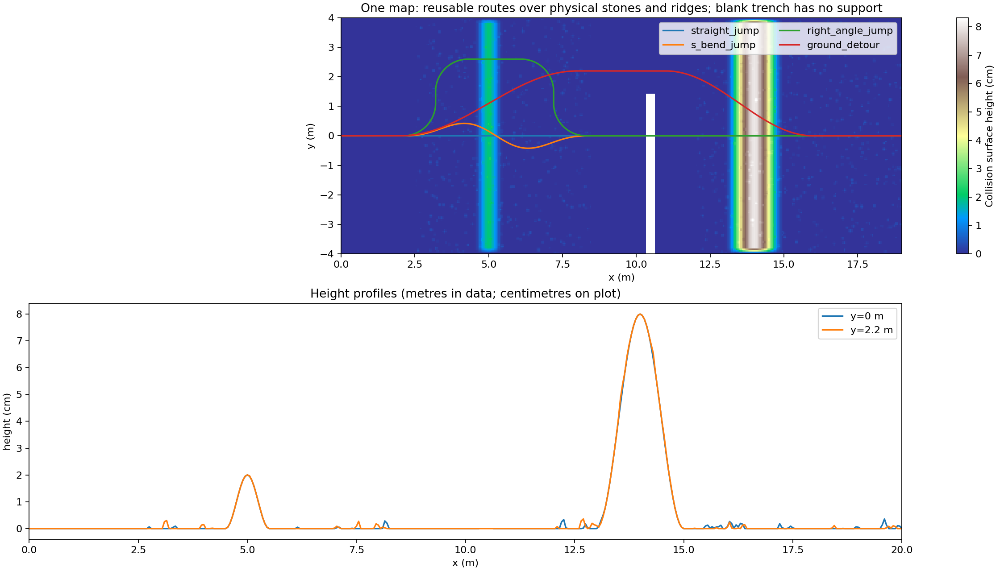
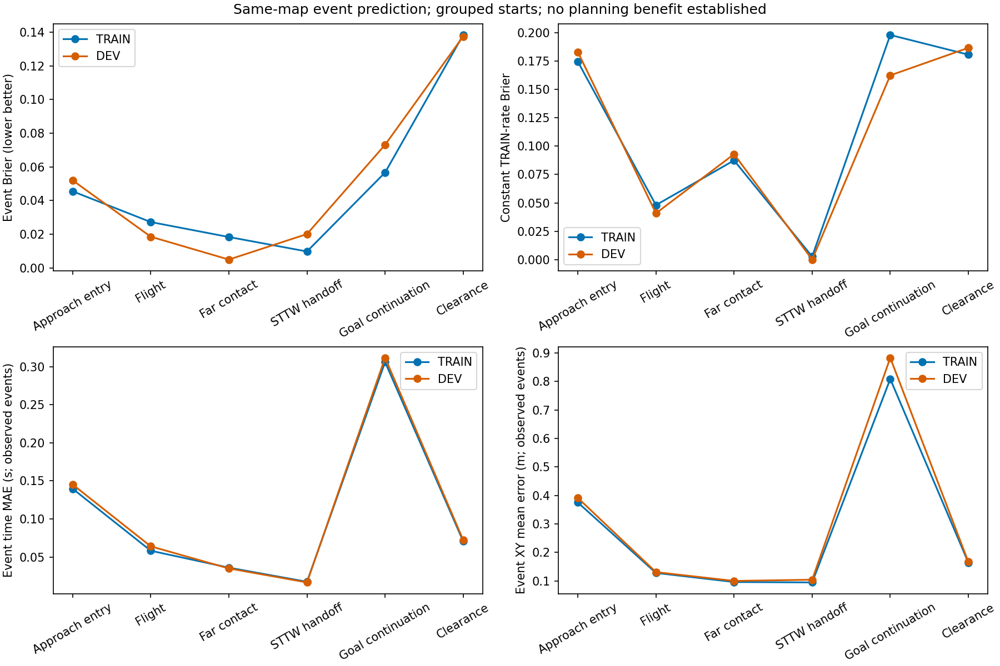
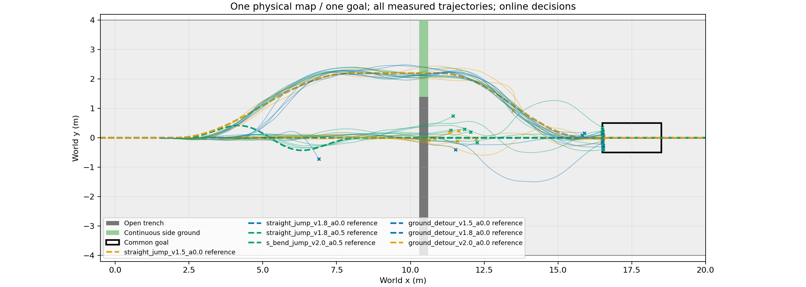
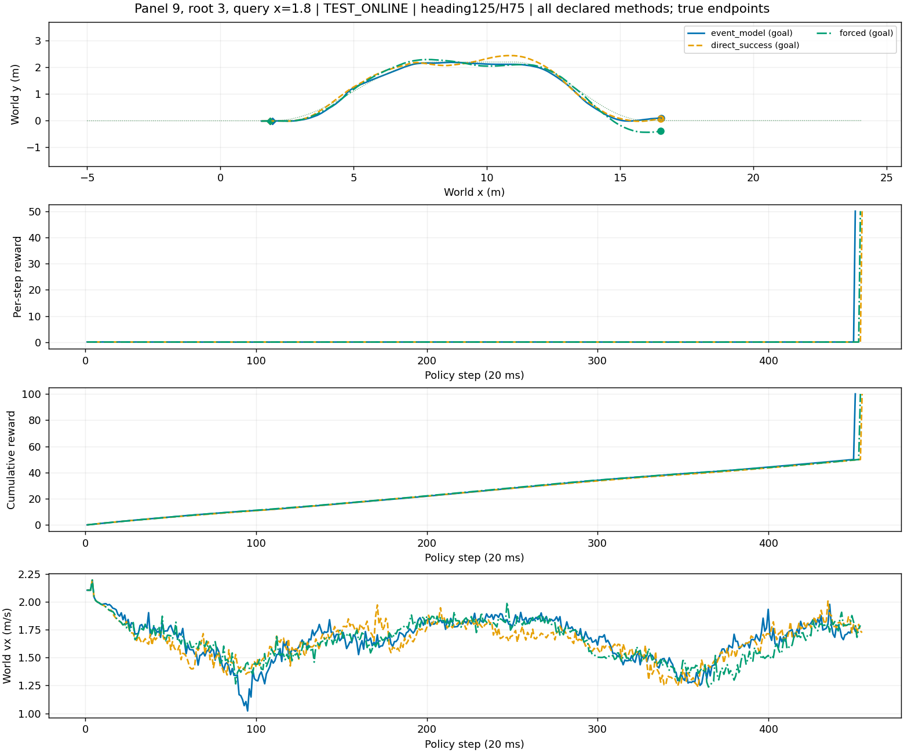
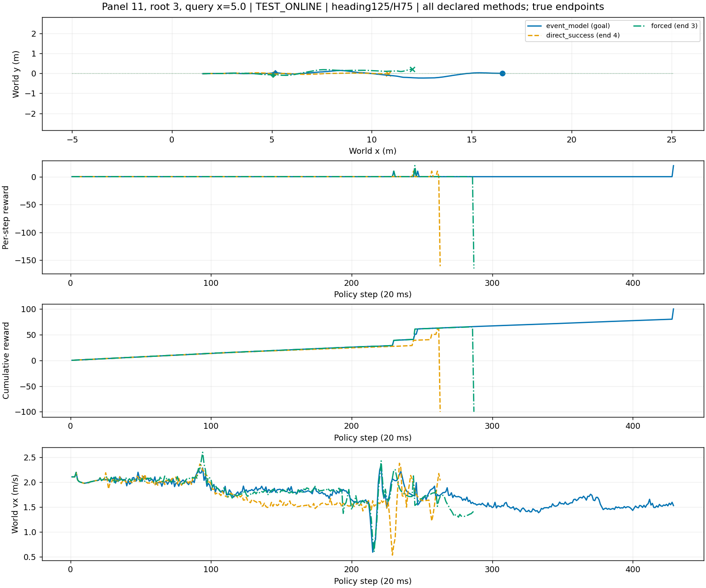

# 第三章 基于接触事件预测的单轨两轮机器人越野行驶与跳跃自主规划

> 已由[英文论文PDF](chapter3_paper/MANUSCRIPT.pdf)与[LaTeX主稿](chapter3_paper/MANUSCRIPT.tex)接替作为当前论文。本文件保留为早期中文工作报告。

> 研究草稿。本文仅使用已经完成的仿真实验；当前结论为已知地图有限候选规划原型及物理执行闭环，不主张相对基线的统计优势。作者、单位与最终论文格式待补。本稿独立于第一章MANUSCRIPT.tex。证据编号及原始数据入口见文末。

## 摘要

单轨两轮机器人在越野任务中不仅需要沿道路行驶，还需要在有限准备距离内选择跨沟或绕行，并在着地后继续到达目标。仅以成功跨越障碍或首次触地作为终点，不能描述完整任务的可执行性。本章构建已知高程地图上的行驶—跳跃组合任务，复用STTW地面控制与冻结跳跃技能，利用轻量接触事件模型预测候选接近方式所产生的关键事件、车辆状态与完成概率。规划器联合选择路线、请求速度、偏好参数α和是否启用跳跃，在计算期间保持车辆前进，并在发布指令前重新检查道路连接条件。Isaac仿真地图包含碎石、脊坡、S弯、沟壑与连续地面绕行。采集实验得到真实的直线跨沟、S弯跨沟和绕行整程实例；在4个新来车初态、3个查询位置的在线测试中，事件规划器完成5/12次任务，直接成败预测器完成5/12次，训练集确定的距离规则完成6/12次。结果证明了候选评价、实际决策、跨技能交接和到达目标的执行闭环，但尚未证明事件模型带来额外完成率收益。当前正面证据集中于多路线可执行性、接触过程的可预测性以及自主决策的实际兑现。

**关键词：** 单轨两轮机器人；越野规划；接触事件；技能组合；世界模型；STTW

## 3.1 研究问题与方法定位

单轨车辆在弯道后接近沟壑时，位置和前向速度相近并不意味着能够采用同一种越障动作。车辆的航向、侧倾、转向及控制器历史共同影响后续运动。另一方面，即使车辆能够腾空并接触远岸，着地后的状态也可能不适合下一段道路。因此，规划对象应覆盖“接近—越障—着地—接续任务”，而不是只评价起跳入口或障碍净空。

本章研究一个有界且可检验的问题：在已知地图、既有控制技能和有限路线集合下，车辆能否在持续前进中，根据当前状态和未来事件预测，选择并执行一项到达共同终点的任务方案？本章不要求重新学习地面控制，也不要求大模型直接生成轨迹。语言模型选择完整预设场景的旧程序仅保留为接口回归，不属于本文方法。

本文实现的自主性具体体现为：任务目标固定，运行时由系统评价候选并发布路线和控制参数，随后由物理闭环执行。路径模板由设计者给定，系统并未生成任意新路径。距离规则同样是一种自动决策方法；本文与规则的区别在于采用状态与事件预测进行评价，而不能仅凭“自主”这一名称宣称更强。当前实验主要回答系统是否能够执行，以及预测能解释哪些阶段；相对规则的性能增益是单独检验的问题。

本章的工作包括三部分：建立具有地形起伏和非连续支撑的单轨车辆组合任务；实现轻量事件预测与有限候选评价；将决策结果接入STTW、冻结跳跃策略及落地交接接口，形成可核查的整程仿真证据。通用世界模型架构创新和可靠性保证不在当前已证明结论之内。

控制器顺序组合已有专门研究[1]；PETS使用概率动力学模型与采样传播不确定性[2]。本章复用“预测后果再选择动作”的思路，但当前实现是固定技能与有限候选上的小型事件模型，不是PETS复现，也不主张首次提出技能组合或模型规划。

## 3.2 任务、地图与成功定义

地图的沟口位于x=10.3～10.6m，宽0.30m，两岸同高。跳跃区域x=8.5～12m保持平整，其余接近与续行区域布置真实碰撞地形：高度1～4mm的小石子，以及高度2cm和8cm的脊坡。小石子不是纯视觉纹理。地图包含合法连续地面绕行通道，所有任务路线指向同一目标区域x=16.5～18.5m、|y|≤0.5m。目标要求前向速度至少0.5m/s，并满足道路及物理判据；回合时域为10s。[E1、E2]

候选路线包括直线跨沟、S弯跨沟、圆角直角弯跨沟和连续地面绕行。请求速度为1.5、1.8、2.0、2.3、2.6m/s，α取0、0.5、1，共形成4×5×3=60个候选。α表示地面控制的有限速度—路径偏好，不改变物理执行器能力。直角弯被保留为困难条件，其当前完整任务成功数为零，不能将路线文件存在写成已具备该路线能力。

完整任务结果定义为

\[
Y=\mathbf{1}_{\mathrm{road}}\mathbf{1}_{\mathrm{physical}}\mathbf{1}_{\mathrm{goal}}.
\]

跳跃路线额外记录进入技能、腾空、远岸接触、回交STTW等阶段；绕行路线不要求人为产生腾空事件。道路半宽0.6m及物理失败条件沿用冻结合同。首次远岸接触不是成功终点，也不强制额外等待1s稳定双轮支撑才允许接续；成功由后续实际行驶到共同目标确认。各历史实验的旧严格落台标签保留，本文不把它们重新计为当前合同的成功。

## 3.3 从状态预测到任务决策

### 3.3.1 输入、候选与执行层

系统输入包括车辆根状态、观测及控制历史、局部高程与支撑信息、已知道路连接。当前实现将13维根状态、训练集拟合的16维历史PCA特征和既往越廊标志作为状态编码；局部地图使用8×8高程与支撑双通道。历史来自352维控制历史和80维观测。这一压缩表征不保证严格Markov性，且不包含物理引擎的接触求解缓存。

候选动作写为a=(r,v_ref,α,s)，其中r为路线、s为轮行或轮行—跳跃技能序列。路线几何、速度、α、技能与准备距离输入预测器。模型输出任务评价，实际电机与摆机构指令仍由原控制器产生。地面执行为H75与ECBC/ESO，当前zero_lower=true，不能将Local300残差描述为实际执行底层；跳跃使用冻结heading125技能。

数据流为：

**车辆状态与历史＋已知地图 → 60项候选 → 道路准入与事件预测 → 持续行驶中的延迟推进 → 发布前复核 → STTW接近或绕行 → 必要时跳跃 → 远岸接触后交回STTW → 共同目标。**

控制周期20ms，物理周期2.5ms。跳跃控制启动线为x=9m，这是技能切换位置而非实际离地位置。远岸接触后在下一控制边界回交地面控制，不重置车辆物理状态。切换后的地面控制器按既有交接接口初始化；不能将物理连续执行与控制器历史完全不变混为一谈。

### 3.3.2 事件条件化预测

模型近似下列事件转移：

\[
p_\theta(x_{k+1},\tau_k,b_k\mid x_k,m_k,a,H_k),
\]

其中m_k为预定义阶段，τ_k为事件时间，b_k表示阶段是否实际发生。当前阶段链固定为接近入口、腾空、远岸接触、STTW回交及目标续行，另有清障辅助标签。该实现不是自行发现接触模式，也不是任意拓扑的模式转移模型。

网络共享状态与地形编码，并分别设置接近、越障和目标续行三个输出头。地形编码使用128→32→32结构，共享主干使用128→64隐藏层；事件输出覆盖状态增量分布、对数时间与事件发生概率。状态预测采用简单物理传播加学习残差，碰撞后的状态变化由残差拟合，不宣称已解析预测接触冲量。训练目标组合状态高斯负对数似然、对数时间均方误差和事件二元交叉熵。状态与时间损失仅在对应事件发生的样本上计算，事件概率评价同时保留未发生样本。

模型按完整来车初态划分TRAIN/DEV，同一来车的多个查询位置及其相邻片段不跨分组。当前模型采用600次CPU优化，由开发误差选择已评估候选中的更新600；这与重新训练低层PPO策略不同。训练后的模型沿事件链采样未来，当前使用32个粒子估计整程完成概率。[E2]

### 3.3.3 准入、排序与计算时延

候选首先通过道路连接和跳跃启动线等几何条件过滤，再由模型估计完整任务完成概率。本轮在线对比中，两种学习方法均以预测完成概率排序，以避免不同代价权重混入比较。候选准入不等于物理可行性保证，评分也不构成安全认证。

规划计算期间车辆继续执行原控制，实测计算时延向上取整到20ms控制边界后，使用新状态复核候选连接并发布。较晚位置绕行候选被排除来自显式几何准入；不能写成世界模型自主发现了绕行的最晚物理边界。每回合只有一次途中查询及发布复核；低层是持续反馈控制，上层尚不是连续滚动重规划。

## 3.4 实验设置与证据划分

所有当前主线物理实验在Isaac中执行，多环境并行，保留各回合实际/参考XY、失败终点、速度及奖励数据。建模数据、开发选模和在线测试分开报告，不把采集候选的大量相关回合解释为独立初态。

|证据|用途|完整来车与条件|主要结果|
|---|---|---|---|
|E1|首轮地图能力采集|12根×60候选，8TRAIN/4DEV|122/720整程完成|
|E2|多准备距离采集与拟合|8根×3位置×60候选，6TRAIN/2DEV|1199次实际发布，162次候选完成|
|E3|冻结在线执行测试|4新根×3位置×3方法|事件5/12、直接5/12、规则6/12|
|E4|RB技能替换验证|4新根×60候选×2技能|原34/240、RB400为35/240|

E2的1440次候选请求中，241次没有发布候选，其中60次沿原方案完成；这60次不归功于未执行候选。晚查询仅使用原10s回合的剩余时域，没有额外重置时钟。当前预测输入未显式编码剩余回合时间，属于模型局限。

在线基线包括同输入直接成败预测器，以及只依据TRAIN结果为三个查询位置分别确定的距离规则。规则在x=1.8、3、5m分别采用绕行1.8m/s、α=0；S弯跳跃2.0m/s、α=0.5；直线跳跃1.8m/s、α=0.5。它不是全图统一固定一个动作。在线模型与规则在测试前冻结，后续不根据本批测试失败调整模型并继续将该批称为独立测试。

## 3.5 仿真结果

### 3.5.1 多种路线存在真实完整执行实例

首轮地图采集的720条轨迹中，直线跨沟完成44/180，S弯跨沟20/180，连续地面绕行58/180，圆角直角弯0/180。正面结果表明，现有技能组合可以在含碎石和脊坡的共同地图中完成不同路线任务，而非仅在平坦直道上跨越单一障碍。该表是能力采集覆盖，不是规划器在线成功率。[E1]

多距离采集进一步显示决策时机的作用。绕行在早、中、晚查询位置分别有120、120、0次实际发布，完成41、7、0次；晚位置的零发布说明几何连接条件已经排除该路线，不能作为已执行绕行的0%成功率。S弯在三个位置分别完成12、16、15次（各120次请求）。直线分别完成25、15、31次；这些差异同时包含来车状态、准备长度与剩余时域，不能直接归因于距离单因素。[E2]

### 3.5.2 对接触事件的预测具有阶段解释能力

|事件|模型Brier↓|TRAIN发生率常数Brier↓|时间MAE/s↓|XY误差/m↓|
|---|---:|---:|---:|---:|
|进入跳跃|0.0520|0.1831|0.1451|0.3912|
|腾空|0.0185|0.0408|0.0640|0.1311|
|远岸接触|0.0050|0.0930|0.0349|0.1002|
|STTW回交|0.0201|约0|0.0166|0.1045|
|目标续行|0.0731|0.1625|0.3115|0.8825|
|清障辅助事件|0.1375|0.1867|0.0723|0.1668|

这些指标来自2个开发来车，时间和位置误差只针对实际发生事件。远岸接触的平均时间误差约35ms、XY误差约0.10m，说明模型能够对跨沟过程提供比单一最终标签更具体的预测。与此同时，回交阶段在开发样本中全部发生，常数预测优于模型；目标续行位置误差约0.88m，说明长链预测仍存在明显误差。不能据部分阶段较好的误差直接推导规划成功率提升。[E2]

### 3.5.3 自主决策实际改变路线并完成接续

在线测试保留60项完整候选。在x=1.8和3m时有60项通过准入，在x=5m时只有30项。事件模型在早位置选择地面绕行，四个来车均完成任务；在晚位置选择直线跳跃，其中一个来车完成跨沟、远岸交接和后续到达。这证明了运行时选择实际影响执行，而不是只在日志中输出一个建议。[E3]

上述两图来自同一初态定义下不同查询位置的独立回合，不是同一条轨迹先绕行再跳跃。早位置选择绕行1.8m/s、α=0，晚位置选择直线跳跃1.8m/s、α=0。两者都到达共同目标，因而形成“输入状态与地图—评价候选—发布选择—执行—终点结果”的可追溯链条。同一root3中位置选择绕行却失败，已保留在完整结果与图索引中，不能只由两个正例声称模型正确理解了所有能力边界。

### 3.5.4 完整对照与计算成本

|查询位置/m|事件模型完成|直接成败完成|距离规则完成|事件模型越廊|
|---|---:|---:|---:|---:|
|1.8|4/4|3/4|4/4|0/4|
|3.0|0/4|0/4|1/4|4/4|
|5.0|1/4|2/4|1/4|2/4|
|合计|5/12|5/12|6/12|6/12|

相对距离规则，两种学习方法均新增1次成功、丢失2次成功。当前数据不支持事件模型优于规则，也不足以建立统计等效。中位置的事件模型绕行均越廊，表明当前位置通过几何准入并不代表该接近状态能够完成转弯。[E3]

三个位置上，事件模型平均查询约49.4～53.7ms，直接成败约3.2～3.5ms，规则约2.6～2.7ms。事件模型付出了更高的规划成本；这些时延已实际计入车辆运动，而非在冻结仿真时计算。整批36条仿真耗时80.81s、144000物理环境步，没有新增策略训练。预测过程更可解释是当前功能收益，尚不能换算成已经证实的任务收益。

### 3.5.5 RecoveryBridge作为能力替换对照

在独立于开发选模的4个新来车、60候选对照中，原技能完成34/240，RB400完成35/240，新增13次、丢失12次。S弯均完成5/60，直线由11/60变为12/60，绕行均18/60，直角弯均为零。因此保留RB作为能力替换对照，不默认替换主线技能，也不将开发集的改善写成普遍恢复能力提升。主线闭环不以进一步训练RB为前置条件。[E4]

### 3.5.6 输出头结构的开发集对照

为检验分支结构的作用，保留相同事件输入、标签、历史压缩、数据划分与600次优化预算，将三个事件输出头改为一个共享输出头。两个模型的训练转移数组与PCA逐项相同，均由DEV选择更新600；参数量分别为35770和27710，因此不是等参数容量实验。[E5]

|指标|三分支模型|单输出头模型|
|---|---:|---:|
|远岸接触时间MAE/s|0.0349|0.0558|
|远岸接触XY误差/m|0.1002|0.1592|
|目标续行时间MAE/s|0.3115|0.3588|
|目标续行XY误差/m|0.8825|1.7799|
|远岸接触Brier|0.0050|0.0030|
|STTW回交Brier|0.0201|0.0120|

三分支模型在六个阶段的XY误差均更低，在五个阶段的时间误差更低；但单头模型在远岸接触与回交的发生概率上更准。这提供了分开预测可能有助于状态预测的开发证据，而不是全面胜出的结论。两模型仍使用相同事件标签与模式条件，单头模型不能冒称普通逐步状态转移世界模型。只有单训练种子和2个DEV根，且模型容量不同；本结果不证明在线规划收益，不替代后续独立测试。[完整六阶段数据](evidence/chapter3_shared_event_head/RESULTS.md)

## 3.6 讨论与适用边界

本章已经形成三个相互衔接的证据层。第一层是物理可执行性：冻结技能在同一越野地图上存在直线、S弯跨沟和绕行的完整任务实例。第二层是预测可用性：事件模型能输出远岸接触等中间事件的时间、位置和发生概率，部分开发指标优于常数发生率。第三层是实际决策：车辆前进中完成候选评价并执行选择，绕行和跨沟后的STTW接续均出现目标完成实例。这三层共同支撑可运行原型；它们不自动构成优于普通规划的因果证据。

当前限制包括有限地图与预设路径模板、较少独立初态、直角弯任务未完成、目标续行预测误差较大、剩余时域未显式入模，以及只有一次上层决策。当前clean-state反馈也未验证部署估计误差。尚缺普通神经状态转移模型、去掉恢复分支等对照，因此不能把观察到的行为专门归因于事件分解或恢复建模。

后续若研究预测模型的增益，应冻结地图、技能和候选，对同一批未使用来车做配对比较，并报告新增与丢失成功；若研究RB的作用，应仅替换技能及其条件模型，检验任务可完成区域是否真实改变。这些是后续验证方向，不作为本章已完成结果。当前交付优先保证任务定义、实现与证据一致，不以不断筛选测试条件制造优势。

## 3.7 本章小结

本章完成了已知越野地图上的有限候选自主规划原型，将STTW地面行驶、冻结跳跃和落地接续组合为共同目标任务。事件模型提供了可核查的中间物理阶段预测，在线决策已在Isaac中实际执行并产生绕行到达与跨沟续行正例。当前研究结论是该系统能够提出、评价和执行多种任务方案；事件模型是否提高完整任务成功率仍未得到证明。论文的核心叙事应围绕跨技能任务闭环与可解释预测展开，并如实呈现其性能边界。

## 证据索引与复核范围

- **E1**：[720条地图采集及实际XY](evidence/chapter3_offroad_event_training/RESULTS.md)，[预测报告](evidence/chapter3_offroad_event_training/PREDICTION.md)。原始run：`chapter3_offroad_event_training`。
- **E2**：[多距离采集、覆盖与全部XY](evidence/chapter3_offroad_distance_training/RESULTS.md)，[完整预测指标](evidence/chapter3_offroad_distance_training/PREDICTION.md)。原始run：`chapter3_offroad_distance_training`。
- **E3**：[36条在线对照](evidence/chapter3_offroad_distance_online/RESULTS.md)，[12条事件模型真实决策](evidence/chapter3_offroad_distance_online/autonomy_trace.json)，[所有条件图](evidence/chapter3_offroad_distance_online/plots/README.md)。原始run：`chapter3_offroad_distance_online`。
- **E4**：[冻结新初态技能对照](evidence/chapter3_offroad_new_roots/ANALYSIS.md)。原始run：`chapter3_offroad_new_roots`。

- **E5**：[输出头结构对照及原始指标](evidence/chapter3_shared_event_head/RESULTS.md)。共享头run：`chapter3_shared_event_head`，三头复用E2模型。

原始run均位于`/media/qy/6A7E3DB07E3D75C3/STTW_runs/`。原始配置、checkpoint身份、轨迹和失败记录保留在对应目录；版本库保留精简报告与关键图，不提交大模型训练产物。本文已按已保存输出核对主要计数与图链接，未为写作重新运行仿真。正式提交前仍需作者复核表述、补充相关工作与引用，以及确认论文所属章节和贡献范围；本稿不是已通过同行审查的结论。

## 参考文献（已核对的基础文献）

[1] Burridge R R, Rizzi A A, Koditschek D E. Sequential Composition of Dynamically Dexterous Robot Behaviors. The International Journal of Robotics Research, 1999, 18(6). [作者原文](https://kodlab.seas.upenn.edu/uploads/Kod/Sequential1999.pdf)。

[2] Chua K, Calandra R, McAllister R, Levine S. Deep Reinforcement Learning in a Handful of Trials using Probabilistic Dynamics Models. NeurIPS, 2018. [论文与作者信息](https://arxiv.org/abs/1805.12114)。

上述引用用于界定已有方法背景；本章自己的实验结论仅来自E1–E5，不借用外部论文的结果作为本系统的证据。STTW与RecoveryBridge自有方法的正式书目信息须由作者在论文定稿时补齐。
