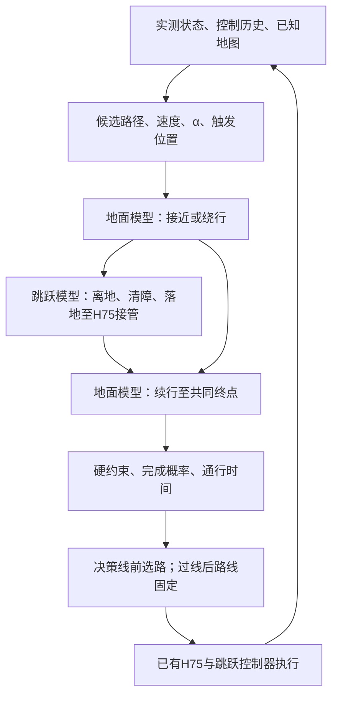
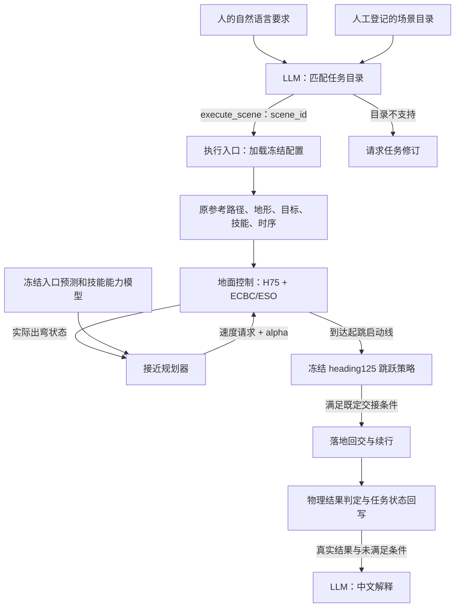

# 第三章当前数据流与历史接口

## 当前方向：交接可恢复性（待短分叉验证）

当前研究方案以[交接接口主线](CHAPTER3_EVENT_WORLD_MODEL.md)为准。原最小事件链闭环是已完成工程基线，不再代表本章研究问题已闭合。新的上游交接状态分布、下游可接续域、控制器初始化消融及条件式修复尚未实现；旧执行流程继续保留。阶段拆分和冷启动核查已完成，见[审计结果](evidence/chapter3_handoff_audit/RESULTS.md)。

当前已在Isaac完成同一越野地图、共同目标下的60个路线×速度×α候选接线与在线物理执行。四类路线包括直线跨沟、S弯跨沟、圆角直角弯跨沟及连续地面绕行；沟外包含1–4mm小石子与2/8cm脊坡。最新4个新来车×3查询位置×3方法共36条：事件模型5/12、直接成败5/12、TRAIN距离规则6/12。早位置自主绕行4/4，晚位置自主跨沟续行1/4；中位置失败全部保留。[全部XY、实际选择与结论边界](evidence/chapter3_offroad_distance_online/RESULTS.md)。

当前交付重点是可执行自主规划原型与论文证据闭环，不继续以优于基线作为推进前提。仅声称已知地图有限候选、单次途中决策与发布复核；低层持续反馈，落地回交STTW后继续到共同目标。普通规则也具备自动决策能力，不能仅因使用学习预测就宣称方法更优。直角弯整程、连续滚动重规划和世界模型收益尚未证明。论文草稿见[英文论文PDF](chapter3_paper/MANUSCRIPT.pdf)及[方法审查](chapter3_paper/REVIEW.md)。

## 当前可运行数据流

`真实车辆状态＋控制历史＋已知地图 → 60个路线/速度/α候选 → 原道路连接检查＋事件预测评分 → 继续旧控制至少20ms → 用更新状态复核连接并发布 → H75接近／绕行 → 必要时heading125跨沟 → 首次远岸接触后的控制边界交回H75 → 共同目标判定`。

- 预测器输入为根状态13维、TRAIN数据拟合的历史PCA16维、既往越廊标志，另有局部8×8高程/支撑双通道、候选几何/速度/α/技能及距离。不是完整Markov状态。
- 当前事件顺序固定：接近到入口、确认腾空、首次远岸接触、STTW交接、共同目标；清障确认作辅助标签。每段预测状态分布、时间及事件发生概率；尚不是学习任意接触模式转移。
- 数值规划器选路线、速度和α；低层H75与冻结跳跃策略输出电机/机构动作。LLM不在主链，旧`execute_scene`仅作语言回归。
- 真实发布改变`g.speed/g.alpha`和路线引用，不重置物理或接近控制历史；落地按既有交接接口初始化地面控制器。不要将两种切换混为一谈。
- 当前每条轨迹只有一次途中决策，计算期间车辆继续行驶。发布复核已执行，但尚未证明连续滚动重规划或反馈修订收益；几何准入和学习分数不等于物理可行性保证。
- 同高30cm沟，跳跃区平整、沟外1–4mm小石子与2/8cm脊坡；高岸暂停。不要求1秒稳定支撑才回交，但物理失败、0.6m原道路和共同目标约束保留。地面为H75+ECBC/ESO、zero_lower=true，反馈沿用clean-state接口。

实际入口：`prepare_ditch_action_collection.py`、`evaluate_ditch_batch.py`、`extract_ditch_decision_segments.py`、`fit_ditch_event_model.py`、`fit_ditch_success_baseline.py`、`prepare_ditch_action_online.py`。所有实验身份和物理记录在对应run，台账只收已完成结果。

## 已实际执行的跨沟回放

`固定初态/地形 → update50跳跃 → stage3落地捕获 → H75 + ECBC/ESO续行 → 原判据评价`。

入口为evaluate_ditch_skill.py，可选ground_handoff调用ditch_ground_handoff.py。1.46s回交、1.92s地面跟随器适用域退出，未完成稳定续行；切换前73步逐值一致，无物理重置。zero_lower=true，地面clean-state接口；并非完整世界模型规划，也没有在此回放中执行上游STTW接近。[实际XY及接口限制](evidence/chapter3_ditch_sttw_handback/RESULTS.md)。

## 目标数据流（尚未完成）

模型输出预测状态/事件/耗时；规划器输出可执行路线和指令安排；已有控制器输出电机/机构指令。规划期间车辆保持前进，计入计算与执行延迟，超时不冻结车辆。轻量事件链已接入途中单次决策；图中连续滚动更新、可行性认证与可靠能力校准尚未完成。LLM不在当前主链，execute_scene只是历史语言回归工具。

---

# 历史：语言回归接口与旧接近规划数据流

以下保留旧接口的实现说明，仅用于回归与结果追溯；不代表当前第三章主方法。

## 每层输入与输出

| 层 | 输入 | 输出 | 当前没有做的事 |
|---|---|---|---|
| LLM任务解释 | 人的要求、可用场景描述、已有证据边界 | 一个工具调用：execute_scene(scene_id)，或request_task_revision(reason) | 不生成新轨迹、不决定速度alpha、不直接控制电机 |
| 执行入口 | 合法scene_id、模式execute/replay/plan | 加载对应配置；新执行时启动一次有界仿真 | 不允许模型覆盖物理、窗口、标签或文件路径 |
| 地面接近规划器 | 实际出弯状态、原路径剩余准备距离、冻结模型、当前参考 | 速度请求、alpha、各候选入口预测与评分、支持范围状态 | 当前不选择是否跳或绕行；不生成整条路径 |
| 控制与技能执行 | 原路径、速度alpha、真实反馈、技能策略 | 转向/轮速及跳跃机构动作，实际状态和执行事件 | 不将建议当成已执行或已完成 |
| 结果判定 | 原始轨迹、接触、阶段事件、冻结任务判据 | complete或revision_required；严格与20ms协议分别保存 | 不由模型文字判定物理成功 |
| LLM结果解释 | 已确定的物理状态、实际选档、未满足条件 | 中文说明 | 不能改写物理标签；本接口不自动循环重规划 |

## 接近规划器的具体接口

`decision_features`从执行事件与原路线提取23项可观测/地图特征；当前动力学模型实际使用其中7项：横向偏差、航向误差、前向速度、到启动线剩余路程、车体系侧向速度、侧倾角、侧倾角速度。几何模型使用前4项。当前参考用于保持指令的比较。

候选为速度1.8/2.0m/s × alpha0/0.5/1，共6项。先预测入口横偏、航向、前向速度、侧向速度、侧倾角与角速度，再结合前缀和下游技能评分选动作。评分是小样本拟合值，不是安全保证或已校准成功概率。

调用为`ApproachPlanner(model, identity=...).choose(state, 'exit', current)`。输出含`status`、`candidate`、`support_rms`、`estimates`及`fallback`。超出模型支持范围返回unknown并保留当前参考；这不等于停车，也不保证能够安全继续。速度alpha交给地面控制器执行，不直接成为电机动作。

起跳由执行器的既定启动线触发，使用配置中指定的冻结技能。是否跳/绕行属于另一个路线或技能选择接口，不能把当前接近选档说成已完成该决策。

## 当前LLM集成的边界

LLM选择的是登记场景ID。场景中的地形、参考路径、平台位置、目标和技能由工程侧预先准备；因此目前不能称LLM自动生成轨迹。直接给同一scene_id可以绕过LLM并运行同一链路。LLM目前增加的是自然语言到结构化请求以及结果解释，不增加控制能力。

`run_language_task.py`支持execute（新物理执行）、replay（读已保存物理结果）与plan（仅选场景）。每次最多两次模型请求、一次26秒仿真。GLM配置从用户已有私有文件读取；请求/响应产物不包含认证头或密钥。原Anthropic兼容接口仍保留。

执行输出中的`selected_request.json`证明模型选了什么；`evaluation/connection_decision.json`证明规划器实际选了什么；`handoff.json`和`landing_handoff.json`记录技能交接；`trajectory.npz`和`chain_summary.json`提供物理证据；`physical_outcome.json`先于模型解释落盘，`model_summary.txt`仅为叙述。

模型收到物理结果后输出解释；失败时返回revision_required，不自动产生或验证绕行路线。

## 代码入口

- `learning/src/sttw_control/language_task.py`：模型协议适配、工具定义和请求解析。
- `learning/cli/run_language_task.py`：任务到执行及结果反馈。
- `learning/src/sttw_control/approach_planner.py`：冻结接近模型和选档。
- `learning/cli/fit_approach_planner.py`：实际仿真记录拟合。
- `learning/cli/evaluate_isaac_pendulum_jump.py`：单场景控制与技能接续。
- `learning/src/sttw_control/isaac_pendulum_batch.py`：既有多lane配对执行。
- `learning/cli/analyze_endpoint_online.py`和`summarize_multiscene_chain.py`：全部场景、实际选档、XY及任务标签回写。
