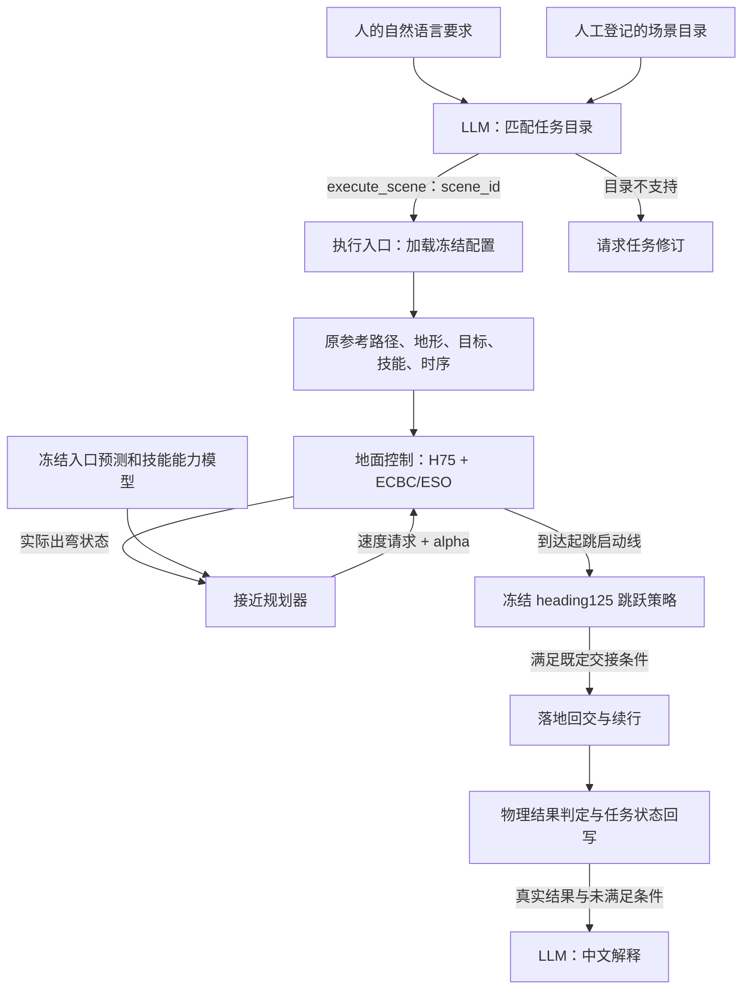

# 第三章任务接口与接近规划数据流

本文说明当前实现，不代表任意地图或自然语言任务均可执行。当前研究状态及结果只在 research-hub/CHAPTER3_PROJECT_STATE.md 维护。

## 每层输入与输出

| 层 | 输入 | 输出 | 当前没有做的事 |
|---|---|---|---|
| LLM任务解释 | 人的要求、可用场景描述、已有证据边界 | 一个工具调用：execute_scene(scene_id)，或request_task_revision(reason) | 不生成新轨迹、不决定速度alpha、不直接控制电机 |
| 执行入口 | 合法scene_id、模式execute/replay/plan | 加载对应配置；新执行时启动一次有界仿真 | 不允许模型覆盖物理、窗口、标签或文件路径 |
| 地面接近规划器 | 实际出弯状态、原路径剩余准备距离、冻结模型、当前参考 | 速度请求、alpha、各候选入口预测与评分、支持范围状态 | 当前不选择是否跳或绕行；不生成整条路径 |
| 控制与技能执行 | 原路径、速度alpha、真实反馈、技能策略 | 转向/轮速及跳跃机构动作，实际状态和执行事件 | 不将建议当成已执行或已完成 |
| 结果判定 | 原始轨迹、接触、阶段事件、冻结任务判据 | complete或revision_required；严格与20ms协议分别保存 | 不由模型文字判定物理成功 |
| LLM结果解释 | 已确定的物理状态、实际选档、未满足条件 | 中文说明 | 不能改写物理标签；本接口不自动循环重规划 |

## 接近规划器的具体接口

`decision_features`从执行事件与原路线提取23项可观测/地图特征；当前动力学模型实际使用其中7项：横向偏差、航向误差、前向速度、到启动线剩余路程、车体系侧向速度、侧倾角、侧倾角速度。几何模型使用前4项。当前参考用于保持指令的比较。

候选为速度1.8/2.0m/s × alpha0/0.5/1，共6项。先预测入口横偏、航向、前向速度、侧向速度、侧倾角与角速度，再结合前缀和下游技能评分选动作。评分是小样本拟合值，不是安全保证或已校准成功概率。

调用为`ApproachPlanner(model, identity=...).choose(state, 'exit', current)`。输出含`status`、`candidate`、`support_rms`、`estimates`及`fallback`。超出模型支持范围返回unknown并保留当前参考；这不等于停车，也不保证能够安全继续。速度alpha交给地面控制器执行，不直接成为电机动作。

起跳由执行器的既定启动线触发，使用配置中指定的冻结技能。是否跳/绕行属于另一个路线或技能选择接口，不能把当前接近选档说成已完成该决策。

## 当前LLM集成的边界

LLM选择的是登记场景ID。场景中的地形、参考路径、平台位置、目标和技能由工程侧预先准备；因此目前不能称LLM自动生成轨迹。直接给同一scene_id可以绕过LLM并运行同一链路。LLM目前增加的是自然语言到结构化请求以及结果解释，不增加控制能力。

`run_language_task.py`支持execute（新物理执行）、replay（读已保存物理结果）与plan（仅选场景）。每次最多两次模型请求、一次26秒仿真。GLM配置从用户已有私有文件读取；请求/响应产物不包含认证头或密钥。原Anthropic兼容接口仍保留。

执行输出中的`selected_request.json`证明模型选了什么；`evaluation/connection_decision.json`证明规划器实际选了什么；`handoff.json`和`landing_handoff.json`记录技能交接；`trajectory.npz`和`chain_summary.json`提供物理证据；`physical_outcome.json`先于模型解释落盘，`model_summary.txt`仅为叙述。

模型收到物理结果后输出解释；失败时返回revision_required，不自动产生或验证绕行路线。

## 代码入口

- `learning/src/sttw_control/language_task.py`：模型协议适配、工具定义和请求解析。
- `learning/cli/run_language_task.py`：任务到执行及结果反馈。
- `learning/src/sttw_control/approach_planner.py`：冻结接近模型和选档。
- `learning/cli/fit_approach_planner.py`：实际仿真记录拟合。
- `learning/cli/evaluate_isaac_pendulum_jump.py`：单场景控制与技能接续。
- `learning/src/sttw_control/isaac_pendulum_batch.py`：既有多lane配对执行。
- `learning/cli/analyze_endpoint_online.py`和`summarize_multiscene_chain.py`：全部场景、实际选档、XY及任务标签回写。
