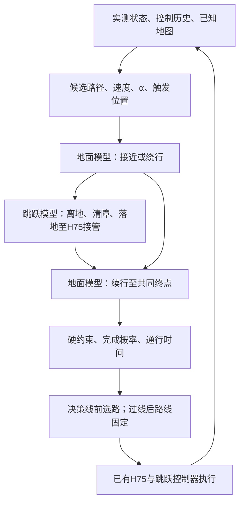
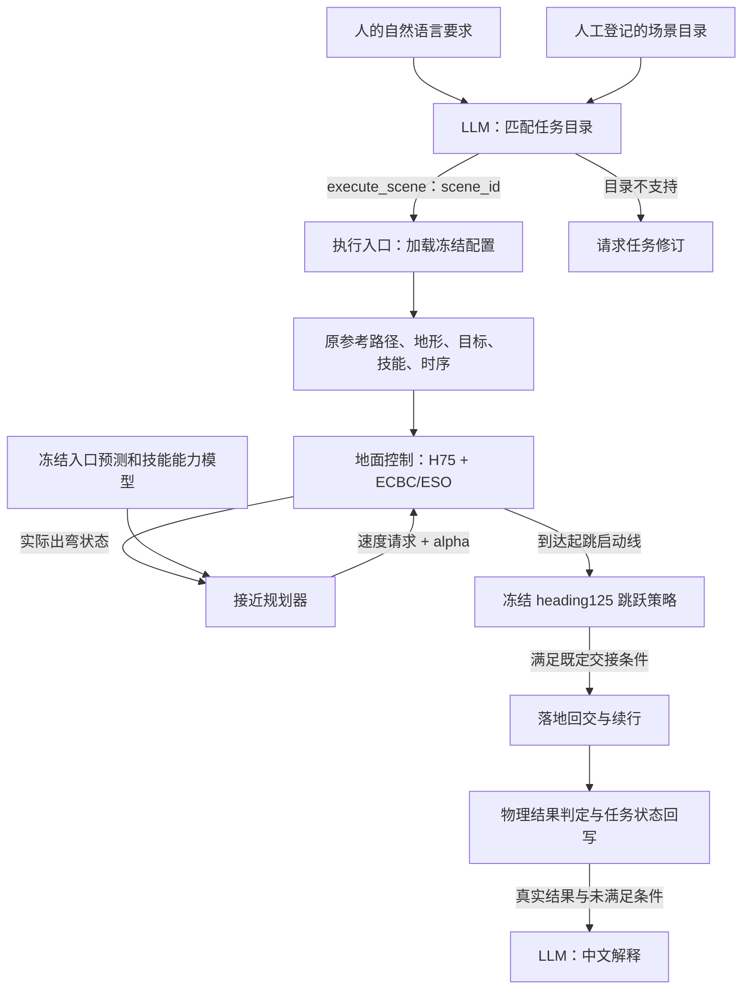

# 第三章当前数据流与历史接口

当前已走通Isaac真实前进中的选路、计算期间继续控制、首次远岸触地后STTW接续。四方法对照中事件模型与准备距离规则均21/48，未证明世界模型优越性。后续地面高度先验修订消除了数米地下终点预测，但新初态实际完成17/48，仍未超过规则；不以预测更合理代替任务收益。[最新预测诊断与全部XY](evidence/chapter3_ground_height_prior/RESULTS.md)；[同数据基线对照](evidence/chapter3_moving_baselines/RESULTS.md)。下一步扩大接近速度／α的真实动作覆盖，停止调已检查的初态。

> 当前已完成Isaac行进中的路线／技能选择：公共直路前进，在x1.8/4/6m查询事件模型，旧控制继续执行计入的20ms延迟，再发布路线；不重置物理或控制历史。新16初态、144条打乱环境排列的评测，模型18/48、几何规则20/48、固定直跳11/48，尚无模型优越性证据。早选绕行可靠，中段模型11/16改选跳跃但仍有误选；相同路线执行差异保留。[全部实际XY与结论边界](evidence/chapter3_moving_decision/RESULTS.md)。

> 历史起点闭环：Isaac共同地面起点→轻量事件模型查询候选→STTW弯道接近→heading125跨沟→首次远岸触地交回H75→共同目标。新地图跳跃/连续地面绕行均有实际完成，192条分组数据及16初态三方法在线执行已完成；模型全部选绕行，尚未超过固定绕行。[全部XY与边界](evidence/chapter3_jump_or_detour/RESULTS.md)。

> 回交不等待连续稳定支撑1秒；保留物理失败、原道路边界与控制域限制。现已实现途中一次路线／技能发布、原路廊再核查及实际延迟传播；最晚可行绕行位置、连续重规划及反馈修订收益尚未证明。

> 最新执行约束：正式训练在Isaac中进行；同高平面或1mm地面，高岸暂停。MuJoCo仅用于所附程序运行及技能流程参考，不作为训练后端。沿用附件方法须核实来源并接入Isaac，成功回放本身没有新增PPO，不能从残留脚本推断原模型训练配方。

研究主线以[行驶与跳跃世界模型规划](CHAPTER3_EVENT_WORLD_MODEL.md)为准，事实见[第三章台账](/home/qy/STTW_CONTROL/research-hub/CHAPTER3_PROJECT_STATE.md)。

## 已实际执行的跨沟回放

`固定初态/地形 → update50跳跃 → stage3落地捕获 → H75 + ECBC/ESO续行 → 原判据评价`。

入口为evaluate_ditch_skill.py，可选ground_handoff调用ditch_ground_handoff.py。1.46s回交、1.92s地面跟随器适用域退出，未完成稳定续行；切换前73步逐值一致，无物理重置。zero_lower=true，地面clean-state接口；并非完整世界模型规划，也没有在此回放中执行上游STTW接近。[实际XY及接口限制](evidence/chapter3_ditch_sttw_handback/RESULTS.md)。

## 目标数据流（尚未完成）

模型输出预测状态/事件/耗时；规划器输出可执行路线和指令安排；已有控制器输出电机/机构指令。规划期间车辆保持前进，计入计算与执行延迟，超时不冻结车辆。轻量事件链原型已训练并接入起点选路；上图持续运动闭环及可靠能力校准尚未完成。LLM不在当前主链，execute_scene只是历史语言回归工具。

---

# 历史：语言回归接口与旧接近规划数据流

以下保留旧接口的实现说明，仅用于回归与结果追溯；不代表当前第三章主方法。

## 每层输入与输出

| 层 | 输入 | 输出 | 当前没有做的事 |
|---|---|---|---|
| LLM任务解释 | 人的要求、可用场景描述、已有证据边界 | 一个工具调用：execute_scene(scene_id)，或request_task_revision(reason) | 不生成新轨迹、不决定速度alpha、不直接控制电机 |
| 执行入口 | 合法scene_id、模式execute/replay/plan | 加载对应配置；新执行时启动一次有界仿真 | 不允许模型覆盖物理、窗口、标签或文件路径 |
| 地面接近规划器 | 实际出弯状态、原路径剩余准备距离、冻结模型、当前参考 | 速度请求、alpha、各候选入口预测与评分、支持范围状态 | 当前不选择是否跳或绕行；不生成整条路径 |
| 控制与技能执行 | 原路径、速度alpha、真实反馈、技能策略 | 转向/轮速及跳跃机构动作，实际状态和执行事件 | 不将建议当成已执行或已完成 |
| 结果判定 | 原始轨迹、接触、阶段事件、冻结任务判据 | complete或revision_required；严格与20ms协议分别保存 | 不由模型文字判定物理成功 |
| LLM结果解释 | 已确定的物理状态、实际选档、未满足条件 | 中文说明 | 不能改写物理标签；本接口不自动循环重规划 |

## 接近规划器的具体接口

`decision_features`从执行事件与原路线提取23项可观测/地图特征；当前动力学模型实际使用其中7项：横向偏差、航向误差、前向速度、到启动线剩余路程、车体系侧向速度、侧倾角、侧倾角速度。几何模型使用前4项。当前参考用于保持指令的比较。

候选为速度1.8/2.0m/s × alpha0/0.5/1，共6项。先预测入口横偏、航向、前向速度、侧向速度、侧倾角与角速度，再结合前缀和下游技能评分选动作。评分是小样本拟合值，不是安全保证或已校准成功概率。

调用为`ApproachPlanner(model, identity=...).choose(state, 'exit', current)`。输出含`status`、`candidate`、`support_rms`、`estimates`及`fallback`。超出模型支持范围返回unknown并保留当前参考；这不等于停车，也不保证能够安全继续。速度alpha交给地面控制器执行，不直接成为电机动作。

起跳由执行器的既定启动线触发，使用配置中指定的冻结技能。是否跳/绕行属于另一个路线或技能选择接口，不能把当前接近选档说成已完成该决策。

## 当前LLM集成的边界

LLM选择的是登记场景ID。场景中的地形、参考路径、平台位置、目标和技能由工程侧预先准备；因此目前不能称LLM自动生成轨迹。直接给同一scene_id可以绕过LLM并运行同一链路。LLM目前增加的是自然语言到结构化请求以及结果解释，不增加控制能力。

`run_language_task.py`支持execute（新物理执行）、replay（读已保存物理结果）与plan（仅选场景）。每次最多两次模型请求、一次26秒仿真。GLM配置从用户已有私有文件读取；请求/响应产物不包含认证头或密钥。原Anthropic兼容接口仍保留。

执行输出中的`selected_request.json`证明模型选了什么；`evaluation/connection_decision.json`证明规划器实际选了什么；`handoff.json`和`landing_handoff.json`记录技能交接；`trajectory.npz`和`chain_summary.json`提供物理证据；`physical_outcome.json`先于模型解释落盘，`model_summary.txt`仅为叙述。

模型收到物理结果后输出解释；失败时返回revision_required，不自动产生或验证绕行路线。

## 代码入口

- `learning/src/sttw_control/language_task.py`：模型协议适配、工具定义和请求解析。
- `learning/cli/run_language_task.py`：任务到执行及结果反馈。
- `learning/src/sttw_control/approach_planner.py`：冻结接近模型和选档。
- `learning/cli/fit_approach_planner.py`：实际仿真记录拟合。
- `learning/cli/evaluate_isaac_pendulum_jump.py`：单场景控制与技能接续。
- `learning/src/sttw_control/isaac_pendulum_batch.py`：既有多lane配对执行。
- `learning/cli/analyze_endpoint_online.py`和`summarize_multiscene_chain.py`：全部场景、实际选档、XY及任务标签回写。
