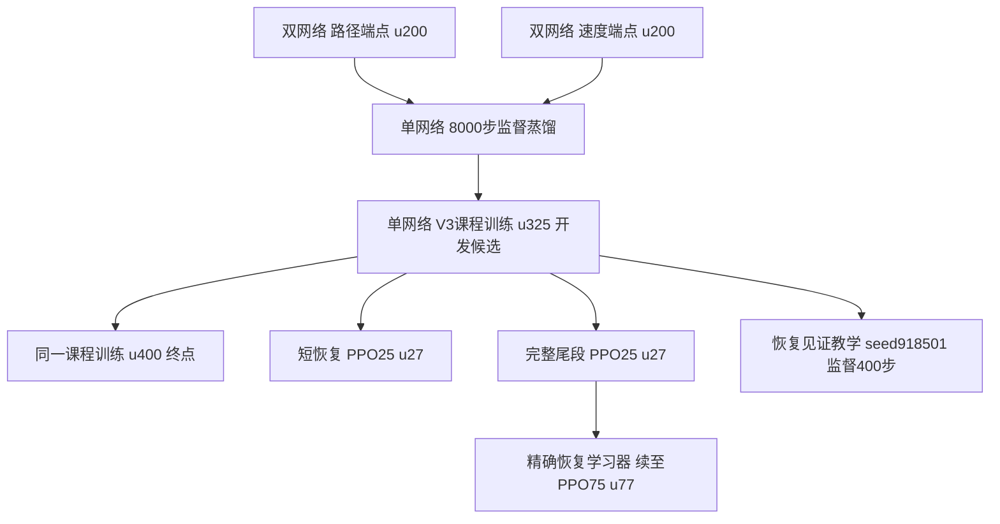

# 已冻结的中层网络与迭代关系

冻结日期：2026-10-24。按用户要求，先保留历史，再继续仿真迭代。当前研究状态仍只在共享台账维护。

实际冻结包：[middle_lineage_20261024_v1](/home/qy/STTW_CONTROL/runs/model_registry/middle_lineage_20261024_v1/manifest.json)。
稳定入口：[机器可读注册表](../learning/configs/frozen_middle_registry.json)。模型不再通过会变化的best/last路径定位。

## 真实继承关系



这不是所有版本都依次优于前一版本的排名。u400是原400轮终点，u325是开发面板选择的候选；H75和教学分别从单网络分叉，教学不是H75的后继。H75的u77包含2次critic预热＋75次PPO，不能误写成77次PPO。两个双网端点分别执行固定α，不是运行时混合两个动作。

|冻结ID后缀（完整ID以STTW_MIDDLE_开头）|具体保存对象|用途与已知限制|
|---|---|---|
|DUAL_COVERAGE_U200_A0|Coverage路径端点actor＋PPO checkpoint，seed910101|历史双网基线；不能视为与单网仅网络结构不同的消融|
|DUAL_COVERAGE_U200_A1|Coverage速度端点actor＋PPO checkpoint，seed910101|与上一行共同构成蒸馏教师；同冻结local300|
|DISTILLED_BC|student_actor.pkl＋student.pt，实际8000监督更新|继承门通过；student.pt不具备PPO优化器精确恢复能力|
|DISTILLED_V3_U325|actor_0325.pkl＋update_0325.pt|开发候选，保留选择依据；不称全部endpoint-primary门槛通过|
|DISTILLED_V3_U400_FINAL|actor_0400.pkl＋update_0400.pt|完整训练终点，保留性能波动，不以它覆盖u325|
|SNIPPET_PPO25_U27|短恢复训练25PPO末端|历史分支，保留来源/终止合同，不作为新的防摔收益证明|
|FULLTAIL_PPO25_U27|完整尾段25PPO末端|H75真实的学习器恢复边界|
|FULLTAIL_PPO75_U77|H75的actor_0077.pkl＋update_0077.pt|当前冻结主要对照；名义偏好用途成立，普遍新增抗扰收益未立|
|WITNESS_S918501_SUP400|恢复教学actor＋监督训练状态|非PPO checkpoint；任务通过165/192，较强75PPO为164/192，不包装为稳健抗扰优势|

## 保存了什么，怎样核验

9个Actor及对应checkpoint/监督状态已复制到独立内容寻址objects，不使用指向原权重的软链接或硬链接。共同local300的Actor、checkpoint与配置一并保存。所有副本只读，原权重不修改、不移动、不清理。

另保存六个历史Git版本的learning源码/配置/CLI/测试压缩包、各阶段manifest与配置/训练记录、冻结时包含未跟踪模块的实际learning源码树及未提交补丁记录。历史Git包代表声明的代码版本；不能据此声称每个历史运行当时都没有未提交补丁。当前源码树是兼容性保留，不冒充所有历史执行的精确源码。外部MuJoCo资产、软件依赖、完整原始轨迹仍通过原source身份与路径定位，未宣称本包可在空机器上直接重现实验。

实际验证：56个内容寻址对象、全部Actor/checkpoint原件与副本SHA一致；PPO更新号和共同底层身份核对通过；H27→H75的恢复checkpoint及u325分支父权重已核对。9个Actor分别用16条已保存的真实351D仿真输入做离线推理，均输出有限二维动作，原件与冻结副本逐值一致。0新物理积分、0训练；这项回读不等于重跑历史能力测试。

```bash
python learning/cli/freeze_middle_lineage.py \
  --root /home/qy/STTW_CONTROL/runs/model_registry/middle_lineage_20261024_v1 --verify
```

包内verification.json记录权重/继承核对，inference_readback.json记录离线推理核对。禁止在同一目录重新生成冻结包；新版本用新ID/新目录，不静默重指向这些别名。

## 实验与未采用分支如何保留

蒸馏、V3奖励和课程同时改变，不能把效果全部归因于奖励。恢复教学与普通加长PPO的差异很小，见[长度对照](evidence/tolerance_progress_20261022/long_baseline_transfer/RESULTS.md)；精选见证对随机成功示范整体净0，见[见证对照](evidence/tolerance_progress_20261022/witness_selection_v1/final/RESULTS.md)。六维物理特征等880例负结果及原模型仍保留在原运行树，见[未采用决定](evidence/tolerance_progress_20261022/reserve_feature_expansion/CONCLUSIONS.md)，不画成通向H75的升级节点。

完整名义偏好、物理防摔、公式误判和接管的证据分别见[证据地图](evidence/tolerance_progress_20261022/baseline_provenance_audit/PAPER_EVIDENCE_MAP.md)。冻结不是采用声明、成功声明或对未来改动的禁止；后续仿真必须在新版本/新运行中迭代，并与这些固定基线比较。
