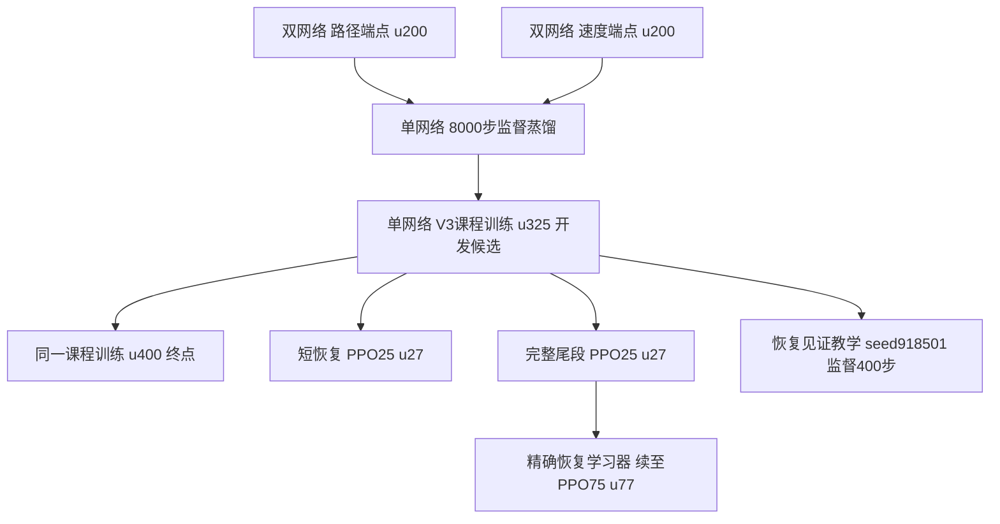

# 已冻结的中层网络与迭代关系

冻结日期：2026-10-24。按用户要求，先保留历史，再继续仿真迭代。当前研究状态仍只在共享台账维护。

实际冻结包：[middle_lineage_20261024_v1](/home/qy/STTW_CONTROL/runs/model_registry/middle_lineage_20261024_v1/manifest.json)。
稳定入口：[机器可读注册表](../learning/configs/frozen_middle_registry.json)。模型不再通过会变化的best/last路径定位。

## 2026-10-29 低速混合U170固定底座

已按用户最新实用综合标准采用 `STTW_MIDDLE_H75_LOW_SPEED_MIXED_U170`，原H75及其冻结包保持不变。新独立冻结包：[/home/qy/STTW_CONTROL/runs/model_registry/middle_low_speed_mixed_u170/manifest.json](/home/qy/STTW_CONTROL/runs/model_registry/middle_low_speed_mixed_u170/manifest.json)。注册表 `current_primary_id` 已更新；旧 `root/manifest_sha256` 仍指历史九模型包，新模型通过 `extension_manifests`/逐记录manifest定位，不能把历史包当新增模型来源。

从H75加载权重补充低速/紧弯与原任务混合训练，u170含2次critic预热＋168次新PPO。完整200PPO已经结束，未默认采用最后一轮。按TRAIN近期奖励趋势先选U170，随后仅做4场景×alpha0/.5/1=12回合DEV；12/12首次到达、0触地、完整10秒、0接回触发。10Hz持续接回保持启用；本批无偏离触发不表示移除了重规划。

两个低速场景实际全窗速度均≤2.1m/s。2m/s、R1.3末2秒横向最大误差约4.7–8.1cm，三个alpha最低实速为1.448/1.594/1.660m/s，出弯收敛。1.6m/s、R.9的alpha0/.5仍有摆动（末2秒横向最大约.205/.073m、航向最大.308/.201rad），不称全面解决；S右弯末窗偏差.263–.381m接受作为继续研究的限制。普通单弯完成且末窗偏差约.15–.18m。没有新增外扰结果，不能推断容扰收益。

本轮统一bank0，与历史bank6不构成严格配对；不称全面超过H75。五档alpha接口保留，仅本次少量选型测0/.5/1。完整12条件、XY图及限制：[选型结果](/media/qy/6A7E3DB07E3D75C3/STTW_CONTROL_archives/tolerance_calibration_disk_recovery_20261025/h75_mixed_u170_targeted_base_review_v1/analysis/README.md)。实际原路径误差/任务成本已独立重建，完整奖励诊断未完成，不能称完整奖励验收。

## 真实继承关系



这不是所有版本都依次优于前一版本的排名。u400是原400轮终点，u325是开发面板选择的候选；H75和教学分别从单网络分叉，教学不是H75的后继。H75的u77包含2次critic预热＋75次PPO，不能误写成77次PPO。两个双网端点分别执行固定α，不是运行时混合两个动作。

|冻结ID后缀（完整ID以STTW_MIDDLE_开头）|具体保存对象|用途与已知限制|
|---|---|---|
|DUAL_COVERAGE_U200_A0|Coverage路径端点actor＋PPO checkpoint，seed910101|历史双网基线；不能视为与单网仅网络结构不同的消融|
|DUAL_COVERAGE_U200_A1|Coverage速度端点actor＋PPO checkpoint，seed910101|与上一行共同构成蒸馏教师；同冻结local300|
|DISTILLED_BC|student_actor.pkl＋student.pt，实际8000监督更新|继承门通过；student.pt不具备PPO优化器精确恢复能力|
|DISTILLED_V3_U325|actor_0325.pkl＋update_0325.pt|开发候选，保留选择依据；不称全部endpoint-primary门槛通过|
|DISTILLED_V3_U400_FINAL|actor_0400.pkl＋update_0400.pt|完整训练终点，保留性能波动，不以它覆盖u325|
|SNIPPET_PPO25_U27|短恢复训练25PPO末端|历史分支，保留来源/终止合同，不作为新的防摔收益证明|
|FULLTAIL_PPO25_U27|完整尾段25PPO末端|H75真实的学习器恢复边界|
|FULLTAIL_PPO75_U77|H75的actor_0077.pkl＋update_0077.pt|当前冻结主要对照；名义偏好用途成立，普遍新增抗扰收益未立|
|WITNESS_S918501_SUP400|恢复教学actor＋监督训练状态|非PPO checkpoint；任务通过165/192，较强75PPO为164/192，不包装为稳健抗扰优势|

## 保存了什么，怎样核验

9个Actor及对应checkpoint/监督状态已复制到独立内容寻址objects，不使用指向原权重的软链接或硬链接。共同local300的Actor、checkpoint与配置一并保存。所有副本只读，原权重不修改、不移动、不清理。

另保存六个历史Git版本的learning源码/配置/CLI/测试压缩包、各阶段manifest与配置/训练记录、冻结时包含未跟踪模块的实际learning源码树及未提交补丁记录。历史Git包代表声明的代码版本；不能据此声称每个历史运行当时都没有未提交补丁。当前源码树是兼容性保留，不冒充所有历史执行的精确源码。外部MuJoCo资产、软件依赖、完整原始轨迹仍通过原source身份与路径定位，未宣称本包可在空机器上直接重现实验。

实际验证：56个内容寻址对象、全部Actor/checkpoint原件与副本SHA一致；PPO更新号和共同底层身份核对通过；H27→H75的恢复checkpoint及u325分支父权重已核对。9个Actor分别用16条已保存的真实351D仿真输入做离线推理，均输出有限二维动作，原件与冻结副本逐值一致。0新物理积分、0训练；这项回读不等于重跑历史能力测试。

```bash
python learning/cli/freeze_middle_lineage.py \
  --root /home/qy/STTW_CONTROL/runs/model_registry/middle_lineage_20261024_v1 --verify
```

包内verification.json记录权重/继承核对，inference_readback.json记录离线推理核对。禁止在同一目录重新生成冻结包；新版本用新ID/新目录，不静默重指向这些别名。

## 实验与未采用分支如何保留

蒸馏、V3奖励和课程同时改变，不能把效果全部归因于奖励。恢复教学与普通加长PPO的差异很小，见[长度对照](evidence/tolerance_progress_20261022/long_baseline_transfer/RESULTS.md)；精选见证对随机成功示范整体净0，见[见证对照](evidence/tolerance_progress_20261022/witness_selection_v1/final/RESULTS.md)。六维物理特征等880例负结果及原模型仍保留在原运行树，见[未采用决定](evidence/tolerance_progress_20261022/reserve_feature_expansion/CONCLUSIONS.md)，不画成通向H75的升级节点。

完整名义偏好、物理防摔、公式误判和接管的证据分别见[证据地图](evidence/tolerance_progress_20261022/baseline_provenance_audit/PAPER_EVIDENCE_MAP.md)。冻结不是采用声明、成功声明或对未来改动的禁止；后续仿真必须在新版本/新运行中迭代，并与这些固定基线比较。

## H75原生连续S弯能力补测（2026-10-28）

[四场景同图XY及完整报告](/media/qy/6A7E3DB07E3D75C3/STTW_CONTROL_archives/tolerance_calibration_disk_recovery_20261025/h75_native_s_capability_v1/analysis/RESULTS.md)

冻结H75 u77、本来参考权限、同local300/ECBC/ESO，60度R2.2/2.6m/s与90度R1.8/2.8m/s各左右S，alpha0/.5/1＋zero，每条10秒。全部16不触地且过第二弯；H75严格末窗任务10/12、zero0/4，但原目标1m首达H75 10/12、zero4/4。紧S的H75 alpha1两条未达原goal且末窗路径/航向未过；zero主要未通过末窗航向保持。H75总V3成本9/12低于zero，三任务通道仅2/12较低，不把总成本优势等同全部任务更好。单祖先、已训练S家族的DEV扩覆盖；无扰动、无重规划，不宣称抗扰/泛化或安全保证。唯一研究事实与后续仍以research-hub/STTW_PROJECT_STATE.md为准。


### 名义几何偏好往返：未采用（2026-10-28）

原生H75固定不变，四个相同S场景新增两种因果规则共8回合、0训练；原16固定轨迹复用。alpha往返严格3/4、原终点首达4/4，原user1费用123.7986；固定alpha.5严格4/4、费用118.9854。普通曲率限速严格2/4。左紧S往返末窗横向误差0.1637m超过0.1m，两温和S用户费用退化；拒绝本规则，不续调阈值或直接训练容扰MLP。没有否定所有调度或扰后恢复机会。全四XY、同用户奖励与独立复核见[完整报告](/media/qy/6A7E3DB07E3D75C3/STTW_CONTROL_archives/tolerance_calibration_disk_recovery_20261025/h75_nominal_preference_schedule_v1/analysis/RESULTS.md)。


## H75测试总入口与中层选型复核（2026-10-28）

此处集中导航已有证据，不将不同任务、接口、观察窗或重复缓存相加为总成功率。当前事实及待办仍以研究台账为准。本次只核验报告/汇总与文件存在，未重新积分全部历史轨迹。

### 不只有S弯：已有非S测试入口

- [直线：H75五档各2条，10/10旧严格任务通过](../runs/preference_full_tail_length75_post_v1/straight/analysis/REPORT.md)。该表nominal全部，不能称为非零扰动直线恢复证据。
- [左右90°单弯：中等脉冲](../runs/preference_full_tail_length75_post_v1/moderate/analysis/REPORT.md)、[强脉冲](../runs/preference_full_tail_length75_post_v1/strong/analysis/REPORT.md)：五档及全部上下文图。
- [左右70°/R1.9，速度2.3/2.7](../runs/preference_long_baseline_transfer_v1/turn70_R1p9/analysis/REPORT.md)：H75 78/96旧任务通过。
- [左右130°/R2.7](../runs/preference_long_baseline_transfer_v1/turn130_R2p7/analysis/REPORT.md)：H75 86/96旧任务通过。两跨几何面板历史α为0/.2/.6/1，不冒充当前五档。

本轮统一选型应覆盖直线、左右单弯及连续S，不只沿用近期S面板。具体新预算仍待封存，以上为已完成历史报告。

### 先看原生XY：H75到底怎样行驶

- [S_left_60_R2p2：三档α与zero实际/原参考轨迹](/media/qy/6A7E3DB07E3D75C3/STTW_CONTROL_archives/tolerance_calibration_disk_recovery_20261025/h75_native_s_capability_v1/analysis/S_left_60_R2p2_xy.png)
- [S_right_60_R2p2：三档α与zero实际/原参考轨迹](/media/qy/6A7E3DB07E3D75C3/STTW_CONTROL_archives/tolerance_calibration_disk_recovery_20261025/h75_native_s_capability_v1/analysis/S_right_60_R2p2_xy.png)
- [S_left_90_R1p8：三档α与zero实际/原参考轨迹](/media/qy/6A7E3DB07E3D75C3/STTW_CONTROL_archives/tolerance_calibration_disk_recovery_20261025/h75_native_s_capability_v1/analysis/S_left_90_R1p8_xy.png)
- [S_right_90_R1p8：三档α与zero实际/原参考轨迹](/media/qy/6A7E3DB07E3D75C3/STTW_CONTROL_archives/tolerance_calibration_disk_recovery_20261025/h75_native_s_capability_v1/analysis/S_right_90_R1p8_xy.png)

四个S场景中，H75严格任务10/12且原1m目标到达10/12，全部不触地；两条失败均为紧S的α=1。zero到达4/4，但严格末窗任务0/4。因此H75的价值是具体偏好与跟踪表现，不能解释为所有场景到达率都高于zero。无扰测试不能证明抗扰。

### 历史五档测试：H75并非只测过三档

[完整长度比较](evidence/tolerance_progress_20261022/full_tail_length75/FINAL_RESULTS.md) · [逐alpha数字](evidence/tolerance_progress_20261022/full_tail_length75/FINAL_RESULTS.json) · [训练审计](evidence/tolerance_progress_20261022/full_tail_length75/TRAINING_AUDIT.md)

|旧面板|H75任务通过|解释|
|---|---:|---|
|中等扰动|200/200|包含重复零扰动基准|
|强扰动|191/200|α=0/.25/.5/.75/1分别37/38/38/39/39，各40|
|直线|10/10|五档各2|
|低速检查|56/60|不是任意低速的保证|

这些标签要求无原生物理/域失败、原目标及末1秒路径/航向/速度容差，与最近仅原1m目标首达的口径不同。470记录含重复名义条件，不是470个独立初态。H75相对完整尾段25PPO为9增0失；48PPO中间点为4增4失，不能用轮数或奖励平台证明收敛。

- [moderate：全部逐alpha轨迹、奖励和误差](/home/qy/STTW_CONTROL/runs/worktrees/tolerance-calibration/runs/preference_full_tail_length75_post_v1/moderate/analysis/REPORT.md)
- [strong：全部逐alpha轨迹、奖励和误差](/home/qy/STTW_CONTROL/runs/worktrees/tolerance-calibration/runs/preference_full_tail_length75_post_v1/strong/analysis/REPORT.md)
- [straight：全部逐alpha轨迹、奖励和误差](/home/qy/STTW_CONTROL/runs/worktrees/tolerance-calibration/runs/preference_full_tail_length75_post_v1/straight/analysis/REPORT.md)
- [low_speed：全部逐alpha轨迹、奖励和误差](/home/qy/STTW_CONTROL/runs/worktrees/tolerance-calibration/runs/preference_full_tail_length75_post_v1/low_speed/analysis/REPORT.md)

### 其他候选：本轮排除双端点及任务型新测试

|候选|核实的既有证据|选型意义|
|---|---|---|
|H75，FULLTAIL_PPO75_U77|上述五档面板；跨几何164/192，含工作侧倾102/192|当前比较基准，尚不声称统一任务下最优|
|W400，WITNESS_S918501_SUP400|旧强扰动195/200、低速58/60；跨几何165/192、含工作侧倾91/192|优先补当前统一任务；净+1同时有6增5失，不按均值直接替换|
|u325，DISTILLED_V3_U325|原开发候选；跨几何parent160/192、含工作侧倾94/192|同族单网主要候选；名称parent仅对应该报告身份|
|u400、短恢复25、完整尾段25、纯BC|冻结Actor均存在且本次SHA核对一致；已有负结果/训练波动|先复用历史筛选，未声明普遍不如H75，不默认全部重跑|

[跨几何配对结果及全部XY入口](evidence/tolerance_progress_20261022/long_baseline_transfer/RESULTS.md)。W400是从u325分叉的恢复教学，不是H75后继，也不是普通goal任务型网络；其training_state是监督状态，不能当PPO恢复包。上述七个非dual Actor本次均核实文件与注册SHA一致。双端点及parent_task64/ordinary_goal64等任务型按用户要求不纳入新测试。

### 原生、扰动与协调实验目录索引

下表列出数据盘所有以h75_命名的实验目录及可见报告。包含失败或未完成尝试；目录存在不等于实验完成。与H75有关但不以h75命名的早期实验由上文历史报告及下方补充入口覆盖。本索引不是对全项目所有旧目录的穷尽审计。

|实验目录|报告入口（缺失者直接标出）|
|---|---|
|h75_channel_factorial_v1|[analysis/RESULTS.md](/media/qy/6A7E3DB07E3D75C3/STTW_CONTROL_archives/tolerance_calibration_disk_recovery_20261025/h75_channel_factorial_v1/analysis/RESULTS.md)|
|h75_channel_response_v1|[原始目录/状态](/media/qy/6A7E3DB07E3D75C3/STTW_CONTROL_archives/tolerance_calibration_disk_recovery_20261025/h75_channel_response_v1)；无该层完整报告入口|
|h75_channel_response_v1_attempt2|[analysis/README.md](/media/qy/6A7E3DB07E3D75C3/STTW_CONTROL_archives/tolerance_calibration_disk_recovery_20261025/h75_channel_response_v1_attempt2/analysis/README.md)|
|h75_channel_switching_v1|[原始目录/状态](/media/qy/6A7E3DB07E3D75C3/STTW_CONTROL_archives/tolerance_calibration_disk_recovery_20261025/h75_channel_switching_v1)；无该层完整报告入口|
|h75_coordinator_cpu_latency_v1|[原始目录/状态](/media/qy/6A7E3DB07E3D75C3/STTW_CONTROL_archives/tolerance_calibration_disk_recovery_20261025/h75_coordinator_cpu_latency_v1)；无该层完整报告入口|
|h75_disturbed_common_interface_v1|[analysis_reconstructed_v2/REPORT.md](/media/qy/6A7E3DB07E3D75C3/STTW_CONTROL_archives/tolerance_calibration_disk_recovery_20261025/h75_disturbed_common_interface_v1/analysis_reconstructed_v2/REPORT.md)|
|h75_frozen_confirmation200_v1|[analysis/README.md](/media/qy/6A7E3DB07E3D75C3/STTW_CONTROL_archives/tolerance_calibration_disk_recovery_20261025/h75_frozen_confirmation200_v1/analysis/README.md)|
|h75_frozen_transfer48_v1|[analysis/README.md](/media/qy/6A7E3DB07E3D75C3/STTW_CONTROL_archives/tolerance_calibration_disk_recovery_20261025/h75_frozen_transfer48_v1/analysis/README.md)|
|h75_geometry_duration_extension240_v1|[analysis/README.md](/media/qy/6A7E3DB07E3D75C3/STTW_CONTROL_archives/tolerance_calibration_disk_recovery_20261025/h75_geometry_duration_extension240_v1/analysis/README.md)|
|h75_guard_fallback_extension72_v1|[analysis/README.md](/media/qy/6A7E3DB07E3D75C3/STTW_CONTROL_archives/tolerance_calibration_disk_recovery_20261025/h75_guard_fallback_extension72_v1/analysis/README.md)|
|h75_guard_fallback_regression60_v1|[analysis/README.md](/media/qy/6A7E3DB07E3D75C3/STTW_CONTROL_archives/tolerance_calibration_disk_recovery_20261025/h75_guard_fallback_regression60_v1/analysis/README.md)|
|h75_late_state_tolerance48_v1|[analysis_late/README.md](/media/qy/6A7E3DB07E3D75C3/STTW_CONTROL_archives/tolerance_calibration_disk_recovery_20261025/h75_late_state_tolerance48_v1/analysis_late/README.md)|
|h75_native_s_capability_v1|[analysis/RESULTS.md](/media/qy/6A7E3DB07E3D75C3/STTW_CONTROL_archives/tolerance_calibration_disk_recovery_20261025/h75_native_s_capability_v1/analysis/RESULTS.md)|
|h75_nominal_preference_schedule_v1|[analysis/RESULTS.md](/media/qy/6A7E3DB07E3D75C3/STTW_CONTROL_archives/tolerance_calibration_disk_recovery_20261025/h75_nominal_preference_schedule_v1/analysis/RESULTS.md)|
|h75_online_confirmation_v1|[analysis/README.md](/media/qy/6A7E3DB07E3D75C3/STTW_CONTROL_archives/tolerance_calibration_disk_recovery_20261025/h75_online_confirmation_v1/analysis/README.md)|
|h75_online_scalar_v1|[analysis/README.md](/media/qy/6A7E3DB07E3D75C3/STTW_CONTROL_archives/tolerance_calibration_disk_recovery_20261025/h75_online_scalar_v1/analysis/README.md)|
|h75_prior_speed_retrospective144_v1|[原始目录/状态](/media/qy/6A7E3DB07E3D75C3/STTW_CONTROL_archives/tolerance_calibration_disk_recovery_20261025/h75_prior_speed_retrospective144_v1)；无该层完整报告入口|
|h75_replan_timing_v1|[analysis/README.md](/media/qy/6A7E3DB07E3D75C3/STTW_CONTROL_archives/tolerance_calibration_disk_recovery_20261025/h75_replan_timing_v1/analysis/README.md)|
|h75_samestate_bank144_v1|[analysis_development/README.md](/media/qy/6A7E3DB07E3D75C3/STTW_CONTROL_archives/tolerance_calibration_disk_recovery_20261025/h75_samestate_bank144_v1/analysis_development/README.md) · [analysis_final/README.md](/media/qy/6A7E3DB07E3D75C3/STTW_CONTROL_archives/tolerance_calibration_disk_recovery_20261025/h75_samestate_bank144_v1/analysis_final/README.md)|
|h75_samestate_confirmation144_v1|[analysis_confirmation/README.md](/media/qy/6A7E3DB07E3D75C3/STTW_CONTROL_archives/tolerance_calibration_disk_recovery_20261025/h75_samestate_confirmation144_v1/analysis_confirmation/README.md)|
|h75_samestate_tolerance_v1|[analysis/README.md](/media/qy/6A7E3DB07E3D75C3/STTW_CONTROL_archives/tolerance_calibration_disk_recovery_20261025/h75_samestate_tolerance_v1/analysis/README.md)|
|h75_speed_query_online60_v1|[analysis/README.md](/media/qy/6A7E3DB07E3D75C3/STTW_CONTROL_archives/tolerance_calibration_disk_recovery_20261025/h75_speed_query_online60_v1/analysis/README.md)|
|h75_switching_continuation_v1|[原始目录/状态](/media/qy/6A7E3DB07E3D75C3/STTW_CONTROL_archives/tolerance_calibration_disk_recovery_20261025/h75_switching_continuation_v1)；无该层完整报告入口|
|h75_switching_continuation_v1_attempt2|[analysis/README.md](/media/qy/6A7E3DB07E3D75C3/STTW_CONTROL_archives/tolerance_calibration_disk_recovery_20261025/h75_switching_continuation_v1_attempt2/analysis/README.md)|
|h75_task_aware_fallback72_v1|[analysis/README.md](/media/qy/6A7E3DB07E3D75C3/STTW_CONTROL_archives/tolerance_calibration_disk_recovery_20261025/h75_task_aware_fallback72_v1/analysis/README.md)|
|h75_tolerance_broaden120_v1|[analysis/README.md](/media/qy/6A7E3DB07E3D75C3/STTW_CONTROL_archives/tolerance_calibration_disk_recovery_20261025/h75_tolerance_broaden120_v1/analysis/README.md)|
|h75_tolerance_online120_v1|[analysis/README.md](/media/qy/6A7E3DB07E3D75C3/STTW_CONTROL_archives/tolerance_calibration_disk_recovery_20261025/h75_tolerance_online120_v1/analysis/README.md)|
|h75_tolerance_online120_v1_prepare_failed_precision|[原始目录/状态](/media/qy/6A7E3DB07E3D75C3/STTW_CONTROL_archives/tolerance_calibration_disk_recovery_20261025/h75_tolerance_online120_v1_prepare_failed_precision)；无该层完整报告入口|
|h75_tolerance_predictor_pilot_v1|[原始目录/状态](/media/qy/6A7E3DB07E3D75C3/STTW_CONTROL_archives/tolerance_calibration_disk_recovery_20261025/h75_tolerance_predictor_pilot_v1)；无该层完整报告入口|
|h75_tolerance_predictor_ranking_v1|[原始目录/状态](/media/qy/6A7E3DB07E3D75C3/STTW_CONTROL_archives/tolerance_calibration_disk_recovery_20261025/h75_tolerance_predictor_ranking_v1)；无该层完整报告入口|
|h75_tolerance_predictor_temporal_mix_v1|[原始目录/状态](/media/qy/6A7E3DB07E3D75C3/STTW_CONTROL_archives/tolerance_calibration_disk_recovery_20261025/h75_tolerance_predictor_temporal_mix_v1)；无该层完整报告入口|
|h75_tolerance_predictor_user_mix_prior_v1|[原始目录/状态](/media/qy/6A7E3DB07E3D75C3/STTW_CONTROL_archives/tolerance_calibration_disk_recovery_20261025/h75_tolerance_predictor_user_mix_prior_v1)；无该层完整报告入口|
|h75_tolerance_predictor_user_mix_v1|[原始目录/状态](/media/qy/6A7E3DB07E3D75C3/STTW_CONTROL_archives/tolerance_calibration_disk_recovery_20261025/h75_tolerance_predictor_user_mix_v1)；无该层完整报告入口|
|h75_tolerance_speed_query_ablation_v1|[原始目录/状态](/media/qy/6A7E3DB07E3D75C3/STTW_CONTROL_archives/tolerance_calibration_disk_recovery_20261025/h75_tolerance_speed_query_ablation_v1)；无该层完整报告入口|
|h75_tolerance_temporal_online40_v1|[analysis/README.md](/media/qy/6A7E3DB07E3D75C3/STTW_CONTROL_archives/tolerance_calibration_disk_recovery_20261025/h75_tolerance_temporal_online40_v1/analysis/README.md)|
|h75_user_late_state192_v1|[analysis_late/README.md](/media/qy/6A7E3DB07E3D75C3/STTW_CONTROL_archives/tolerance_calibration_disk_recovery_20261025/h75_user_late_state192_v1/analysis_late/README.md)|
|h75_user_preference120_v1|[analysis/README.md](/media/qy/6A7E3DB07E3D75C3/STTW_CONTROL_archives/tolerance_calibration_disk_recovery_20261025/h75_user_preference120_v1/analysis/README.md)|
|h75_user_prior_online72_v1|[analysis/README.md](/media/qy/6A7E3DB07E3D75C3/STTW_CONTROL_archives/tolerance_calibration_disk_recovery_20261025/h75_user_prior_online72_v1/analysis/README.md)|

补充入口（历史对照中含用户本轮排除的新测试候选，但旧证据保留）：

- [固定路径任务迁移：不是H75原生接口](/media/qy/6A7E3DB07E3D75C3/STTW_CONTROL_archives/tolerance_calibration_disk_recovery_20261025/ordinary_goal_endpoint_v1/analysis_with_h75/RESULTS.md)
- [原生H75与zero/其他网络](/media/qy/6A7E3DB07E3D75C3/STTW_CONTROL_archives/tolerance_calibration_disk_recovery_20261025/native_zero_preference_v1/analysis/README.md)
- [原生H75与平衡规则](/media/qy/6A7E3DB07E3D75C3/STTW_CONTROL_archives/tolerance_calibration_disk_recovery_20261025/native_equilibrium_rule_v1/analysis/README.md)
- [历史同接口模型比较：仅无扰动](/media/qy/6A7E3DB07E3D75C3/STTW_CONTROL_archives/tolerance_calibration_disk_recovery_20261025/lineage_nominal_common_interface_v1/analysis_corrected_roles_v1/REPORT.md)

尚未完成：当前共同接回条件下H75/W400/u325的五档配对选型；新五档协调器闭环；2.8/3s实际转角机制图及接回修复。不能把旧域成绩当作这些工作已经通过。

## 三中层五档与10 Hz持续接回：2026-10-29新增结果

统一336物理回合：三中层各105（7路线×3事件×5档alpha），zero为21物理回合，跨alpha仅重评分。单个prepared bank6、相关开发条件，不是独立训练种子或最终TEST。正常原路，离带后10Hz持续几何接回；首达停止更新路径但继续物理至H10。

|模型|原1m终点首达/105|H10触地/105|无扰动首达/35|
|---|---:|---:|---:|
|H75|67|28|33|
|W400|68|30|33|
|u325|67|28|33|

zero原终点首达17/21、触地4/21，无扰动7/7。不同分母不能直接比较计数。三中层共同无扰动未达为左右紧S的alpha1；H75最小目标距离1.0816/1.0512m，保留原1m判据，不能事后改成成功，也不夸大微小越界。原终点首达不要求末速度、航向或保持，不能当完整轨迹合格。

目前无明显依据替换H75；W400多1到达却多2触地，须结合原任务成本与逐条件得失再定。三者共享的一些大绕行说明提高规划频率本身不等于解决动态可跟随性；本批没有同条件一次规划对照，不声称10Hz增益。

[全部42张轨迹/奖励图与原始分析索引](/media/qy/6A7E3DB07E3D75C3/STTW_CONTROL_archives/tolerance_calibration_disk_recovery_20261025/middle_selection_five_alpha_v1/analysis/README.md)。420份逐步诊断视图、完整原始轨迹保留。固定诊断的分项及速度代理独立图尚待补全，非任务奖励尚未全独立重建；不称最终论文交付。执行382.61s，分析109.07s，0optimizer。

## 用户采用决定：H75（2026-10-29）

用户已查看10Hz持续接回轨迹，明确当前绕行程度可接受，并选定 **STTW_MIDDLE_FULLTAIL_PPO75_U77（H75）** 为后续冻结中层。中层选型结束；不再以消除当前绕行为前置门槛。保留五档alpha=0/.25/.5/.75/1、当前10Hz接回和冻结底层，回到容扰预测与偏好协调主线。采用不代表所有指标最优，现有失败及zero基线保留。

## 低速紧弯训练覆盖核查（2026-10-29）

用户询问新低速紧弯路径震荡是否训练不足。root核对冻结包H75/u325 resolved_config、H75 plan/declaration/实际后50轮metrics，并实际反序列化恢复TRAIN bank。课程四级速度/半径配对为2.0–2.4m/s与2.2–2.6m、2.4–2.6与2.0–2.2、2.6–2.8与1.8–2.0、2.8–3.2与1.6–1.8；不能把各维范围交叉当作联合训练覆盖。双端点祖先配置半径1.8–4.0，亦不覆盖0.9/1.3m。

H75由u325继承，再完成完整尾段75次PPO（2次critic预热不算PPO）。实际恢复训练bank320源，route.speed范围2.40915–2.79936m/s，route.radius范围1.80025–3.0m，无新1.6m/s请求/0.9或1.3m半径。真实状态速度可能低于请求；上述范围仅指路线请求/生成参数，不能称完全没见过低实际车速。H75续训是同bank受扰尾段+名义锚定，不是新低速紧弯课程。源bank: runs/preference_recovery_train_v1/bank/bank.pkl；冻结配置在middle_lineage_20261024_v1/STTW_MIDDLE_FULLTAIL_PPO75_U77_resolved_config.json。

后50轮日志中，u28–37与u68–77训练mean_step_reward均值分别−0.89287/−0.90778，均0physical失败，但domain退出150/153；两个十轮均接受160minibatches，mean exactKL约.00229/.00245。随机批次描述不能证明收敛或倒退，更不能证明新工况补训必然有效；已有25→75长度对照说明增加轮数不保证覆盖外能力。新测试同时使用双轮.8（与历史前轮10身份不同），仍存在物理分布变化。

结论：已证实新几何/低速请求训练覆盖不足；尚未隔离为单一网络问题，也没有足够证据判定原分布训练轮数不足。若改善这类场景，应先做最小闭环定位，再以独立候选补充低速紧弯及出弯保持训练，不覆盖冻结H75；当前未启动续训。
