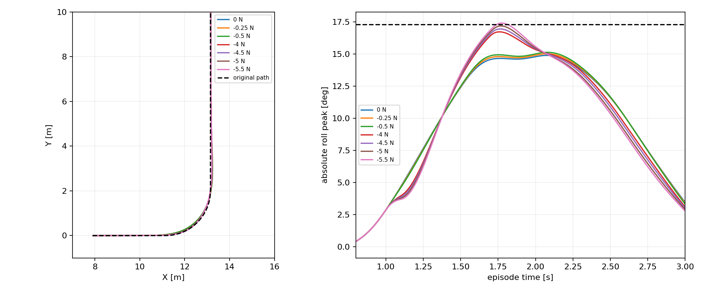

# 容扰度研究：任务、已做工作、结果与下一步

> 单网络恢复学习已启动（2026-10-23）：[三组匹配PPO协议、工程验证与运行快照](evidence/tolerance_progress_20261022/preference_recovery_pilot/README.md)。真实u325/V3/原10s、4s恢复片段，uniform/guided/shuffled各2轮Critic预热+25轮PPO；当前前两组运行、第三组排队。TensorBoard http://localhost:6008 的实际奖励已核验；训练完成后自动接续1240例新评测并复用400例已核验父策略结果。尚未获得训练后能力结论。


> 强脉冲结果（2026-10-23）：[单网u325的0/±20/±32N面板](evidence/tolerance_progress_20261022/preference_stress_results/CONCLUSIONS.md)完成200例，任务恢复189/200，9次域退出、2次末段保持不达标，无记录物理摔倒。全部11例发生在2s弯道起扰；独立320上下文TRAIN前缀采集已启动，随后检验精确alpha/力档匹配的均匀、真实余量、打乱余量三组恢复训练。


> 单网络整合更新（2026-10-23）：[真正u325单alpha网络的200例真实脉冲结果](evidence/tolerance_progress_20261022/preference_screen_results/CONCLUSIONS.md)已完成，所有alpha任务恢复40/40，工作性能33/31/28/25/26；V3/原10s任务/冻结local300保持不变，尚无新PPO。公式在160个非零样本中预测86余量内全部恢复，另74余量外也恢复；没有任务负例，不能判断区分能力。正在执行同任务0/±20/±32N的有界强脉冲诊断，目标是定位有实际改进空间的恢复工况，再建立独立TRAIN前缀和精确alpha/力档匹配的采样对照。旧双端点训练结果与此区分。


> 后续扫描也已完成：[32个TRAIN完整状态、416例同状态带符号扫描](evidence/tolerance_progress_20261022/train_margin_scan_results/CONCLUSIONS.md)。不改参数，公式余量内281例均完成任务恢复，余量外另有127例恢复，表现保守；严格工作性能与物理边界分开，6例提前域退出后的物理存活UNKNOWN。未启动下一轮训练，当前重点是余量如何指导状态—方向采样，而非精确拟合或解冻底层。

> 更新：4秒短恢复联合协议与完整864例DEV已结束。[本轮XY、奖励、结果与下一步](evidence/tolerance_progress_20261022/short_recovery_results/CONCLUSIONS.md)。α0原标准parent/uniform/guided=133/138/136；α1均141；真正任务恢复α0=142/144/142，α1均144。uniform α0保留为下一阶段冻结后缀候选，未宣布部署替换。接续TRAIN方向扫描已声明并启动：32状态×13力档=416例，无PPO；见[协议](TOLERANCE_SHORT_RECOVERY_PLAN_20261022.md)。以下旧“最新”块为此前20秒训练阶段的历史快照。

> [外部评审逐项核查](TOLERANCE_EXTERNAL_REVIEW_AUDIT_20261022.md)与[补齐代码/逐例数据入口](evidence/tolerance_review_audit_20261022/CODE_AND_DATA_INDEX.md)：含时间尺度实测、采样测试及需纠正的归因。

> [详细任务环境、训练分布与评测协议](TOLERANCE_TASK_AND_EVALUATION.md)：包含物理/reset、网络动作、随机训练与固定测试、扰动、失败条件及全部阈值。

> 最新：四组训练与864例评测已完成。[完整结果与研究判断](evidence/tolerance_progress_20261022/pulse_curriculum_results/diagnostics/CONCLUSIONS.md)。本报告后文“正在进行”段落保留为先前发布快照；当前未采用guided候选。



本报告是截至 2026-10-22T18:59:10.005456-07:00 的发布快照；运行状态以原机实时文件为准。代码分支：`experiment/tolerance-calibration-20261022`。单网络α成果在独立分支 `experiment/path-conflict-exposure-v1`，本轮容扰度实验使用两个独立中层端点网络和冻结local300。

## 1. 我们具体要解决什么问题

在现有速度—路径控制器上，利用车辆状态估计“某个方向还能承受多大扰动”，并验证这个估计是否能帮助训练出更好的抗扰控制器。最终价值是受扰后仍能完成原始任务，同时保留正常跟踪；公式精确拟合不是目标。允许适度保守和小误差，但不能把未验证的估计称为安全保证。

例如：车以2.6m/s进入弯道时，左右推力的后果可能不同。公式分别估计两个方向的余量，用它安排有训练价值的推力，再看模型能否更好地恢复路径和速度。侧倾越过工作阈值、跟踪偏差、物理摔倒是不同结果，分别报告。

## 2. 公式输入输出与实现

输入：当前侧倾φ、侧倾角速度ω、转角δ、控制器轮速代理、ESO扰动估计d̂、剩余恢复时间，以及简化模型参数、等效扰动映射γ和控制努力预算E_b。输出：正负方向余量F₊/F₋（N）、有效性标记；早期奖励实验还输出有上界的成本。不是给底层直接输出电机动作。

```text
λ = sqrt(a4),  b = a1 + a2/λ
z = (a2/λ)δ + λφ + ω + d̂/λ
T = min(1s, 剩余时间)
W = b²(1−exp(−2λT))/(2λ)
K = γ(1−exp(−λΔ))/λ
E(F) = (z+KF)²/W
r = sqrt(E_b W)
F₊ = max(0, (r−sign(K)z)/|K|)
F₋ = max(0, (r+sign(K)z)/|K|)
```

最后两式用于|z|≤r的名义可行情形；实现对名义已越界返回零余量，对非法参数保留无效标记。Δ=0.1s。当前训练使用E_b=0.0308390853、γ=0.8155609071作为代理参数；努力量不是焦耳，也没有证明实际执行器峰值一定可行。简化线性模型的最小努力与完整非线性学习策略的任务成功不是同一个概念。

早期还实现了基于±小力探针的完整闭环轨迹灵敏度预测；它与上述廉价解析代理有区别。不能把一个局部灵敏度成功例子当成解析代理跨场景有效的证明。

- [解析代理实现](../learning/src/sttw_control/tolerance_shaping.py)
- [一般方向容扰度计算](../learning/src/sttw_control/directional_tolerance.py)
- [真实扰动采样与状态管理](../learning/src/sttw_control/tolerance_pulse.py)
- [实现与历史审计](DIRECTIONAL_TOLERANCE_IMPLEMENTATION.md)

## 3. 已完成工作与成果

### A. 从推导到真实物理扰动和局部验证

完成数学计算模块、实际外力脉冲、完整闭环状态分支、轨迹指标、方向标签和XY报告。外力在真实物理子步施加，记录冲量，不注入位置或速度。复用vmap/scan和编译缓存；小数值差异已接受，不再设额外精度门。

- [首轮42案例](evidence/tolerance_progress_20261022/calibration/pulse_pilot_v1_attempt2/REPORT.md)：41/42通过，唯一不通过为工作侧倾阈值，不等于摔倒。
- [左转局部边界](evidence/tolerance_progress_20261022/calibration/boundary_focus_v1/REPORT.md)：预测4.72N，实测5N通过、5.5N越工作侧倾阈值。这一状态下估计偏保守，是有限网格证据。
- [右转迁移](evidence/tolerance_progress_20261022/calibration/right_transfer_v1/REPORT.md)：8个验证幅值7个判断正确，1个预测通过但实测失败；[同状态局部幅值验证](evidence/tolerance_progress_20261022/calibration/right_local_validity_v1/REPORT.md)12个判断中11个正确、1个保守拒绝。局部预测可以有用，但外推不能假定保守。
- [跨速度/状态264案例](evidence/tolerance_progress_20261022/calibration/cross_state_v1_attempt2/REPORT.md)：2.3m/s校准132例，96个可评分预测中92正确、4个误判通过；2.8m/s132例存在9个名义失败状态，只剩24个可评分预测。不能以24/24宣称全面泛化。
- [标量努力模型审计](evidence/tolerance_progress_20261022/model_energy/REPORT.md)：动态代理校准123/132正确、9个保守拒绝；速度迁移只有44/132正确，含84个误判通过。因此目前把它作为训练启发信息，不能作为安全筛选器。

### B. 已完成“容扰度直接进奖励”的对照训练

两端点各有baseline/static/dynamic三组，每组50轮，共19,660,800策略步。保持原始任务，比较静态余量与状态相关动态余量奖励。随后完成1152个固定开发评估案例；训练时未加入本次真实外力脉冲，因此测试的是奖励塑形向抗扰的迁移。

| α | baseline原始成功 | static原始成功 | dynamic原始成功 |
|---|---:|---:|---:|
| 0 | 133/144 | 134/144 | 103/144 |
| 1 | 141/144 | 0/144 | 0/144 |

α1的0/144主要是最终路径偏差约10–13cm越过原10cm限值，全部到达目标、无物理/域失败。按路径0.15m、侧倾0.33rad的实用诊断，α1三组均144/144；α0分别142/144、144/144、139/144。允许的小偏差不必为了“变绿”重训；原标签仍保留。

按每个策略自身无扰轨迹扣除名义差异后，dynamic的扰动侧倾响应RMS在α0/α1分别变差约7.9%/3.8%；static路径扰动响应有约2.5%/4.6%的小改善，但侧倾没有一致改善。动态成本下降不等于实际抗扰变好。

结论：**已完成可运行的容扰度诊断与训练集成，但直接奖励塑形没有取得稳定抗扰增益。** 不能因此宣称公式数学错误，也不能把代理分数改善包装成鲁棒性改善。模型平衡时z可以为零，不能简单说正常侧倾必然受罚；详见机制更正。

- [完整1152案例结果和144张XY图](evidence/tolerance_progress_20261022/reward_shaping/REPORT.md)
- [终端偏差与实用诊断](evidence/tolerance_progress_20261022/reward_shaping/TERMINAL_DIAGNOSIS.md)
- [相对自身无扰轨迹的响应](evidence/tolerance_progress_20261022/reward_shaping/PULSE_RESPONSE_DIAGNOSIS.md)
- [奖励机制更正](evidence/tolerance_progress_20261022/reward_shaping/REWARD_MECHANISM_AUDIT.md)、[起扰状态余量审计](evidence/tolerance_progress_20261022/reward_shaping/ONSET_RESERVE_AUDIT.md)

## 4. 当前正在做什么

改为**真实外力训练，两组仅改变扰动采样方式**：均匀随机采样 vs 容扰度引导采样。公式不进奖励，不作为安全门，继续使用同一原任务奖励；单网络V3奖励此次没有混入，避免同时改变两个因素。

每回合50%无扰；其余在0.8–3.5s施加0.1s侧向推力，候选±2/±4/±6/±8N。引导组在50%均匀分布上混合50%贴近方向余量的软权重，无效估计回退均匀并计数。两组同端点父模型、同初始化方式和交互量，但力暴露分布有意不同。

4组各25轮，总6,553,600策略步，两进程并行。发布时α0均匀/引导两组已完成25轮，α1两组仍训练中；当前细节见[状态快照](evidence/tolerance_progress_20261022/snapshots/pulse_curriculum_train_v1/status.json)。首批真实回合已验证施力和冲量；这证明管线工作，不证明方法更优。

已配置训练后自动比较parent/uniform/guided共864例，相同路线、速度、起扰时刻、力幅值，完成后生成XY报告。仍是已使用开发面板，不是最终独立测试。Bark保留，邮件和自动Codex修复保持禁用。进度在原机 http://localhost:6010 查看。

- [实验设计](TOLERANCE_PULSE_CURRICULUM_DESIGN_20261022.md)
- [训练及评估协议快照](evidence/tolerance_progress_20261022/snapshots/pulse_curriculum_train_v1/comparison_protocol.json)
- [训练实现](../learning/src/sttw_control/tolerance_training.py)、[自动衔接入口](../learning/cli/finish_tolerance_campaign.py)

## 5. 下一步如何决定

1. 完成本轮4组训练及864例统一评估，先看实际/参考XY、名义跟踪、任务成功、工作侧倾与终端恢复，再看受扰相对自身无扰的增量；保留提前失败和有效前缀覆盖率。
2. 若引导优于均匀且正常性能可接受，再用不同训练种子/新场景确认收益；若无改善，结合实际采样分布判断引导是否过弱或代理排序不可靠，选择一个具体改动再实验，不盲目延长同一训练。
3. 最终论文以“有物理解释的状态/方向余量能否提高抗扰训练效率或性能”为可检验问题。当前能报告公式、实现、局部校准和负结果；尚不能声称可靠安全边界或广泛鲁棒性提升。单网络α的update325成果独立保留，待主线明确后再考虑结合。

本次远端包含源码、配置、测试、报告、指标及XY图片；模型权重/全量轨迹留原机，运行manifest和报告保留来源。历史失败尝试不删除，以下快照只是阶段证据，不会随训练自动刷新。
