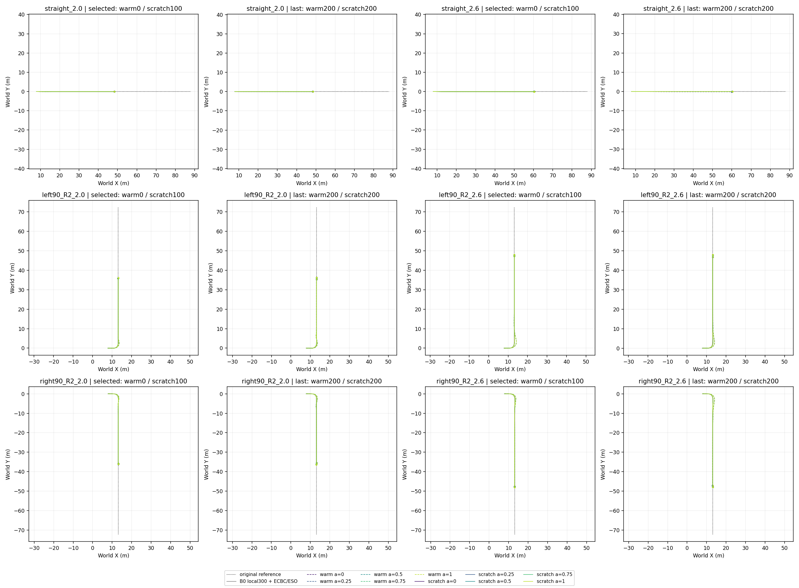
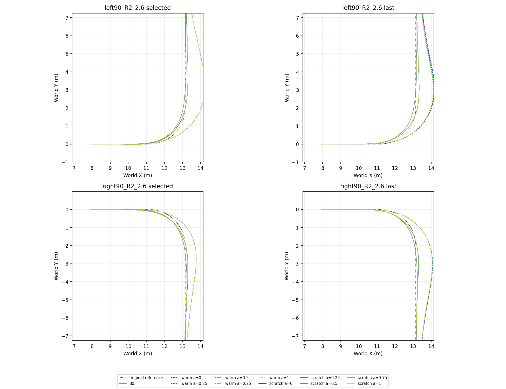
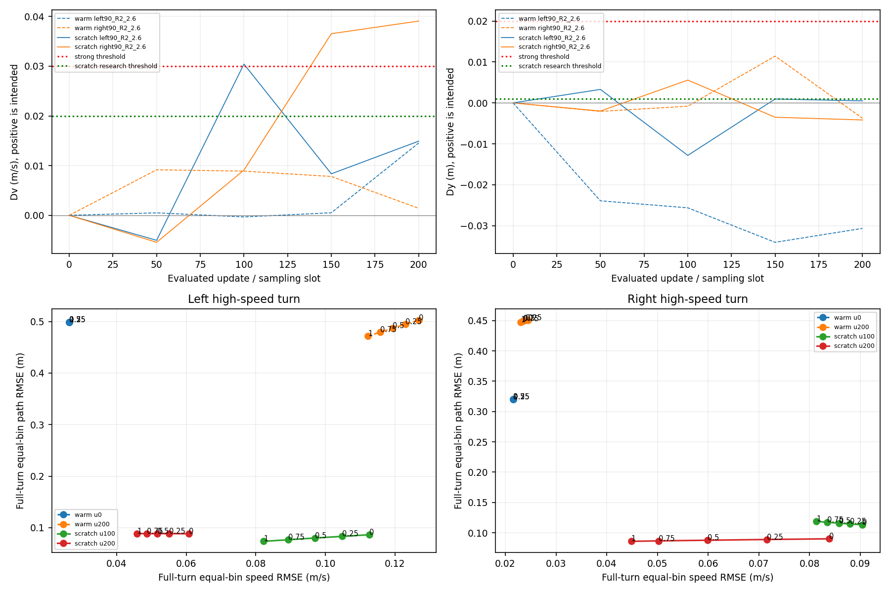

# 统一α上层：热启动与scratch结果核验（2026-10-15）





**结论：scratch已学出可辨认的α响应，整体路径跟踪优于本次α1热启动组；两组均未通过各自预先声明的偏好验收，动态α没有执行。** 当前进展支持继续诊断共享网络的条件行为，不支持宣称已实现跨左右弯一致、可实时改变的速度—路径偏好。

曲线：warm虚线、scratch实线，颜色表示α=0/.25/.5/.75/1，灰色B0为冻结local300＋ECBC/ESO，黑点线为固定原路径。selected为各自排序最佳，不能把两种排序分数直接比较。每条轨迹都在真实20秒终点停止，圆点是真实末帧；全部300条DEV策略轨迹无物理/路径域终止，没有用补零延长失败。全程图保留长出口段，局部图专门显示弯道差异。原请求恒定为场景速度2.0或2.6m/s，无额外外扰。

**运行与身份**

| 运行 | 重启后的真实语义 | 选中候选 | 末轮 | 本次结果 |
|---|---|---|---|---|
| warm：Coverage α1 Actor fold＋隐藏2/3层调制 | 从u30恢复；200个可恢复学习更新，另有8个已执行但丢失更新＋第39轮最多1批未知交互 | u0 | u200 | strong偏好失败 |
| scratch：随机Actor/Critic＋相同调制 | 从u0恢复，采样计费槽位从6接续；第200槽位对应194个可恢复更新，不是完整200个模型更新 | slot100（94个可恢复更新） | slot200（194个） | research偏好失败 |

两者同冻结local300、物理/控制时序、Coverage V2路径分布、v2奖励及主seed911401；source manifest与path_reward逐字段相同。它们同时改变初始化、α采样课程和验收/选模，且重启记账不同，仅各一个训练种子，**不是初始化单因素或多种子结论**。warm前100轮只采端点，之后40/40/20；scratch全程40/40/20。原阶段记录、丢失更新和配额不回写删除。

| 指针 | checkpoint SHA-256 |
|---|---|
| warm selected | b3e9b54ae5e420811038c48267d5a5915b73882421261ec51795720a3e180eed |
| scratch selected | 9f1f91fcc2dbc479e171b9cc0c11f947d7450793ebfa3e313d60a6ce85147bd9 |
| warm last | 411b8c11e11146ec4717510c0d4fc71dfe0cde8347adff27a6edae111d53a66d |
| scratch last | ae28c8b480dd014496d5c86c192483f371047b961483fe5a268a252fc04f107b |

末轮Torch checkpoint内部update、512路counter、25组Adam状态及scratch恢复边界计数已实读，[checkpoint核验](last_checkpoint_verification.json)明确200标签与194可恢复更新的关系。完整配置、冻结底层/source身份、全部十个DEV候选的checkpoint/Actor SHA与原始路径见[provenance.json](provenance.json)。同一候选的五个α共用一个Actor；未蒸馏、未训练底层。

**不同验收口径**

| 项 | warm strong（原方案） | scratch research（后续独立方案） |
|---|---:|---:|
| 完整弯段α0路径RMSE | ≤0.10m | ≤0.15m |
| 完整弯段α1速度RMSE | ≤0.05m/s | ≤0.10m/s |
| Dv=Ev0−Ev1 | ≥0.03m/s | ≥0.02m/s |
| Dy=Ey1−Ey0 | ≥0.02m | ≥0.001m |
| 最后保持 | 1s，每步速度/路径/航向≤.10/.10/.05 | .5s，每步≤.15/.20/.10 |
| 相邻α反向变化 | .01m/s/.01m边界参与验收 | 只作诊断 |

滚转.302rad与路径.40m均继续记录，本阶段两种偏好资格都不以它们否决。scratch研究口径较宽，不能回写成历史strong成功。两者仍均未合格。完整弯段固定s=[3,6.6415926536]m、0.5m分箱，各箱MSE等权平均后开方；所有八箱都覆盖，不仅比较共有片段。这与全20s时间RMSE、χ需求窗口RMSE是三个不同指标，表中不混用。

**端点取舍：所有评估候选**

| 运行 | 候选 | 高速弯 | Ev0 | Ev1 | Ey0 | Ey1 | Dv | Dy |
|---|---:|---|---:|---:|---:|---:|---:|---:|
| warm | 0 | 左 | 0.026349 | 0.026349 | 0.498789 | 0.498792 | 0.000001 | 0.000003 |
| warm | 0 | 右 | 0.021533 | 0.021531 | 0.320336 | 0.320340 | 0.000002 | 0.000004 |
| warm | 50 | 左 | 0.015001 | 0.014507 | 0.574615 | 0.550681 | 0.000494 | -0.023934 |
| warm | 50 | 右 | 0.173110 | 0.163958 | 0.299722 | 0.297641 | 0.009152 | -0.002081 |
| warm | 100 | 左 | 0.022126 | 0.022451 | 0.541067 | 0.515423 | -0.000325 | -0.025645 |
| warm | 100 | 右 | 0.106431 | 0.097543 | 0.285544 | 0.284735 | 0.008887 | -0.000808 |
| warm | 150 | 左 | 0.037560 | 0.037047 | 0.577092 | 0.543018 | 0.000512 | -0.034074 |
| warm | 150 | 右 | 0.061618 | 0.053802 | 0.407790 | 0.419227 | 0.007816 | 0.011437 |
| warm | 200 | 左 | 0.126834 | 0.112286 | 0.502752 | 0.472078 | 0.014548 | -0.030673 |
| warm | 200 | 右 | 0.024464 | 0.023052 | 0.450747 | 0.446996 | 0.001412 | -0.003751 |
| scratch | 0 | 左 | 0.068835 | 0.068836 | 0.140642 | 0.140643 | -0.000000 | 0.000001 |
| scratch | 0 | 右 | 0.057530 | 0.057530 | 0.116425 | 0.116425 | 0.000000 | 0.000000 |
| scratch | 50 | 左 | 0.059155 | 0.064185 | 0.126575 | 0.129871 | -0.005030 | 0.003296 |
| scratch | 50 | 右 | 0.084927 | 0.090356 | 0.122299 | 0.120312 | -0.005429 | -0.001988 |
| scratch | 100 | 左 | 0.112702 | 0.082280 | 0.086495 | 0.073663 | 0.030422 | -0.012832 |
| scratch | 100 | 右 | 0.090449 | 0.081353 | 0.113148 | 0.118719 | 0.009097 | 0.005571 |
| scratch | 150 | 左 | 0.052763 | 0.044417 | 0.091783 | 0.092738 | 0.008346 | 0.000954 |
| scratch | 150 | 右 | 0.121269 | 0.084736 | 0.082404 | 0.078895 | 0.036534 | -0.003510 |
| scratch | 200 | 左 | 0.060772 | 0.045856 | 0.088443 | 0.088935 | 0.014916 | 0.000492 |
| scratch | 200 | 右 | 0.083898 | 0.044823 | 0.089961 | 0.085790 | 0.039075 | -0.004172 |

速度单位m/s，路径单位m。均是完整原弯段分箱值；全部原值见[preference_metrics.csv](preference_metrics.csv)。

scratch末轮：左弯Dv=.014916，Dy=.000492，方向正确但均未达到research的.02/.001；右弯Dv=.039075达到速度分离，但Dy=−.004172，α1同时改善路径，未显示所要求的“保速度而路径让步”。它不是单纯超限卡住，也不能为了制造Dy而人为损害α1。scratch所选slot100左弯Dv=.030422但Dy=−.012832，右弯Dv=.009097但Dy=.005571；两个缺口分布在不同弯，选模的“缺口数”优于末轮，但不能代表末轮所有跟踪指标都差。

scratch从初始到末轮，α0完整弯段路径RMSE左.140642→.088443（约37%降低）、右.116425→.089961（约23%降低）；α1速度RMSE左.068836→.045856、右.057530→.044823。末轮端点数值已同时落在.10m/.05m/s这组旧数字以内，但这不等于通过旧χ窗口普通场景/共同门槛，更不等于通过偏好差值。

warm的selected停在u0有明确原因：u0物理/域与目标保持失败均0，高速端点失败2；u50/u100端点失败3，u150有15个严格保持失败，u200有1个严格保持失败且端点失败3。字典序优先这些项，因此不能拿u0当训练成功，也不能用末轮替换原best指针。warm初始α完全近似重叠，本身没有偏好；训练后响应变大，但方向和任务质量未同时改善。父Coverage α1源checkpoint本来就有左/右高速全20s路径RMSE .299940/.155644m，新u0约.299941/.155647m，符合继承α1速度偏置，并不是把早期α1第100轮的较好路径结果当成当前父模型。



**完整六场景、全部α的共同诊断**

| 运行/候选 | 完整回合 | 过目标 | 严格最后1s保持 | research最后.5s保持 | 最大滚转rad | 滚转>.302的条件数 | 路径>.40的条件数 | 最大横向偏差m |
|---|---:|---:|---:|---:|---:|---:|---:|
| warm 0 | 30/30 | 30/30 | 30/30 | 30/30 | 0.298563 | 0 | 15 | 1.089173 |
| warm 200 | 30/30 | 30/30 | 29/30 | 30/30 | 0.264388 | 0 | 20 | 1.038149 |
| scratch 100 | 30/30 | 30/30 | 30/30 | 30/30 | 0.298017 | 0 | 0 | 0.163404 |
| scratch 200 | 30/30 | 30/30 | 30/30 | 30/30 | 0.309247 | 2 | 0 | 0.188446 |

所有300条件的逐实验/候选/α/场景完整指标、超限时长与各有符号奖励分项总和：[condition_metrics.csv](condition_metrics.csv)。中间α并未伪造单独主任务阈值。warm150的15条保持反例也保留在该表。scratch初始严格1秒保持失败30/30、slot50失败10/30（全部高速左右弯）；slot100/150/200严格保持均30/30。它们的宽研究保持却全程通过，说明早期不能用研究通过替代严格跟踪。checkpoint_summary.csv的strict_goal_hold_failures由原始轨迹独立重算；recorded_goal_hold_failures保留原记录字段，scratch该字段与研究口径一致，不误称旧严格口径。scratch末轮峰值.309247rad并不满足旧.302界，但这不是research未过的判定项；warm偏好失败时其滚转全程反而未超.302。

**六场景诊断图**

每张图左右为selected与末轮，均含两组全部五α以及匹配B0。每步与累计reward按同α重评分比较，不能跨α拿加权回报排名运动能力。分项图含十项成本的有符号每步/累计贡献与失败尾罚；本组没有物理/域终止，因此尾罚0。控制链显示原请求→Pure Pursuit nominal→实际offset→governed参考→最终转向角速度/轮轴角速度→实测速度/转角；wheel proxy是轮速派生估计，不是速度真值。

- **straight_2.0**：[XY](straight_2.0_XY.png) · [滚转/误差/每步和累计奖励](straight_2.0_errors_rewards.png) · [每步有符号分项](straight_2.0_components.png) · [累计分项](straight_2.0_components_cumulative.png) · [完整控制链](straight_2.0_command_chain.png)
- **straight_2.6**：[XY](straight_2.6_XY.png) · [滚转/误差/每步和累计奖励](straight_2.6_errors_rewards.png) · [每步有符号分项](straight_2.6_components.png) · [累计分项](straight_2.6_components_cumulative.png) · [完整控制链](straight_2.6_command_chain.png)
- **left90_R2_2.0**：[XY](left90_R2_2.0_XY.png) · [滚转/误差/每步和累计奖励](left90_R2_2.0_errors_rewards.png) · [每步有符号分项](left90_R2_2.0_components.png) · [累计分项](left90_R2_2.0_components_cumulative.png) · [完整控制链](left90_R2_2.0_command_chain.png)
- **left90_R2_2.6**：[XY](left90_R2_2.6_XY.png) · [滚转/误差/每步和累计奖励](left90_R2_2.6_errors_rewards.png) · [每步有符号分项](left90_R2_2.6_components.png) · [累计分项](left90_R2_2.6_components_cumulative.png) · [完整控制链](left90_R2_2.6_command_chain.png)
- **right90_R2_2.0**：[XY](right90_R2_2.0_XY.png) · [滚转/误差/每步和累计奖励](right90_R2_2.0_errors_rewards.png) · [每步有符号分项](right90_R2_2.0_components.png) · [累计分项](right90_R2_2.0_components_cumulative.png) · [完整控制链](right90_R2_2.0_command_chain.png)
- **right90_R2_2.6**：[XY](right90_R2_2.6_XY.png) · [滚转/误差/每步和累计奖励](right90_R2_2.6_errors_rewards.png) · [每步有符号分项](right90_R2_2.6_components.png) · [累计分项](right90_R2_2.6_components_cumulative.png) · [完整控制链](right90_R2_2.6_command_chain.png)

**预算、性能与负例**

[training_accounting.json](training_accounting.json)逐组保存重启前后记账、丢失更新与HTTP200末reward；[training_metrics.csv](training_metrics.csv)保留已执行但丢失的日志行并用retained标记，训练图只连可恢复模型链。warm已知策略交互13,631,488，加第39轮未知65,536储备上界13,697,024，处于用户追加最多9轮授权内；scratch已知13,041,664，加未知65,536储备恰为13,107,200原预算。每组DEV均600,000lower ticks；本次分析新增物理/PPO为0，两组dynamic均not_run/0ticks，未做动态PPO。

重启后warm170批采样14803.68s/优化36.40s/DEV18561.19s，stage总33393.45s；scratch194批采样16876.22s/优化37.63s/DEV17741.12s，stage总34659.75s。阶段总耗时不冒充全历史累计墙钟。实际启用了vmap批评测、scan50、共享JAXcache和DirectCommandPPO；不能用历史加速倍数代替本次耗时。两组重启后训练物理失败均0，但路径域终止warm153/scratch198，不能把固定DEV无域失败推广成训练分布完全安全。

[TRAINING.png](TRAINING.png)显示loss/KL/reward与耗时；两组α课程不同，平均reward较高不是受控能力优越性证明。末25批均值warm−.079252/scratch−.009804，不能用单个末批−.039560/−.008452替代，更不能据此判定收敛。正式TensorBoard已重新读取各自目录的step200真实reward，warm6007/scratch6006。

**下一步建议（未执行，不追加训练）**

1. 不续训本次warm分支；保留其初始和中后期反例。保留scratch正式selected100与last200，后者作为跟踪更好的后续诊断候选，不能覆盖既有best。
2. 先按左右弯与原需求区分解速度/路径/primary/安全/offset成本和权限占比，检查当前任务中是否真的存在稳定冲突区。现有日志只有lower_observation、没有完整upper输入；若做“同状态α扫输入”，应使用完整记录/补录的真实upper观测，不能把不同α产生的不同轨迹当同状态。先区分网络条件化不足、左右不对称、共同目标可同时改善，不能仅由未达差值宣布奖励可靠或失效。
3. 后续另行声明有界诊断/训练预算与验收，再决定采样困难段或条件优化；实时α仍未验证，本次不绕过固定资格门槛去自动跑动态六回合，也不事后放宽本次阈值。单训练种子和已用于选模的六场景DEV不支持泛化/论文安全保证。

**精简文件与复现**

本包仅PNG、必要CSV/JSON、可复算脚本和一个无损轻量NPZ；无模型/Adam/缓存/完整训练日志，无PDF/重复ZIP。NPZ保留selected与last两组共120条件的每个实际5ms采样：XY、原请求/真实速度、路径/航向误差、进度、滚转、实测转角、wheel proxy与逐步总reward，以及原路径和同α重评分B0。它不冒充完整闭环快照；所有原始含分项/控制链NPZ均留服务器，路径在[reward_audit.csv](reward_audit.csv)。[curve_data.npz](curve_data.npz)中key含运行/u/α/场景，provenance与图例可一一定位。

验证覆盖两组×5候选×5α×6场景=300原始轨迹、1,200,000实际lower采样；全部时间/失败终点、α、路径与匹配B0通过，逐项cap/失败尾罚由冻结配置独立NumPy重建；每步总reward最大误差9.89e−8。200次完整弯段分箱复算，其中100个高速条件与原记录逐值核对。[verification.json](verification.json)和[reward_audit.csv](reward_audit.csv)为数值收据；图、Markdown链接与文件完整性另见[package_validation.json](package_validation.json)。

在具有原冻结运行目录的服务器上执行：

```sh
OMP_NUM_THREADS=2 MKL_NUM_THREADS=2 JAX_PLATFORMS=cpu PYTHONPATH=learning/src /home/qy/mujoco_playground/.venv/bin/python docs/evidence/alpha_unified_results_20261015/build_analysis.py --workspace /home/qy/STTW_CONTROL
/home/qy/mujoco_playground/.venv/bin/python docs/evidence/alpha_unified_results_20261015/summarize_training.py
```

两个脚本只读既有模型身份/日志/NPZ，不启动仿真或优化。来源运行代码warm b0ae710、scratch恢复5888a9e；本包源Git提交由远端交付记录标明。
