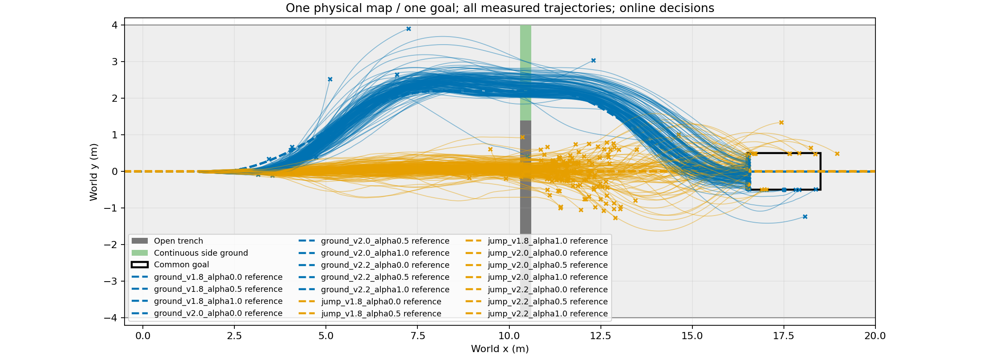
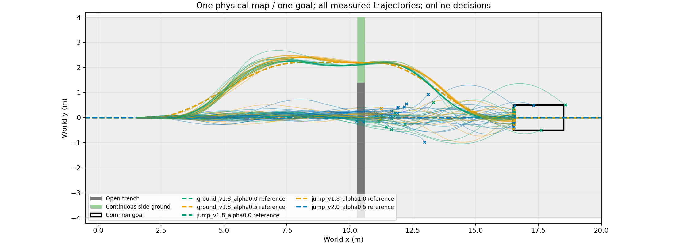
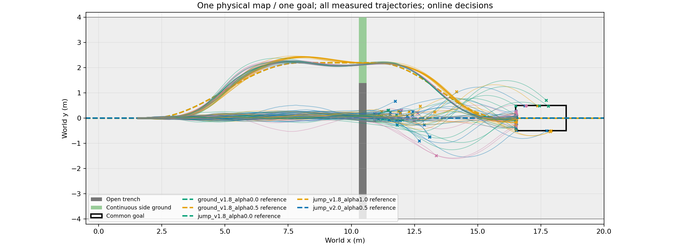

# 路线、接近速度与alpha联合候选的真实执行

实线：蓝色轮行绕行、橙色跳跃；虚线为参考。圆点为合格目标，叉为实际失败终点。

候选不是预设完整场景ID：同一物理地图、同一目标，重复使用两条道路；每条道路组合速度1.8/2.0/2.2m/s与alpha0/.5/1，形成18个可实际发布的接近方案。车辆从公共直路持续行驶，在x1.8m发布；保留控制历史与原始物理状态。跳跃后固定回交1.5m/s、alpha.5的STTW，轮行绕行全程沿所选参数。

## 实际覆盖与训练

24个根初态×18候选=432条，16TRAIN/4DEV/4TEST完整初态分组，环境排列预先打乱；116.27秒、1728000物理环境步。全部432条正常发布，0PPO技能训练。以下是完整共同任务到目标且未越廊的计数；不是模型预测分数。

|候选|TRAIN/16|DEV/4|TEST/4|
|---|---:|---:|---:|
|ground_v1.8_alpha0.0|15|3|4|
|ground_v1.8_alpha0.5|16|4|4|
|ground_v1.8_alpha1.0|16|4|3|
|ground_v2.0_alpha0.0|14|3|4|
|ground_v2.0_alpha0.5|15|4|3|
|ground_v2.0_alpha1.0|9|3|4|
|ground_v2.2_alpha0.0|13|2|2|
|ground_v2.2_alpha0.5|8|3|2|
|ground_v2.2_alpha1.0|0|1|0|
|jump_v1.8_alpha0.0|3|2|0|
|jump_v1.8_alpha0.5|6|1|2|
|jump_v1.8_alpha1.0|7|1|2|
|jump_v2.0_alpha0.0|3|0|1|
|jump_v2.0_alpha0.5|2|0|0|
|jump_v2.0_alpha1.0|3|0|2|
|jump_v2.2_alpha0.0|1|1|0|
|jump_v2.2_alpha0.5|2|0|0|
|jump_v2.2_alpha1.0|3|0|0|

TRAIN排序并列取最先：绕行为1.8m/s、alpha.5，跳跃为1.8m/s、alpha1。固定绕行已经覆盖全部24个初态的已观察可完成范围；不通过人为罚绕行来制造模型优势。不同速度／alpha对任务结果有实际影响，但此为单地图、单训练技能的探索性面板，克隆物理差异仍存在，不作单因素因果或泛化证明。

使用全部432条实际发布片段训练18候选事件模型；0.5秒因果前缀、相同完整根分组、地面高度先验、600次CPU更新、DEV每100次评一次，选600，耗时3.60秒（不含仿真）。新PPO训练为0；heading125/H75未更新。直接整程成败模型复用同样状态历史编码、地形与参数，独立BCE目标，600次CPU更新，作为对照。

## 首次在线接线（独立16新初态、96条）

实线：蓝色原始直跳、橙色TRAIN规则、绿色事件模型；虚线为所选候选参考。

|决策位置|原始直跳2m/s alpha.5|TRAIN固定规则|事件模型|
|---|---:|---:|---:|
|x1.8m|8/16|16/16|15/16|
|x6m|7/16|6/16|2/16|

早段模型全部选1.8m/s、alpha0绕行；晚段绕行不再满足原道路连接，模型全部改选1.8m/s、alpha0直跳。TRAIN规则使用1.8m/s、alpha.5绕行和1.8m/s、alpha1跳跃。事件模型17/32、规则22/32、原始直跳15/32，没有超过规则。没有据此修改或重新调模型。

核对实际在线日志20673个有效地面控制步：请求速度与alpha均对应实际选择候选，错配为0；这证明指令接通，不代表速度跟踪无误差。首次接地后按声明恢复固定STTW指令。18候选事件查询平均15.4–16.1ms，全部仍在一个20ms控制周期后发布，期间真实前进。

所有初态的XY、每步/累计奖励及实际速度：[432条索引](/media/qy/6A7E3DB07E3D75C3/STTW_runs/chapter3_jump_or_detour/action_collection/plots/README.md)；[首轮96条索引](/media/qy/6A7E3DB07E3D75C3/STTW_runs/chapter3_jump_or_detour/action_online/plots/README.md)。逐条计数见[counts.json](counts.json)、[first_online_results.json](first_online_results.json)。同数据四方法最终对照单独列于下节，不与此前不同初态拼成一个成功率。

## 同数据四方法最终对照（另16新初态、128条）

实线：蓝色原始直跳、橙色TRAIN规则、绿色直接成败、紫色事件模型；虚线为候选参考。

冻结上述两模型，seed20261122，2位置×4方法，空间排列打乱；耗时87.59秒、512000物理环境步。TRAIN规则只用原16个TRAIN根选参数，未按这批结果调整；任务、物理、道路与目标保持不变。

|查询x/m|原始直跳|TRAIN规则|直接成败|事件模型|
|---|---:|---:|---:|---:|
|1.8|4/16|16/16|16/16|16/16|
|6.0|3/16|6/16|2/16|5/16|
|两种位置合计|7/32|22/32|18/32|21/32|

两种学习方法在全部32个条件中选择完全相同：早段1.8m/s、alpha0绕行，晚段1.8m/s、alpha0跳跃。21与18的差别来自同方案执行差异，不能归因于世界模型比成功分类器更会决策。事件模型也没有超过TRAIN固定规则22/32。32是16个初态的两种查询位置，不是32个独立随机初态。

平均查询：事件模型15.3–15.4ms，直接分类器约1.15ms，规则约0.76–0.78ms；所有发布均计入至少20ms旧控制实际执行。事件模型当前额外预测开销没有形成额外选路收益。本次只验证动作参数已经进入真实执行链；不采用为世界模型方法优势，不再扩大这批测试或调参。

[最终全部逐初态XY与奖励](/media/qy/6A7E3DB07E3D75C3/STTW_runs/chapter3_jump_or_detour/action_baselines/plots/README.md)；[逐条结果](final_online_results.json)。完整物理数据在`action_baselines/evaluation/trajectories.npz`；前两批分别在`action_collection`和`action_online`，禁止混合初态分母或只选最好视频。
