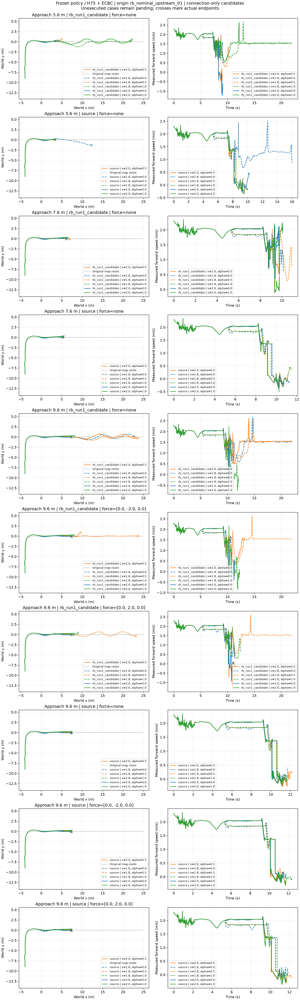

# 适配后完整接近与外扰面板

两策略各25更新后冻结。60评测槽位：12复用、48新增，全部完成；同一上游根，非独立TEST，0新增训练。

|条件|source25|RB25|
|---|---|---|
|5.6m无扰|0/6|1/6|
|7.6m无扰|0/6|0/6|
|9.6m无扰|0/6|3/6|
|9.6m Fy=-2N，0.12s|0/6|1/6|
|9.6m Fy=+2N，0.12s|0/6|1/6|

RB25成功档：短段2/alpha1；长无扰1.8/0、1.8/.5、2/.5；两外扰均仅1.8/.5。完成要求包含落台、交回与继续行驶，不是存活。30配对为仅RB成功6、皆失败24；RB成功接近交换给source25仍失败，source没有可反向交换的成功档。

支持同预算适配后的工程差异，不证明原论文RB恢复教学的因果优势或独立初态泛化；中距离全败保留，不假设距离越长必然更好。不追加训练。

下一步：预划分train前六根，在5.6m同六档配对update2/RB25，共72条，最多633600物理步，0训练，400/200/50Hz。上游失败保留，不替换根、不看TEST。两工程策略训练史不同，单列工程性能。数据盘chapter3_short_approach_skill_roots/manifest.json保存全部配置。

当前逐条配置、失败终点、原始数据路径见all_cases.json、summary.json和paired_summary.json；原始NPZ/命令/接触保留在各run目录。
