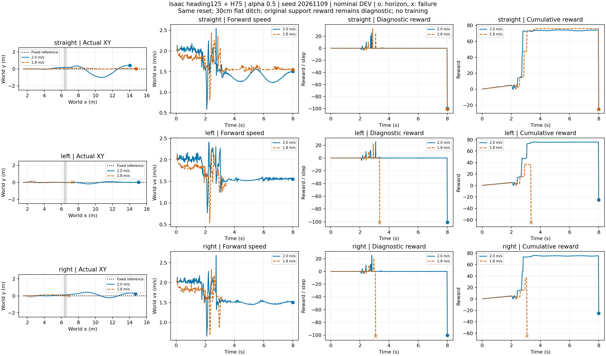

# Isaac 弯道接近—跨沟—STTW接续

同起点x1.5/vx2，固定heading125与H75，α0.5，seed20261109；同高平面30cm沟位于6.3～6.6m。左右路线是x1.5～3.5m内±15cm偏移双弯，不是90°弯。真实STTW行至x≥5再跳跃，不恢复快照；捕获stage3直接回交，无连续支撑保持前置。零训练，六条名义DEV。

|来路/请求速度|回交时间(s)|终止时间(s)|结果|终点横偏(m)|全程最大绝对y(m)|
|---|---:|---:|---|---:|---:|
|straight_v20|2.8000000000000003|8.00|续行至窗口末端|0.400|0.992|
|straight_v18|3.08|8.00|续行至窗口末端|0.027|0.089|
|left_v20|3.08|8.00|续行至窗口末端|0.014|0.180|
|left_v18|—|3.36|侧倾超限，未回交|0.011|0.020|
|right_v20|2.82|8.00|续行至窗口末端|0.254|0.423|
|right_v18|—|3.08|俯仰超限，未回交|0.008|0.127|

4条完成交接并续行至8秒；左右双弯的1.8m/s两条清沟stage2后姿态超限。这说明降低请求速度并不必然改善落地接续，尚不能归因于某个单独动力学量。直道2m/s虽续行，但横向摆动明显，不能称跟踪合格。

原支撑评分全部false：续行组累计−25、失败组−65；仅保留为原评分诊断，不将其作为当前接续判据。无新增独立ECBC基线，本批比较固定同一地面/跳跃栈的路线和速度候选。奖励未平滑，累计自首实际步求和，失败后不补齐。圆点为窗口结束、叉号为真实失败。

尚无共同目标区/完整道路约束的预定义验收，不将4/6写成任务成功率；无世界模型选档、绕行或泛化收益证明。下一步先声明共同终点及道路边界，再基于这些真实接近和落地记录构建预测输入。

原始记录：`/media/qy/6A7E3DB07E3D75C3/STTW_runs/chapter3_bend_approach`。`analyze.py`从六条原NPZ生成图，`plot_data.npz`保留全量绘图数据，`summary.json`含真实跳跃入口状态。运行服务退出码0，六份status均completed，日志未检出Traceback/CUDA error/PhysX error。

## 接触事件标签核验

复用原物理频率记录，无新仿真。两条失败样本均清沟且已有远岸接触：左1.8首次远岸接触2.8875s、清沟2.9175s、3.36s侧倾失败；右1.8对应2.8900s、2.9450s、3.08s俯仰失败。两者均未捕获/回交，不把缺失事件补成成功。首次前轮远岸接触可早于双轮完全清沟，因此事件不能强制套入单一顺序。

`learning/cli/export_ditch_events.py`导出物理步事件状态、关节、接触模式和原策略观测；[事件清单](event_manifest.json)保存全部6条及缺失事件。已逐条核对入口物理状态、时间单调性、失败事件掩码。源physical()根姿态是xyzw，物理记录是wxyz，导出字段分别明确，转换后六条入口状态一致。

数据盘 `events_checked` 是核验后的导出；初版 `events` 已标记被替代。事件时间分辨率2.5ms，起飞标签为原判据确认的腾空尝试，不是未经去抖的首次失去支撑。接触模式是载荷标签，不冒充完整物理阶段。所有候选归为同一起点组，禁止按相邻帧随机分训练/测试。缺完整ESO/滤波器隐藏状态与局部高程裁剪，当前是标签接口数据，不是已完成的世界模型训练集。
