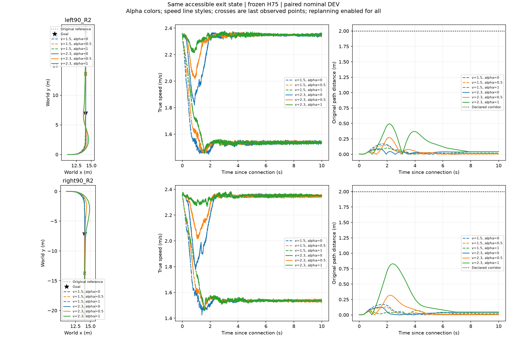
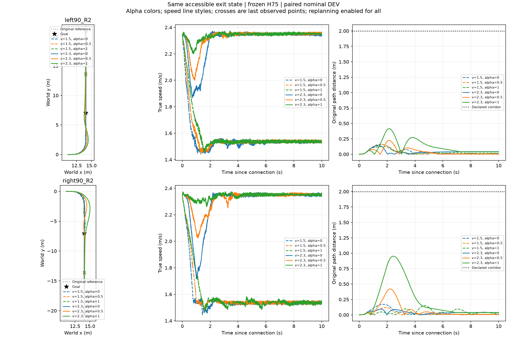

# 第三章6候选：正反出口配对数据与部署规则一致性

复用真实闭环记录，无新增仿真或RL。两种上游origin × 左/右任务 × 六候选 = 24条；所有候选均启用重规划。按完整origin留出，其全部候选/分支均不得进入该折训练证据。仅探索性DEV，不是独立TEST。

本次修复离线评价与在线ContinuousTask的选择差异：统一要求已知支持且预测完成概率≥0.7；在最大概率0.05范围内选择成功条件耗时最低方案。已知但无可行候选与无支持的unknown分开报告。核密度支持不等于置信度，概率尚未校准。

|比较|完整任务|成功条件平均到达时间|
|---|---:|---:|
|留一origin能力选择|4/4|3.300 s|
|固定2.3m/s、alpha=.5|4/4|3.295 s|
|每个其他固定候选|均4/4|详见evaluation.json|

24条均成功导致Brier=0；这是全正例数据上的结果，不证明失败预测、校准或泛化能力。目前没有优于固定候选的证据。任务完整性还要求全窗口存活和原走廊约束，到达时间只是成功后的效率指标。

代码：`empirical_capability.select_connection_estimate`供在线和离线共同使用。7个unittest通过；ContinuousTask前4项物理证据/未知状态/封路/任务修订测试通过。剩余原pytest用例因当前mjp环境缺少pytest未执行，不将它计入通过数量。

文件：records.jsonl为实际24条摘要，config.json为冻结特征尺度，evaluation.json为分折结果。原轨迹路径在records中保留；本包复用XY图而非重跑。后续需要具有明显不同残余动态及成功/失败差异的实际出口，再比较6与36候选；不继续用这些全成功数据声称评价器已充分验证。大模型暂停。
