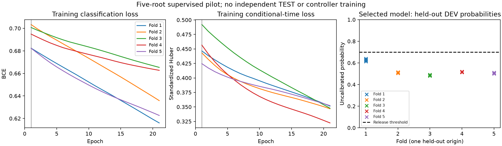
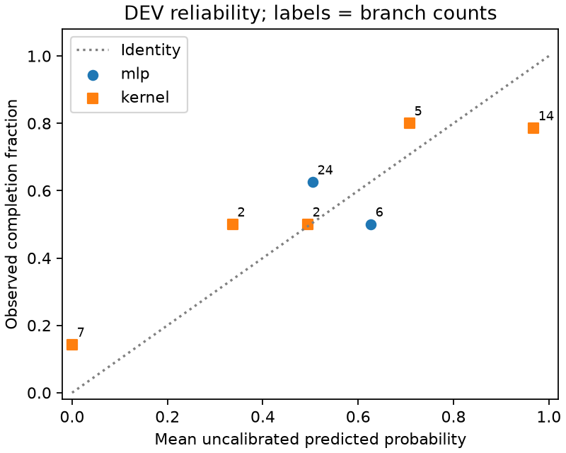
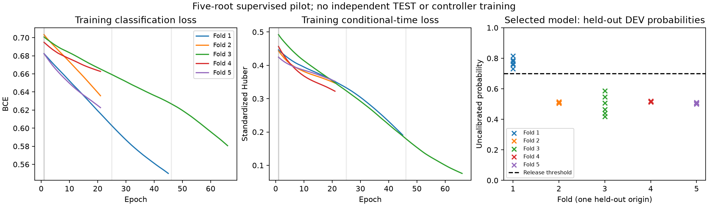

# 接续评价器监督学习开发先导

先看实际/参考 XY：[两新增根 C6](../chapter3_jump_midpoint_20261106/hold_baselines/summary.json)、[中点候选轨迹](../chapter3_jump_midpoint_20261106/xy_candidates.png)。本次仅复用既有分支终局，无新增物理仿真，不修改 H75、底层或跳跃策略。



## 结果与采用决定

| 方法 | 完整完成 / 留出根 | 主动选档 | 主动选档失败 |
|---|---:|---:|---:|
| MLP 加原指令回退 | 4/5 | 0/5 | 0/0（不适用） |
| 同输入高斯核 | 4/5 | 5/5 | 1/5 |
| 调参根选定固定档 | 5/5 | 5/5 | 0/5 |

MLP 五折全部保留第 1 轮模型，最高候选概率为 0.491–0.639，均未过冻结的 0.70 门槛。全部回退到实际原指令 2.0 m/s、α=.5，4/5 不能算作网络主动选择带来的效果。五折调参选档从未变化，离散选档指标形成平台；每折运行21轮后触发20轮无改进停止，共105个优化步。训练分类/时间损失仍下降，因此不声称收敛，更不据此否定 MLP 的一般适用性。

本试验不采用 MLP 上线，不调整门槛以制造放行。当前简单核方法继续作为基线；正式训练需要更多独立根，选模同时报告概率质量，避免把回退结果平台解释为模型已经学好。该修正尚未重训。

## 冻结配置与证据范围

36记录来自6个代表根；旧名义根6条缺完整可观测输入，保留排除清单，不补造。有效30分支来自5根。每折3根18分支训练、1根6分支调参、1根6分支留出开发评价；分支不是独立根，各折共享训练数据，不是独立 TEST。

25输入（23可观测状态＋速度/α），64 ReLU→64 ReLU→成功logit与条件时间两个输出。Adam .001，CPU2线程，实际全批18；BCE全部分支均值＋成功分支标准化时间Huber均值，权重1:1。标准化仅用训练根。上限100轮，选档真实完成优先、时间次之，20轮无改进停止。候选1.8/2.0×α0/.5/1；p≥.7，概率容差.05、时间容差.1s，支持度沿用冻结核配置。未经概率校准，未触及正式120根的独立测试集。

`results.json` 含逐根选择、预测和配置；`diagnostics.json` 含 Brier 与成功条件时间误差；`fold*_training.json` 是全部真实训练历史，loss为更新前、选模为更新后。`records.jsonl` 保留身份/终局/源路径，`source_identity.json` 标识实现。权重仅在数据盘原运行目录，不入Git。原物理为400/200/50Hz，带摆5.091kg模型、update2冻结技能，身份见逐记录；本次不是控制器PPO训练。

复算：
```bash
PYTHONPATH=learning/src python learning/cli/summarize_connection_predictor.py \
  --run docs/evidence/chapter3_connection_predictor_20261106 \
  --records docs/evidence/chapter3_connection_predictor_20261106/records.jsonl
```
复算仅刷新派生图和诊断，不重新训练，不改原结果。

## 概率质量与共同成功耗时



按五个留出DEV根的30条候选记录复算：MLP Brier=0.250807，核=0.191674（越低越好）。两者均有30/30候选得到支持，但“有支持”不等于过风险门槛；MLP没有主动放行。固定等宽五箱及空箱计数完整保存在 `prediction_quality.json`。候选同根相关，各折训练数据也重叠，不提供把30分支当独立样本的置信区间，不声称已完成概率校准。

与调参固定档共同成功的4根中，MLP实际回退策略耗时差为0、−1.20、0、−0.14秒，核为+.04、−1.00、+1.54、−.14秒（正值更慢）。两个方法均丢失固定档成功的另1根，不能只用共同成功耗时宣称整体更好。逐根选择的完整检查项、原始差值及根ID保存在 `prediction_quality.json`，不以最终到达代替走廊和全任务条件。

## 选模同分判据修正：仍不采用 MLP



新增可选 `--brier-tiebreak`：调参实际完成率、成功耗时仍为前两级，完全同分时才比较全部候选 Brier。默认关闭，原先导可按原规则复现。未改输入、结构、优化器、分组、支持度、放行门槛或控制策略。

五折分别执行45/21/66/21/21轮，共174步；入选25/1/46/1/1轮。MLP仍4/5，其中4次回退、1次主动放行；主动放行root000选2/.5且失败。核4/5，调参固定5/5，整体排序未变。留出DEV Brier为.269300，比原先导.250807更高，不能以训练拟合改善宣称预测能力提升。

这不是独立验证：修正规则由已看过的先导局限触发，五根结果应标为自适应DEV。保留原105步试验及新174步试验的全部历史、选档与失败，不挑最好折重新拼模型。本阶段不采用MLP，不再针对这五根加轮次或调门槛；后续使用新采集根检验实际任务收益。权重仅保存在数据盘 `chapter3_c6_predictor_pilot/five_fold_brier_tie`，未入Git。控制器RL与物理仿真均0新增。
