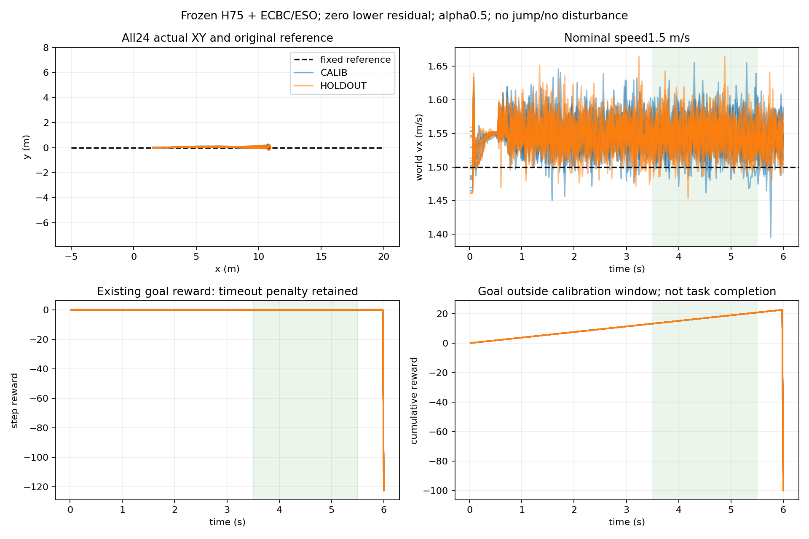

# Nominal continuation calibration

24 ground starts;12CALIB/12HOLDOUT, 42.05s wall time, 57600 physical lane steps,0training.

Envelope adopted: **True**. Full-window envelope coverage: CALIB 12/12; HOLDOUT 11/12. Ground-contact recorded in 24/24 lanes.

|Feature|Absolute bound|
|---|---|
|roll_rad|0.0677412|
|pitch_rad|0.0174533|
|yaw_rad|0.268831|
|world_y_m|0.154724|
|vx_error_m_s|0.186124|

Window3.5–5.5s; limits=max(predeclared floor,1.2×CALIB-window maximum). Holdout does not change limits. Straight world-y/heading metrics cannot be used as curved-road errors. These limits describe ordinary dynamic motion, not static support or a certified recoverable set.

Nominal empirical reference envelope only; no recovery-domain or safety claim. Contact presence checked; raw peak buffer occupancy not exported. Holdout used for coverage report, not threshold fitting.

All original episode terminal codes and failed conditions remain in envelope.json. Horizon goal failure is distinct from a fully observed continuation window. No historical task success labels are rewritten.

|Lane|Role|Full window|Inside|Progress(m)|End code|
|---|---|---|---|---|---|
|0|CALIB|True|True|3.103|9|
|1|CALIB|True|True|3.093|9|
|2|CALIB|True|True|3.092|9|
|3|CALIB|True|True|3.101|9|
|4|CALIB|True|True|3.076|9|
|5|CALIB|True|True|3.108|9|
|6|CALIB|True|True|3.088|9|
|7|CALIB|True|True|3.092|9|
|8|CALIB|True|True|3.085|9|
|9|CALIB|True|True|3.101|9|
|10|CALIB|True|True|3.094|9|
|11|CALIB|True|True|3.094|9|
|12|HOLDOUT|True|True|3.094|9|
|13|HOLDOUT|True|True|3.090|9|
|14|HOLDOUT|True|True|3.102|9|
|15|HOLDOUT|True|True|3.101|9|
|16|HOLDOUT|True|True|3.096|9|
|17|HOLDOUT|True|True|3.098|9|
|18|HOLDOUT|True|True|3.101|9|
|19|HOLDOUT|True|True|3.106|9|
|20|HOLDOUT|True|True|3.105|9|
|21|HOLDOUT|True|False|3.096|9|
|22|HOLDOUT|True|True|3.088|9|
|23|HOLDOUT|True|True|3.088|9|

原始记录：`/media/qy/6A7E3DB07E3D75C3/STTW_runs/chapter3_continuation_calibration/batch`。24条均完整6秒、无越廊；3.5–5.5秒前进3.076–3.108米。留出lane21横偏达到包络的1.04566倍，其余特征在内；不据此放大阈值。侧倾3.881°、俯仰1°、航向15.403°、横偏0.15472m、速度误差0.18612m/s。仅作为直道名义参考，不直接当弯道捕获判据。

姿态按原`TorchPendulumObservation.privileged`乘资产安装旋转，避免将车体root的90度安装角误作侧倾；24个初始侧倾与声明值最大误差2.05e-7rad。无物理参数或在线终止判据变更。

启动阶段出现3次配置接口错误（网格布局、路径bank维度），在进入物理评测前退出；日志保留于父目录的run.log、nominal/run.log、ground/run.log。成功批次为batch，不用失败启动计算任务完成率。接触模式24/24存在；未导出原始接触缓冲峰值，不声称全面通过接触容量验证。
