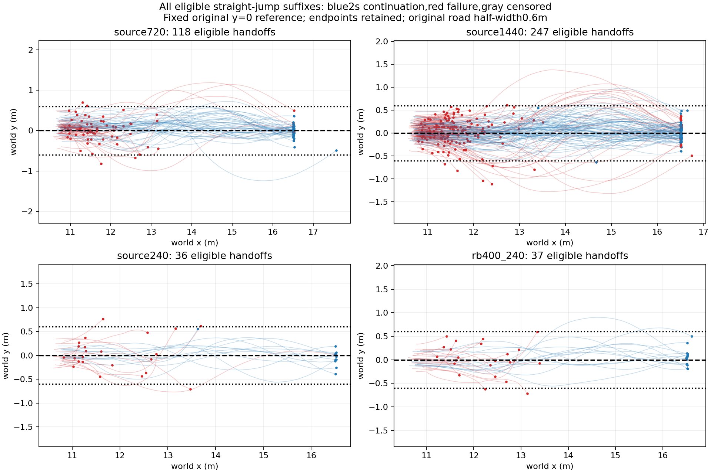

# Frozen-envelope retrospective handoff labels

No new physics or training. Straight-jump subset only; not a replacement for full-task denominators. Nominal-envelope entry is not yet validated capture.

|Dataset|Eligible|Original goal|Envelope held|Continue2s|Fail2s|Censored|Held then fail2s|
|---|---:|---:|---:|---:|---:|---:|---:|
|source720|118|44|11|46|72|0|0|
|source1440|247|71|20|79|168|0|0|
|source240|36|11|3|12|24|0|0|
|rb400_240|37|12|2|14|23|0|0|

Full exclusions and per-source labels: labels.json. Criteria were fixed in declaration.json before label evaluation. Nominal calibration was separate from these jump outcomes, but this is retrospective analysis of previously inspected data, not independent TEST. Early goals without2s observation are censored for2s continuation while retaining original_success=true.

The nominal envelope achieved11/12 coverage on its own holdout; absence of envelope entry must not be called physically unrecoverable. Perturbation margins and rescuability need matched physical branching. Root-only snapshots are not used.

## Interpretation and adoption

The nominal envelope is not adopted as a necessary capture condition. In source720,11 of46 observed2s continuations entered and held the envelope within1s; in source1440,20 of79 did so. All envelope-entering cases continued2s in these inspected subsets, but many continuations never satisfied the envelope criterion. These are descriptive associations, not an independent predictive validation. Failing to enter the envelope cannot label a physical capture failure.

Adopt the directly observed2s continuation outcome as an initial downstream prediction target, retaining full-task outcomes separately. Keep nominal-envelope entry as an auxiliary descriptor. No rescuability or disturbance margin labels exist yet. Source/RB eligible counts differ, so12/36 versus14/37 is not a same-state causal improvement claim.
