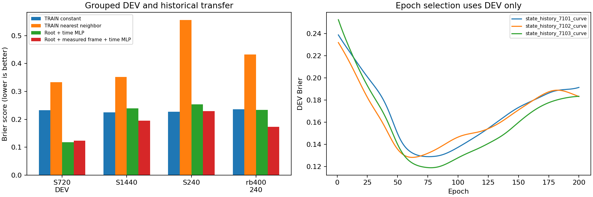
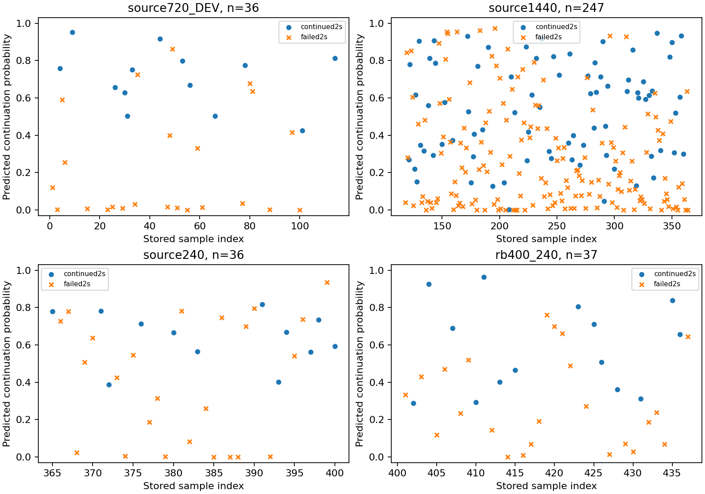

# Downstream handoff continuation predictor

Actual/reference XY for every included source: [frozen label evidence](../chapter3_continuation_labels/RESULTS.md).

|Data role|N|Continued2s|Constant|Nearest neighbor|Root+time|Measured frame+root+time|
|---|---:|---:|---:|---:|---:|---:|
|source720_TRAIN|82|33|0.24048|0.00000|0.08396|0.10494|
|source720_DEV|36|13|0.23242|0.33333|0.11742|0.12376|
|source1440|247|79|0.22436|0.35223|0.23948|0.19509|
|source240|36|12|0.22700|0.55556|0.25350|0.22978|
|rb400_240|37|14|0.23579|0.43243|0.23335|0.17277|

CPU elapsed 4.446s; three seeds per MLP,200 epochs each.82 samples from roots0–7 TRAIN;36 from roots8–11 DEV. DEV selects epochs, so its scores are selection-biased. Other collections are previously inspected historical transfer, not new independent TEST.

Input39: exact13D handoff root, latest25D measured frame already available before the switching step, physical time1. The frame contains measured gravity/gyro/acceleration, steering/pendulum positions and rates, wheel rates and prior-action context. The field name state_history denotes this compact measured-frame model, not a complete controller-history snapshot. H75 uses the fixed cold reset; no unknown controller state is claimed reconstructed. Root/frame are sampled at the same declared switch boundary; maximum root alignment error0. Input dimension and weights are frozen in saved checkpoints.

Target: observed2s continuation, not full goal. BCE,64/32SiLU MLP,Adam lr.001/weight_decay.0001,TRAIN-only normalization; average three seeded predictions. Per-member disagreement is uncalibrated, not a physical margin. Nearest-neighbor TRAIN score0 is resubstitution, not generalization evidence. All routes here are straight, so a route-only table collapses to the TRAIN constant.

The measured-frame model improves over the constant on DEV,source1440 and RB historical transfers, but is slightly worse on source240. Root-only is slightly better on DEV and worse on these transfer batches. This supports retaining the richer measured input as a candidate, not claiming universal benefit, recovery-domain certification or planning superiority. RB was not used to fit or select this source-trained model.

No upstream handoff-distribution model or online integration is completed by this experiment. Next: fit the upstream model including missing/invalid handoffs,then test composition under the same fixed interface context before new layouts. Saved .pt files and raw arrays stay in the run directory; inference wrapper is learning/src/sttw_control/handoff_model.py.

Raw data, predictions and all six selected checkpoints: /media/qy/6A7E3DB07E3D75C3/STTW_runs/chapter3_continuation_model. Inference reloading matched stored438 probabilities to max1.20e-7. TensorBoard http://localhost:6014 (6006 belongs to existing H75 service).
