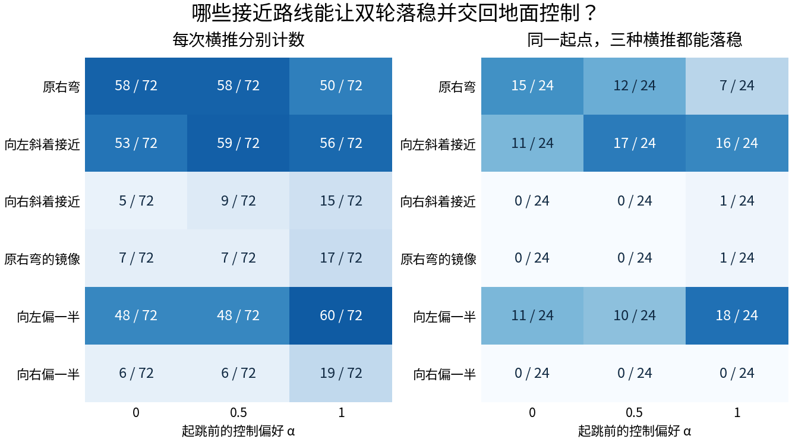

# P0-B 开发实验：改变起跳路线和落地出口各有多少作用

[同一起点的左右门实跑 XY](root1174_shared_entry_xy.png) · [图中两道门的全部 108 条分支](root1174_shared_entry_sources.csv) · [两张开发图全部 24 个起点和 9,072 条轨迹](/media/qy/6A7E3DB07E3D75C3/STTW_runs/chapter3_continuous_p0b_20261123/analysis/xy/index.html)

车必须越过 0.16 m 台阶，落地后通过指定门、在目标区保持 0.5 s，全程避墙。两张新开发地图各用 12 个不同起点。每个起点有三种横推、两种门距离和两个门向，合计每种方法 288 项任务。每个跳前选择必须应对三种事先未知的推力。四批物理仿真运行了 1,296 组跳前条件，每组七个出口分支，共 9,072 条轨迹。

## 同一落地规划器，扩大跳前选择

比较五种旧入口与包含它们在内的十八种入口，落地后使用相同的连续滚动出口。入口按每个起点和门分别选出在三种推力下合计表现最好的一条。它度量有限路线库提供的机会；车上自动选中路线属于下一阶段。

| 起点 | 已确定增加的完整任务 |
|---|---|
| 右偏墙 1174 | 远右门 1、远左门 2、近右门 2 |
| 错位双墙 1184 | 远左门 1、近右门 1 |
| 错位双墙 1191 | 远右门 1、近左门 1 |
| 错位双墙 1193 | 远左门 1、近右门 2 |

原定逐字节配对标准确认 1,086/1,296 组。余下 210 组的未知结果全部保留时，扩大入口多完成 12 至 160 项，下界为 4.17 个百分点。七条车都在接管前终止且未执行出口的 136 组，如果以实际归档起跳过程为对象，均无法完成任务。以此补充信息计分，范围为 18 至 87 项，下界为 6.25 个百分点。这两行是给定物理证据的范围。按起点抽样的统计不确定性另计。[逐任务范围](/media/qy/6A7E3DB07E3D75C3/STTW_runs/chapter3_continuous_p0b_20261123/analysis/partial_identification/shared_entry_bounds_by_root_gate.csv) · [全体与分图结果](/media/qy/6A7E3DB07E3D75C3/STTW_runs/chapter3_continuous_p0b_20261123/analysis/partial_identification/shared_entry_bounds.csv)

### 落地接管状态复核

对原检查留下的 210 组，按真实记录复核七个分支。136 组均未复锁且没有出口执行，69 组在出口开始时的车辆与控制状态相同，余下 5 组保留未知。按这项补充分析，固定滚动出口时，扩展入口比旧库实际多提供 **37–40 个可完成任务，占 288 项的 12.85–13.89 个百分点**，净增加的下界涉及 15/24 个起点。右偏墙多 15–16/144 项，错位双墙多 22–24/144 项。沿用旧出口时，扩展入口多 39–43/288 项。该批支持继续研究跳前选路；自动选路的收益须在新的测试起点测量。[原始接管状态审计](/media/qy/6A7E3DB07E3D75C3/STTW_runs/chapter3_continuous_p0b_20261123/analysis/branch_parity) · [补充逐起点结果](/media/qy/6A7E3DB07E3D75C3/STTW_runs/chapter3_continuous_p0b_20261123/analysis/secondary_partial_identification/shared_entry_bounds_by_root_gate.csv)

以每张图的 12 个起点为一组，各自按起点重抽 10,000 次，每个起点保留四道门和三档推力。两图合并后，增益下端点的 95% 百分位区间为 [8.32, 18.06] 个百分点，上端点为 [9.03, 19.44]。该统计固定这两张开发地图。[逐起点增益](/media/qy/6A7E3DB07E3D75C3/STTW_runs/chapter3_continuous_p0b_20261123/analysis/secondary_partial_identification/shared_entry_bounds_by_root_gate.csv)

### 哪些路线能让车落稳

每种路线与控制偏好覆盖 24 个起点，各测 −5、0、+5 N 三种横推。按时序核对的跳跃交接与七个分支各自记录的交接全部吻合，同一个跳跃只计一次。18 种选择共 581/1,296 次完成交接。图右逐起点检查三种横推，左偏半幅、α=1 在 18/24 个起点三次都落稳；右偏半幅、α=1 虽有 19/72 次落稳，分别分布在一部分扰动条件，三次都落稳的起点为 0/24。开发这些入口时应让跳前选择器看到失败，并按未知横推检验；右侧在本批能够落稳，也保留在训练和测试中。过门与最后保持继续单独计分。[逐路线原始计数](/media/qy/6A7E3DB07E3D75C3/STTW_runs/chapter3_continuous_p0b_20261123/analysis/verified_entry_ranges.csv)

## 固定起跳入口，只换落地出口

车按给定门向选择预设入口。下表使用通过原配对标准的全部 236 个合同，涵盖滚动规划全否决时实际执行的默认路线。

| 门向 | 旧出口完成 | 滚动出口完成 | 旧出口碰墙 | 滚动出口碰墙 |
|---|---:|---:|---:|---:|
| 右，110 项 | 35 | 12 | 27 | 37 |
| 左，126 项 | 37 | 20 | 30 | 31 |
| 合计，236 项 | 72 | 32 | 57 | 68 |

滚动出口救回 9 项，丢失 49 项，净少完成 40 项；新增 18 次碰墙，避免 7 次。49 项丢失的终点为跟踪越域 28、撞墙 11、到达目标区但未通过指定门 5、超时 3、物理失败 2。其中 21 项已经通过指定门，17 项全程没有成功发布新的滚动路线。在 49 项中均无记录的规划超时。即使将剩下 52 个未配对合同全部算作滚动出口新增成功，完整 288 项的净增也至多 12 项（4.17 个百分点）。下一轮应在同一裕量下比较落地只规划一次与持续滚动，对比实际下发参考、跟踪与净空。[实际出口与终点](/media/qy/6A7E3DB07E3D75C3/STTW_runs/chapter3_continuous_p0b_20261123/analysis/measured_exits.csv.gz)

补充复核使按门向固定入口的可比合同从 236 增至 284。旧出口完成 84/284、碰墙 73/284，滚动出口完成 37/284、碰墙 85/284。左门完成 41→22，碰墙均为 34；右门完成 43→15，碰墙 39→51，各侧分母 142。另将跳前入口放宽至 18 种、允许事后选最佳共享入口，再比较两种出口：右偏墙用滚动出口少完成 33–35/144 项，错位双墙却多完成 7–12/144 项。需要分别诊断两图的几何与参考跟踪。[补充结果与分图差值](/media/qy/6A7E3DB07E3D75C3/STTW_runs/chapter3_continuous_p0b_20261123/analysis/secondary_partial_identification/shared_entry_bounds.csv)

### 滚动规划丢失在哪一步

284 项可比任务中，滚动出口救回 11 项、丢失 58 项。58 项中 25 项已过正确门侧，38 项至少实际发布一次新路线，两者兼有的有 20 项。终点为跟踪越域 33、碰墙 14、物理失败 2、超时 4、到目标区但门侧错误 5。14 个碰墙病例全程都没有实际发布新路。右门丢 31 救 3，左门丢 27 救 8。

上图截取台阶附近及下游，实线为实际轨迹，圆点和叉号分别是两种方法的实际终点。蓝色与橙色虚线各显示各自最后保存的一版参考，滚动方法在行驶中曾多次更换参考。黑块是墙的水平占地。起点 1171 的近左门两种方法都过对了。滚动出口下发过 22 次新路线，车在 5.788 s 通过指定侧，7.320 s 物理失败；旧出口 8.060 s 完成。起点 1175 的远左门中，滚动出口 21 次请求全部得到模型准入，20 次实际发布，最终在距门纵向 0.154 m 处跟踪越域。旧出口在 6.824 s 通过指定侧，8.065 s 完成。[两例所属起点的全量轨迹](/media/qy/6A7E3DB07E3D75C3/STTW_runs/chapter3_continuous_p0b_20261123/analysis/xy/index.html)

对这两例的每次实际发布，从当时车体所在纵向位置往前取 1 m，按参考 XY 相邻方向角差除以平均弧长估计曲率。每次先取窗口内最大绝对曲率，再在同一个任务的发布间取中位数。1171 的滚动路线为 8.26 m⁻¹，旧出口参考在相同纵向窗口为 0.49 m⁻¹；1175 分别为 10.32 和 0.56 m⁻¹。这里测的是路线要求转得多急。把这些数解释为车辆一定无法执行，还需要转向、侧倾及速度界。后续单次与滚动对照应记录重复改线是否放大了转弯要求，以及实际车身有没有跟上。[42 次实际发布的逐次数据](/media/qy/6A7E3DB07E3D75C3/STTW_runs/chapter3_continuous_p0b_20261123/analysis/fixed_entry_two_cases_published_reference_curvature.csv)

全 284 项按同一算法统计。95 项至少发布过一次滚动路线，共 1,815 次实际发布。其余 189 项保留在各自任务分母中。

| 旧出口与滚动出口 | 总项数 | 曾发布数 | 滚动参考曲率中位数 [四分位区间]，m⁻¹ | 同纵向窗口的旧参考，m⁻¹ |
|---|---:|---:|---:|---:|
| 两者均完成 | 26 | 26 | 约 0 [约 0, 1.30] | 约 0 [约 0, 0.27] |
| 滚动新增完成 | 11 | 11 | 1.29 [1.00, 1.56] | 约 0 [约 0, 约 0] |
| 滚动丢失完成 | 58 | 38 | 1.95 [0.62, 6.33] | 0.35 [0.31, 0.54] |
| 两者均失败 | 189 | 20 | 1.30 [1.16, 2.99] | 0.49 [0.25, 1.12] |

表中每个有发布的任务先对其各次发布取中位数，再对任务汇总。曾发布的 38 项丢失中有 35 项的滚动路线比旧路线更弯，11 项救回也全部更弯。更急的转弯能帮助车绕过障碍，问题是当时的车速与侧倾能否跟上。后续可用同起点的真实跟踪与实际转向检验。[逐任务数据](/media/qy/6A7E3DB07E3D75C3/STTW_runs/chapter3_continuous_p0b_20261123/analysis/fixed_entry_published_reference_curvature_by_contract.csv) · [分组结果](/media/qy/6A7E3DB07E3D75C3/STTW_runs/chapter3_continuous_p0b_20261123/analysis/fixed_entry_published_reference_curvature_summary.csv)

## 直接重标定现有裕量

旧系统共享的 10.18 cm 来自运动学模型。对同样的 73 条开发撞墙记录，改用本次平台动力学预测器计算同一顺位的预测净空，得到 5.33 cm。以这两个数重评分同批 44 个旧留出起点的已执行分支，主图 249 条中放行数 100→129，新增 25 条到目标、4 条超时；另一图 258 条中放行数 110→138，新增 28 条均到目标。新增 57 条分支中记录到 0 次碰墙。下一组在线对照比较原裕量、动力学预测器自己的固定裕量、按预测时长校准的裕量，同时报告是否通过指定门和能否稳住到终点。[原始标定逻辑](../../../../learning/cli/score_platform_review.py:31) · [主图分支](/media/qy/6A7E3DB07E3D75C3/STTW_runs/chapter3_playground_sttw_rb_sttw/platform_test0_20261120/approach_alignment/replication_wide/review_114/forecasts_primary_rb_run1.csv) · [另一图分支](/media/qy/6A7E3DB07E3D75C3/STTW_runs/chapter3_playground_sttw_rb_sttw/platform_test0_20261120/approach_alignment/replication_wide/review_114/forecasts_alternate_rb_run1.csv)

历史主图起点 24 的两个出口，可以从同一实际状态、实际参考分别重放到各自的真实终点。左转实际到达，直行实际碰墙。按原程序复算全程最小预测净空分别为 4.775 cm 和 −8.511 cm，与旧 CSV 的最大差为 1.49×10⁻⁸ m。左转在 1 秒处预测净空 8.85 cm，随后 20 ms 中实测车身包围盒最小净空 29.12 cm；2 秒处预测 123.42 cm、实测 109.30 cm。误差方向随这条路线上的位置发生变化，左转全程实测最小净空为 10.60 cm。该对出口用于验证重放方法与时间对齐，两个出口来自同一起点。[逐时净空](/media/qy/6A7E3DB07E3D75C3/STTW_runs/chapter3_continuous_p0b_20261123/analysis/clearance_pilot/root24_clearance.csv) · [模型和几何来源](/media/qy/6A7E3DB07E3D75C3/STTW_runs/chapter3_continuous_p0b_20261123/analysis/clearance_pilot/receipt.json)

### 5.33 cm 在右偏墙的实际对照

右偏墙起点 1171–1176，72 个按门固定入口的任务。右门 36 项全部通过同车接管配对，余量从 10.18 cm 改为 5.33 cm 后，完整完成 0→3，碰墙 21→16。三个新完成分属两个起点，1172 的 −5 N 近右门和远右门，以及 1176 的 +5 N 近右门。左门严格可比 33 项，完成 5→5，碰墙 4→2。全批 72 项的实测完成数 7→10，三项左门的全车状态检查只有固定世界坐标体上的一个合力分量相差 0.000061；保留为未配对时，69 项可比，完成 5→8、碰墙 25→18，整批净完成变化界为 0 至 +6。1171 与 1175 上述两个滚动失败的全程姿态、速度、实际轨迹记录和最后参考，在这两种余量下分别完全相同。[三个救回的实际与参考 XY](/media/qy/6A7E3DB07E3D75C3/STTW_runs/chapter3_continuous_margin_fixed_20261123/analysis/margin_pairs/right_offset_part_0_rescued_xy.png) · [首批逐项核对](/media/qy/6A7E3DB07E3D75C3/STTW_runs/chapter3_continuous_margin_fixed_20261123/analysis/margin_pairs/right_offset_part_0.csv)

第二批右偏墙 72 项全部严格配对，完成 3→6，碰墙 28→22。合并两批，144 项实测完成 10→16，碰墙 53→40，6 个新增任务都集中在 3 个起点（1172、1176、1180）。右门 0→5/72、碰墙 43→32；左门 10→11/72、碰墙 10→8。按含固定世界体内部合力的严格口径，可比 141 项，完成 8→14、碰墙 53→40。第二批增加的 3 项均来自起点 1180 的 0 N 条件，两道右门旧车曾过门后超出跟踪范围，远左门旧车超时。新车三项均继续到目标并保持。1172 和 1180 的两个右门分别复用了相同的物理轨迹；六项成功有四组不同的新旧实际 XY。[两个批次的完整轨迹索引](/media/qy/6A7E3DB07E3D75C3/STTW_runs/chapter3_continuous_margin_fixed_20261123/analysis/margin_pairs/right_offset_two_batch_index.html) · [全六项配对实跑](/media/qy/6A7E3DB07E3D75C3/STTW_runs/chapter3_continuous_margin_fixed_20261123/analysis/margin_pairs/right_offset_all_changes_xy.png)

### 固定净空的四批最终结果

四批各 2,268 条物理轨迹全部结束。主比较在同一个门向固定入口、同样的滚动出口下只更改净空阈值。下表保留全部实测合同。

| 开发地图与门向 | 任务 | 完整完成，10.18→5.33 cm | 碰墙，10.18→5.33 cm |
|---|---:|---:|---:|
| 右偏墙，右门 | 72 | 0→5 | 43→32 |
| 右偏墙，左门 | 72 | 10→11 | 10→8 |
| 错位双墙，右门 | 72 | 15→17 | 8→7 |
| 错位双墙，左门 | 72 | 12→14 | 24→25 |
| 两图合计 | 288 | **37→47** | **85→72** |

新阈值救回 11 项，丢失 1 项。24 个起点中有 6 个净增加、1 个净减少、17 个持平。原计划的逐车接管状态严格一致或两边均已结束的合同有 284 项，完成 35→45、碰墙 85→72。其余四项实测均持平；若保留全部未知反事实，完整面板净完成增益为 6 至 14 项。44 根旧分支集的准入碰墙率不能替代这两张图的实际闭环碰墙率。错位双墙起点 1185、0 N、近右门，两车均通过正确一侧且未碰墙。10.18 cm 的车完成最后 0.505 s 保持；5.33 cm 的车在 7.825 s、x=16.393 m 跟踪越域。阈值选择为后续开发保留 5.33 cm；两图实测净增加 3.47 个百分点，整体完整完成率仍只有 16.32%。[全部 288 项实际及参考 XY](/media/qy/6A7E3DB07E3D75C3/STTW_runs/chapter3_continuous_margin_fixed_20261123/analysis/margin_pairs/all_288_xy.html) · [逐项实测与接管核对](/media/qy/6A7E3DB07E3D75C3/STTW_runs/chapter3_continuous_margin_fixed_20261123/analysis/margin_pairs/matched_lane_index.csv) · [四批的地图与门侧分解](/media/qy/6A7E3DB07E3D75C3/STTW_runs/chapter3_continuous_margin_fixed_20261123/analysis/margin_pairs/batch_by_side.csv)

同样用 5.33 cm 并固定跳前入口，只换落地选路算法，在七个物理分支通过逐字节配对的 236 项中，旧三出口选择完成 **91/236**、碰墙 **42/236**，滚动连续选择完成 **39/236**、碰墙 **60/236**。其中右偏墙完成 56→12/116、错位双墙完成 35→27/120。这个比较问落地算法选哪个好，前面的 288 项比较问同一个滚动算法换裕量有何效果。[逐项实跑终点](/media/qy/6A7E3DB07E3D75C3/STTW_runs/chapter3_continuous_margin_fixed_20261123/analysis/measured_exits.csv.gz)。

### 按预测时长放大净空的全档复核

使用两张历史图全部 2,052 个 RB 物理出口，1,317 个复锁出口可重放。拟合尺度用根 8–24，校准用 25–77，两图共用的根合并为一个单位。78–121 的 44 根已参与过历史分析，用来检查开发效果。每个预测时刻与随后 20 ms 内每 5 ms 记录的车身包围盒净空最小值比较。以每个校准根全部已观察时间和出口的最大归一化高估量标定 98% 目标。53 个校准根的有限样本顺位为第 53 个，得到公用乘数 5.538。相应余量在前 0.5 秒为 17.35 cm、0.5–1 秒为 18.34 cm、1 秒后为 135.93 cm。历史开发检查 44/44 根的已观察区间均覆盖，进入决策的方案全部被拒绝。

| 44 根、507 条已实跑的复锁出口 | 放行 | 放行且实际完成 | 放行且实际碰墙 |
|---|---:|---:|---:|
| 原固定值 10.18 cm | 210 | 170 | 0 |
| 预测器固定值 5.33 cm | 267 | 223 | 0 |
| 上述时变余量 | **0** | **0** | **0** |

507 条中实际有 279 条完成、73 条碰墙。全 114 根（含拟合和校准）按冻结原始预测值和严格大于规则，5.33 cm 放行 699 条，有 2 条碰墙；旧 10.18 cm 放行 549 条，记录到 0 条碰墙。CPU 重放中一个撞墙出口的预测净空比阈值多 7.45×10⁻⁹ m，原档恰好等于阈值，因此 CPU 计为 700 次放行、3 次碰墙。两种口径的上述 44 根开发检查结果完全相同。当前时变余量配方退出在线候选。其全轨迹同时覆盖目标与出口能否通过并非同一指标，今后若重做需另立方案，在同等准入下考察实际完成与碰墙。[全部原始分母与决策](/media/qy/6A7E3DB07E3D75C3/STTW_runs/chapter3_continuous_p0b_20261123/analysis/clearance_by_horizon/admission_physical_branches.csv) · [时距与有效根数](/media/qy/6A7E3DB07E3D75C3/STTW_runs/chapter3_continuous_p0b_20261123/analysis/clearance_by_horizon/bins_and_support.csv) · [复算结果](/media/qy/6A7E3DB07E3D75C3/STTW_runs/chapter3_continuous_p0b_20261123/analysis/clearance_by_horizon/results.json)

## 在起跳前，同一个输入可能对应几个真实结果

两张开发地图的 1,296 条实际跳前样本已按真实时间导出。每个起点在第一帧有一套实测车辆状态；到 15 ms 时，控制偏好 α 已经改变了车辆状态，24 个起点都出现三套数值。开发输入取 t=0，候选曲线与 α 作为拟执行动作。432 组“起点 × 路线 × α”的八项模型输入，对三种尚未发生的横推逐元素相同。581 次成功的落地标签包含实测复锁时刻、首次出口查询时的姿态与速度，以及该查询之前 20 ms 的速度，均和对应车辆快照逐位一致。715 次未复锁保留失败标签。[输入与标签说明](/media/qy/6A7E3DB07E3D75C3/STTW_runs/chapter3_continuous_p0b_20261123/analysis/p1_dev_prefixes/export_receipt.json) · [逐例源轨迹](/media/qy/6A7E3DB07E3D75C3/STTW_runs/chapter3_continuous_p0b_20261123/analysis/p1_dev_prefixes/prefix_index.csv)

**本面板的数学下界。** 固定车的出发状态、地图和拟执行动作。三个等权横推中若有 \(k\) 次落稳，只看上述输入的确定性二元预测只能给三次同一个答案，因此至少会错 \(\min(k,3-k)\) 次。给定一个概率 \(q\)，记 \(p=k/3\)，三次二次概率误差（Brier 分数）的均值为
\[
\frac13\sum_{j=1}^3(q-y_j)^2=(q-p)^2+p(1-p).
\]
432 组中，\(k=0,1,2,3\) 的组数分别为 148、106、59、119。即使逐组知道最优答案，二元预测至少错 165/1,296 次（12.73%），概率预测的平均 Brier 分数至少为 0.08488。例为右偏墙 1171 的原右弯、α=0.5，−5 N 和 0 N 都能复锁，+5 N 未复锁。该推导针对出发帧的观测、这三种等权推力与所测动作；24 个起点都存在某条三种推力均可落稳的候选。
同样做完 3 次跳跃的 119 组中，按同一组里三个结果的最大差取中位数，首次落地查询时横向位置差 14.17 cm、车头方向差 16.41°，复锁时间差 0.105 s。这些是状态差，不要求推力产生 14 cm 的纯空中横移。[落稳状态的实测差异](/media/qy/6A7E3DB07E3D75C3/STTW_runs/chapter3_continuous_p0b_20261123/analysis/p1_dev_prefixes/successful_outcome_ranges.csv) · [逐组下界计数](/media/qy/6A7E3DB07E3D75C3/STTW_runs/chapter3_continuous_p0b_20261123/analysis/hidden_push_relock_by_root_action.csv)
固定相同的落地滚动规划器，逐“起点 × 门”比较两个有限库最优值。合法参考在三种未知横推中共用一个起跳选择；另一参考可预知未来推力再各自选。对每个合同枚举尚未认证的二值结果，并在前后两个最优值中使用同一份填充，后者在这 288 项的计数会高出 37–42 项。故使用提前知道推力的参考，会把车上其实无法使用的信息计入指标。[逐起点和门的界](/media/qy/6A7E3DB07E3D75C3/STTW_runs/chapter3_continuous_p0b_20261123/analysis/unknown_push_selection_bounds.csv)

**跳前模型的开发基线。** 在一张图的 12 个起点上，按同一候选入口统计复锁率，在另一张图 12 个起点上按原协议评分，然后两图交换。18 种动作都参与，三种未来横推均不可见。仅按动作取 12 个起点的平均，合并 Brier 为 0.15391；按原稿的起点状态距离取最近 5 个独立起点，合并为 0.16623。两张图均是已检查的 0.16 m 高台开发图。数值越低代表复锁概率预测越准。新分布模型需要在独立地图上与这两个基线同台比较，再看过门表现。[比较协议](/media/qy/6A7E3DB07E3D75C3/STTW_runs/chapter3_continuous_p0b_20261123/analysis/p1_dev_prefixes/dev_comparator_protocol.json) · [每条预测和目标](/media/qy/6A7E3DB07E3D75C3/STTW_runs/chapter3_continuous_p0b_20261123/analysis/p1_dev_prefixes/development_probability_predictions.csv)

### 相同裕量下，落地只算一次还是每 100 毫秒重算

两组使用相同的 5.33 cm 门槛、跳前入口、首轮候选和发布时间。右偏墙先完成 6 个起点 × 3 种未知横推 × 近远左右四种门任务，共 72 对。单次规划完成 18 项，滚动规划完成 10 项，同样的 18 项都撞墙。左门完成 12→7/36，右门 6→3/36。滚动丢失 8 项，救回 0 项，5 个起点完成数下降、1 个持平。严格首轮状态一致的 71 项完成 17→10。其余 1 项的差异仅在固定世界体的内部力。两组均执行首轮查询的 62 项，模型输入和决定一致；其中实际发出首条路线的 34 项，路线坐标、航向和曲率均一致。

8 项丢失中，滚动组有 6 项已从正确一侧过门，再未完成终点任务。以起点 1171、零横推、近右门为例，两车在 5.79 秒过门时横向位置均约 −0.593 m（世界 y）；两条实际轨迹的车位在 5.715 秒首次出现数值差异。滚动组先后发布 12 条路线，在 x=14.85 m 超出地面控制器跟踪范围。单次组只发布 1 条路线，8.235 秒完成终点保持。此处的“单次”指落地后只调用一次出口规划器，低层控制仍连续运行。[全部实际/参考 XY](/media/qy/6A7E3DB07E3D75C3/STTW_runs/chapter3_continuous_single_update_20261123/analysis/paired/all_xy.html) · [起点 1171 四道门的轨迹](single_rolling_right_1171_xy.png) · [右偏墙 8 项逐车终点](single_rolling_right_lost.csv)

两图的全部 144 个开发任务已经跑完。错位双墙的 72 项完成 16→13、碰墙 17→18，左门完成 6→6，右门 10→7。两图合计完成 **34→23/144**，碰墙 **35→36/144**；11 项由成功变失败，没有任务由失败变成功。12 个起点中 8 个完成数下降、4 个持平。143 项满足严格首查状态一致，完成 33→23，碰墙 35→36。两组共同首查 110 项，其中首轮 58 项都拒绝，52 项都发出完全相同的参考。滚动组全程查询 2,473 次，单次组共 110 次。[按地图和左右门的分母、查询与完成记录](single_rolling_by_map_side.csv)

11 项丢失中滚动组有 9 项先正确过门。那 9 项过门后共收到 87 次成功的 CEM 路线发布，其中 74 次与上一条参考逐元素相同，13 次才改变了参考。最清楚的一例是起点 1187、零横推、近右门。两车同在 5.7403 秒正确过门；滚动组在 6.780 秒下发的新路线与原参考的同弧长位置最多差 42.06 cm。地面跟踪器和底层策略在 6.790 秒读到它，7.000 秒实际转向指令已经相差 0.00628 rad。单次组在 8.78 秒完成，滚动组到 10 秒仍未完成。另有 8/9 项在过门之前实际控制输出就已分开，逐车归因需保留这一区别。[1187 的四道门实际轨迹](single_rolling_staggered_1187_xy.png) · [11 项的真实换线、控制输入及终点](single_rolling_loss_commands.csv)

### 5.33 cm 下保持相同入口，比较旧出口和滚动出口

四批的 1,296 组跳跃前缀中，1,087 组通过原始严格一致性检验。附加逐车核对后，另有 69 组在接管时状态相同，137 组在可执行出口前均已失败，3 组仍无法确认。固定每侧的跳前入口后，286 个合同可用于补充配对。右偏墙 144 项，旧三出口选择完成 66 项、碰墙 27 次，滚动连续出口完成 16 项、碰墙 40 次。错位双墙可比的 142 项分别完成 43 与 31 项、碰墙 27 与 32 次。合计完成 109→47/286，碰墙 54→72/286。保留另外两个未知合同，全 288 项完成差仍在 −64 至 −60 项。此处比较出口算法；只改净空门槛和只改查询频率均为另外的配对实验。[逐合同原始数与匹配状态](/media/qy/6A7E3DB07E3D75C3/STTW_runs/chapter3_continuous_margin_fixed_20261123/analysis/secondary_partial_identification/fixed_entry_by_gate.csv)

同一批的另一问题是提前选入口有多大空间。每个起点和门用同一个入口应对三种未知横推，分别穷举 5 个旧入口或 18 个扩展入口。按上述补充状态证据，固定旧出口系统时多出 41–42/288 个可完成机会，固定滚动出口时多出 37–39/288 个。仅采用严格一致性证据时，两项下界分别为 7/288 与 10/288。此结果衡量有限候选在这些开发起点上能达到什么，真正的跳前选择器将用出发时的信息作决定。[有限库的四格结果与上下界](margin533_shared_entry_bounds.csv)

### 修订后的连续出口在原两张开发图上复验（单车计时已得，物理任务运行中）

在右偏墙和错位双墙上固定跳前入口与 5.33 cm 净空门槛，比较旧三出口、落稳后只规划一次，以及每 100 ms 检查当前路线、需要时才重规划。连续规划每轮检查 64 条候选，做两轮搜索，限制从车当前位置到终点的参考曲率峰值为 1.0 m⁻¹。两图各运行 792 条物理轨迹，主比较共有 288 项指定门任务。按图与门侧报告实际完成和碰墙，并保留同起点逐案配对、超时和实际与参考轨迹。北京时间 2026-11-24 00:34 已提交队列，上面的旧版完成率仍属旧实验。[冻结设计、两图配置、运行与计分绘图源码](smooth_exit_dev_protocol.tar.gz)

单车 GPU 计时取右偏墙起点 1171 的同一条实测轨迹、近右门、5.33 cm 净空。每种情形固定一个车身状态，预热后重复计时 100 次。4.880 秒时尚未过门，完整搜索两轮、每轮 64 个候选、每次向前预测 255 步，中位数 56.12 ms，P95 为 56.71 ms，全部否决。6.540 秒时已经正确过门，现行路线仍可用，检查其有效性的中位数为 14.15 ms，P95 为 14.26 ms，100 次均保留现行路线。两组热请求各 100/100 在 100 ms 以内。首次冷搜索耗时 **934.54 ms**，超出期限。这里的两组重复计时覆盖两个状态；搜索后有新路线获准、打包并实际下发的端到端耗时仍待取样。[逐次单车计时与原始状态记录，包内 single_robot_latency.csv 和 single_robot_latency.json](smooth_exit_dev_protocol.tar.gz)

北京时间 2026-11-24 01:05，两图已经同步完成第 256 个控制步（仿真 1.28 秒），每图 792 个环境都仍在运行。最终指定门完成数、碰墙数以及过门后能否抵达终点，待 10 秒物理窗口和配对计分结束后统计。
