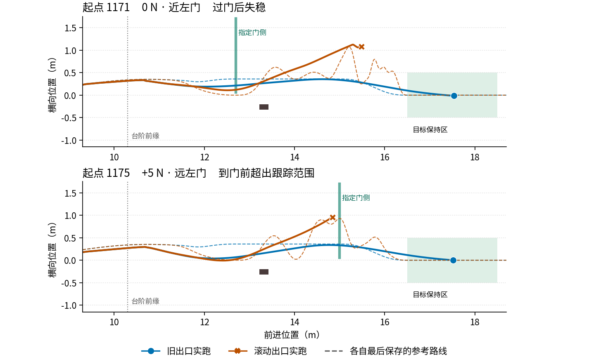

# P0-B 开发实验：改变起跳路线和落地出口各有多少作用

[同一起点的左右门实跑 XY](root1174_shared_entry_xy.png) · [图中两道门的全部 108 条分支](root1174_shared_entry_sources.csv) · [两张开发图全部 24 个起点和 9,072 条轨迹](/media/qy/6A7E3DB07E3D75C3/STTW_runs/chapter3_continuous_p0b_20261123/analysis/xy/index.html)

车必须越过 0.16 m 台阶，落地后通过指定门、在目标区保持 0.5 s，全程避墙。两张新开发地图各用 12 个不同起点。每个起点有三种横推、两种门距离和两个门向，合计每种方法 288 项任务。每个跳前选择必须应对三种事先未知的推力。四批物理仿真运行了 1,296 组跳前条件，每组七个出口分支，共 9,072 条轨迹。

## 同一落地规划器，扩大跳前选择

比较五种旧入口与包含它们在内的十八种入口，落地后使用相同的连续滚动出口。入口按每个起点和门分别选出在三种推力下合计表现最好的一条。它度量有限路线库提供的机会；车上自动选中路线属于下一阶段。

| 起点 | 已确定增加的完整任务 |
|---|---|
| 右偏墙 1174 | 远右门 1、远左门 2、近右门 2 |
| 错位双墙 1184 | 远左门 1、近右门 1 |
| 错位双墙 1191 | 远右门 1、近左门 1 |
| 错位双墙 1193 | 远左门 1、近右门 2 |

原定逐字节配对标准确认 1,086/1,296 组。余下 210 组的未知结果全部保留时，扩大入口多完成 12 至 160 项，下界为 4.17 个百分点。七条车都在接管前终止且未执行出口的 136 组，如果以实际归档起跳过程为对象，均无法完成任务。以此补充信息计分，范围为 18 至 87 项，下界为 6.25 个百分点。这两行是给定物理证据的范围。按起点抽样的统计不确定性另计。[逐任务范围](/media/qy/6A7E3DB07E3D75C3/STTW_runs/chapter3_continuous_p0b_20261123/analysis/partial_identification/shared_entry_bounds_by_root_gate.csv) · [全体与分图结果](/media/qy/6A7E3DB07E3D75C3/STTW_runs/chapter3_continuous_p0b_20261123/analysis/partial_identification/shared_entry_bounds.csv)

### 落地接管状态复核

对原检查留下的 210 组，按真实记录复核七个分支。136 组均未复锁且没有出口执行，69 组在出口开始时的车辆与控制状态相同，余下 5 组保留未知。按这项补充分析，固定滚动出口时，扩展入口比旧库实际多提供 **37–40 个可完成任务，占 288 项的 12.85–13.89 个百分点**，净增加的下界涉及 15/24 个起点。右偏墙多 15–16/144 项，错位双墙多 22–24/144 项。沿用旧出口时，扩展入口多 39–43/288 项。该批支持继续研究跳前选路；自动选路的收益须在新的测试起点测量。[原始接管状态审计](/media/qy/6A7E3DB07E3D75C3/STTW_runs/chapter3_continuous_p0b_20261123/analysis/branch_parity) · [补充逐起点结果](/media/qy/6A7E3DB07E3D75C3/STTW_runs/chapter3_continuous_p0b_20261123/analysis/secondary_partial_identification/shared_entry_bounds_by_root_gate.csv)

以每张图的 12 个起点为一组，各自按起点重抽 10,000 次，每个起点保留四道门和三档推力。两图合并后，增益下端点的 95% 百分位区间为 [8.32, 18.06] 个百分点，上端点为 [9.03, 19.44]。该统计固定这两张开发地图。[逐起点增益](/media/qy/6A7E3DB07E3D75C3/STTW_runs/chapter3_continuous_p0b_20261123/analysis/secondary_partial_identification/shared_entry_bounds_by_root_gate.csv)

### 哪些路线能让车落稳

每种路线与控制偏好覆盖 24 个起点，各测 −5、0、+5 N 三种横推。按时序核对的跳跃交接与七个分支各自记录的交接全部吻合，同一个跳跃只计一次。18 种选择共 581/1,296 次完成交接。图右逐起点检查三种横推，左偏半幅、α=1 在 18/24 个起点三次都落稳；右偏半幅、α=1 虽有 19/72 次落稳，分别分布在一部分扰动条件，三次都落稳的起点为 0/24。开发这些入口时应让跳前选择器看到失败，并按未知横推检验；右侧在本批能够落稳，也保留在训练和测试中。过门与最后保持继续单独计分。[逐路线原始计数](/media/qy/6A7E3DB07E3D75C3/STTW_runs/chapter3_continuous_p0b_20261123/analysis/verified_entry_ranges.csv)

## 固定起跳入口，只换落地出口

车按给定门向选择预设入口。下表使用通过原配对标准的全部 236 个合同，涵盖滚动规划全否决时实际执行的默认路线。

| 门向 | 旧出口完成 | 滚动出口完成 | 旧出口碰墙 | 滚动出口碰墙 |
|---|---:|---:|---:|---:|
| 右，110 项 | 35 | 12 | 27 | 37 |
| 左，126 项 | 37 | 20 | 30 | 31 |
| 合计，236 项 | 72 | 32 | 57 | 68 |

滚动出口救回 9 项，丢失 49 项，净少完成 40 项；新增 18 次碰墙，避免 7 次。49 项丢失的终点为跟踪越域 28、撞墙 11、到达目标区但未通过指定门 5、超时 3、物理失败 2。其中 21 项已经通过指定门，17 项全程没有成功发布新的滚动路线。在 49 项中均无记录的规划超时。即使将剩下 52 个未配对合同全部算作滚动出口新增成功，完整 288 项的净增也至多 12 项（4.17 个百分点）。下一轮应在同一裕量下比较落地只规划一次与持续滚动，对比实际下发参考、跟踪与净空。[实际出口与终点](/media/qy/6A7E3DB07E3D75C3/STTW_runs/chapter3_continuous_p0b_20261123/analysis/measured_exits.csv.gz)

补充复核使按门向固定入口的可比合同从 236 增至 284。旧出口完成 84/284、碰墙 73/284，滚动出口完成 37/284、碰墙 85/284。左门完成 41→22，碰墙均为 34；右门完成 43→15，碰墙 39→51，各侧分母 142。另将跳前入口放宽至 18 种、允许事后选最佳共享入口，再比较两种出口：右偏墙用滚动出口少完成 33–35/144 项，错位双墙却多完成 7–12/144 项。需要分别诊断两图的几何与参考跟踪。[补充结果与分图差值](/media/qy/6A7E3DB07E3D75C3/STTW_runs/chapter3_continuous_p0b_20261123/analysis/secondary_partial_identification/shared_entry_bounds.csv)

### 滚动规划丢失在哪一步

284 项可比任务中，滚动出口救回 11 项、丢失 58 项。58 项中 25 项已过正确门侧，38 项至少实际发布一次新路线，两者兼有的有 20 项。终点为跟踪越域 33、碰墙 14、物理失败 2、超时 4、到目标区但门侧错误 5。14 个碰墙病例全程都没有实际发布新路。右门丢 31 救 3，左门丢 27 救 8。

上图截取台阶附近及下游，实线为实际轨迹，圆点和叉号分别是两种方法的实际终点。蓝色与橙色虚线各显示各自最后保存的一版参考，滚动方法在行驶中曾多次更换参考。黑块是墙的水平占地。起点 1171 的近左门两种方法都过对了。滚动出口下发过 22 次新路线，车在 5.788 s 通过指定侧，7.320 s 物理失败；旧出口 8.060 s 完成。起点 1175 的远左门中，滚动出口 21 次请求全部得到模型准入，20 次实际发布，最终在距门纵向 0.154 m 处跟踪越域。旧出口在 6.824 s 通过指定侧，8.065 s 完成。[两例所属起点的全量轨迹](/media/qy/6A7E3DB07E3D75C3/STTW_runs/chapter3_continuous_p0b_20261123/analysis/xy/index.html)

对这两例的每次实际发布，从当时车体所在纵向位置往前取 1 m，按参考 XY 相邻方向角差除以平均弧长估计曲率。每次先取窗口内最大绝对曲率，再在同一个任务的发布间取中位数。1171 的滚动路线为 8.26 m⁻¹，旧出口参考在相同纵向窗口为 0.49 m⁻¹；1175 分别为 10.32 和 0.56 m⁻¹。这里测的是路线要求转得多急。把这些数解释为车辆一定无法执行，还需要转向、侧倾及速度界。后续单次与滚动对照应记录重复改线是否放大了转弯要求，以及实际车身有没有跟上。[42 次实际发布的逐次数据](/media/qy/6A7E3DB07E3D75C3/STTW_runs/chapter3_continuous_p0b_20261123/analysis/fixed_entry_two_cases_published_reference_curvature.csv)

全 284 项按同一算法统计。95 项至少发布过一次滚动路线，共 1,815 次实际发布。其余 189 项保留在各自任务分母中。

| 旧出口与滚动出口 | 总项数 | 曾发布数 | 滚动参考曲率中位数 [四分位区间]，m⁻¹ | 同纵向窗口的旧参考，m⁻¹ |
|---|---:|---:|---:|---:|
| 两者均完成 | 26 | 26 | 约 0 [约 0, 1.30] | 约 0 [约 0, 0.27] |
| 滚动新增完成 | 11 | 11 | 1.29 [1.00, 1.56] | 约 0 [约 0, 约 0] |
| 滚动丢失完成 | 58 | 38 | 1.95 [0.62, 6.33] | 0.35 [0.31, 0.54] |
| 两者均失败 | 189 | 20 | 1.30 [1.16, 2.99] | 0.49 [0.25, 1.12] |

表中每个有发布的任务先对其各次发布取中位数，再对任务汇总。曾发布的 38 项丢失中有 35 项的滚动路线比旧路线更弯，11 项救回也全部更弯。更急的转弯能帮助车绕过障碍，问题是当时的车速与侧倾能否跟上。后续可用同起点的真实跟踪与实际转向检验。[逐任务数据](/media/qy/6A7E3DB07E3D75C3/STTW_runs/chapter3_continuous_p0b_20261123/analysis/fixed_entry_published_reference_curvature_by_contract.csv) · [分组结果](/media/qy/6A7E3DB07E3D75C3/STTW_runs/chapter3_continuous_p0b_20261123/analysis/fixed_entry_published_reference_curvature_summary.csv)

## 直接重标定现有裕量

旧系统共享的 10.18 cm 来自运动学模型。对同样的 73 条开发撞墙记录，改用本次平台动力学预测器计算同一顺位的预测净空，得到 5.33 cm。以这两个数重评分同批 44 个旧留出起点的已执行分支，主图 249 条中放行数 100→129，新增 25 条到目标、4 条超时；另一图 258 条中放行数 110→138，新增 28 条均到目标。新增 57 条分支中记录到 0 次碰墙。下一组在线对照比较原裕量、动力学预测器自己的固定裕量、按预测时长校准的裕量，同时报告是否通过指定门和能否稳住到终点。[原始标定逻辑](../../../../learning/cli/score_platform_review.py:31) · [主图分支](/media/qy/6A7E3DB07E3D75C3/STTW_runs/chapter3_playground_sttw_rb_sttw/platform_test0_20261120/approach_alignment/replication_wide/review_114/forecasts_primary_rb_run1.csv) · [另一图分支](/media/qy/6A7E3DB07E3D75C3/STTW_runs/chapter3_playground_sttw_rb_sttw/platform_test0_20261120/approach_alignment/replication_wide/review_114/forecasts_alternate_rb_run1.csv)

历史主图起点 24 的两个出口，可以从同一实际状态、实际参考分别重放到各自的真实终点。左转实际到达，直行实际碰墙。按原程序复算全程最小预测净空分别为 4.775 cm 和 −8.511 cm，与旧 CSV 的最大差为 1.49×10⁻⁸ m。左转在 1 秒处预测净空 8.85 cm，随后 20 ms 中实测车身包围盒最小净空 29.12 cm；2 秒处预测 123.42 cm、实测 109.30 cm。误差方向随这条路线上的位置发生变化，左转全程实测最小净空为 10.60 cm。该对出口用于验证重放方法与时间对齐，两个出口来自同一起点。[逐时净空](/media/qy/6A7E3DB07E3D75C3/STTW_runs/chapter3_continuous_p0b_20261123/analysis/clearance_pilot/root24_clearance.csv) · [模型和几何来源](/media/qy/6A7E3DB07E3D75C3/STTW_runs/chapter3_continuous_p0b_20261123/analysis/clearance_pilot/receipt.json)

### 5.33 cm 首批实际对照

右偏墙起点 1171–1176，72 个按门固定入口的任务。右门 36 项全部通过同车接管配对，余量从 10.18 cm 改为 5.33 cm 后，完整完成 0→3，碰墙 21→16。三个新完成分属两个起点，1172 的 −5 N 近右门和远右门，以及 1176 的 +5 N 近右门。左门严格可比 33 项，完成 5→5，碰墙 4→2。全批 72 项的实测完成数 7→10，三项左门的全车状态检查只有固定世界坐标体上的一个合力分量相差 0.000061；保留为未配对时，69 项可比，完成 5→8、碰墙 25→18，整批净完成变化界为 0 至 +6。1171 与 1175 上述两个滚动失败的全程姿态、速度、实际轨迹记录和最后参考，在这两种余量下分别完全相同。[三个救回的实际与参考 XY](/media/qy/6A7E3DB07E3D75C3/STTW_runs/chapter3_continuous_margin_fixed_20261123/analysis/margin_pairs/right_offset_part_0_rescued_xy.png) · [首批逐项核对](/media/qy/6A7E3DB07E3D75C3/STTW_runs/chapter3_continuous_margin_fixed_20261123/analysis/margin_pairs/right_offset_part_0.csv)
