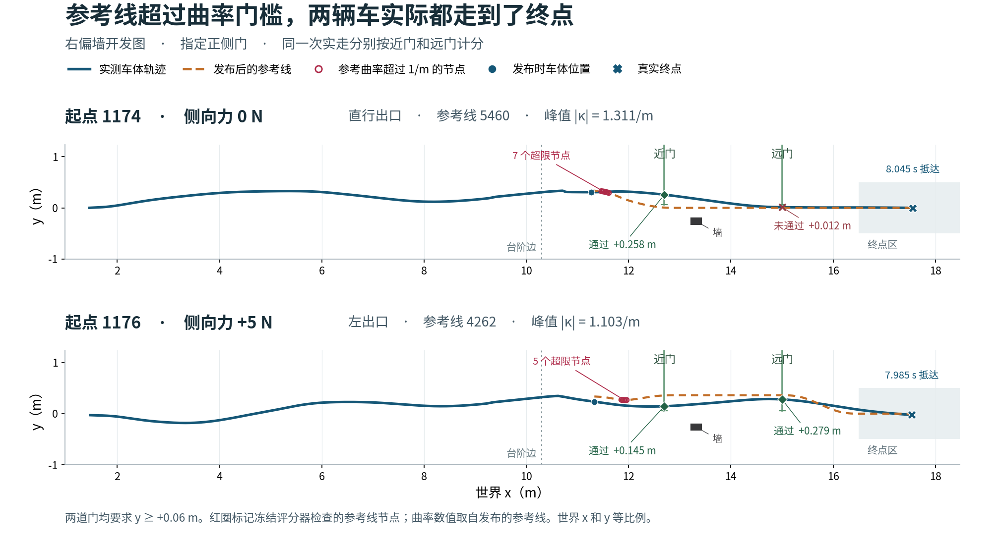

# 超过 1/m 的旧参考，车实际跑过了几条

在 226 个真实接手状态上，旧选择器按原规则放行 112 次。用原评分的门向、碰撞净空、跟踪范围和终点保持条件逐项复算，与原生记录一一对应。给同一批参考增加“剩余峰值曲率不超过 1/m”的条件后，旧三条中至少还有一条获准的有 106 项，旧选择器原先选中的那条仍获准的有 97 项。15 项原选择只因参考曲率被筛掉。其中 9 项还存在另一条获准的旧路线，6 项三条都没有获准。

把这 15 项对应到原执行的物理轨迹，共涉及 10 个起点、11 条不同轨迹。相应接手状态严格配对的有 12 项，其中 8 项实际过了指定门并到达终点，3 项到达终点但门侧不合格，1 项驶出跟踪范围。12 项都没有碰墙。另有 3 项前缀不匹配，单列在逐项表中。8 个成功任务来自右偏墙的左门，涉及 6 个起点和 7 条不同轨迹。每条成功轨迹都驶过了参考曲率峰值所在的纵向位置，8 项中该位置均早于指定的门线。

对这 7 条成功轨迹，从首次接手查询到终点，每 5 ms 按地面评分器相同的车身及摆体包络重算与墙的净空。各条轨迹的最小值为 **12.98–28.79 cm**，全都超过冻结要求的 **5.33 cm**。按预测器相位每 20 ms 取一帧，8 个任务仍全部合格。1174 零推的最小值为 25.56 cm，1176、+5 N 为 28.79 cm。这里的最小值覆盖存档采样时刻。使用同一包络定义的[贴墙对照](../p1/single_vehicle_nested_gpu.md)说明，过门成功与留足安全距离是可以分别核验的。

尤其值得保留的是 6 项“三条都未获准”的任务。它们具有严格匹配的接手状态，实际来自 2 个起点、3 条完成行驶的轨迹。对近门和远门分别评分，完成 4/6 项。相同物理轨迹在不同门位上分别计分。

| 起点、侧向推力 | 当时实际选择的出口 | 参考峰值 (1/m) | 近门处实测横向位置 y (m) | 远门处实测横向位置 y (m) | 原任务结果 |
|---|---|---:|---:|---:|---|
| 1174，0 N | 原直行出口 | 1.311 | +0.258 | +0.012 | 过近左门，远左门未过，达到终点 |
| 1174，+5 N | 原直行出口 | 1.317 | +0.306 | +0.015 | 过近左门，远左门未过，达到终点 |
| 1176，+5 N | 原左出口 | 1.103 | +0.145 | +0.279 | 近、远左门都过，达到终点 |

左门判定要求门线处车心 y 至少 +0.06 m。1174 零推时实际发布的是路线库第 5460 行，曲率绝对值峰位于 x=11.516 m，此处参考 y=0.31845 m。车辆在 5.031 s 经过相同纵向位置，实测 y=0.31203 m，两者相差 6.4 mm。它在 5.728 s 穿过近门，8.045 s 到达终点。表中曲率由实际发布的参考求得，车体瞬时曲率在本对照中没有估计。

这些结果支持把 1/m 写成规划器对参考线施加的工程约束。它能用于推导这类参考线的不可行条件，用来裁决整车物理能力会错判上述成功病例。这里追查的是已选路线被拒的原因，替换在线规划器或取消该阈值后的整车净完成数仍需闭环比较，尤其要计入回退到当前路线的结果。

[全部接手对应的原物理轨迹、15 项逐条对照、图源数据与复算脚本](cap_witness_inputs.tar.gz)
