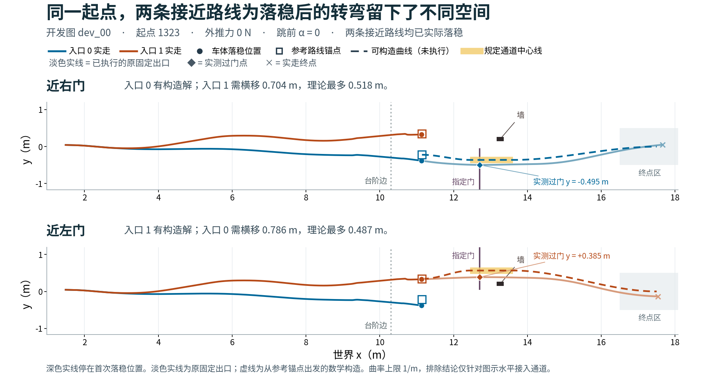

# 同一起点换跳前路线，能否改变落稳后的转弯余量

两张 P1 开发图各有 12 个起点。每个起点都用同一组原生初始位姿和速度、2 m/s 的速度指令、跳前 α=0 实际跑过三种接近路线。每条已落稳的记录按四种规定通道计算，分别对应近门与远门、正侧与负侧。实际接手时的路线进度决定锚点。每个通道沿用原定 0.30 m 净空和水平进入要求。主比较用零外推，同一起点的四种门共享同一组跳跃记录。

## 单个起点的实际轨迹

在 dev_00 的 1323 号起点，两条路线分别在 4.860 s、4.825 s 落稳。当时车心都在纵向 11.13 m 附近，横向分别为 −0.381 m、+0.329 m。对应的地面参考锚点分别在 −0.220 m、+0.344 m。下面的证明从参考锚点计算。

| 跳前几何 | 规定通道 | 需要横移 | 结论 |
|---|---|---:|---|
| 0 | 负侧 | 14.0 cm | 可构造，前段曲率绝对值上界 0.492/m |
| 1 | 负侧 | 70.4 cm | 允许的最大横移为 51.8 cm |
| 0 | 正侧 | 78.6 cm | 允许的最大横移为 48.7 cm |
| 1 | 正侧 | 22.2 cm | 可构造，前段曲率绝对值上界 0.891/m |

对照原有两条固定出口的真实仿真轨迹，几何 0 配右出口在近门线穿过 y=−0.495 m，几何 1 配左出口穿过 y=+0.385 m，两车均到达终点，全程无墙碰撞。交换门侧评分后，这两条实走轨迹各自只完成了原来一侧的任务。第三种入口没有确认落稳。

## 如何判定

设锚点到规定通道入口的纵向距离为 L，横向有符号位移为 d，起始斜率为 m，终点斜率为 0。参考线沿纵向向前，曲率绝对值至多为 1/m。由有界曲率得到[横移必要条件](reference_curvature_bound.md)。超过上界的情形可以排除。

另一种情形可以直接给出一条满足条件的参考线。取 u=x/L，在起点坐标系中令

  y(x) = mL(u−2u²+u³) + d(3u²−2u³).

它两头的位置和切线都正确。二阶导数随 x 线性变化，因而整段曲率绝对值由两端二阶导数的绝对值控制，至多为

  max(|6d/L²−4m/L|, |−6d/L²+2m/L|).

若该数小于 1/m，直至通道入口都满足曲率约束。同样检查从通道末端返回中心线的三次曲线，中间沿通道水平前进。三段连接时切线连续，曲率分段有界。采用这两种判据，未能判定的组合保留为未定。在所有得到相反结论的比较里，被排除一侧超出横移上界至少 8.76 mm，可构造一侧距曲率上限至少 0.005/m。车身侧倾、可跟踪性和实际接管后的控制误差另由物理实验评估。

## 全部分母与实走结果

| 实验设定 | 起点×门×推力 | 至少两条路线确认落稳 | 一条可构造、另一条可排除 | 涉及不同起点 |
|---|---:|---:|---:|---:|
| 零推，dev_00 | 48 | 44 | 19 | 11 |
| 零推，dev_01 | 48 | 48 | 19 | 9 |
| −5 N，两图 | 96 | 44 | 16 | 9 |
| +5 N，两图 | 96 | 36 | 16 | 8 |

外推由同一触发规则施加，各路线的触发时间和实际飞行重叠可不同。表中每个任务计数一次，同一任务中可能有多对入口满足条件。

针对表中得到相反几何结论的任务，对每种入口的两条真实固定出口分别按原门侧、实际到达目标和未碰墙计分。下表中“完成”表示两个已实跑出口中至少有一条完成，多个满足同类几何判据的入口也取其中任一。门侧由保存的车心轨迹按原门线和 ±6 cm 内缘重评分。涉及的两条出口均按预定方向执行，同对的分叉前状态已在原实验认证匹配。

| 已有实走轨迹完成情况 | 零推 38 项 | −5 N 16 项 | +5 N 16 项 |
|---|---:|---:|---:|
| 只有可构造一侧完成 | 12 | 6 | 10 |
| 两侧都有出口完成 | 7 | 2 | 1 |
| 两侧都未完成 | 19 | 8 | 5 |
| 只有被排除一侧完成 | 0 | 0 | 0 |

零推的 7 个两侧均完成样本中，原门任务允许车辆采用位置或方向不同的轨迹过门。可用解析界排除具体通道连接，直接据此丢弃整个跳前选项会损失可执行方案。零推 19 个两侧都失败的样本同样表明，画得出的路线仍需验证整车可执行性。上述分母来自开发数据，出口按实跑结果事后取最好。

[逐任务记录、来源和复算材料](paired_entry_corridor.tar.gz)
