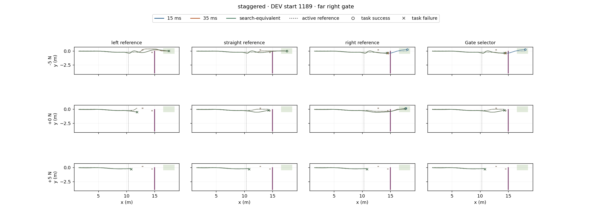

# 同一条出口路线，提早交给小车能救回几次

错位双墙，1189 号起点，向一侧横推 −5 N。这个例子中三辆车都在 5.800 s 落稳，下一控制步都决定用同一条右出口参考。控制器在作出选择后 15、35、75 ms 收到路线，第一次改变转向命令也分别发生在 15、35、75 ms。早发车过远门时在中线右侧 36.8 cm，于 8.920 s 完成任务。另两辆分别在 x=14.522 和 14.386 m 处碰墙，距离 x=15 m 的门还有约半米。看图的第一行 −5 N 和最后一列选择器即可看到这次差别。

## 同批对照

两张已打开的开发地图，每图 12 个起点，三种横推、两条接近路线。每种跳前条件做九份，分别走旧左、直、右三个出口，按三个实际时刻下发。共 1,296 条物理轨迹，两图各 648 辆同时开始，耗时 433.65 秒。选路器在首次实际接手时按原规则定出口，等待期间车继续沿当前直行参考前进。每条轨迹可分别评价近门、远门，得到每个时钟下相同的 288 个任务。晚发的 60–75 ms 来自此前单车搜索耗时和控制周期的取整，本批按实际控制步下发预定路线。

| 出口发布时刻 | 过指定门并到终点 | 碰墙 | 到达终点 |
|---|---:|---:|---:|
| 15 ms | 112/288 | 59/288 | 150/288 |
| 35 ms | 111/288 | 60/288 | 149/288 |
| 60–75 ms | 111/288 | 60/288 | 149/288 |

214 项满足九辆车在接手前匹配且选路一致，15 ms 成功 97 项，35 ms 和晚发各 96 项。早发相对晚发救回 1 项、损失 0 项，即上图。另 40 项所有九辆车一致地在交回地面控制前结束，均失败。剩余 34 项三组各成功 15 项，未获得相同起跳到接手过程的认证；将这部分干预效应留为未知，全部 288 项的晚发减早发可认证范围是 −35 到 +33，记录到的原始差是 −1。125 项严格匹配且三钟都选直行的任务中，车轮命令、位置和速度全程与终态逐位一致。

右偏墙近右门、远右门在三个时钟分别都是 18/36、21/36；近左、远左分别都是 15/36、18/36。错位双墙的近右门都是 22/36，远右门由 16/36 降到 15/36；近左和远左在三个时钟均只有 1/36。该地图左门的低成功率在早发时同样存在。

## 下发是否真的改变了转向

每钟有 357 条固定方向的车次发出请求。早发 357 条全部于 15 ms 下发，居中 357 条全部于 35 ms 下发，晚发 354 条分别于 60、65、70、75 ms 下发，另外三辆在发布前终止。逐条与同钟直行副本比较，发布前未出现舵或后轮指令提前改变。晚发的非直行支路第一次出现差异舵指令在 75–90 ms。车辆实际读取新的参考和转向生效的控制步均有记录。

## 与先前 212 项的关系

旧实验的 212 项中，44 项没有接手，97 项一直选直行且其中 15 项成功，71 项真正换路线且其中 70 项成功。若完全保留旧接手状态、选路、参考及直行组的情况，调整发布时间至多完成 15＋71＝86 项，原为 85 项。这是对当时物理状态和固定参考的条件上界。

新批中，相同的 212 项任务键和初始车辆位置、速度均匹配，三个时钟各实测成功 80 项。但旧组中曾经接手的 168 项，均未逐位复现到旧接手时刻的物理与控制记录；旧组 44 项未接手也未逐条复现全程。不能用 80 与 85 的差来衡量晚发造成的损失。同起始状态的两批，首次可测 qpos/qvel 差异在地面接近期第 2–205 个控制步，中位第 25 步。最早出现差异的命令，176 项仅在舵角目标、36 项仅在后轮转速目标，其中 152 项只差一个单精度浮点数的最小相邻间隔。两批地图和低层策略身份一致，每图并行车辆数从 792 变为 648。具体由哪个数值运算引起差异尚未定位。两批都有接手查询的 144 项，查询时刻的绝对差中位 70 ms。逐项取两批中较早的查询时刻，在相同钟点比较车身 XY，相差中位 11.3 cm、最大 27.2 cm。按新批自身匹配标准得到的干预效果采用上节数字。原先连续出口损失的 47 项中，新批有 33 项可比较接手、3 项共同未接手，这 36 项没有随下发时钟改变成败，其余 11 项需保留不确定性。

[全部 96 组实际/参考 XY 图](</media/qy/6A7E3DB07E3D75C3/STTW_runs/chapter3_exit_release_dev_20261124/analysis/xy/index.html>) · [全部 1,296 辆车的数值 XY、参考切换及世界地图](release_clock_xy.tar.gz) · [发布、读取、碰墙、过门及跨批匹配原始表](release_clock_results.tar.gz)
