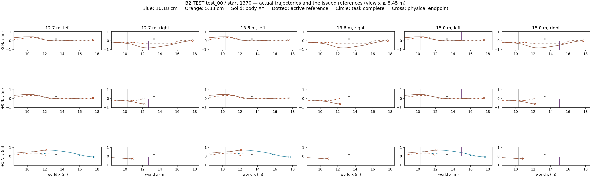

# P1 已知地图上的跳跃结果预测

## 固定入口与三出口的四图终审

四张前瞻冻结的16 cm台阶地图各使用16个独立初态。每个初态在三种隐藏横推、三个门距和左右指令下各运行两个裕量。按门侧固定同一入口，在真实复锁后用相同模型评价左、直、右原生出口。把预测放行裕量从10.18 cm改为5.33 cm，完整过指定门并在终点保持的任务由454/1,152增至551/1,152（净增8.42个百分点，按图内初态分组重采样的95%区间为5.90至11.02）。挽回103项，丢失6项。碰墙由266降至177（净降7.73个百分点，95%区间为−10.42至−5.30），其中避免92次、增加3次。1,152对全部通过决策前的状态、控制、接触判据和时钟匹配；原始接触载荷在1,079对上逐位相同。

| TEST地图 | 每臂任务 | 完成（10.18→5.33 cm） | 挽回／丢失 | 碰墙（10.18→5.33 cm） | 新增／避免碰墙 |
|---|---:|---:|---:|---:|---:|
| test_00 | 288 | 117→129 | 15／3 | 48→33 | 0／15 |
| test_01 | 288 | 147→161 | 14／0 | 41→27 | 0／14 |
| test_02 | 288 | 101→141 | 41／1 | 96→57 | 0／39 |
| test_03 | 288 | 89→120 | 33／2 | 81→60 | 3／24 |

左门完成197→239/576，右门257→312/576。新增碰墙的3项来自同一个起点。全部分母包含未复锁及提前终止。5.33 cm是预测器的候选出口放行阈值，成功按车辆实际复锁、无碰墙、从指定一侧过线及终点保持评分。四张图支持在本批固定系统中采用重标定裕量，仍有601/1,152项未完成，其他几何和真车的碰撞风险尚待测量。[逐图六道门的收益与损失](terminal/four_maps_six_gates.csv) · [test_00 全部实走](terminal/test_00_xy.zip) · [test_01](terminal/test_01_xy.zip) · [test_02](terminal/test_02_xy.zip) · [test_03](terminal/test_03_xy.zip)

此前直接学习替换入口的唯一一次DEV检验中，六图5,184个训练前缀仅用于训练和留图选阈值。两张DEV图96次决策仅6次改变入口。288项原门从175增至176（救5丢4），进一步满足5.33 cm实际净空的任务由123降至122（救2丢3）；两图原门各净增5、净减4。单核16候选从观测到选择的热P95为0.668 ms，未达到净增15项的任务门槛。这里的175/123来自按指令执行同侧固定出口的归档实走。对可配对的原生三出口决策，含未知任务的净收益区间为−14至+10，亦低于门槛。学习替换止于DEV；四图终审使用Fixed。较早的落姿预测加地面搜索在单车上实测热中位数195／1,024 ms（均值／混合），扩充数据后的主种子九选一仅96/288，固定规则175/288。联合排序未能在该协议下兑现收益。[B1 冻结协议、源码与逐项证据](terminal/b1_source_and_results.tar.gz)

隐藏横推使一次起跳决策必须在三次不同后果之间取舍。六张训练图、72个起点的576组双入口比较中，有73组在左右指令互换后出现严格相反的路线偏好。允许按门择优相对两门共用一入口的事后收益为79–80/3,456，仅约束这个有限菜单与已执行后段。两张DEV图的连续出口复验中，旧三出口完成114/288；单次和事件改线分别46和62，碰墙分别80和75，旧法为47。最终保留同一三出口算法，用四图配对测量净空重标定的作用。[有限菜单证明和真实反例](train_entry_gate_reversal.md) · [连续出口的配对复验](../p0_b/RESULTS.md) · [B2 执行源码、地图定义、冻结哈希和全体逐项表](terminal/b2_source_and_results.tar.gz)

[八条未见起跳曲线的 1,152 条实走轨迹、过门成绩和失例](unseen_entry_results.md)

10 张图的物理采集均已完成。每张图 576 个出发条件、1,152 条左右成对记录，总计 5,760 个出发条件与 11,520 条物理仿真记录。训练图、开发图、校准图各有 6、2、2 张。

## 只看出发信息，在新开发图上实际能过几次门

**起点 1325，近左门，换路丢了两次。** 旧规则走入口 4，三次横推中两次完成。混合模型认为入口 5 的落稳概率略低（0.76 对 0.82），却认为落稳后能过门的概率高得多（0.59 对 0.28），于是给入口 5 更高的总分。实际三次都失败。无横推时，新路线出了跟踪范围，旧路线过门并到达终点。[三种横推的实际与参考轨迹](dev_00_root1325_gate12.7_L.png)

**起点 1328，同一扇近左门，换路救回一次。** 混合模型从入口 4 换到 11。−5 N 横推下原路线撞墙，新路线完成；另外两种横推两条路线都能完成。[三种横推的实际与参考轨迹](dev_00_root1328_gate12.7_L.png)

每个起点都给定近左、近右、远左、远右四种任务。每种任务先根据出发观测选定一次入口，再对照三种当时未知的横推。24 个起点共 96 个入口选择、288 个任务。入口和 α 必须在首条控制指令前确定；落稳后各方法统一执行门侧出口。评分使用已采集的配对仿真轨迹，没有新增物理回合。两图全部 2,304 条原分配门标签均已复现。两个起点各有一对没有执行的后段，按未知计；五种可执行规则实际选中的任务结果均可确定。

| 按出发信息选入口 | 单墙左门 /72 | 单墙右门 /72 | 双墙左门 /72 | 双墙右门 /72 | 合计 /288 |
|---|---:|---:|---:|---:|---:|
| 旧固定规则（左 4，右 0） | 35 | 54 | 34 | 52 | **175** |
| 单一高斯选旧 5 条 | 22 | 54 | 34 | 52 | 162 |
| 单一高斯选全部 16 条 | 24 | 54 | 28 | 52 | 158 |
| 混合模型选旧 5 条 | 21 | 54 | 38 | 41 | 154 |
| 混合模型选全部 16 条 | 24 | 48 | 33 | 34 | **139** |
| 事后知道结果，从旧 5 条择优 | 42 | 57 | 43 | 52 | 194 |
| 事后知道结果，从 16 条择优 | 52 | 63 | 52 | 53–55 | **220–222** |

核心负结果是旧固定规则完成 60.8%，混合模型配轻量出口评分完成 48.3%，净少 36 项（12.5 个百分点）。逐项比较新增成功 12 项、丢失成功 48 项。将同一起点的 12 道题合并，24 个起点中 3 个受益、12 个退步、9 个持平。单一高斯规则用中心姿态评一次，混合规则取 16 个可能姿态的平均，两者的完成数反映整套选择方法。在丢失的 48 项里，21 项没有落稳，另外 27 项已经落稳，其中 12 项撞墙、12 项超出跟踪范围、2 项超时、1 项到了终点却未完成门任务。对于同一混合模型，把 5 个选项扩到 16 个，新救回 11 项、丢 26 项。若只看所有候选都已实测的 22 个起点，264 项中混合选 16 条完成 125，旧规则 160，方向相同。事后上限说明候选里确实有好路，但这个评分器在出发时挑不出来。当前不采用它替换旧规则；继续核验已登记的完整后段动力学评分。[全部 96 组实际轨迹](/media/qy/6A7E3DB07E3D75C3/STTW_runs/chapter3_continuous_p1_20261123/actions/amortized_exit/development_entry/xy/index.html) · [逐车选择与预测分解](/media/qy/6A7E3DB07E3D75C3/STTW_runs/chapter3_continuous_p1_20261123/actions/amortized_exit/development_entry/mixture_vs_old_cases.csv.gz)

**如果事先告诉它车最后是怎么落地的呢？** 在上述负结果出来后，专门重算了同一批题。固定已经训练好的出口评分器，只把跳跃模型的输入结果换成每个候选在三种横推下实际有没有落稳，以及当时的真实姿态、速度和时刻，每个起点和门仍只选一条共同入口。选旧 5 条完成 181/288，选全部 16 条完成 204/288，比同批混合模型在出发时选 16 条的 139 项净多 65 项（救 77，丢 12）。22 个后段全部可识别的起点上，两者为 188/264 和 125/264。再分两次替换。只告诉评分器三次横推中实际落稳几次，落地姿态仍用原模型预测，完成数先从 139 到 157（救 39，丢 21）。再换上实际落稳时刻、位置、姿态和速度，完成数从 157 到 204（救 62，丢 15）。22 个完整起点上依次为 125、145、188。在这个替换顺序下，后一步的差额更大，值得首先核查“落稳后车往哪走”的预测。这个诊断提前知道了每次横推和它造成的实际落地，只用来定位预测环节的损失。结果仍低于 16 条候选事后择优的 220–222 项。[逐病例替换与差值](/media/qy/6A7E3DB07E3D75C3/STTW_runs/chapter3_continuous_p1_20261123/actions/amortized_exit/dev_true_handoff/paired_case_differences.csv.gz)

## 正式跳跃预测在两张新开发图上的表现

出发时给模型当前车辆状态、入口和地图，让它预测双轮能否落稳并重新交回地面控制，以及交接时的姿态。六张训练图有 72 个起点、3,456 次跳跃。开发图另取 24 个起点，每个起点对 16 个入口各跑三种横推，共 1,152 次，534 次实际落稳。两个神经模型各训练三个种子，每次 540 步，主结果取事先指定的 61123。三次训练使用同一批开发轨迹。

| 出发时使用的方法 | 落稳概率 Brier（越低越好） | 落稳时刻平均绝对误差 | 交接位置二维均方根误差 |
|---|---:|---:|---:|
| 最近五个历史起点 | 0.16282 | 95.4 ms | 22.8 cm |
| 只按入口统计历史频率和落地状态 | 0.15627 | 85.7 ms | 21.1 cm |
| 单一高斯模型 | 0.15661 | 83.3 ms | 19.7 cm |
| 三成分混合模型 | 0.15593 | 82.2 ms | 19.7 cm |

概率列包含全部成功与失败。姿态和时刻按实际落稳计算，五近邻能给出 533/534 个姿态，其余方法覆盖 534/534。以起点为单位在两张固定图内分别重采样，混合模型的 Brier 减五近邻为 −0.00688，95% 配对区间 [−0.01266, −0.00133]。换两个训练种子，差值为 −0.00614 和 −0.00543。主种子相对按入口统计的差为 −0.00034，区间 [−0.00305, +0.00258]；相对单一高斯的差为 −0.00067，区间 [−0.00156, +0.00013]。混合模型相对五近邻的分箱校准误差差值为 −0.02123，区间 [−0.05050, +0.00895]。因此，“落稳概率比五近邻估得准”在这两张图上有依据；是否值得引入混合分布要看实际选路。

主种子按地图拆开，混合模型相对五近邻的 Brier 在单墙图低 0.01366，在双墙图仅低 0.00011；另两个种子在双墙图分别高 0.00016 和 0.00125。混合预测的落地状态联合分布在三个种子上都有更低的标准化负对数似然，但两张图、三个种子的六项侧倾角平均绝对误差均高于单一高斯。

**换地图的难度。** 八张训练和开发图都从同一方向接近位于 x=10.3 m 的 16 cm 高台，粗糙区石块高 1–4 mm，两条凸脊高 2 和 4 cm。开发图换了石块随机种子、起点和墙坐标。第一张为单墙，第二张为双墙。两种墙型都在训练中出现过。结果支持对这两张同类地图的比较；换台阶高度、斜向跳跃或大弯道的成功率仍待实测。[逐图几何](/media/qy/6A7E3DB07E3D75C3/STTW_runs/chapter3_continuous_p1_20261123/maps/training_development_geometry.csv) · [六个模型的拟合、预测和复算材料](known_map_models.tar.gz)

## 完整地面动力学能否在出发时识别可行入口

两张开发图各有 12 个起点，每个起点 16 个入口。每图在 192 个起点与入口组合里放行得分最高的 48 个，再以三次未知横推核对，两图共放行 288 项。将两条实测左右出口都失败定义为误放。主种子在单墙、双墙图分别误放 90、90 项，单一高斯为 92、133，按动作统计的经验模型为 92、87，五近邻为 94、91，各图分母均为 144。三成分模型相对简单经验法在三个训练种子分别多误放 1 项、持平、多误放 5 项。这个试验固定放行数量，评估能否识别机会；文首的 288 项入口决策则要求每个起点、每道门实际选路。

事先选定的每图前六个起点另有五出口物理记录，共 576 个跳前条件，按同一得分每个方法放行 144 项。依据可配对分支，主种子的混合模型比单一高斯多选中 1–56 个确有可行出口的条件，与按动作统计的经验模型之差为 −18 至 +14。这里的范围来自实际可识别的分支。全部 3,456 条五出口补跑均已结束，所用版本为旧连续出口，留作对照。

16 入口单车计时，单一高斯、三成分、动作经验、五近邻各五次热调用中位数依次为 1.80、8.05、10.28、7.48 秒。全部 48 次单入口及多入口调用均超过 100 毫秒。每次决策的粒子时域和分支一致性与批量地面内核的 45.70 ms 性能试验分别报告。[逐车预测、物理回查与计时](downstream_two_exit_dev.tar.gz)

## 六张训练图上，改入口和改出口各能救多少

六图共有 72 个起点，3,456 个跳前条件，各实跑两个固定出口，共 6,912 条仿真轨迹。1,651 次跳跃通过了复锁检查。以下两种比较分别固定跳前动作、固定落地路线，回答不同的问题。

**落地才选出口的额外空间。** 保持每个起点原本分配的接近动作和门不变，对三种未知横推各跑一次。对 1,152 组出发观测，若预先知道所有训练成绩，但每组三推必须事先固定同一条出口路线，最多完成 634/3,456。若允许根据落地后的结果为每次分别挑左或右，最多完成 640/3,456。仅 6 组同时出现“只有左路能完成”和“只有右路能完成”。比较中两种方法都可事后挑最优规则；直接按门侧固定出口完成 614/3,456。

这个上限可以逐组证明。某一组的三次试验中，设仅左路成功 L 次，仅右路成功 R 次，两路都成功 B 次。出发时固定一边最多成功 B+max(L,R) 次，逐次选路最多 B+L+R 次。因此多出的成功次数恰为 min(L,R)。各组三种推力可见的八项出发输入逐字节相同，并且每组三推门指令相同。上界统计以真实复锁后首查时刻与姿态再次分组，得到相同的 640 次。拟合历史样本上的这组最优对应关系并不保证能预测新的起点。起点 1259 的同一道左门给出一个翻转病例，无推时只有右路线完成，+5 N 时只有左路线完成，−5 N 时两条路线均失败。[全部六条实际 XY](train00_exit_switch.png)

**起跳前换接近动作。** 为了让所有 16 个动作接受同一扇门的检验，把每条固定出口轨迹分别在 x=12.7、15 m 读出实际越门位置，按左右两侧评分。采集时两个出口始终执行预先指定的路线，门只传入影子预测器，终点保持与碰墙由车辆和地形决定。6,912 个原分配门标签全部复现。所得 27,648 个标签重复使用了相同轨迹。每个起点、每扇门从相应集合选一个共同入口，用它应对 −5、0、+5 N 三种横推，合计 288 个起点与门组合、864 个任务。

| 后段如何走 | 旧 5 个入口最高完成 | 新 11 个入口最高完成 | 合并 16 个入口最高完成 |
|---|---:|---:|---:|
| 按门侧固定走左或右 | 649/864 | 524/864 | 716/864 |
| 出发前连出口也一起选定，三种推力共用 | 653/864 | 530/864 | 720/864 |
| 每次落稳后可事后选两条出口中能完成的一条 | 659/864 | 538/864 | 730/864 |

即使始终按门侧走，扩展可选入口也能额外完成 67 次（7.75 个百分点），涉及 33 个起点。最后一行的 71 次增益有 60 次来自左门，11 次来自右门。若把旧 5 个全部替换为新 11 个，右门从 368/432 降到 210/432，左门从 291/432 升到 328/432。若从新 11 个均匀抽取 5 个再择优，遍历全部 462 个子集后，最后一行新候选的期望为 401.89/864。以上为给定参考曲线及 α 的有限样本上限；3,456 个出发条件中有两项在失败终止帧缺少有效位置，本表沿用冻结仿真标签。实际在线算法能获得多少由开发与封存闭环决定。

旧库还允许把形状与 α 分开。在落地按门侧走的 432 项右门任务中，同用左接近、α=0 时完成 118；固定 α=0 而在三种接近形状中选，最多 361；保留这条左接近只在三档 α 中选，最多 153。432 项左门的三项依次为 132、136、284。两种选择各有三个候选，都在每个起点和门内选一个动作应对三推。这个分组说明左右门应分别检验几何和控制偏好的作用。

起点 1251 指定近左门并保持落地后走左路线。5 个旧入口中最好的只能应对三种横推中的一种。新入口 11 三种均完成。图中旧入口 1 的 −5 N 轨迹到达终点却走错门，无推时过对门后撞墙。新动作同时改变接近形状和 α。另一个起点 1305 仅看预分配到近左门的一个旧入口时是 0/3，把五个旧入口都在同一扇门下评分后，旧入口 3 也能达到 3/3。[1251 的六条实际轨迹](train00_shared_entry.png)

按原任务每个起点分给每扇门四个动作，72 个起点上旧子集与扩展子集的事后最优为 271→394/864。但每扇门最初只分到 1 或 2 个旧入口。完整四门重评分消除了这一候选数差异，估计对全旧库的额外收益应采用上表。

**固定放行比例的误放下限。** 在原分配门下，每张图 192 组出发状态中选定 48 组放行，三种未知推力共用选定结果。对每组用 L+R+B 算出至少一条已测路线可完成的次数，将 192 个整数由大到小排列。任何选择 48 组的方法都不能超过前 48 项的和。六图各取 25% 后，共放行 864 次，最多 524 次有路可走，至少 340 次（39.35%）两个实际出口均走不通。该数值只针对训练图的这两个已测出口和原任务门，用于解释后续同覆盖误放比较。[逐图、逐动作及完整复算脚本](six_train_gate_analysis.tar.gz)

## 四张训练图的落地与出口

同一起点、同一接近动作和同一次横推复制两辆仿真车，落稳后分别走预定左、右路线。两辆车接受同一过门指令。任务完成要求从规定一侧过门、到达并保持，且途中无碰墙、失稳或越域。对四图的 2,304 对逐对核过截至首次出口查询或终止的已记录车态与控制。

| 训练布局 | 跳上后落稳 / 出发 | 仅左路线完成 | 仅右路线完成 | 两条都完成 | 落稳后两条都失败 |
|---|---:|---:|---:|---:|---:|
| 左偏墙 00 | 267/576 | 41 | 49 | 10 | 167 |
| 右偏墙 01 | 294/576 | 97 | 39 | 10 | 148 |
| 错位双墙 02 | 284/576 | 49 | 35 | 2 | 198 |
| 左偏墙 03 | 268/576 | 34 | 63 | 5 | 166 |
| 合计 | 1,113/2,304 | 221 | 186 | 27 | 679 |

407 个已落稳前缀换一条路线会改变任务成败，其中 132 个一条路线完成、另一条碰墙。679 个两条路线都失败的前缀中，434 个至少有一辆到达目标区却未从规定侧过门，其中 35 个两辆都如此；另有 81 个两边都撞墙，78 个来自错位双墙。其他出口的可行性要用对应轨迹判断。[全部 679 对的终点组合](both_exits_failed.csv) 每张图使用不同起点，分图成绩同时受墙和起点影响。[逐图数量](training_maps.csv) · [48 个起点](training_roots.csv)

右偏墙起点 1263，动作 1，横推 +5 N，目标在 x=15 m 的左侧。两车 4.895 s 落稳；左路线 7.008 s 从 y=+0.259 m 通过，8.250 s 完成。右路线 6.085 s 撞墙。两车落稳时沿前进方向的速度均为 1.315 m/s，此后直至各自终点，每个 5 ms 采样间隔都继续向前；右车又前进了 1.984 m 才撞墙。[这两条实测 XY](train01_same_landing_two_exits.png)

四图共有 768 组出发观测与动作，每组有三种等权的未知横推。274 组内同时出现成功和失败，所以在这 2,304 条冻结仿真标签上，同输入每次只报“能/不能落稳”的确定性判断至少错 274 次。右偏墙起点 1268 的一个前缀在 4.580 s 的终止帧缺少有限 XY，两辆复制车的最后有效位置均在 4.575 s。将这个前缀的潜在复锁结果作未知处理，至少仍错 273 次。这里证明的是有限样本内的最低错数。单点落地 XY 误差下界分图为 10.83、11.96、11.76、9.88 cm，只对确实交回控制的 267、294、284、268 条计分。[逐图误差下界](training_maps.csv)

全部实际与参考 XY 按地图、起点和真实终点查看。[00](/media/qy/6A7E3DB07E3D75C3/STTW_runs/chapter3_continuous_p1_20261123/export/train/train_00/xy/index.html) · [01](/media/qy/6A7E3DB07E3D75C3/STTW_runs/chapter3_continuous_p1_20261123/export/train/train_01/xy/index.html) · [02](/media/qy/6A7E3DB07E3D75C3/STTW_runs/chapter3_continuous_p1_20261123/export/train/train_02/xy/index.html) · [03](/media/qy/6A7E3DB07E3D75C3/STTW_runs/chapter3_continuous_p1_20261123/export/train/train_03/xy/index.html)

## 首张训练图

台阶高 0.16 m，左偏墙，12 个此前未参加第三章任务的起点。每个起点 16 个接近动作，分别施加 −5、0、+5 N 横推。每个前缀复制成两辆车预定走左、右出口；同组的三种推力和两个出口共用门的位置及方向。下表来自 576 个前缀、1,152 条实际物理分支。

| 结果 | 数量 |
|---|---:|
| 越过台阶、双轮在高台恢复承重，并交回地面控制 | 267/576 |
| 在首次出口查询之前结束 | 309/576 |
| 在已复锁前缀中，仅左出口完整完成 / 仅右出口完整完成 | 41 / 49 |
| 在已复锁前缀中，两个出口均完整完成 / 均未完整完成 | 10 / 167 |
| 左出口与右出口各自完成 | 51/576，59/576 |
| 左出口与右出口各自碰墙 | 90/576，7/576 |

每组在首次出口查询或前缀终点以前，左右车记录的姿态、速度、实际施加的四通道控制和接触判据均已核对。比较只覆盖已执行的两个出口。5 个旧接近动作共复锁 110/180，11 个新动作共复锁 157/396；动作组及其 α 取值不同，这两个比例不能解释为在线规划器收益。全部 384 个非零扰动均实际施加 100 ms，其中 150 个与经过台阶的无接触区间完全重合、2 个部分重合、232 个无重合。[全部实际与参考 XY](/media/qy/6A7E3DB07E3D75C3/STTW_runs/chapter3_continuous_p1_20261123/export/train/train_00/xy/index.html)

## 相同观测的误差下界

192 个起点与动作组合各有三次横推。每组逐项核对了八类出发时可见输入，三次完全相同。复锁次数为 0、1、2、3 的组合依次有 57、62、14、59 个。给定相同输入，只输出一次“能/不能复锁”的确定性预测器必然在每个混合组上至少错一次；因此至少错 76/576（13.19%）。等权评价三档横推，组内有 k 次成功时，最佳固定概率为 k/3，三次预测的平方误差之和为 k(3−k)/3。全组 Brier 分数下界为 0.08796。对有实际接手姿态的 267 次成功，任何单点 XY 预测的欧氏均方根误差下界为 0.1083 m；推导对每组取实测点的算术均值，再按全部实测样本计算均方误差。以上均为这批轨迹和指定观测条件下的有限样本结论。[逐组证据](train00_hidden_push_by_action.csv)

起点 1250 的第 13 号动作在 3.68 秒交给跳跃技能。无横推时 4.745 秒复锁；向左或向右施加 5 N 时均未复锁。两次非零推力均位于实际腾空区间。图中对三个条件预先固定了相同的左出口分支，橙、绿、紫色为真实车体轨迹。[三次横推的 XY 与车体高度](train00_three_pushes.png)

同一起点第 3 号动作、−5 N 工况的两辆车都在 4.840 秒复锁。任务指定 x=15 m 的右门（y≤−0.06 m）。选右出口的车在 y=−0.380 m 过门，8.440 秒到达。选左出口的车在 y=+0.055 m 穿过该截面，8.145 秒也到达终点，但未按指令过门。[实测左右出口对照](train00_two_exits.png)

## 按当前路线连续生成候选

在车辆已经承诺跟踪的前 5.025 m 保持原路线。将台阶前 1.1 m 设为目标截面，从连续变量指定横移、车头角和曲率，用两段五次多项式相接，到台阶边缘回到同一条直线。离线实际生成了目标向左 8.2 cm、车头向左 2.30°和目标向右 6.1 cm、车头向右 1.35°两条曲线。两条都和原有 14 条样本不同。地面控制代码读入生成的两条参考时，目标处横移误差均小于 0.002 mm。此处测的是参考轨迹插值。读入跳跃模型的 230 维出发观测也已核对，沿用训练时的车辆、地图和路线采样函数。在起点 1250 的 39 个路线形状坐标上，左例有 4 个高于这张训练图逐坐标样本最大值，右例有 1 个低于样本最小值。已用同一个出口几何函数为任意输入的接近路线直接生成左、直、右三条路线。在已记录的 82 个落地查询上，按需生成的 246 条旧出口的坐标、航向和曲率均与原库逐位相同。两条新接近路线也分别生成了三个出口。用同一个已经记录到的落地状态和近左门运行冻结的地面预测器，两组候选都被全部否决。两组向左走的预测净空分别为 3.39 和 3.44 cm，低于 5.33 cm 门槛；向右走净空足够，却过错门。此处考察同一姿态上出口评分器的判断。单线程 CPU 上，已知接管进度时生成三条几何路线的中位耗时约 0.26 ms；对三方向完整预测 254 步（每步 20 ms）各重复 7 次，两例中位耗时分别为 136.29 和 135.99 ms，超过原定 100 ms 重算周期。正式单车 GPU 耗时待测。[三出口预测与各项判据](/media/qy/6A7E3DB07E3D75C3/STTW_runs/chapter3_continuous_p1_20261123/actions/continuous_examples/departures/full_ground_forecast.csv) 两条路线的跳跃与最终过门要由闭环仿真检验。[新生成的接近轨迹](/media/qy/6A7E3DB07E3D75C3/STTW_runs/chapter3_continuous_p1_20261123/actions/continuous_examples/continuous_reference_xy.png) · [实际模型输入](/media/qy/6A7E3DB07E3D75C3/STTW_runs/chapter3_continuous_p1_20261123/actions/continuous_examples/jump_inputs.csv)

## 一次实际计算的跳前连续选路

在训练图 00 的起点 1250，给定车辆的出发观测、地图、已承诺参考和近左门。用历史 72 条开发记录上的小模型检验算法接线。算法在出发时用两轮交叉熵搜索生成八条连续接近路线，再与原路线比较。目标横移、航向、曲率的搜索范围是 ±22.5 cm、±8°、±0.08 m⁻¹，α 从 0、0.5、1 选择；每个候选共用 16 个预测落地样本。此次允许发布的时间按当前控制周期、预瞄和已承诺的路段计算。

第 7 条新曲线（α=0.5）得分 0.1052，高于原路线 0.0739。这个分数由小模型预测，两个候选分别有 4/16、3/16 个落地样本通过至少一个出口判据。原逐粒 CPU 实现耗时 20.433 秒，其中地面预测 20.424 秒。真实归档轨迹用了 0.678 秒便走完出发点到已承诺末端的 1.361 m，而这一次参考更新实际只预留 15 ms。接口按时间判断保留了原路线及原 α=0。该次工程测试没有让小车执行新轨迹，也未用这台小模型比较实测过门率。[候选参考和得分](/media/qy/6A7E3DB07E3D75C3/STTW_runs/chapter3_continuous_p1_20261123/actions/continuous_examples/departure_plan/three_alpha/decision_xy.png) · [实际时间与发布结果](/media/qy/6A7E3DB07E3D75C3/STTW_runs/chapter3_continuous_p1_20261123/actions/continuous_examples/departure_plan/three_alpha/timing_window.json)

同一批 144 个样本的完整地面评分另作了单线程配对计时。每轮把候选一起送入冻结动力学模型，各样本在各自的剩余时间处截断预测，仍按原规则判断碰墙、过门和保持。逐个评分 20.868 s，合批评分 1.667 s，约快 12.5 倍。144 个接入点、144 个出口选择、432 个方向判据逐项相同；110 个三方向全拒绝的样本均按原规则继续直行。接入完整搜索后，从输入到返回参考路线实测 1.716 s，原逐粒全链路为 20.433 s。两版对全套候选、评分、最高分路线和最终保留旧路的决定一致。1.716 s 仍长于这个出发案例 0.678 s 的车身行驶窗口。[同机同样本的逐项对照](/media/qy/6A7E3DB07E3D75C3/STTW_runs/chapter3_continuous_p1_20261123/actions/continuous_examples/departure_plan/three_alpha/batched_cpu/receipt.json)

α 的生效时刻也会改变出发状态到落地的演化。在六张训练图的全部 72 个起点，固定同一条接近曲线、同一左出口和零横推，分别用 α=0 和 1。72 对起点的初始位置、姿态和速度逐项相同，第一帧下发的执行器指令就已不同，实测车辆状态在 5–10 ms 首次出现差异。0.5 s 时两车平面位置间距的中位数为 5.83 mm，1.6 s 时为 7.78 cm，最大 24.97 cm。提前在模型里使用新 α、随后等运算完成才给车辆切换 α，会产生不同的输入历程；闭环验证须按真实切换时刻发指令和计分。[72 个起点的实测控制与位置差](/media/qy/6A7E3DB07E3D75C3/STTW_runs/chapter3_continuous_p1_20261123/export/exit_decision_time/alpha_actuation.csv) · [批量规划源码、固定权重和六次 CPU 计时](continuous_planner_timing.tar.gz)

## 出发后还有多久能换入口

原运行器从 0 ms 使用已给定的 α，沿公共参考行驶，到 15 ms 才发布指定入口曲线。这两个时刻不同。在同一训练图起点 1250，对三条旧几何固定 α=0、零横推和左出口。槽 0 与 1 在 20 ms 首次下发不同的前轮转角和后轮转速目标，车身在下一物理帧 25 ms 分开。槽 0 与 2 一直给出相同的四个执行器目标，到 1.520 s、车身 x=4.68 m 才首次分开。三条实测轨迹统一截在 3.600 s，即其中第一条进入跳跃控制的时刻。[实际车身 XY、发布参考和控制指令](train00_approach_command_timing.png)

六张 TRAIN 图的 72 个起点上，零横推、同 α 的八种配对各有 72 对实际轨迹。七种配对在全部起点的第一条不同指令都发生于 20 ms，车态在 25 ms 首次不同。旧槽 0 与 2 的第一条不同指令最早 1.38 s，中位 1.54 s，最晚 1.66 s。这两个入口能为迟决策提供的任务收益很小。后段按门侧预定，三个横推共用所选入口，固定槽 0 完成 358/864，允许事后在槽 0、2 中择优为 359/864。此计数使用实跑过的路线，控制器在 15 ms 就收到了路线；实际延后换路线的成功率还要用延后下发的闭环实验测量。原 11 个新增动作按起点轮换中间 α，未在 α 精确为 0、0.5、1 时交叉测试其几何。扩展库增加的 67 次包含几何及 α 的共同作用。[576 对控制与状态首个差异](/media/qy/6A7E3DB07E3D75C3/STTW_runs/chapter3_continuous_p1_20261123/export/exit_decision_time/same_alpha_geometry_controls.csv) · [相同门和推力下的得分](/media/qy/6A7E3DB07E3D75C3/STTW_runs/chapter3_continuous_p1_20261123/export/exit_decision_time/equal_alpha_gate_scores.csv)

每个起点另取槽 0、α=0、零推、固定左出的一次实际运动。按计时用的已承诺路段，车身抵达末端的中位时间为 0.710 s，范围 0.659–0.787 s。依实际 H75 初始化重新投影，车身抵达中位为 0.712 s，最早及最晚相同。按物理 H75 的参考更新时钟和原生承诺段重建首次预瞄，43 辆在 40 ms、29 辆在 60 ms 首次看进可变路段。出发时给这一版路线的发布预算是 15 ms。同一起点 1250 原 CPU 请求六次用时 1.698–1.772 s；普通 RTX 4090 D 冷请求为 1.357 s，五次热请求中位 1.148 s（1.141–1.151 s）。GPU 每次均选 7 号，432 个出口准入标志和 144 个出口选择与 CPU 一致；所有请求都保留原路线。上述单车耗时与 72 个运动窗口逐一比较，两设备的最快请求均慢于最宽的车身窗口。[逐起点时钟](/media/qy/6A7E3DB07E3D75C3/STTW_runs/chapter3_continuous_p1_20261123/export/exit_decision_time/approach_window/by_root.csv) · [GPU 每次完整耗时和计算结果](/media/qy/6A7E3DB07E3D75C3/STTW_runs/chapter3_continuous_p1_20261123/actions/continuous_examples/departure_plan/three_alpha_timing_cuda/requests.csv)

同一起点再调用 P0 已有的 Triton 地面动力学内核。完整 GPU 请求冷启动 0.872 s，五次热运行中位 0.333 s（0.330–0.383 s）。六次中的每一次，432 个准入值、144 个出口选择和各粒子的预测时限均与原 CPU、普通 GPU 结果相同。五次热请求都在本例车身到达原承诺路段末端前返回，但控制器到 15 ms 已要求接收该版几何，六次均来不及。[全部 GPU 对照](/media/qy/6A7E3DB07E3D75C3/STTW_runs/chapter3_continuous_p1_20261123/actions/continuous_examples/departure_plan/three_alpha_timing_cuda_fused/comparison.json)

按 P1 真实控制时序另做一次只优化几何的 CPU 检查。起点 1250 的 α 从首步保持 0。H75 原生段投影为 6.575 m，预瞄 1.276 m。沿用两轮交叉熵搜索、每轮四条曲线及原路线，各用 16 个相同的条件粒子。原路线有 3 个粒子获准走通至少一个出口，综合预测分数 0.07390；得分最高的 7 号为 4 个，分数 0.10313。本次计算 1.778 s，超过 15 ms，仍应走原路线。累计在线完成率时，超时后也要沿实际保留的路线跑到物理终点。本工程计时的 0 号候选来自 shared/neutral.npz，是已发布的公共直线。物理比较中的旧槽 0 则有右移段，和公共直线最大相差 22.0 cm；两者的过门成绩不能互换。[实际选出的参考和分数](/media/qy/6A7E3DB07E3D75C3/STTW_runs/chapter3_continuous_p1_20261123/actions/continuous_examples/departure_plan/fixed_alpha_batched/receipt.json)

### 能否一边走一边算，到 400 毫秒才换路

保持 α=0，让车继续跟踪已经发布的旧槽 0。出发时用原控制器的预瞄及速度公式锁定更长的一段原路线，只允许规划器改变更远处的曲线。比较在 15 ms 和 400 ms 发布相同新曲线的两种时序。两条新曲线在台阶前 1.1 m 分别向左、右偏 8 cm，72 个已实跑起点全部比较。在旧路线的 5 ms 物理记录上，重建控制器实际读取的路径投影、预瞄、曲率及参考指令，再在第 80 步实际调用原发布接口。

| 出发时为原路线预留的时间 | 400 ms 前读取量相同，左／右 | 400 ms 读取量相同且通过原发布接口，左／右 |
|---|---:|---:|
| 0.4 s | 24/72，24/72 | 11/72，11/72 |
| 0.5 s | 70/72，70/72 | 65/72，65/72 |

预留 0.5 s 后，从保留段末端到起跳接手截面仍有 5.03–5.45 m 向前距离可以调整。7 个起点未通过原发布规则，其中 2 个在第 400 ms 的发布前已经预瞄出不同指令。这些案例继续使用旧路。[实际行驶的 XY、两条候选及逐车余量](delayed_approach_release.png)

这里有一个可证明的结论。若两次运行的初始车态、控制器内部状态和每步外扰相同，每一步控制器读取的路线量也相同，确定性控制器就会给出相同指令，确定性车辆模型随之到达相同下一状态。逐步重复，可得两条运行在约定的切换时刻前相同。实测表给出这批车和两条候选是否满足参考读取条件，未重新执行切换后的跳跃。[逐起点、逐候选的实际发布检查](/media/qy/6A7E3DB07E3D75C3/STTW_runs/chapter3_continuous_p1_20261123/export/exit_decision_time/approach_window/late_publication/by_root_candidate.csv)

## 轻量模型能否帮车选路

在已知地图上开车时，耗时最多的是从各个可能的落地状态逐步预测出口。作为跳前评分备选，直接根据接手姿态、两帧速度、门的位置、候选出口曲线、局部地形和墙的位置预估完成概率。每次留出一张完整训练图，在其余五张图训练同一个固定配置的 L2 逻辑回归；按起点等权。1,651 个核验落稳状态中，4 个直到最后一帧才分配出口，两条后段都没执行，因而有 1,647 个可比较的真实落地状态。四扇门共给出 6,588 个选择，使用重复评分的同一批物理轨迹。

**车已落地，选左或右。** 逻辑回归的按起点等权 Brier 分数为 0.09081，按门和出口统计历史成功频率的基准为 0.13798。按模型选路完成 2,490/6,588，基准完成 2,492/6,588。换了出口的 92 项中，两种方法均失败 90 项，模型新增失败 2 项，救回 0 项。六次留图拟合中的五次和最终全训练拟合都用完了 200 次迭代预算。[逐图检验](/media/qy/6A7E3DB07E3D75C3/STTW_runs/chapter3_continuous_p1_20261123/actions/amortized_exit/held_metrics.csv)

**用它给起跳前的入口排序。** 先用已经测到的三种横推的实际复锁结果和落地状态作诊断，测试快速评分器能否区分不同入口。这项诊断预先知道了本该预测的跳跃结果。每个起点和门仍须用同一个入口应对三推。将上述四个含未执行出口的起点完整剔除，配对比较还剩 68 个起点、272 个起点与门的组合和 816 个任务。

| 入口选择所用的信息 | 完成数 |
|---|---:|
| 别的五张图按门预选一条旧入口，落地按门侧走 | 548/816 |
| 已知三推实际落地，按轻量模型在旧 5 条中选 | 595/816 |
| 已知三推实际落地，按同一模型在 16 条中选 | 646/816 |
| 事后知道全部结果，在 16 条中选一个共同入口，每次落地可在两条已测出口择优 | 692/816 |

第二、三行使用相同的未来信息。扩至 16 条后多完成 51 次，44 个起点与门的组合改善，12 个退步，216 个相同。把同一起点四道门合并，68 个起点中有 25 个完成数上升、5 个下降、38 个持平。若 16 条模型选完入口后统一走门侧，仍完成 646 次。单在旧库中、按门侧出的事后上限为 613/816。最后一张训练图上，模型排全部入口得到 75/120，低于旧 5 项同门侧事后上限 77/120。可在出发时实施的简单基准在六次留图时都选左门旧槽 4、右门旧槽 0。真正的下一项检验是在两个开发图上只给出出发观测，用冻结的一步跳跃模型代替这些真实落地状态。[逐组选择](/media/qy/6A7E3DB07E3D75C3/STTW_runs/chapter3_continuous_p1_20261123/actions/amortized_exit/approach_groups.csv) · [开发检验配置](/media/qy/6A7E3DB07E3D75C3/STTW_runs/chapter3_continuous_p1_20261123/actions/amortized_exit/development_entry_protocol.json)

**完整规划所需时间和本次实际决策。** 从出发观测开始计时，生成全部新接近曲线、预测落地姿态、生成对应左右出口、计算各自成功概率并选路。起点 1250 上，公共直线作原参考、α=0、按原 15 ms 窗口，冷运行 24.87 ms，五次热运行中位 22.41 ms，均超时。再用与实跑相同的旧入口 0 和 α=0，预留 0.5 s 原路线，到 0.4 s 发布。六次完整 CPU 决策均按时，冷运行 32.05 ms，五次热运行中位 25.66 ms。旧入口分数 0.04648，最好的新曲线 0.04564，所以六次均保留旧入口。第 80 个物理步用原接口回放发布校验，已保留的参考比实际最低要求多 5.39 cm。这一例验证了边走边算能及时返回，实际新曲线通过门的次数仍待闭环。两种时钟的比较同时涉及已承诺的几何段与原参考，不作为单一延迟消融。[15 ms 的全部请求](/media/qy/6A7E3DB07E3D75C3/STTW_runs/chapter3_continuous_p1_20261123/actions/amortized_exit/timing/requests.csv) · [400 ms 的实际候选及分数](/media/qy/6A7E3DB07E3D75C3/STTW_runs/chapter3_continuous_p1_20261123/actions/amortized_exit/late_timing/candidates.csv) · [接收判定](/media/qy/6A7E3DB07E3D75C3/STTW_runs/chapter3_continuous_p1_20261123/actions/amortized_exit/late_timing/receipt.json)

控制时钟、完整单车计算记录、轻量模型、留图特征和逐项结果均附复算入口。[数据和源码](entry_timing_and_value.tar.gz)

## 将连续出口接入跳前搜索

跳前搜索现在可以直接调用落地后使用的事件触发连续规划器。每条新接近曲线输入正式跳跃模型，预测是否落稳及落稳状态；每个预测状态从该条接近曲线生成接手参考，再用完整地面动力学判断能否过门并稳定到达终点。真实交接使用控制器的实测进度，跳前预测用预测位姿在路线上的投影估计进度。若预测接手时已经越过门线，模型缺少越线历史，该粒子不计作已识别的成功机会。

首次完整 CPU 接线使用训练起点 1250、旧入口 0、固定 α=0。均值和混合模型各看当前入口与两条新生成的路线，分别给出 3、6 个落稳状态。各状态都做了 255 步地面预测及每轮 64 候选的两轮出口搜索。两次完整请求用时 2.13 和 4.29 秒，均超过 100 毫秒。没有候选获准，两种模型均保留当前路线，本例没有执行车辆物理轨迹。GPU 单车计时将使用当前入口加 16 条新曲线，混合模型每条取 8 个落稳样本。[逐次 CPU 决策与复算源码](entry_timing_and_value.tar.gz) · [GPU 联合计时配置](/media/qy/6A7E3DB07E3D75C3/STTW_runs/chapter3_continuous_p1_20261123/actions/continuous_examples/continuous_entry_event_exit/gpu_protocol.json)

单车正式计时覆盖从设备上的观测状态，到控制器读得懂的新路线已在设备上就绪，或保留原路的决定已返回。如果选路及时、转换参考时超过 100 ms，继续原路。用同一个训练起点检查这条计时路径，均值和混合模型分别用了 2.17 s 和 4.27 s，均否决全部新路线。另用已有路线和指定时钟检查发布时间，99 ms 时返回可下发的新路线，101 ms 时保留原路线。两图配对仿真的轨迹图写完后，已登记的 12 次单车 GPU 计时自动进入共享队列。

同一运行入口的接线已在独立工作副本重放。训练起点 1250 的三辆车分别对应 −5、0、+5 N 的后续横推，它们在出发时的观测相同，三车共用一次入口选择，全部沿原路。复锁后的查询从第 956 个控制步读取真实车态，并使用第 952 步的速度；该状态的出口搜索也全部否决。另给控制器一条预先指定的新路线，三辆车的发布接口均在第 4 步接受该路线，已承诺路段逐点一致，此后的参考最多横移 12 cm。这里的 12 cm 是参考路线的变化。重放使用原物理记录，没有产生新的实际行驶轨迹。[已登记配置、运行接口改动与复放记录](entry_timing_and_value.tar.gz)

## 八条新接近路线

取训练中 14 条不同的参考路线，在同一世界坐标 x=10.3 m（台阶边缘）内插横向位置，2 条约为 −22 cm，6 条约为 +34 cm，6 条约为 −34 cm。原拟的 8 条新路线都经过台阶中央。这样会同时改变接近时的弯法和边缘位置，若模型失准，难以区分两者的影响。

在取得新路线的物理结果前，将相同预算分成两组。四条在边缘处仍沿用原参考的左右 34 cm、车头约偏 3.09°，接近曲线在台阶前 1.1 m 处向左右偏 8.3 或 17.1 cm。另四条经过此前未采样的边缘中点，在台阶前 1.1 m 处向左右偏 8.5 或 20.5 cm。对每条新曲线，在世界 x=3.0–10.3 m 的共同区间比较横向位置，先取与每条旧路线的最大横差，再取最近的旧路线。同边缘组为 3.62–3.88 cm，中央组为 22.00–23.25 cm。本组新路线均固定 α=0，训练时这些插值父路径的 α 随起点轮换。两组各自对照冻结模型及经验基线，单独报告。这里的边缘位置指指令参考经过的位置。车实际从哪里起跳、以什么姿态落地和能否过门，将由物理轨迹测量。[八条路线的俯视图](continuous_entry_geometry.png) · [参考坐标与制图源码](entry_timing_and_value.tar.gz)

## 复算入口

[冻结采集配置、采集与评分源码及四图逐车记录](p1_source_and_protocol.tar.gz)保留相对于本次运行目录的结构。归档内记录运行所用的既有控制器、地形、原始轨迹及原目录绝对路径。[运行数据目录](/media/qy/6A7E3DB07E3D75C3/STTW_runs/chapter3_continuous_p1_20261123)

## 新接近曲线的两图开发评估已排队

两张原开发图共 24 个起点。八条未跑过的接近曲线中，四条维持训练时的台阶边缘位置，另一组四条经原训练参考未经过的台阶正中央。每条曲线配三种未来未知的横推、两个实跑固定出口，预算 1,152 条物理轨迹。物理计算前已固定 3,072 项预测分数和四种方法在三个候选集合上的 1,152 项选择记录。按同一起点和指定门评选时，三推共享出发选择。按图、门侧和候选集合报告完整过门数、等放行比例误判、实际落稳与姿态误差。图形判断使用 96 组实际/参考轨迹和真实终点。计算使用原 P1 物理交接模块，已验证只读绑定后的源码身份。此阶段仅有开发样本，结果按实际结束时间追加。[冻结输入、预先选择与执行来源](held_out_approach_design.tar.gz) · [八条路线的几何差别](continuous_entry_geometry.png)

四种方法的选线已在新路线物理结果产生前冻结。允许八条入口时，混合模型与均值模型在 96 个“起点 × 指定门”中有 56 个选了不同曲线，与按动作统计的经验方法有 57 个不同、与五近邻有 67 个不同。只看保留原台阶边缘的四条曲线时，混合与均值有 31/96 个不同；只看中央四条时是 75/96。相同曲线、同一后段、相同起点和推力的记录共用一个物理结果，因而分数未知时也能判定这类任务没有方法间完成差。已经登记按实际救回、丢失、不能识别的上下界逐图逐根比较。[已冻结选择与配对统计](held_out_approach_design.tar.gz)

### 八条库外接近路线的预测范围与放行比例

在两张开发图的库外物理采集开始前冻结了 24 个起点、每起点 8 条路线的预测，共 192 个跳前输入。均值模型每个输入给出一个点，三成分模型和全经验方法各给 16 个样本。取五个近邻起点的经验模型有 189 个输入给出 16 个样本，另外 3 个给出零复锁概率，没有后续姿态预测。三例分别为 dev_00 的 1322、1328 及 dev_01 的 1344 号，均为同边缘组的入口 1。在这些输入上，其余三个模型给出的落稳概率为 4% 至 12% 之间。预测可信程度待实际行驶检验。

落稳后比较预测样本第 5 至第 95 百分位数之间的实际命中比例，同时列出区间宽度、位置与姿态误差及可评分分母。时间对齐到首次复锁后查询；水平位置取当时的车辆位置。同一跳前输入只产生一套预测，分别与三次物理扰动结果对应。分别报告每个方法自身可评分样本和四方法都可评分的样本。点预测的区间宽度为零。没有实测复锁状态的任务保留在落稳概率和整车任务分母中。

另按事前分数从高至低逐条放行，检查能覆盖多少实际可行路线、放行中有多少实际失败。完整曲线同时给出对单支实走结果及对分叉前已核实相同的两支轨迹的上下界。四方法 × 两图 × 四道门 × 三组候选的 96 种排名中，预定 25% 截点处均无并列。旧两张 DEV 的 2,304 个实跑后段均有匹配认证，边界算例另用手算核对。两项后处理已接入库外物理作业完成后的 CPU 队列。此处仅记录预测、定义及核验。[冻结分析脚本、排名与回执](held_out_approach_diagnostics.tar.gz)

单车完整 GPU 请求已经完成。在同一个 TRAIN 起点，均值模型五次热中位 194.96 ms，三成分模型 1,023.88 ms；12 次全部超过 100 ms，且所有预测落稳状态都被地面出口判否。两张旧 DEV 图的离线诊断表明保留原选项再检查一条轻量排序的其他入口还有上界空间，实际第二阶段能否选对仍须检验。[单车计时、原始回执、精简筛选容量](single_vehicle_nested_gpu.md)
