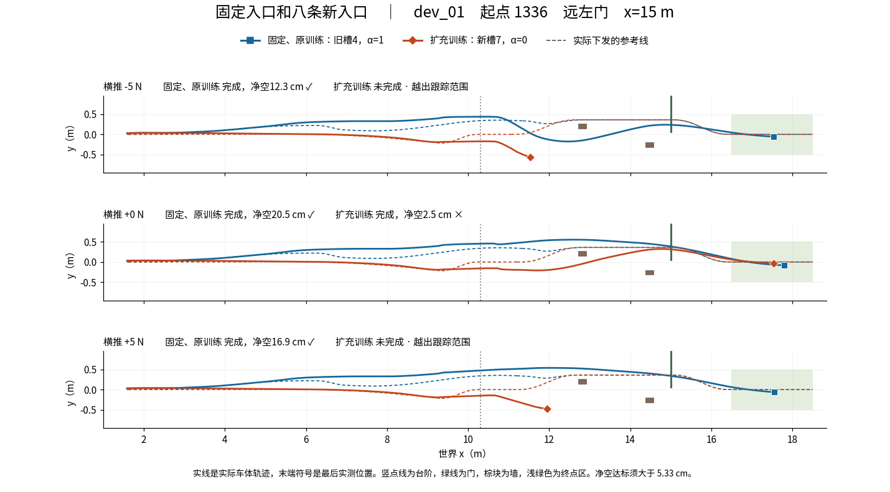

# 补充跳前训练数据以后，小车能选对过门路线吗？

1336 号要从远左门过。原固定入口和旧训练模型选同一条路，三种未知横推全部完成。补过数据的模型改选新 7 号入口，预报它落稳的概率为 0.901，落稳后过门的条件分为 0.680，乘积 0.613，高于固定入口的 0.377。实走只完成一次，三次均未达到 5.33 cm 净空。1325 号近右门给出了相反的结果：旧训练模型把三次本可成功的任务全选丢，扩充训练模型选新 7 号后，三次都成功并达到净空要求。[1325 号三次实走](augmented_training_rescue.png) · [两图全部 96 次事前选择的实走、参考及真实终点](augmented_training_xy.tar.gz)

## 同一批任务上的训练对照

两种训练都用六图、72 个仿真起点。原训练有 3,456 个跳前样本，扩充训练增加 1,728 个同起点的新路线样本，合计 5,184 个。输入只含出发时可以知道的状态、地图与参考路线。保持模型结构、地面出口评分和训练预算相同，均值模型和三成分模型各按三个预定种子拟合，每个模型做 540 次更新。增加样本也降低了每条旧记录在固定更新预算内被重复抽到的频率。

两张已公开的开发图另有 24 个起点。每个起点分别要走近左、近右、远左、远右，每道门在出发前从原固定入口与八条新入口中选一次，三种横推共用选择。合计 96 次决定、288 项过门任务。旧训练与扩充训练的选择均先从预测分冻结，再与实际仿真轨迹相连。近、远门可共享同一次物理行驶。表中第一列成绩要求落稳、通过指定侧、无碰墙到达并满足终点条件；第二列还要求接手至真实终点的每个 5 ms 存档帧，包络净空均严格大于 5.33 cm。

| 起跳前的选路规则 | 原训练：完成 / 达到净空 | 扩充训练：完成 / 达到净空 |
|---|---:|---:|
| 固定入口 | 175 / 123 | 175 / 123 |
| 三成分，主种子 61123 | 138 / 95 | **96 / 71** |
| 三成分，61124 | 96 / 69 | 156 / 113 |
| 三成分，61125 | 97 / 68 | 153 / 106 |
| 均值，61123 | 159 / 110 | 110 / 80 |
| 均值，61124 | 116 / 88 | 138 / 109 |
| 均值，61125 | 80 / 59 | 120 / 87 |
| 相似动作的训练经验 | 110 / 84 | 134 / 99 |
| 五个相近训练起点的经验 | 141 / 100 | 139 / 105 |
| 每个起点和门事后选三推合计最好的路线 | 220 / 178 | 220 / 178 |

主种子相对固定规则救回 23 项、丢失 102 项，净少 79 项；净空救回 23 项、丢失 75 项。相对同种子的旧训练救回 41 项、丢失 83 项，净少 42 项；净空救回 37 项、丢失 61 项。严格匹配的前缀界给出相同的净差。近、远门相对固定分别少 41、38 项。左门固定入口使用 α=1，右门和新曲线用 α=0；所有入口统一 α=0 复核，固定为 148 / 87，扩充三成分为 91 / 68。

| 开发地图、侧别 | 原固定：完成 / 达到净空 | 扩充主模型：完成 / 达到净空 |
|---|---:|---:|
| 图 00 左门，72 项 | 35 / 26 | 9 / 4 |
| 图 00 右门，72 项 | 54 / 54 | 52 / 52 |
| 图 01 左门，72 项 | 34 / 27 | 9 / 5 |
| 图 01 右门，72 项 | 52 / 16 | 26 / 10 |

## 为什么落稳预测改善了，过门反而变少？

八条新开发路线中，有四条在台阶边收回到中线。它们实际有 193/288 次落稳（67.0%）。旧主模型预报 23.8%，扩充模型预报 71.1%。另外四条在台阶边与旧路线同位置、同朝向，实际落稳 38.5%，模型从 38.7% 变为 35.8%。只在新八条中选，主模型的过门数由 60 增至 90/288。但把原固定路线也交给它，它在 96 次决策中有 94 次放弃固定路线，右门 48 次全选新 7 号，左门也有 30 次选新 7 号。较准的落稳概率还不足以给不同入口按指定门排好序。

丢失的 102 项固定方案成功病例中，36 项在地面接手前便失败；其余 66 项中，38 项驶出跟踪范围，21 项碰墙，7 项到达终点却过错门侧。获救和其余病例也全部计入表中。主模型全分母碰墙 28 项，固定 40 项。较少碰墙的同时，更多车在其他环节结束。

额外做了一次事后离线诊断。在同样九个入口上，互换两个已保存模型的评分成分，重排后按实际轨迹计分。下表固定主种子，每格为过门 / 达到净空。

| 落稳概率来自 | 落稳后出口分用旧训练预测的姿态 | 落稳后出口分用扩充训练预测的姿态 |
|---|---:|---:|
| 旧训练 | 138 / 95 | 127 / 97 |
| 扩充训练 | 137 / 93 | 96 / 71 |

两个因子相乘后会改变九条路线的排名。单换落稳概率只少 1 项，单换条件出口分少 11 项，一起换少 42 项。地面出口评分器权重全程固定，变化来自它收到的预测落地状态以及两个因子如何共同影响排名。这里考察已冻结分数的组合，尚不足以把整个退化归因到某个单独的动力学量。

按原登记让新八条中预测分最高的 25% 放行，扩充主模型放行的 576 项中有 420 项未完成，旧训练为 435 项。只看原 16 入口，主种子从 139 / 96 退至 130 / 86；只看原来的三个 α=0 入口，从 140 / 83 退至 127 / 74。不同菜单均对同一批任务评价。[新八条的逐组校准与状态误差](augmented_training_new8.tar.gz) · [原入口的成对复算](augmented_training_old16.tar.gz)

## 阶段决定

预登记的开发筛选要求主种子相对固定规则至少多完成 5 项、净空至少多 1 项，左右门分别不退化；相对旧训练两项也都须改善。实测结果未通过，该版本停止进入单车限时和封存地图测试。两位次要种子比各自旧版本有进步，二者仍未达到固定规则。现阶段可作为论文证据的是指定门会改变某些起点最合适的起跳入口，以及单独提高落稳预测准确度仍可能选错整段任务路线。要主张在线连续规划优于固定路线，仍须达到开发门槛并进行独立地图的同预算闭环验证。[两条实测入口的门向反转与数学推导](train_entry_gate_reversal.md) · [训练数据、有效配置、预测、逐项对照及复算资料](augmented_training_data.tar.gz)
