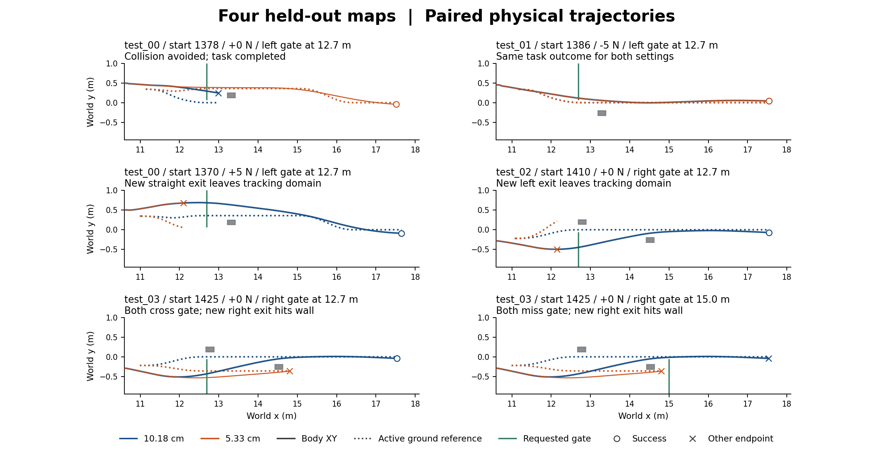

# 四张 TEST 地图上的过门、碰墙与反例



同一辆模拟车复锁后都能选左、直、右三个出口。只把模型要求的预测净空从 10.18 cm 调到 5.33 cm，1,152 个配对任务中，成功数从 454 增至 551（39.41%→47.83%），挽回 103 项，丢失 6 项。碰墙从 266 减至 177（23.09%→15.36%），避免 92 次，新增 3 次。成功要求小车复锁、在指定一侧过门、全程无碰墙、到终点保持 0.5 秒。601 个任务在新设置下仍未完成。

图中实线是车身中心的原始 XY，点线是相应地面控制阶段生效的路径。绿线为该任务的指定门，灰块为禁碰墙体。圆圈表示完整成功，叉号标在其他结局的最后一个物理采样点。车身有尺寸，车身中心停在墙旁也可能产生碰撞。为看清区别，首图放大了落地之后，覆盖所有 64 个起点的原图及完整坐标均可获取。[全套分图与研究说明](../RESULTS.md) · [便携逐帧坐标和重画程序](b2_physical_coordinates.tar.gz)

## 六个原本成功、换裕量后失败的任务

| 地图与起点 | 横推、门侧、门距 | 实际发出的出口，原→新 | 原设置与新设置的结局 |
|---|---|---|---|
| test_00，1370 | +5 N，左，近／中／远 | 左→直 | 原车过三个门并到达终点。新车在 x=12.101 m、y=+0.679 m 退出跟踪范围，连近门都未到。共丢失 3 项。 |
| test_02，1410 | 0 N，右，近 | 直→左 | 原车在 y=−0.447 m 过右门并到达终点。新车在 x=12.151 m、y=−0.501 m 退出跟踪范围，丢失 1 项。 |
| test_03，1425 | 0 N，右，近／中 | 直→右 | 两车都实际过了指定门。新车随后在 x=14.801 m、y=−0.364 m 撞墙。原车到终点，丢失 2 项。 |

**第三次新增碰墙也发生在 1425，对应远门。** 原车通过 x=15 m 时 y=−0.0129 m，落在要求的 y≤−0.06 m 之外，最终到达终点仍判任务失败。新车行驶到 14.801 m 就撞墙了。此项新增碰撞，两车的总任务结局都是失败。近、中、远是各自实际执行的三项任务；核对三份新轨迹，全程位置、速度和时序记录逐位相同。这三次新增碰撞来自同一个起点、同一种路径和同一面墙。

## 收益分布和不确定性

按原方案固定四张图，各图内对 16 个起点整组有放回抽样 10,000 次，随机种子为 20261124。每个被抽到的起点保留其全部横推、门距、门侧以及配对的两种方法。下表区间为相对原设置的绝对变化，单位为百分点。任务数是每种设置的分母。逐图区间描述这四张图内的初态差异。[逐图、门侧、门距和推力及其交叉分层的完整区间](b2_paired_intervals.csv)

| 范围 | 配对任务 | 成功原→新 | 成功率变化 [95%区间] | 碰墙原→新 | 碰墙率变化 [95%区间] |
|---|---:|---:|---:|---:|---:|
| 合计 | 1152 | 454→551 | +8.42 [+5.90, +11.02] | 266→177 | −7.73 [−10.42, −5.30] |
| test_00 | 288 | 117→129 | +4.17 [0.00, +8.33] | 48→33 | −5.21 [−9.38, −2.08] |
| test_01 | 288 | 147→161 | +4.86 [+1.39, +9.04] | 41→27 | −4.86 [−9.04, −1.39] |
| test_02 | 288 | 101→141 | +13.89 [+7.64, +20.49] | 96→57 | −13.54 [−20.49, −7.64] |
| test_03 | 288 | 89→120 | +10.76 [+5.56, +16.67] | 81→60 | −7.29 [−13.54, −2.08] |
| 左门 | 576 | 197→239 | +7.29 [+3.65, +11.28] | 190→145 | −7.81 [−11.46, −4.51] |
| 右门 | 576 | 257→312 | +9.55 [+6.08, +13.37] | 76→32 | −7.64 [−11.28, −4.17] |

近、中、远门每种设置各 384 项，分别多完成 24、33、40 项。横推 −5、0、+5 N 每种设置各 384 项，分别多完成 30、41、26 项。test_00 右门（70→70/144）和 test_01 左门（86→86/144）两组成功数均持平。test_00 全图成功增益区间下界为零。每项仅有一对观察值，个体反例用真实执行记录核对，区间按上述起点分组计算。

## 实际运行与时钟

四个原先预留的 TEST 地图槽位各有 16 个预留起点。四张具体的 16 cm 台阶地图及粗糙度种子在首次仿真前生成并冻结。每张图实际运行 576 条轨迹，两批各包含两图、1,152 个独立仿真环境。单批墙钟耗时 379.6 秒和 374.0 秒。两侧固定入口分别为左 4 和右 0。两种设置共用同一套跳跃、地面控制和三出口选择器，预测放行裕量分别为 0.1017768085002899 m 和 0.05330585315823555 m。[冻结合同、初态分配和物理执行回执](b2_source_and_results.tar.gz)

复核读取每条轨迹的实际姿态、速度、终点、碰墙标志、控制器出口和施加到车轮的命令。两次执行在允许发出各自出口前，1,152 对的姿态、速度、接触判据、控制命令、决策输入和时钟全部匹配。连续接触载荷的浮点原值在 1,079 对逐位相同。每种设置 246 条轨迹已腾空且接触远端，但在复锁前物理失败；另外 906 条进入在线出口计算，均按同一时刻发出了选中出口。两种设置间有 148 对实际轮命令发生改变。

仿真控制周期为 5 ms。复锁后一个控制步读取状态，查询后第三个控制步发布选择，因而两臂各承担 15 ms 的仿真发布延迟。四图 192 个真实 GPU 查询批次的墙钟中位数为 310.60 ms，P95 为 316.99 ms。这批记录测到了并行仿真上的算法效果，单车控制器端到端的实时期限仍需另测。

下载上述两个 tar.gz 文件，将补充包解压到子目录，在该目录中运行以下命令。第一条用原始时间与 XY 独立求过门点，核对碰墙和终点保持，重算各层区间与反例图；第二条重画 1425 号起点的全部 18 项配对。程序依赖 NumPy、pandas、Matplotlib，可在 CPU 上运行。

```sh
python reproduce.py ../b2_source_and_results.tar.gz --output review
python reproduce.py ../b2_source_and_results.tar.gz --output review --root 1425
```
