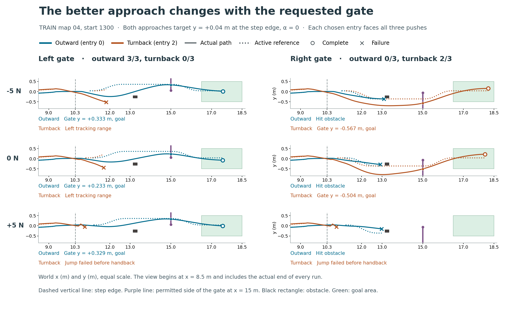

# 同一起点换一个指定门，会不会连跳前的路线也要换？

六张训练图里，1300 号起点给出了一个可以逐车核对的例子。两条起跳参考都瞄准台阶边左侧 4 cm。外移路线在跳跃触发时位于中线右侧 3.5 cm，折回路线此时已经到了左侧 11.5 cm。远门位于世界坐标 x = 15 m。给定指定门后，两条路线分别承受 −5、0、+5 N 三种横推。每次出发前选路，承受的推力对选路者保密。落地后均执行所指定一侧的固定出口控制。

| 1300 号远门任务 | 外移路线 | 折回路线 |
|---|---:|---:|
| 左门并到达终点 | 3/3 | 0/3 |
| 右门并到达终点 | 0/3 | 2/3 |

外移路线在右门任务中三次都撞墙。折回路线遇到 −5 N 和零推力时，走左出口两次都驶出跟踪范围，走右出口两次都完成；+5 N 时它在交回地面控制前失败。计分采用仿真中实际越过指定侧门线、无碰墙并到达终点的判据。左右两门各考三次，只肯在起跳前使用同一条路线的选法最多过三次；允许按指定门选路线，左门取外移、右门取折回，可以过五次。放宽到随机选路，共用一条选路规则的期望完成数仍至多为三。

## 对任意两条入口的计数证明

固定起点、台阶边目标和门线距离。令 $L_1,L_2$ 为两条入口在三种推力下完成左门任务的次数，$R_1,R_2$ 为对应的右门次数。同一个门内只许选一次入口，三种推力共享选择。两个门各给三个任务，相同权重。

- 允许按门分别选，六项中最多完成 $A=\max(L_1,L_2)+\max(R_1,R_2)$ 项。
- 两门共用同一入口，最多完成 $B=\max(L_1+R_1,L_2+R_2)$ 项。若用概率 $p$ 选入口 1，期望完成数是两列总数的加权平均，仍以 $B$ 为上界。

设 $d_L=L_1-L_2$，$d_R=R_1-R_2$。由 $\max(a,b)=(a+b+|a-b|)/2$ 得

$$
A-B=\frac{|d_L|+|d_R|-|d_L+d_R|}{2}.
$$

因此两门都偏好同一路线，或任一门打平时，差为零。两门严格偏好相反时，差恰为 $\min(|d_L|,|d_R|)$。1300 号的差为两项。这个结论只需四个计数，对任何两条入口都成立。

## 六张训练图上实际出现了多少次

配对检查覆盖 72 个仿真起点 × 台阶边左右两侧 × 距中线 4 或 14 cm × 近远两种门线，共 576 组。每组只比较瞄准同一边缘位置的一条外移路线和一条折回路线。每组三推、两门，合计 3,456 个评分项。同一物理轨迹可在近、远门线分别评分，统计中的独立起点仍为 72 个。一些轨迹缺少可确认的出口执行记录，其任务计数保留上下界。

| 门距 | 组数 | 可确定左右门严格偏好相反的组数 | 允许按指定门选的事后上限 $A$ | 两门必须共用路线的事后上限 $B$ | 差 |
|---|---:|---:|---:|---:|---:|
| 近门，12.7 m | 288 | 17 | 565–566 / 1,728 | 548 / 1,728 | 17–18 |
| 远门，15.0 m | 288 | 56 | 807 / 1,728 | 745 / 1,728 | 62 |
| 合计 | 576 | **73** | **1,372–1,373 / 3,456** | **1,293 / 3,456** | **79–80** |

73 组覆盖六张图、42 个不同起点。其中 65 组左门更适合外移、右门更适合折回；另 8 组方向倒过来。还有一组会随未知结果取值而打平或翻转。这套权重下，每次都能在两条曲线中选优时，提前按门分开选的收益为 **2.29–2.31 个百分点**。车辆实际执行的后段固定、入口只有这两条、地图均属训练集。新模型能从出发时可用的信息兑现多少收益，由另行冻结的开发选路实验衡量；对任意连续控制的物理可达界还需车辆动力学推导。

[逐项数据与作图脚本](train_entry_gate_reversal.tar.gz) · [六图全部入口和逐起点实走资料](train_entry_support.md)
