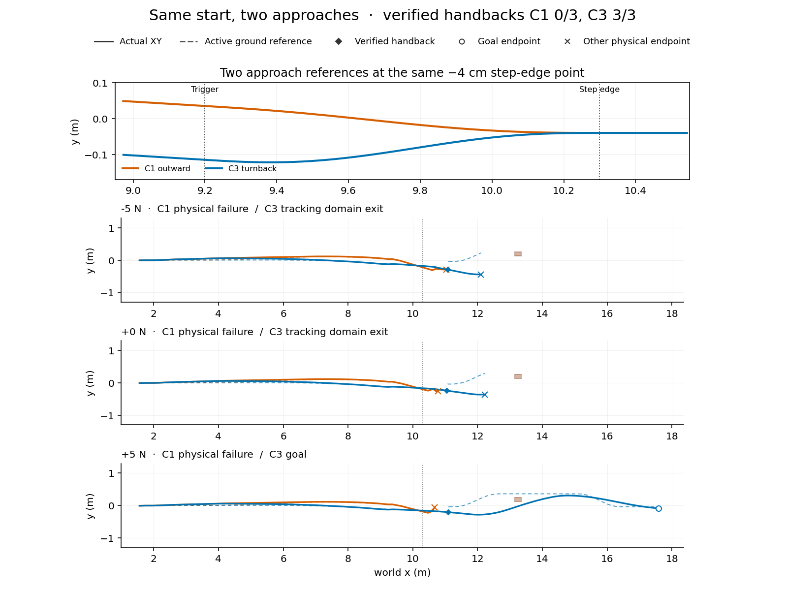

# 同一台阶边位置下，两种接近路线的训练实走

第一张训练图上，1250 号起点要到台阶边右侧 4 cm 的同一点。橙线 C1 在跳跃触发时位于中线左侧 3.5 cm，继续向右移；蓝线 C3 在触发时已经到了中线右侧 11.5 cm，再向中线折回。两条参考在台阶边都朝正前方，α 均为 0。图顶为参考几何，下面三行分别是 −5、0、+5 N 横推下的左出口副本。实线为实际车身 XY，虚线为当时地面控制器正在跟踪的参考。橙线三次都在交回地面控制前失败。蓝线三次都落稳并交回控制，其中两次随后超出跟踪范围，只有 +5 N 的车抵达终点。

## 复锁与过门分别计分

6 张既有训练图，每图 12 个起点，每个起点 8 条新参考、3 种推力，各执行左右两个固定出口，共 3,456 车次。复锁与首查按预先指定的左副本统计，分母为 1,728 个前缀。左右副本从起始到交回控制或查询前终止均匹配。1,039 个前缀确认复锁，在接手后的下一个 5 ms 控制步观测到首次查询。复锁时刻为出发后 4.515–5.710 s，中位数 4.780 s。其他 689 个前缀在首次查询前终止。所有 72 个根与原训练组相同，新增的是几何条件。

| 训练图 | 已复锁且获首查 / 288 | 折回复锁 / 144 | 外移复锁 / 144 | 仅折回复锁 | 仅外移复锁 |
|---|---:|---:|---:|---:|---:|
| 00 | 188 | 109 | 79 | 56 | 26 |
| 01 | 177 | 109 | 68 | 63 | 22 |
| 02 | 158 | 98 | 60 | 59 | 21 |
| 03 | 172 | 108 | 64 | 64 | 20 |
| 04 | 183 | 110 | 73 | 56 | 19 |
| 05 | 161 | 96 | 65 | 60 | 29 |
| 合计 | **1,039/1,728** | **630/864** | **409/864** | **358** | **137** |

对同一张图、同一起点、同一推力、同一边缘侧与同一边缘位置，比较两种接近参考。864 对中有 358 对仅折回复锁，137 对仅外移复锁，272 对都复锁，97 对都失败。合计多 221 次复锁（25.6 个百分点），六张图净变化均为正。按 −5、0、+5 N 分别有 385、400、254 次复锁，各自分母 576。

正负侧的规律不同。以世界坐标 y 正方向为左侧，同一侧的边缘位置为 +4/+14 cm 时，折回复锁 133/131 次，外移为 172/180 次，各自分母 216。换到 −4/−14 cm，折回为 189/177，外移为 26/31。触发位置、后续弯法与走过的地形一起变化，这里比较的是完整参考的效果。

| 固定出口和门 | 折回：正确过门并到终点 / 864 | 外移：正确过门并到终点 / 864 |
|---|---:|---:|
| 近左 | 19 | 24–25 |
| 远左 | 121 | 178–179 |
| 近右 | 472 | 153–154 |
| 远右 | 473 | 158–159 |

过门按首次在复锁后通过 12.7 m 或 15.0 m 门线时的侧向位置、无撞墙并达成原终点条件计分。外移组每个门有一条分支缺少确认执行证据，表中保留界限。近、远复用同一实际轨迹。折回的落稳次数较高，实际左门完成数却低于外移组；右门出现相反结果。这给起跳前评分提供了直接依据：落稳后还能不能过指定的门，会改变入口的取舍。

## 数据与图

采集收据为 1,728 个新增前缀、3,456 条物理轨迹和 6,912 条门记录。合并收据为原 3,456 个训练前缀加本批 1,728 个，共 5,184 个，来自相同的 72 个训练起点。本报告只评价新增采集的数据。逐根图每张包含八条参考和三种推力。保存 1,954,517 组原时间与 XY，按真实物理终止截断；6,572 段生效地面参考按原程序裁取。1,727 条轨迹的最终 XY 有限。训练图 02、根 1275、C7、0 N 在 4.630 s 物理失败，末帧坐标非有限；图中空心三角标出 4.625 s 的最后有限位置 (10.817794, −0.277679) m。

[各根实走图、实际 XY、参考与独立重画入口](train_entry_support_xy.tar.zst) · [逐图逐根逐槽逐推力表、几何与采集/合并回执](train_entry_support_metrics.tar.gz) · [本地 72 张实走图](</media/qy/6A7E3DB07E3D75C3/STTW_runs/chapter3_continuous_p1_20261123/continuous_train_support/collection_report/index.html>)
