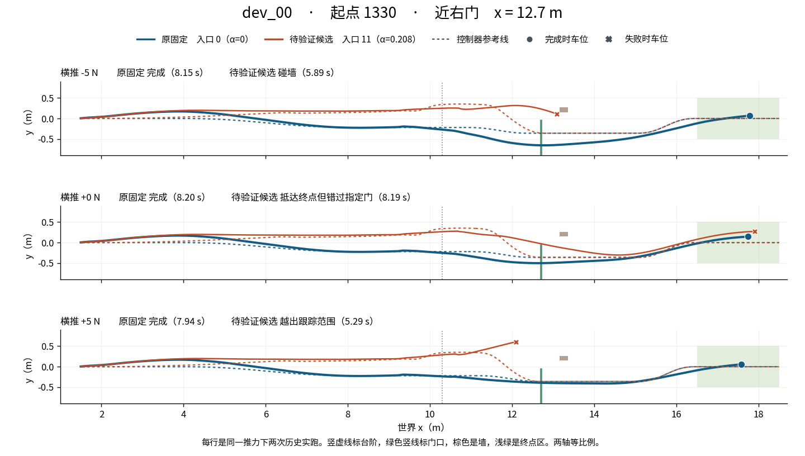
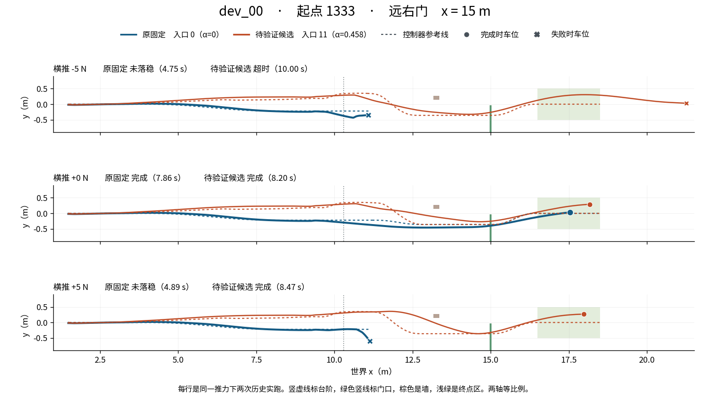

# 只验证两个候选，规划器实际选对了多少

上图是同一个跳前决策在三种未来横推下的实走记录。原规则的路线三次都完成近右门任务；换用另一条预测能落稳且能出门的路线，三次都落稳，但最后三次都没有完成原任务。各入口沿用各自登记的跳前 α，后段均实际执行固定右出口。

每张地图 12 个起点，近远、左右四道门。对每个起点与门，只保留原固定规则选项和轻量均值评分中最高的另一选项。两者都从出发时允许的观测中预测接手状态，并用冻结的地面模型评估与目标门同侧的固定出口，要求足够净空、门向正确、处于适用范围且终点保持合格。最后分数为落稳概率乘以该后段的预测可行性。两分相等时沿原选项。

96 个选择、共 192 个候选都先算完并写下最终入口，再按原记录检查每次选择随后三种未知横推的实际结果。在 51 个与历史登记门相同的候选上，单侧地面模型全部复现原有的二元准入。这是使用已执行开发轨迹评估决策的离线回放。

| 开发图与门侧 | 原规则实际完成 | 两候选均值验证实际完成 | 救回 | 损失 |
|---|---:|---:|---:|---:|
| dev_00 右门 | 54/72 | 47/72 | 1 | 8 |
| dev_00 左门 | 35/72 | 35/72 | 0 | 0 |
| dev_01 右门 | 52/72 | 52/72 | 0 | 0 |
| dev_01 左门 | 34/72 | 34/72 | 0 | 0 |
| 合计 | **175/288** | **168/288** | **1** | **8** |

96 次跳前选择中有 7 次换路，影响 21 个推力任务。8 个损失病例都实际落稳，后段出现两次碰墙、三次退出跟踪范围、一次超时和两次到达终点却从错误一侧过门。1 个救回发生在 1333 号起点远右门。图中 1330 与下图 1333 使用的替换入口均为第 11 项；不同起点的结局相反。

原候选与替换候选的地面预测都判可行时，二元后段分数同为 1，最终排序只剩预测落稳概率。dev_00 右门五次切换都属于这种情况，包含全部 1 次救回与 8 次损失。作事后对照，若原候选获准时一律沿原路线，余下 2/96 次切换；两图总数回到 175/288，已知净收益为零。没有证据表明仅靠这个二选一均值规则可以改善整车结果。此前 192/288 是同一候选集中事后选对时能达到的上界。

[逐候选分数、冻结选择、各推力实走结果和计算方法](two_finalists_verification.tar.gz) · [96 组 XY 的紧凑重画数据](two_finalists_xy.tar.gz)
