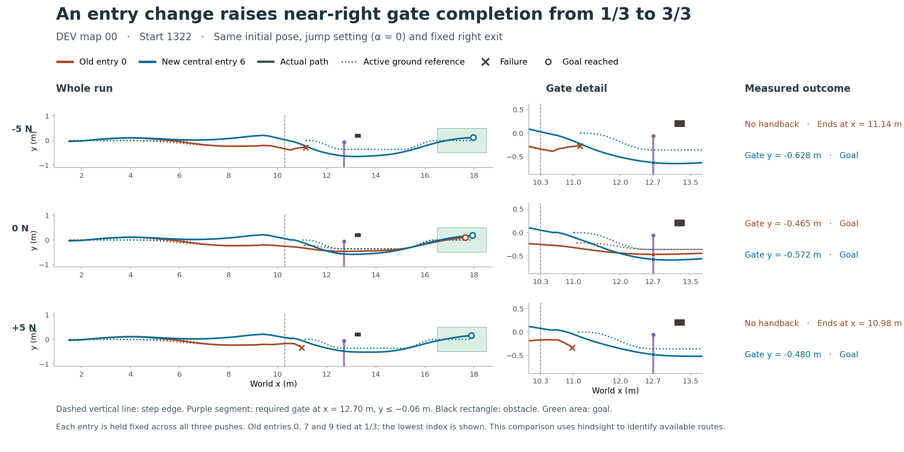

# 八条新起跳路线的实走结果

1322 号起点要过右门。车越过门线时，车身参考点需要处于中线右侧至少 6 cm，之后还要在没有碰墙的情况下抵达并稳住。图中实线是实际轨迹，虚线是地面控制器当时跟踪的参考。对三种可能的横推，每种方法都必须预先选定同一条起跳路线。旧 16 条中成绩最高为 1/3；图中选并列最高的旧 0 号，零推时过门，两次有推力时都在落稳前失败。新 6 号把参考弯向一侧、再对准台阶中央，三种推力下都成功，过门分别在中线右侧 62.8、57.2、48.0 cm。图中两入口的 α 均为 0。

## 实验怎样安排

沿用两张已打开的开发地图、每图 12 个起点。8 条参考都是新的，α 固定为 0；前段共同走至世界坐标 x=3 m。四条保持原库在台阶边的位置和朝向，改变接近段形状；另四条在跳跃触发处偏左或偏右 8.5 或 20.5 cm，到台阶边时回到道路中央并朝前。每条都真实执行 −5、0、+5 N 三种未知横推，并各跑固定左、右出口。共 576 个跳前条件、1,152 条新物理轨迹。每图 576 辆同时运行，两图在前 512 个控制步全数重叠。每个出口可在近、远两个门位置评分，同一轨迹可能贡献两个门结果。

四种方法的所有选择均在实跑前写定，共享同一快速出口评分机制。主选择要求按每个起点和指定门从全部八条中选一条，选定后承担三种推力。各方法均有完整的 24 起点 × 四道门 × 三推 = 288 项。24 个起点是这批开发数据的抽样单位，八条曲线新，两张地图已用于开发。

| 出发前的选法 | 正确过门并到终点 | 同时满足实测净空 |
|---|---:|---:|
| 单点落姿模型 | 57/288 | 46/288 |
| 三成分落姿模型 | 60/288 | 55/288 |
| 按相似动作汇集训练经验 | 68/288 | 52/288 |
| 从五个相近训练起点汇集经验 | 69/288 | 50/288 |

净空按冻结的车身与摆体包络，从落稳后的首次地面查询到真实终点每 5 ms 检查一次，各帧均须大于 5.33 cm。共有 253 条不同的成功轨迹，184 条满足该标准。原门任务 2,304 个候选结果中有 8 个未能判定；四种方法在主选择中选到的 288 项都能判定，核实左右两辆车分流前的状态后计数不变。

三成分对单点在原任务上救回 25 项、丢掉 22 项。第一张图近右门，1326 号起点选新 2 号后，两种推力的任务得以完成；+5 N 时两车都到了终点，却都没偏到右侧要求的 6 cm。第二张图近右门，1340 号的单点选新 6 号，三推全过；三成分选新 0 号，两次未落稳，一次在门前约 5.4 cm 碰墙。按净空计，三成分对单点救回 26、丢掉 17，其中第二张图右门合计救回 6、丢掉 14。[1326 号得例](unseen_entry_1326.png) · [1340 号失例](unseen_entry_1340.png)

## 候选中有多少本来可以走通

对每个起点、每道门，先将每一入口在三种推力下的成功数相加，再取其中最大值。若有未定结果，就分别将其计为失败和成功，得到下表范围。这是用事后轨迹计算的上限。车在出发时预测能得到的实绩见上表。

| 可选范围 | 原门任务上限或固定实绩 | 同时要求实测净空 |
|---|---:|---:|
| 原固定规则，实际完成 | 175/288 | 123/288 |
| 新八条，事后最优 | 171–173/288 | 147–149/288 |
| 原固定入口加新八条，事后最优 | 220/288 | 178/288 |
| 旧十六条，事后最优 | 220–222/288 | 尚未全量复算 |
| 旧十六条加新八条，事后最优 | 242/288 | 尚未全量复算 |

与旧十六条相比，加入新曲线在 18 组起点与门、9 个不同起点上带来 20–22 次额外成功。仅加入四条回到台阶中央的路线就可以达到 239/288。两批的起始位置与速度、地形、推力、低层策略、时钟和指定出口规则相符。旧库包含不同 α，落地后的实际出口参考随接手状态而变。固定 α=0 作敏感性对照时，原三条上限 149/288，加入新八条为 199–201/288。此比较同时扩展了候选数与形状。

## 将原固定入口也交给选路器

小车面对一个已知能走的入口和八个新入口。出发前比较九个分数，打平先保留原固定入口。相同起点、门和选法共用同一选择承担三种未知推力。两张开发图的结果此前已打开，本次先保存逐候选分数与选择，再按任务键读取各方法所选的实走结局；这项比较是事前输入驱动的离线回放。原固定规则左门采用原 4 号和 α=1，右门采用原 0 号和 α=0。

| 九选一的评分方法 | 原门任务 | 同时满足 5.33 cm 净空 | 相对原固定的原门救回 / 丢失 |
|---|---:|---:|---:|
| 保持原固定入口 | 175/288 | 123/288 | — |
| 单点模型 | 159/288 | 110/288 | 4 / 20 |
| 三成分模型 | 138/288 | 95/288 | 4 / 41 |
| 相似动作经验 | 110/288 | 84/288 | 21 / 86 |
| 五近邻 | 141/288 | 100/288 | 2 / 36 |

三成分在 96 次出发选择中有 25 次换路。原门任务左、右门净少 18、19 项。即使将左门也改用实际跑过的同几何 α=0 入口，固定规则 148/288，三成分 123/288，加净空则为 87 与 74。下面两组在每次出发前都允许保留原固定入口。

- 1325 号近右门，原 0 号得分 0.758，新 2 号 0.785。模型换路，三种推力原本均过门且达净空要求，换后全部失败；两个入口均为 α=0。[三条推力的实走 XY](nine_choice_loss.png)
- 1342 号远左门，原 4 号得分 0.475，新 2 号得分 0.530。换路使 −5 N 得以过门，三推的原门任务从 2/3 升至 3/3。零推时新路线的采样包络净空降为 −4.43 mm，按规定净空三推合计仍为 2/3。[三条推力的实走 XY](nine_choice_rescue.png)

九选一的候选相同，最优可达 220/288 或按净空计 178/288，四种评分均未超过原固定实绩。少数新形状有价值与现有模型是否选对是两个可分别验证的问题。下一步在六张训练图上补充外移与折回的成对路线，比较补数据前后同一方法的完整任务得失。[已冻结评分、实走对照、增广拟合合同与复算入口](nine_choice_results.tar.gz)

## 模型漏掉了哪些路

两张图的中央四条入口分别落稳 104/144（72.2%）和 89/144（61.8%），三成分模型出发前给的平均概率只有 24.1% 和 23.4%。在同边四条上，实测为 57/144 和 54/144，预测为 38.9% 和 38.5%。允许八选一时，三成分在全部 96 组都选了同边入口；限制在中央四条时，同一模型完成 78/288，加净空为 60/288。评分同时使用落稳概率和出口成功预测，两项都影响最后选择。

按各图各门固定放行前 25% 时，三成分放行的 576 项中有 141 项完成，均值为 131 项。三成分漏掉 298–306 项本来可能完成的门任务。该统计跨起点排序，与每个起点独立选一路的 288 项成绩含义不同。

两图上三成分与均值模型的接手位置均方根误差都约为 22 cm。三成分给出的名义 90% 边际范围，在四法均有预测的 300 次有效查询中，前向位置覆盖 229 次、横向位置 261 次、前向速度 220 次。原始粒子的分散程度低估了部分状态误差。要判断补数据能否帮助选路，应在 TRAIN 扩展“跳前偏到哪里、到台阶边又回到哪里”的组合，保留原固定入口，冻结模型后同时检查原门任务、净空和左右门的配对得失。当前结果支持继续研究可执行的新入口，独立地图上的在线规划增益仍待验证。

[逐项结果、冻结选择、预测与数学上限的复算数据](unseen_entry_results.tar.gz) · [全部开发任务的实际与参考 XY 图索引](/media/qy/6A7E3DB07E3D75C3/STTW_runs/chapter3_continuous_p1_20261123/continuous_interpolation/choice_xy/index.html)

[可移植的 1,152 条原始 XY、实际生效参考与重画入口](unseen_entry_xy.tar.gz) · [96 组完整轨迹图与图例，解压打开 choice_xy/index.html](unseen_entry_figures.tar.gz)
