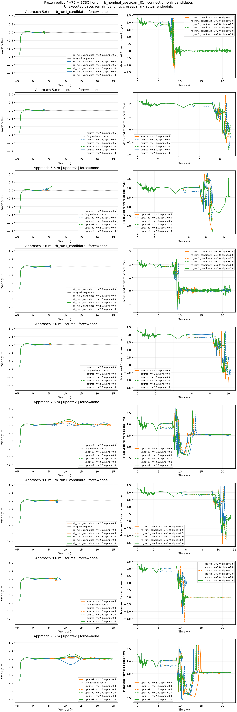
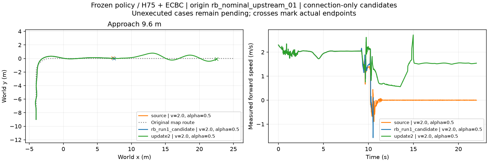
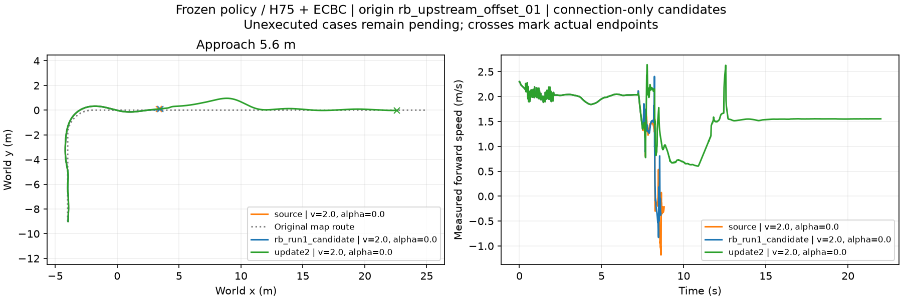

## 同名义根完整矩阵：source/RB各18条已完成

18组相同接近条件全部both_failed：source 0/18、RB Run1 0/18；两者均18/18到交权线并出现腾空，但0/18达到严格支撑、0/18交回地面。每组到交权的已记录前缀位置完全相同（最大差0），没有把不同地面接近冒同入口。各距离5.6/7.6/9.6m各六档，轨迹在实际失败终点停止；存活至窗口但留在台前同样判任务失败。

update2独立工程参照同18条件7/18完成、12/18严格支撑并交回；它有Isaac适配历史，不能用来证明原RB优于source。source/RB同接口待遇下均未完成，不是恢复能力负贡献证据。当前没有成功档可进行“分别选成功接近再交换”的效果比较，机器摘要显式no_successful_candidate，不用最好存活者代替。

外扰24条已准备并接续执行；首次启动缺PYTHONPATH未进入物理，失败日志保留，修复现有运行入口后继续。后续若确认原技能是瓶颈，按任务书单列同预算适配，不能将新训练史与原权重混名。当前本矩阵0优化，原权重未修改。

matrix保存36原策略逐条完整配置/模型时钟身份、实际轨迹/动作/接触/终局；update2复用原chapter3_jump_approach_pilot证据不重复训练。下面是早期四条先导快照。

# 跨技能同接口先导：已完成四条新评测

source/RB Run1四条为本次新执行，update2两条为原已完成结果复用。全部为 DEV 先导。

| 工况 | source | RB Run1 | update2（复用） |
|---|---|---|---|
| 名义根，9.6 m，2.0 m/s，α=.5 | 未稳定落台，运行22 s | 未稳定落台，10.545 s终止 | 完整成功，T=16.36 s |
| 根01，5.6 m，2.0 m/s，α=0 | 未稳定落台，8.810 s终止 | 未稳定落台，8.610 s终止 | 完整成功，T=13.70 s |

四条source/RB均出现双轮离地，但没有满足台面双轮支撑、无非轮接触、姿态限制及连续1 s保持。长连接source虽存活22 s，速度在跳跃后衰减至接近零，未完成台面落地与后续目标；不能把存活算成功。各根三技能交权前实际轨迹配对差为0（长461、短362个保存样本），差异出现在交权后。

使用同一原RB车、圆弧轮形、摩擦0.8、400 Hz物理/200 Hz地面/50 Hz策略、H75+ECBC且地面残差为零、释放线距台沿1.6 m和统一落台交回规则；网络和动作映射见bindings.json，完整每条实际配置见results/*/protocol.json及原配置。没有训练、没有技能专属参数调整，预算上限35200物理步。

source/RB是原论文绑定策略，经原有JAX/Torch导出；update2有独立Isaac适配训练历史。因此本次只说明前两者直接接当前连续任务尚不可用，不是原MuJoCo能力或RB方法无效，也不是公平训练预算下的恢复能力优劣结论。继续用已适配update2开展接续规划；正式跨技能机制实验仍需可执行接口、同域候选矩阵、匹配外扰与接近参考交换，未完成。

summary.json保留所有条件、完整失败、事件与配对前缀；results/包含实际轨迹、路径、接触判定和协议，模型权重未入Git。source/RB哈希及历史导出parity来源见bindings.json。
