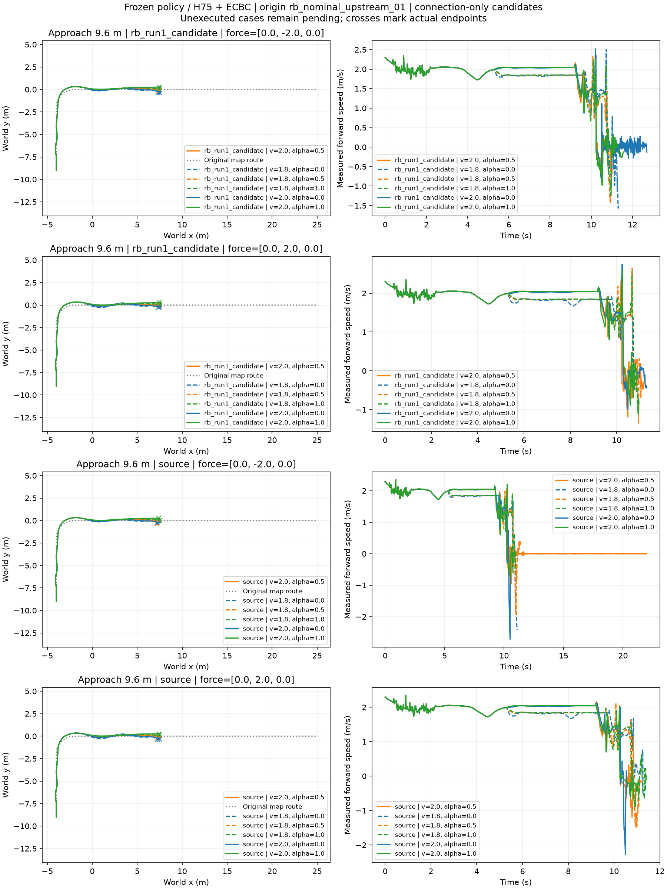

# E4 同外扰技能对照：24条已完成

长接近9.6m、六档接近、两种确定性Fy=±2N/.12s、同一上游根。source与RB各12条：完整任务均0/12；12配对全部both_failed。各自12/12到达交权线、观测到腾空，但严格落台、交回地面和续行均0。source仅1条满22s（v2/.5、Fy−2N）却在台前停住；RB无满窗。不能用存活或腾空冒任务成功。

同候选、同外扰的交权前实际位置最大差为0；实际施力每条48个物理tick、冲量Fy=±0.239999995Ns，见applied_impulses.json。不跨扰动匹配前缀。两策略均无成功候选，因此交叉选档结果为no_successful_candidate，不编造“最佳成功接近”。update2无扰参考不冒受扰匹配比较。

这是单上游根的确定性开发矩阵，不是12独立根或随机扰动成功概率。结果支持在当前Isaac域进行同待遇有界适配，不能由直接迁移失败断言RB原方法无效。保持原模型/频率/任务与失败证据，0优化。完成后队列复用该GPU名额自动启动既定36条E5多根路线，无额外长期并发。

下面保留原执行前预算与设计记录，历史“未执行”不代表当前状态。

# E4 相同外扰技能对照：仅准备，尚未执行

长接近9.6m，原名义上游根，1.8/2.0m/s × α=0/.5/1 × source/RB Run1 × 两种预定侧向力，共24条。复用E5外力协议：chasis局部作用点、世界Fy=±2N、持续.12s、原位置触发；精确字段见各配置external_force_pulse。它们是两种确定性DEV条件，不是随机扰动概率估计。

保留原模型、同一地面H75＋零底层残差ECBC/ESO、同样的锁摆/释放、400/200/50Hz时钟和22秒评价。预算211200物理步、0优化。尚未启动，没有成功/失败结果。待当前名义source/RB候选矩阵完成后接续；不另增长期第四GPU任务。

生成器prepare_cross_skill_connections.py支持--distance及--disturbance-configs，复用已执行外扰配置。不会把无扰update2参考标成配对受扰结果。compare_cross_skill_connections.py按来源、距离、完整外力协议配对，两策略各六档均完成后才产生事后交叉选档。图按技能和外扰分面、按alpha着色；前缀比较限定同一扰动。

当前机器摘要：12技能配对均pending，两个扰动组各六档。冻结配置与manifest保留；路径指向本工作站的资产与原权重，无新权重或训练。
