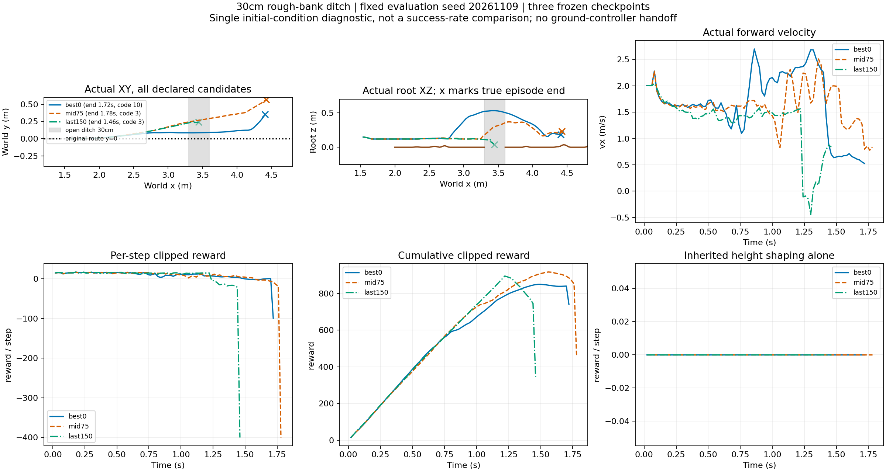
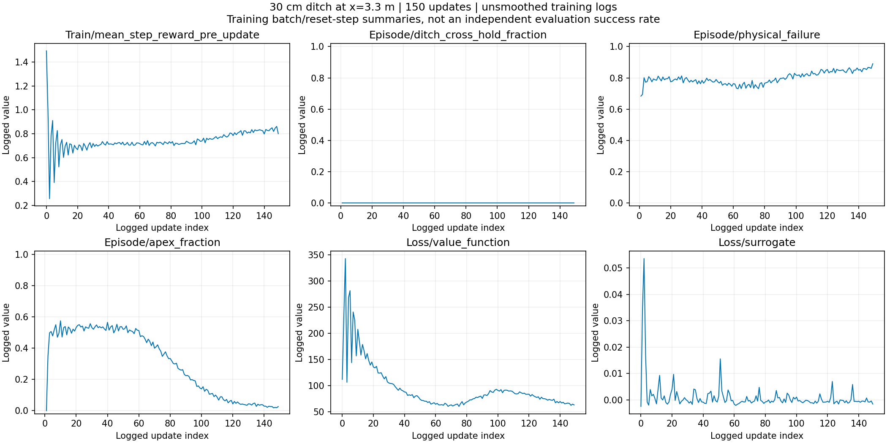
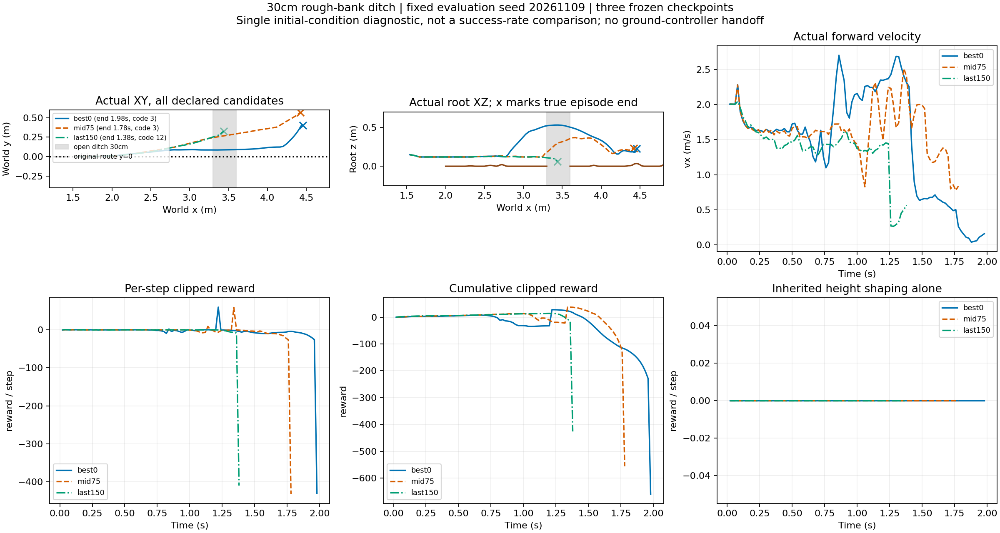

# 第三章：30cm碎石跨沟与奖励修订

## 实验背景

主线是已知地形上的接触事件世界模型规划：复用STTW行驶和RecoveryBridge跳跃/恢复能力，预测清障、着陆、恢复后能否继续任务。当前先解决E0跨沟技能，不把11个完整预设场景的LLM选择当作自主规划。

用户指定沟口x=3.3m、沟宽0.30m、同高远岸，中心带有1–4cm固定碎石。物理步2.5ms、策略步20ms，保持原车辆、执行器、网络及Go2域随机化。碎石地图与沟宽固定，不能称为地形随机训练。

## 已完成结果

旧目标奖励训练4096环境×24步×150更新，14745600转移，34.18分钟；接触缓冲修复后本轮日志无溢出或非有限值。训练149个有效episode记录的跨沟保持指标均0。另一次旧60cm训练存在接触patch溢出，不能作有效训练证据。

同固定种子20261109、同抽样物理参数、均值Actor，各一条真实回放：

|模型|时长|最高车体z|最终x|终止与接触|
|---|---:|---:|---:|---|
|初始best0|1.72s|0.530m|4.406m|前轮接触远岸，航向超限|
|中期75|1.78s|0.368m|4.421m|前轮接触远岸，侧倾超限|
|最终150|1.46s|0.148m|3.440m|未明显腾空，无远岸轮接触，侧倾超限|

全部未稳定双轮落地续行。此单初态最终模型退化，不是独立成功率结论。没有STTW地面回交。模型身份、冻结旧配置与逐候选结果见本目录JSON；完整NPZ和动画留在[provenance.json](provenance.json)指向的本地运行目录，模型权重不入Git。

`Episode/reward`是结束回合累计奖励汇总，末值686.90；best却按4096×24步的平均单步奖励选更新前模型，最终选到update0（与初始权重相同）。首批仅覆盖0.48s起步，后续混合失败与落地，存在阶段分布偏差。best0不是任务能力最优的证明。最终150已独立回放，不能用训练reward替代实际行为。

## 奖励问题及本次修改

最终150在未清沟时仍累计取得速度约398、前进192、位置122、存活110分；旧目标速度1.5m/s与接近段1.8–2m/s要求竞争。不同失败终止罚也不同。证据支持“容易在沟前获得正奖励”，尚不能证明策略有意求死。

当前候选奖励：

|项|定义|
|---|---|
|实际进展|20×相邻时刻x进展，x限于[1.5,5.6]；停留不奖励，后退扣回|
|首次腾空|+10，双轮无支撑且有离地高度，回合内只一次|
|首次清沟|+60，已腾空且双轮越过远岸、轮高大于0.045m；不是落地成功标签|
|恢复续行|+150，沿用双轮支撑、姿态、速度及1秒保持条件，回合内只一次|
|失败|-400，统一物理失败及未完成的超时；不再给未完成超时bootstrap|
|正则|保留非正的姿态偏离、动作变化/幅度和关节能耗成本|

取消沟前每步位置/速度/存活奖励、重复正姿态奖励及冲突的接近速度塑形。不靠抬高跳跃高度给分。此为待训练候选，不能称已消除强化学习的所有投机行为。

用户明确要求先学跳跃、后做轨迹跟踪：取消原45°航向终止及横偏/偏航跟踪奖励；横向边界从±0.9m改为实际±4m地面的内侧±3.9m。中心碎石带之外为平地，后续须分开记录落点，不能将侧向绕到平地称为完成碎石着陆。侧倾35°、俯仰75°、车体碰撞、沟底跌落终止保留，1秒恢复姿态/速度条件保留。

**本次同时更改奖励与任务域约束，不是单因素奖励消融。旧训练配置与失败记录不改写。**

代码入口：[奖励](../../../learning/src/sttw_control/ditch_goal_reward.py)、[奖励汇总](../../../learning/src/sttw_control/phase_u_reward.py)、[事件与环境](../../../learning/src/sttw_control/phase_u_env.py)、[新任务配置](../../../learning/configs/isaac_phase_u_task_ditch_goal.json)、[训练配置](../../../learning/configs/isaac_rb_jump_ditch_goal150.json)。16项相关测试通过，覆盖停留/后退、失败惩罚、非中心落地及旧奖励兼容。新奖励尚未训练；下一步依据短回放确认接线，再开展冻结预算的训练。

## 新奖励与放宽航向的工程回放（0训练）

同三模型、同种子、同物理采样，改用新奖励和任务边界。初始模型在原航向终止前86个控制步的root状态逐值一致；取消45°终止后由1.72s延长至1.98s，随后侧倾超限，仍未1秒续行。中期75因侧倾超限结束；最终150在1.38s触发地形失败（code12：沟底/地面边界/车体接触的并集）。三条均无运行报错，不代表新策略训练完成。

|模型|时长|进展奖励|腾空/清沟/恢复奖金|失败罚|总奖励|
|---|---:|---:|---|---:|---:|
|best0|1.98s|59.14|10/60/0|-400|-659.48|
|mid75|1.78s|58.42|10/60/0|-400|-556.24|
|last150|1.38s|38.77|0/0/0|-400|-426.15|

当前修改只验证了事件奖励实际接入及航向终止移除，没有证明训练增益。原/新回报定义不同，不横向比较总分。详细新回放摘要见[event_reward_check_summary.json](event_reward_check_summary.json)。
