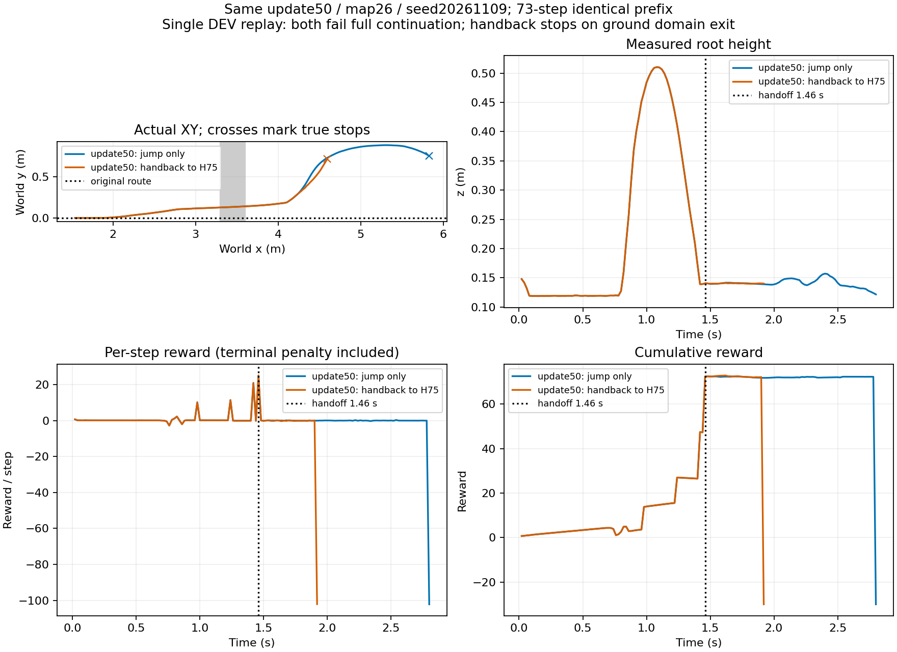

# 第50轮跳跃后交回 STTW：已执行，续行未完成

同一 update50、seed20261109、地图26（沟口3.3m、宽30cm，远岸高2.1916cm、碎石1–4mm），复用原跳跃回放作配对基线。仅单初态DEV；没有新增训练。

|执行|交接|真实终点|最终阶段|任务结果|
|---|---|---|---|---|
|原跳跃策略持续执行|无|2.80s，侧倾超限|3|未完成1秒稳定续行|
|落地捕获后交回H75|1.46s|1.92s，地面跟随器适用域退出|3|未完成1秒稳定续行|

切换前73个控制步的root逐值一致，随机化物理参数相同；切换瞬间root未变化，没有重置位姿或速度。交接时横向速度0.765m/s、偏航角速度1.226rad/s；之后横向位置误差由0.218m增至0.715m。停止记录明确 domain_exit=true、numerical_fault=false。适用域检查涉及预瞄点位于车前与航向差小于90度；本次未分别记录两个子条件，不能声称已定位其中哪一项，也不能把此停止称为摔倒。

实现复用现有 H75 + ECBC/ESO，zero_lower=true（不是启用Local300残差），目标速度1.5m/s、α=.5，原始直线路径y=0不重定位。stage3落地捕获后在下一个策略边界回交；摆机构使用现有当前位置关节制动，控制器历史按实测状态初始化，物理时钟保持连续。地面控制200Hz、策略50Hz、物理400Hz。

范围限制：本次仅接通评价入口，未修改正在训练的奖励或训练循环。地面反馈沿用已有clean-state接口，跳跃前的噪声/延迟没有自动扩展到地面控制；随机化物理参数保持。轨迹文件的action仍为跳跃网络候选输出，交接后不执行；实际地面指令见ground_commands.npz。完整任务仍失败，不能据此称技能闭环已经可靠。

首次工程回放遗漏地面监督停止的终止扣分，原文件保留于handoff50/evaluation，不采用其+71.84总回报。修复为按既有有限时域失败结算、清除剩余势函数后，checked复跑总奖励−30；没有修改物理失败或成功判据。两条比较均保留真实失败终点。

## 证据与复现

- 原始运行根目录：`/media/qy/6A7E3DB07E3D75C3/STTW_runs/chapter3_ditch_random_contactfix450`
- 原对照：`eval50/update50/trajectory.npz`。
- 正式本次回放：`handoff50/checked/`，含config、summary、handoff、ground_stop、ground_identity、随机物理参数、逐物理步接触与控制步轨迹。
- `handoff50/config.json`、`manifest.json`保留预算和入口；命令：`PYTHONPATH=learning/src /home/qy/miniconda3/envs/env_isaaclab/bin/python learning/cli/evaluate_ditch_skill.py --config <run>/handoff50/config.json --output <new-output>`。
- [画图与前缀检查脚本](plot.py)、[核对结果](verification.json)。Python编译及diff检查通过，物理回放完整退出。

结论：落地后切回STTW已实际实现；当前落地状态与地面控制能力尚不匹配。下一步应定位预瞄/航向域退出并检查落地可接管状态，保留原路径与物理判据，不将自动切换视作成功恢复。
