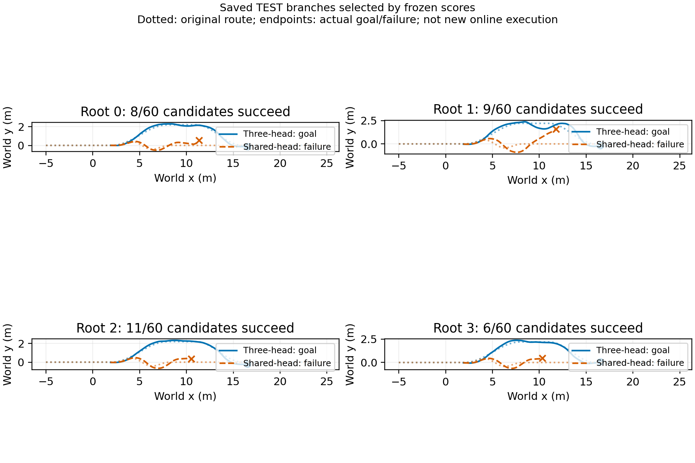

# Frozen candidate-ranking diagnostic

This analysis ranks the 60 saved candidates per root by their existing frozen autoregressive completion scores. Ties use candidate ID. Neither fitting nor new physical execution is performed. All four previously inspected TEST roots are shown.

|Root|Successful candidates|Three-head selection / result|Shared-head selection / result|
|---|---:|---|---|
|0|8/60|ground_detour_v1.8_a0.0 / 1|s_bend_jump_v1.5_a0.0 / 0|
|1|9/60|ground_detour_v1.8_a0.0 / 1|s_bend_jump_v1.5_a0.0 / 0|
|2|11/60|ground_detour_v1.8_a0.0 / 1|s_bend_jump_v1.5_a0.0 / 0|
|3|6/60|ground_detour_v1.8_a0.0 / 1|s_bend_jump_v1.5_a0.0 / 0|

The three-head top-ranked branches complete 4/4; the shared-head top-ranked branches complete 0/4. This connects frozen prediction differences to a finite action ranking, but does not show superiority over the fixed low-speed detour (also 4/4), parameter-count-controlled superiority, or new online improvement.

Each score was evaluated at its own saved publication state. Publication time is 0.18 s for all branches, but states are not exactly identical across candidates; componentwise initial position and velocity ranges are recorded in `ranking.json`. Consequently, these are observed branch outcomes associated with frozen rankings, not exact common-state counterfactuals. There are only four root groups, not 240 independent planning tests.

The 36-trajectory online result remains event/direct/rule = 5/12, 5/12, 6/12. These offline counts must not replace it. Follow-up causal comparisons should score all candidates at one observed state and physically execute each model selection under the same protocol.

Figure code: `learning/cli/analyze_event_candidate_ranking.py`. Scientific-visualization skill guidance and tooling attribution: [paper tooling notes](../../chapter3_paper/README.md#author-review-and-tooling-notes).
