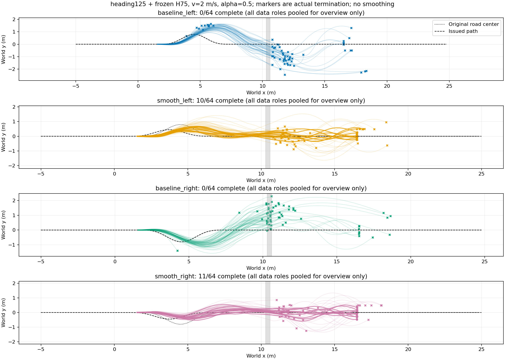

# 同地图批量事件预测与选路原型

同高30cm沟（x10.3～10.6m），接近/续行区0.5～1mm微凸面；heading125跳跃，首次远岸接触交回冻结H75＋ECBC/ESO（zero_lower=true）。共同目标x16.5～18.5m、|y|≤.5m、vx≥.5m，候选各自原道路半宽.6m，物理阈值不变。不是新训练跳跃策略。

## 采集结果

先64条工程采集，随后64个完整地面初态×四条候选=256条；后者184秒、1,024,000物理环境步。按同一初态四候选分组冻结40 TRAIN/8 DEV/16 TEST，所有失败保留。扩展批次21/256完整完成、191条实际回交STTW；左/右原路线均0/64，平滑左10/64、平滑右11/64。汇总只描述数据组成，不代表独立训练种子成功率。

保存2.5ms接触位模式/根状态，50Hz观测、归一化动作提案、352维控制器历史及道路违反记录。早期64条有事件状态但无完整物理接触带，未混入此次模型拟合；另一次初始化四元数错误导致首步失败的64条保留INVALID标记并排除。

[全部64组四候选XY、逐步/累计奖励、速度图](/media/qy/6A7E3DB07E3D75C3/STTW_runs/chapter3_event_collection/plots/README.md)。原始数据、配置与分组：[extension](/media/qy/6A7E3DB07E3D75C3/STTW_runs/chapter3_event_collection/extension)。

## 第一版事件模型

状态为根状态13维、仅用TRAIN拟合的因果观测/历史PCA16维和既往越廊标志；地形为实际碰撞网格的局部8×8高程/支撑掩码。候选使用连续曲线参数和剩余距离，不输入场景ID。共享编码、接近/越障/续行三个预测分支，预测关键事件到达概率、时间及事件后状态；物理位置外推加学习残差，采样未来后排序。历史压缩不保证Markov完备；当前为规定事件链的到达/失败预测，尚非任意接触模式跳转模型。

CPU600梯度步，DEV每100步选模，选update200；拟合及报告约4.4秒。原留出TEST中首次远岸接触预测（实际抵达47条）时间MAE.0479s、XY误差.110m；接近入口XY误差.467m，续行到目标仅3条、XY误差2.80m，恢复段明显不足。所有阶段完整指标见[event_model_results.json](event_model_results.json)。

|同一离线候选结果表|DEV 8初态|TEST 16初态|
|---|---:|---:|
|TRAIN最佳固定路线（平滑右）|2|1|
|事件模型选路|2|1|
|直接成功预测器|2|1|
|事后知道全部结果的覆盖上界|4|2|

没有新增完成。直接成功预测器是同分组补充基线；其TEST及随后条件事件状态诊断已在首次结果之后查看，不包装成新的独立测试。条件诊断将不存在的事件从状态/时间损失中排除、仍用于失败分类，DEV目标事件时间误差降至.190s，但选路仍无新增完成；不以预测误差改善代替任务收益。

## 在线接线与限制

冻结第一版模型，从16个新实际地面初态在线查询四候选，32条配对执行。32环境查询合计.163秒；16个模型分支中4个选择平滑左、其余平滑右。固定路线组0/16、模型组3/16完成，其中两条新增完成仍选与固定组相同的路线，因此并行物理差异影响结果，不能将3对0作为规划收益。已保留全部轨迹和真实决策，没有按未来成功标签选路。

[在线逐组XY与奖励](/media/qy/6A7E3DB07E3D75C3/STTW_runs/chapter3_event_collection/online_selection/plots/README.md)；[真实查询记录](/media/qy/6A7E3DB07E3D75C3/STTW_runs/chapter3_event_collection/online_selection/evaluation/planning.json)。后续以冻结选择的重复物理执行区分选路作用与克隆环境差异，不宣称当前已证明世界模型优于成功率预测器。

当前决策发生在首次运动之前，模型查询期间仿真不前推；尚未实现持续运动中的中途反馈重规划，也未验证推理延迟补偿。模型输入未包含完整关节物理状态，使用已有跳跃观测/控制历史压缩；接触模式带已保存，任意模式跳转预测仍待接入。
