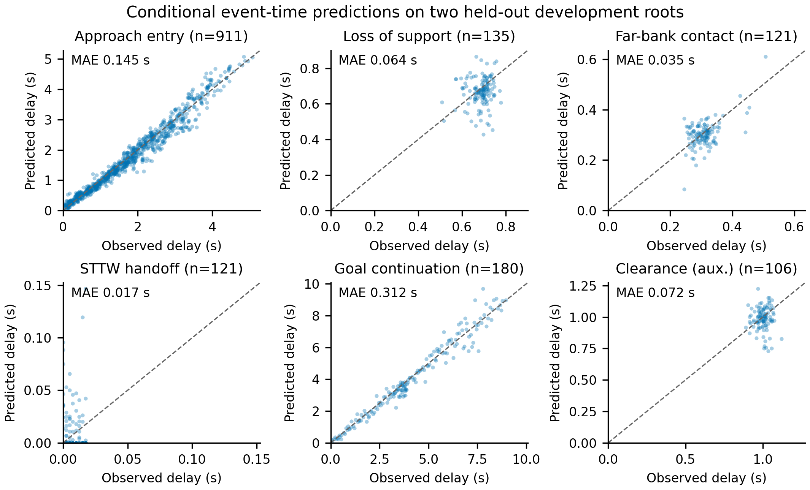
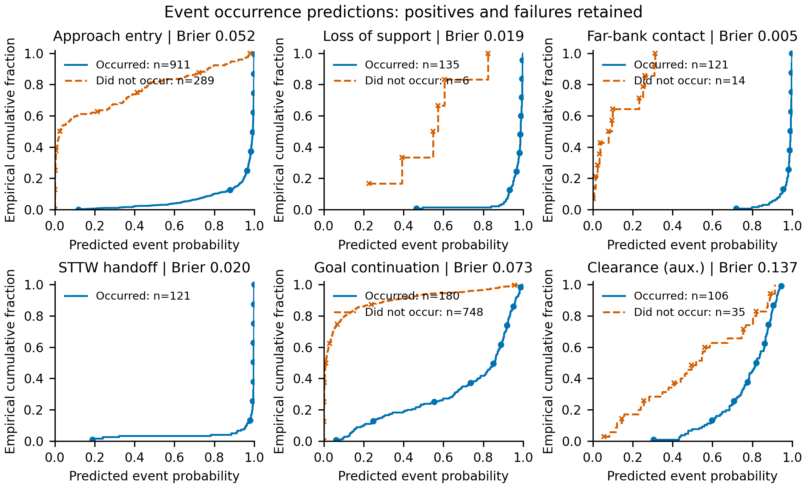
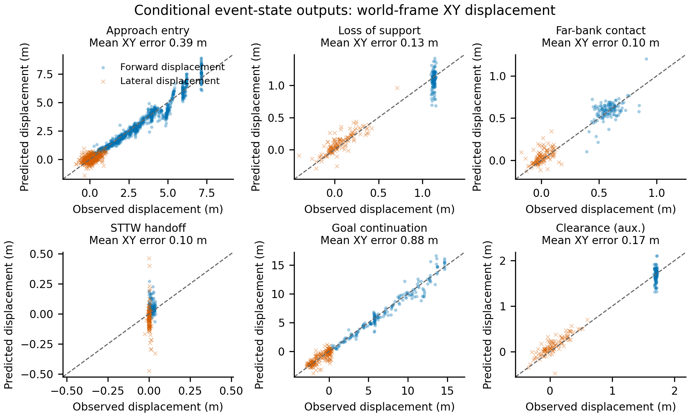
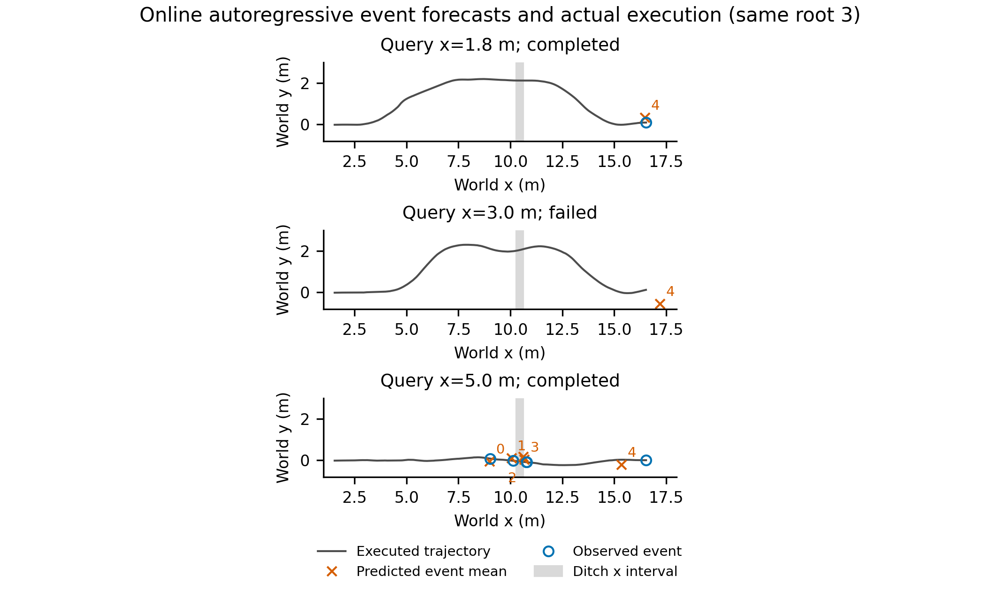
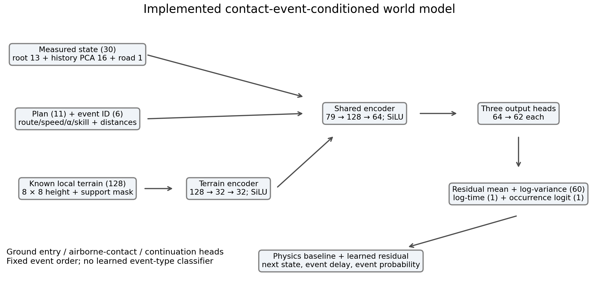
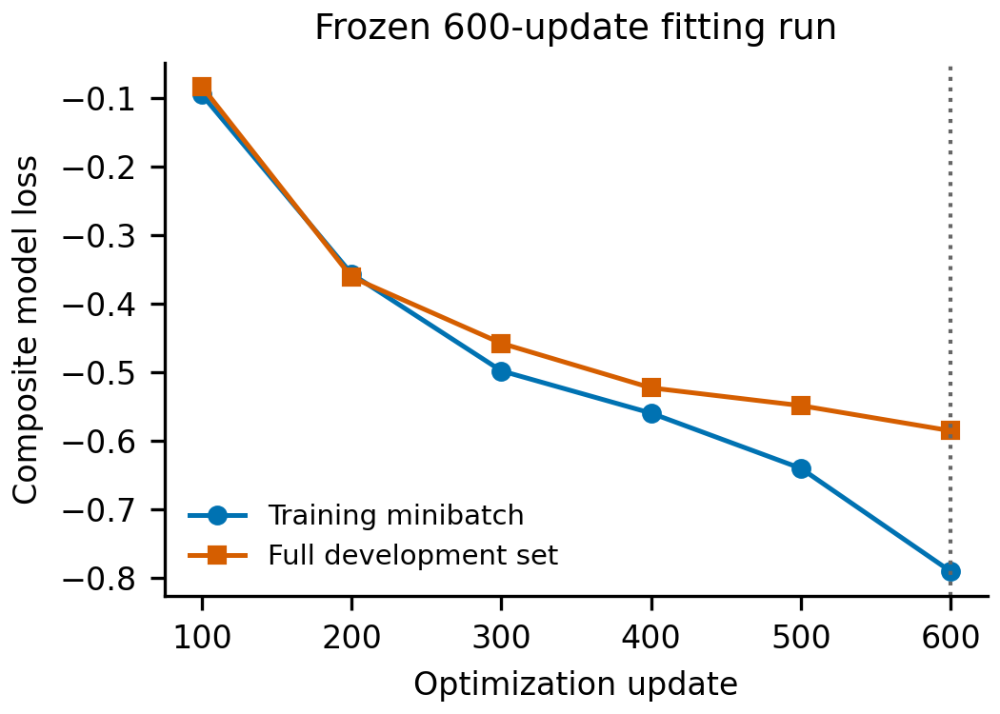
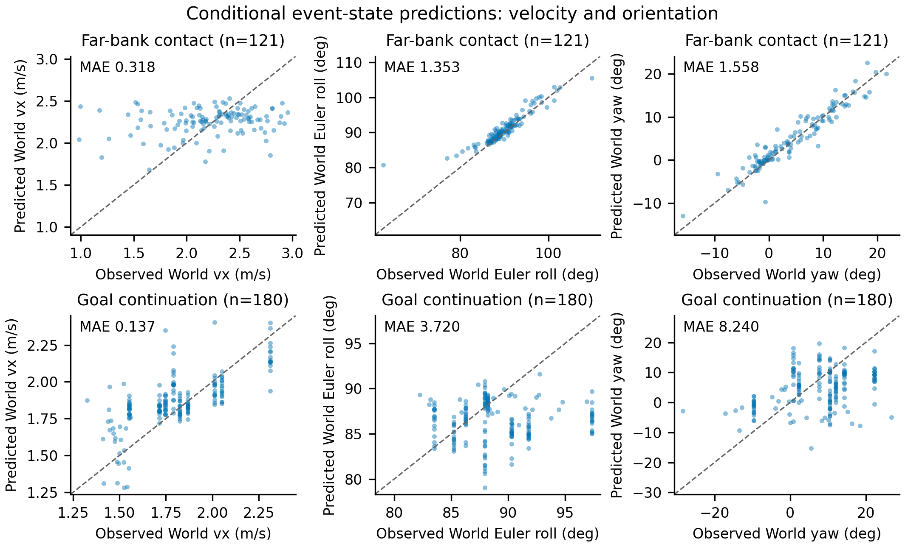

# Event-world-model outputs

Frozen-model prediction evidence for a manuscript draft; publisher-specific layout approval is pending.

## Conditional DEV predictions

Checkpoint update 600; 2666 transitions from two whole held-out development roots [6, 7]. These roots were used to select the checkpoint; they are not independent TEST. Repeated prefixes and route candidates are dependent observations. No confidence intervals or independent-sample claims are made.

| Event | All / positive / negative | Time MAE (s) | Mean XY error (m) | Brier |
|---|---:|---:|---:|---:|
|Approach entry|1200 / 911 / 289|0.1451|0.3912|0.0520|
|Loss of support|141 / 135 / 6|0.0640|0.1311|0.0185|
|Far-bank contact|135 / 121 / 14|0.0349|0.1002|0.0050|
|STTW handoff|121 / 121 / 0|0.0166|0.1045|0.0201|
|Goal continuation|928 / 180 / 748|0.3115|0.8825|0.0731|
|Clearance (aux.)|141 / 106 / 35|0.0723|0.1668|0.1375|

Time and state errors include only events that occurred. Failure-terminal states are not treated as event observations; their CSV targets are blank. Occurrence probabilities include all positive and negative labels. STTW handoff has no negative DEV transition, so its discrimination is untested. Its near-perfect constant-rate baseline can outperform the network.







## Online autoregressive outputs



The three panels deliberately include both complete tasks and the failed middle query for root 3. This is a case illustration, not a representative performance estimate. Ground bypass uses only the goal-continuation event. For the jump, entry, loss of support, far-bank contact, STTW handoff and goal are recursively forecast with 32 particles. Auxiliary clearance is predicted separately and is not multiplied into completion. Mean event positions are isolated markers; they are not a predicted continuous trajectory. Missing actual events are omitted rather than assigned a terminal location. The shaded strip marks the ditch x interval, which has a legal side bridge; it is not a full-width impassable barrier.

The online JSON stores event probabilities and mean root states but not per-stage elapsed times. Consequently only the stored total predicted completion time is exported; no per-stage online timing is reconstructed or invented. The conditional DEV timing plot uses the saved transition delay, not an absolute event timestamp.

## Reproduction and provenance

```bash
PYTHONPATH=learning/src /home/qy/miniconda3/envs/env_isaaclab/bin/python learning/cli/report_ditch_event_outputs.py \
  --model /media/qy/6A7E3DB07E3D75C3/STTW_runs/chapter3_offroad_distance_training/model \
  --online /media/qy/6A7E3DB07E3D75C3/STTW_runs/chapter3_offroad_distance_online \
  --output docs/evidence/chapter3_event_outputs
```

The CLI reads frozen transitions and reconstructs route parameters by the segment reference-route identity, local crop from the actual mesh, and 11-dimensional plan features. DEV event means use the implemented physics baseline plus the network residual, with time expm1(clamp(log-time, 0, log(11))). Sources and identity hashes are in `outputs.json`; all DEV prediction pairs are in `dev_predictions.csv`. No resampling, smoothing, fitting, or new physical rollouts are performed. Figures use vector PDF and 300 dpi PNG, redundant markers/line styles, and untrimmed data ranges. The empirical probability curves are descriptive ECDFs, not confidence bands. Numerical agreement with the original frozen-model metrics is checked below.


## Architecture and fitting





The six logged loss pairs are the actual recorded training minibatch and full DEV losses every 100 updates. The Gaussian NLL can be negative; this is not a reward curve. Dotted line marks checkpoint selection. The continuation head predicts the goal-reaching event after handoff or along bypass; it does not predict a separately labeled recovery duration. The auxiliary clearance output is not included in the planner completion score. The score is a heuristic product of event probabilities followed by an additional non-violation factor, although goal success already includes the road constraint; it must not be described as a calibrated joint task probability.


## Conditional event velocity and attitude



| Event | Positive transitions | World vx MAE (m/s) | Roll circular MAE (deg) | Yaw circular MAE (deg) |
|---|---:|---:|---:|---:|
|Far-bank contact|121|0.3182|1.353|1.558|
|Goal continuation|180|0.1373|3.720|8.240|

Quaternion predictions and observations are normalized before xyzw-to-Euler conversion. Roll here is the saved root world Euler angle, not a body lean error; its nominal offset follows the imported asset orientation. vx is the world x velocity, not body-forward speed. Angular errors use atan2(sin(predicted-observed), cos(predicted-observed)); scatter predictions are shown on the equivalent angular branch nearest the observed angle. The CSV retains principal-value angles in radians and circular errors, with failure observations blank. These are positive-event conditional predictions on two DEV roots, not autoregressive attitude accuracy or independent TEST performance. No uncertainty or calibration claim is made for the residual covariance.

All six modes reproduce the stored DEV Brier, time MAE and XY error within numerical tolerance (rtol=1e-4, atol=1e-6).
