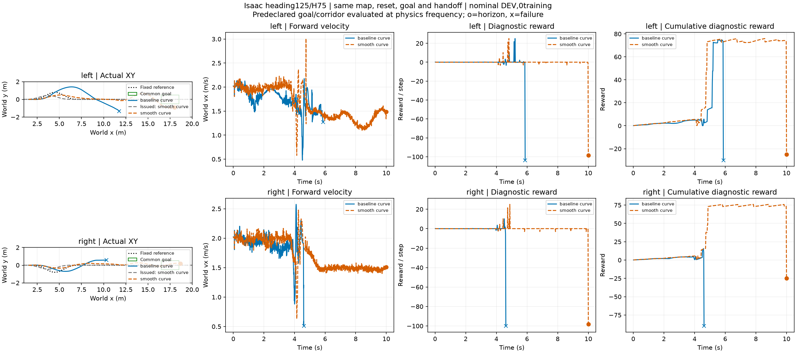

# 同地图接近候选与首次触地接续：接触范围修复后重跑

固定 heading125、H75＋ECBC/ESO（下层残差为零），Isaac，0训练。共同起点 x=1.5m/vx=2m/s；30cm同高开口沟位于10.3～10.6m，0.5～1mm微凸面在接近和续行区。速度2m/s、α=.5；首次远岸接触后下一20ms边界回交STTW，不要求1秒稳定支撑。

|候选|入口航向|回交|共同目标|限制与终止|
|---|---:|---:|---:|---|
|原左路线|−33.22°|5.14s|未到达|2.05s越原路廊；5.88s地面域退出|
|平滑左路线|−4.18°|4.76s|未到达|7.015s越原路廊；存活至10s不算完成|
|原右路线|+13.02°|未回交|未到达|4.62s物理失败code12|
|平滑右路线|−7.00°|4.72s|**8.515s完成**|全程最大路廊距离0.488m；续行至10s|

目标在运行前固定为x∈[16.5,18.5]m、|y|≤.5m、vx≥.5m且已回交；到达前不得物理失败或离开原始中心线±.6m路廊。验收使用2.5ms物理根状态；实际车辆外廓扫掠未作认证。平滑候选仍按原任务道路验收，没有用新下发路线重定义道路。

**结论：** 已有真实弯道来车、微凸地形、跨沟、首次触地接回STTW、达到共同目标的完整工程实例。同右路目标下，两个任务方案产生不同结果。候选由人工根据DEV失败提出，尚未由事件世界模型在线选择；4条同初态DEV不能作泛化成功率。诊断奖励仍来自旧支撑评分，不替代上述完整任务验收。

此前长地图接触标签错误地限制在x≤8m，已修复为实际地图终点25m；本次从共同起点重新执行，未重标旧轨迹冒充新闭环。旧结果保留并标明交接判断无效。

[逐候选数值](summary.json) · [实际坐标及奖励数据](plot_data.npz)

原始配置、物理频率轨迹、接触标签和控制历史：`/media/qy/6A7E3DB07E3D75C3/STTW_runs/chapter3_far_bank_fix`。
