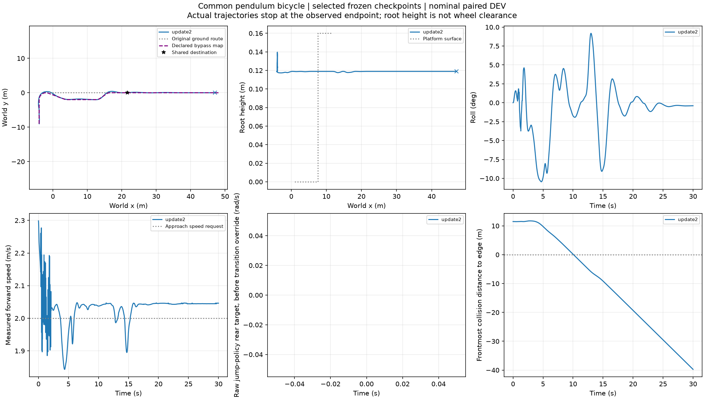
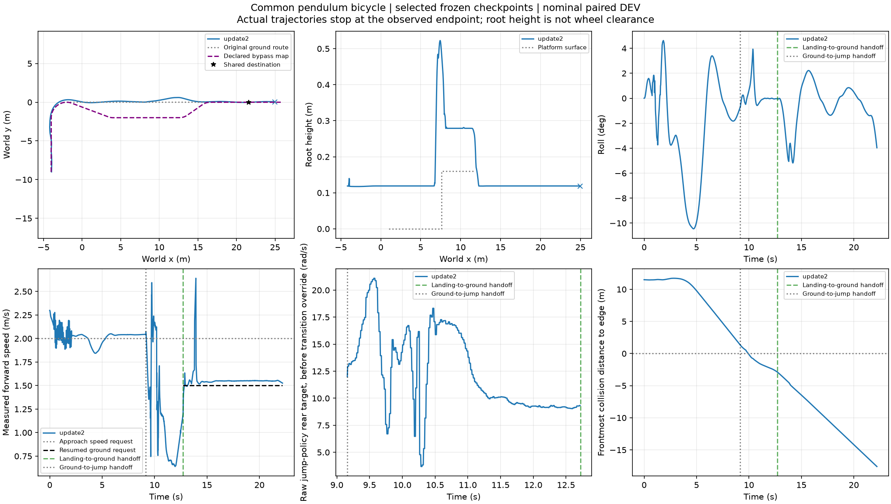

# E5两条强制路线：绕行通过，原路参考尾段不足

两条均实际执行，运行器退出0。分流时刻5.22秒，之前262个保存状态逐点相同；同一根的配对路线，不是两个独立来车样本。

|路线|目标区首次到达|观察时长|最大地图中心误差|平台技能|30秒完整任务|
|---|---|---|---|---|---|
|原路跳跃|18.76s|22.2s|.612285m / 1m|完成严格落台、交回和继续|未通过|
|绕行|16.56s|30s|.469108m / .6m|未触发跳跃|可选平台任务通过；必需跳跃任务未完成|

原路线终止于x24.954m，参考末点x25m；末速度1.526m/s、侧倾−.0692rad、根高度.11875m，没有明显倒地迹象，怀疑是参考尾段不足导致控制域退出。旧physical_termination字段包含控制器终止，不能据该字段直接称摔倒。原始失败数据和标签保留。

仅延长目标后的直线参考到x51.6，原路径点列、共同目标21.6、模型、频率、30秒窗口和成功标准均不变。独立追加原路一条12000物理步/0优化正在运行，尚无修复后结果。

绕行这一次证明同模型冻结控制下可执行。它尚不是受扰备用路线可靠性、在线选路收益或整车包络净空证明；当前只按声明的中心走廊计分。不能把单次通过推广到所有出口，也不能把绕行冒作必跳任务完成。实际路线切换耗时原路.000555s、绕行.134891s，后者含首次构造/上传参考的开销。
