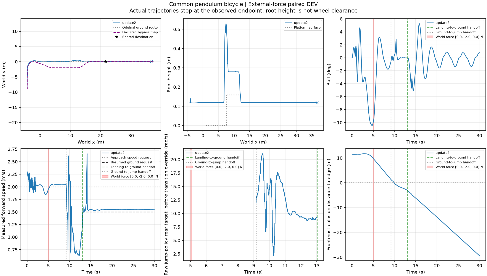
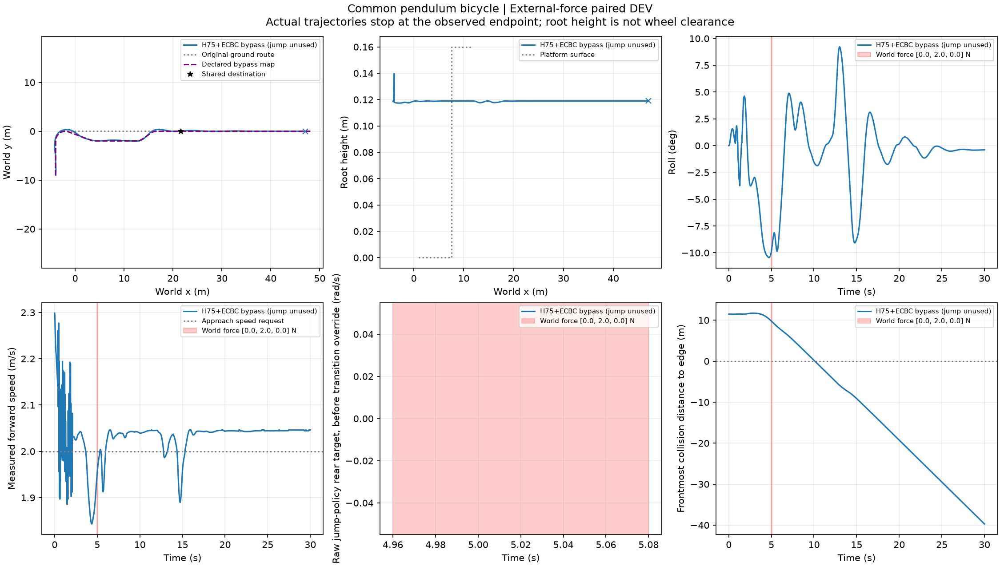

# 受扰前向路线：四条已完成

|世界Y外力|路线|30秒完整任务（跳台可选）|首次到目标 s|最大路线中心误差 m|必须上台任务|
|---|---|---|---|---|---|
|-2 N|原路跳跃|通过|18.98|0.510|通过|
|-2 N|绕行|通过|16.54|0.450|不通过，仅安全退出|
|+2 N|原路跳跃|通过|18.74|0.350|通过|
|+2 N|绕行|通过|16.56|0.488|不通过，仅安全退出|

四条均在4.96秒触发0.12秒世界外力，实际冲量分别±0.239999995 N·s；同方向两路线分流前完整记录逐点相同（各262样本，最大差0），5.22秒分流。所有控制历史、原任务目标、模型和频率保持配对。每条文件夹保留完整XY、实际施力序列、输入命令、身体接触、配置及判定。

这是两种轻扰动下两条路线均可执行的证据。原路仍然成功，不能宣称此时绕行是必要恢复，也不能当规则/能力选择器比较。绕行较快与任务省去跳跃有关；强制上台时绕行不算成功。无独立测试、无新增训练。后续仍需共享观测/分流期限的实际规则与能力选择比较，并保留错过分流和提前绕行。

以下为原准备合同，现已按该合同执行完毕：

# 前向支路外力先导（已准备，尚未运行）

复用已通过30秒的原路线参考延长版与绕行路线，固定同一root01、模型、权重、400/200/50 Hz、共同目标和原任务判据。弯出口前首次x≥−2.5 m时，在车架局部原点施加世界Y向±2 N、0.12秒外力；名义冲量±0.24 N·s。实际触发受当前控制采样影响，逐物理步力与实际冲量另存；不是速度置换或指令残差。

两方向×两条强制路线，共4×30秒×400 Hz=48000物理步、0优化。复用现有无外力配对，不重跑基线。必须先比较同方向分流前状态，再报告原路/绕行完整任务、原路跳跃和必须跳跃时绕行仅安全退出。失败保留，不自动加强执行器或训练。

这批只确认受扰后的路线可执行性；规则与能力选择的公平在线比较仍待完成。当前仅完成回调语法和48物理步施力/到期归零/0.24 N·s/时间戳检查，未宣称Isaac实际运行成功。等待现有108条任务释放资源后执行。
