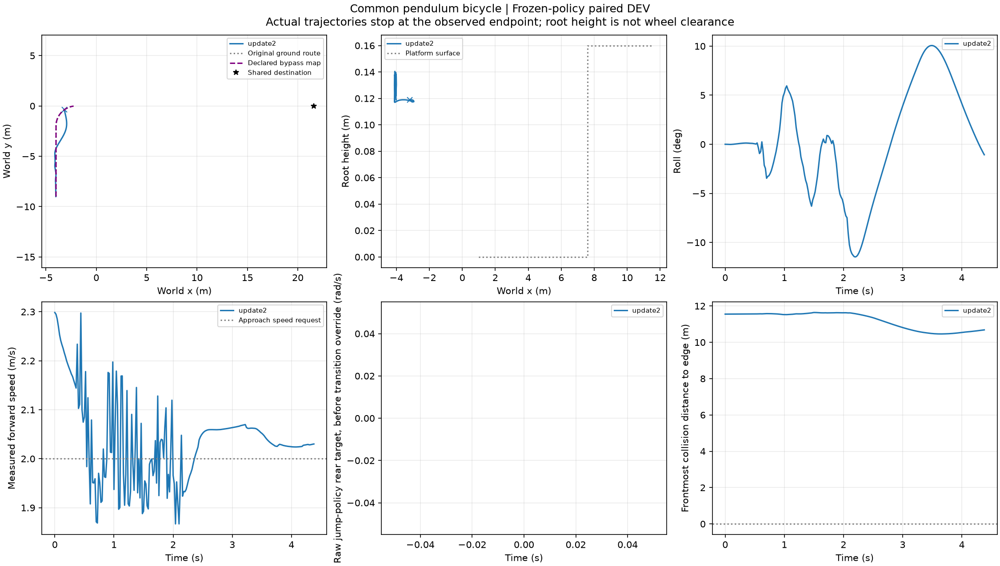
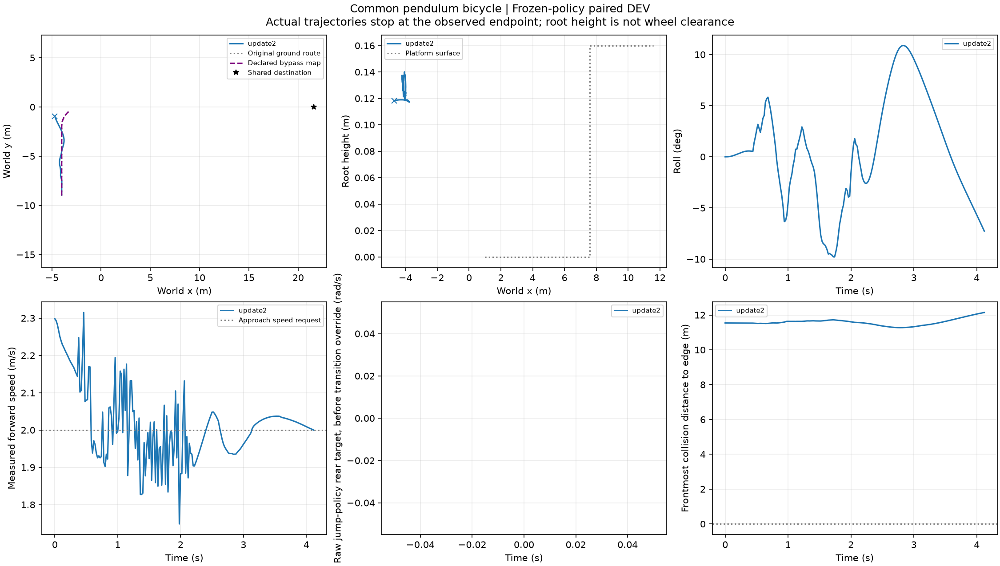
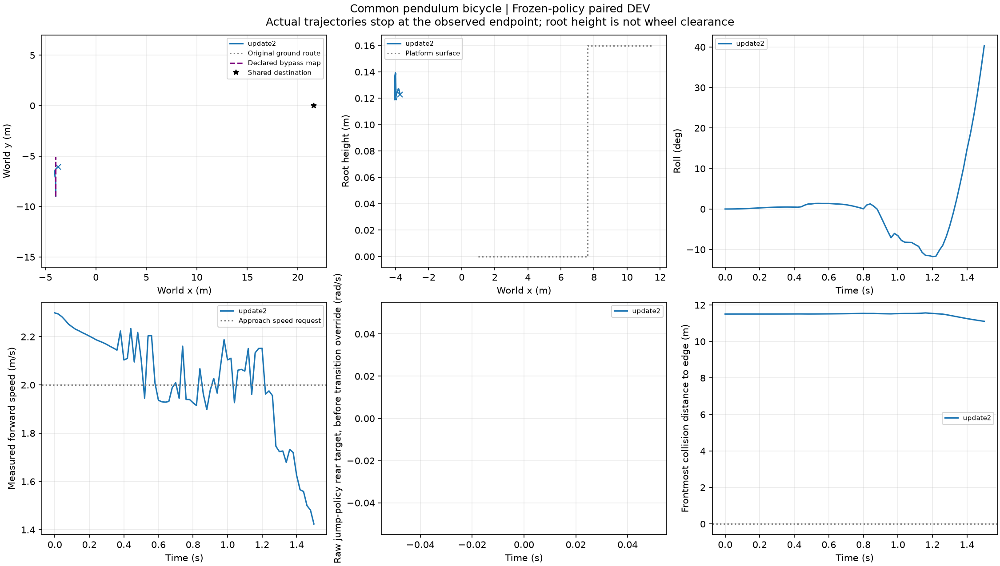

# 六训练根强制路线采集完成

实际/参考XY入口：[root000](../first_train_root/)、[root002](../second_train_root/RESULTS.md)、[root003](../third_train_root/RESULTS.md)。下面三根未到选路点：

36/36声明配置全部完成执行与分析，6预分配训练根×D0/Fy±2×两路线。按“预定原路”分组为3/18完整成功，预定绕行为0/18；每一组保留未到分流的失败，不把它们写成已经执行了对应路线。只有root002的三种扰动条件原路完成。36条不是36独立来车样本。

|来车根|原路 D0/−2/+2|绕行 D0/−2/+2|限制|
|---|---|---|---|
|000|0/0/0|0/0/0|原路后段失败；绕行满窗到达但越界|
|002|1/1/1|0/0/0|原路通过；绕行超过.6m走廊|
|003|0/0/0|0/0/0|两路线分流前均已越界，满窗到达不改变标签|
|004|0/0/0|0/0/0|4.38s地面域退出，未到分流|
|005|0/0/0|0/0/0|4.12s地面域退出，未到分流|
|008|0/0/0|0/0/0|1.50s ground_alive=false，侧倾约40°；跳跃尚未执行|

004/005日志明确ground_domain_exit=true，不能写成PhysX跌倒。008的通用roll_limit标志为false，但地面alive已false、XY/姿态曲线快速失稳；此处只报告地面终止，不编造具体底层触发分项。

两路线的事后并集仍仅3/18根—扰动条件可完成，与固定原路相同；没有新增可行来车根的选路余量。原路1m、绕行.6m走廊在共同前段标准也不同，已在逐根报告说明。分流前失败留整任务分母，不能由后续选路撤销。后续原路换参考1.8/.5补充已排队，但尚无结果，不据C6旧窗口直接宣称它解决E5。

导出数据中18物理配置到达路线决策，另18未到；成功/失败均保留。每个到达配置生成optional/mandatory两个标签，它们不是额外物理样本。`route_records/`、`manifest.json`和`summary.json`保留身份、前缀、原始判据、输入与缺失清单。当前角色全部DEV，不是独立TEST。

采集父1948468正常退出，既有队列已冻结此36条证据并启动 `chapter3_online_route_comparison` 的规则/能力36条，接着执行原路换参考18条；同一名额顺序，不新增GPU并发。在线结果未返回，强制路线数据不能当在线方法收益。
