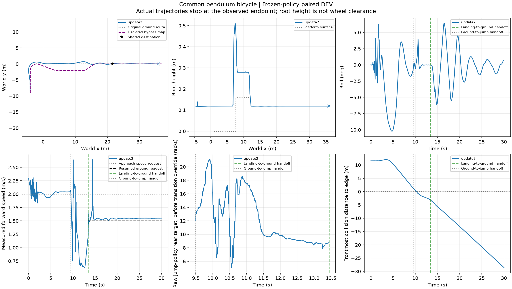
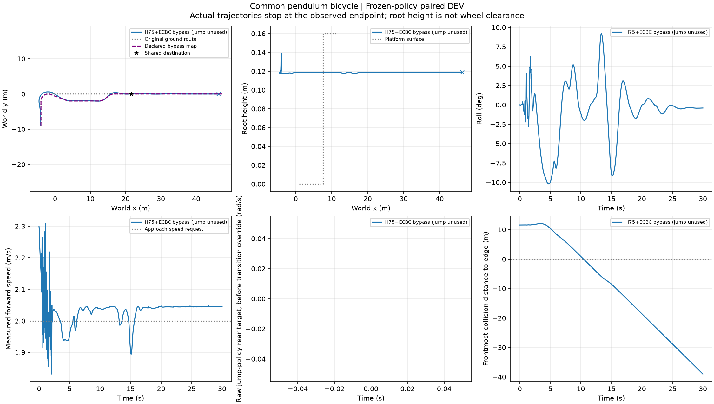

# E5 第二训练来车根：原路可用，绕行越界

6条来自同一预分配train root002，D0与世界Fy±2N脉冲按既定协议配对。是DEV分支，不是6独立来车根，也不是在线规划方法效果。全程30s，update2/H75/零底层残差冻结，400/200/50Hz。

|路线|扰动|完整可选高台任务|首次进入共同目标区(s)|全程地图横向峰值(m)|走廊半宽(m)|
|---|---|---|---:|---:|---:|
|原路跳跃|D0|通过|19.46|.713076|1.0|
|原路跳跃|Fy−2|通过|19.80|.645111|1.0|
|原路跳跃|Fy+2|通过|19.08|.645111|1.0|
|绕行|D0|失败|16.92|.668050|.6|
|绕行|Fy−2|失败|16.90|.645193|.6|
|绕行|Fy+2|失败|16.92|.687482|.6|

六条均满30s。原路三条也完成必须跳台任务；绕行既未满足完整可选任务的走廊条件，也不可能替代必须跳台任务。绕行更快到达不代表成功。此处共同目标区首次进入时间取E5 `forward_task.first_goal_arrival_s`；原J4完整阶段条件时间分别20.10/20.44/19.72s，两字段不同，不能混用。

三条绕行在4.18s已超过.6m走廊，路线选择发生在5.54s；分流前峰值.645111m。分流后峰值仍分别.668050/.645193/.687482m，所以不能只把失败归咎于共同前段。原路沿用1m，绕行沿用.6m；两种地图标准在共同前段不同是当前协议的限制，显式报告，不事后放宽或删除越界历史。

原路D0连续严格台面支撑1.215s；Fy−2/＋2也通过原严格支撑和续行条件，详情见各 `landing.json`、`chain_summary.json`。XY显示地面转弯、上台、回地面和续行完整；绕行按支路行驶但有限偏离超窄路标准，不将其标为跌倒。

当前新两根共12分支：root000两路线均未完整成功，root002只有原路三条件成功。未完成的其余根不计失败。继续已冻结全36路线采集及在线对照；尚无依据宣称状态评价器已能利用该差异。

`summary.json` 是既有路线汇总器输出；六目录保留压缩原轨迹、实际控制/接触/扰动记录、配置与判据。未新增物理仿真或控制器训练，未改运行中配置。来源映射见 `manifest.json`。
