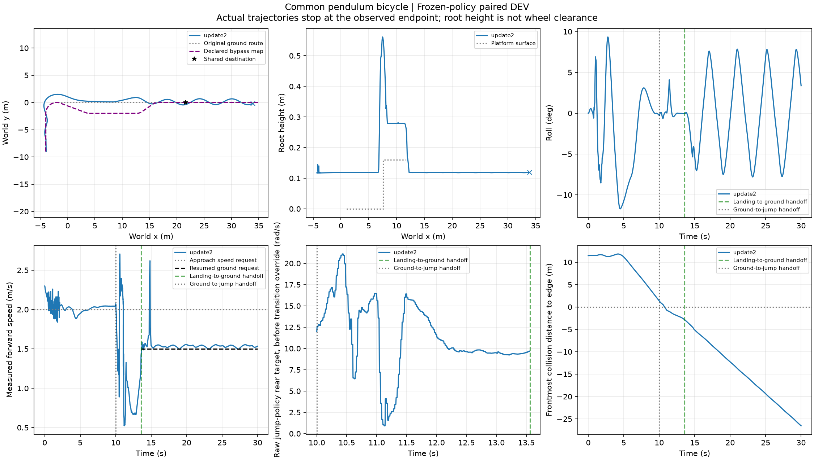
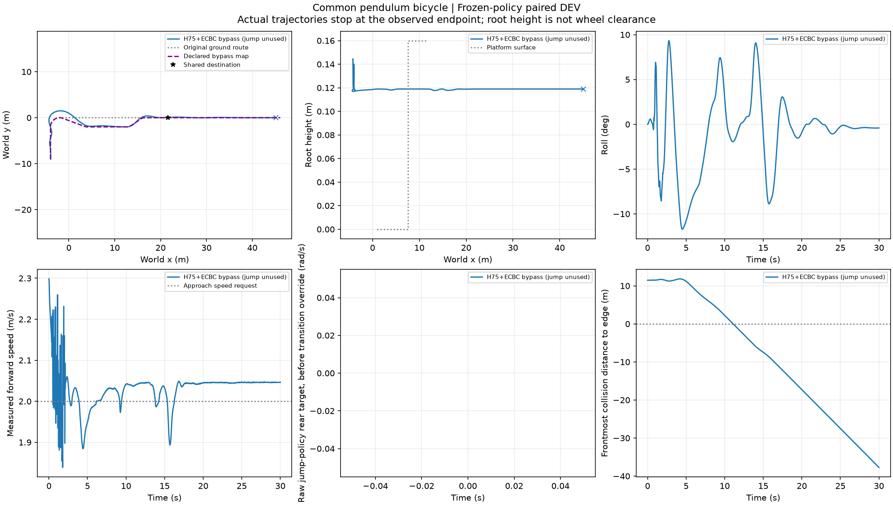

# E5 第三训练根：决策前已失败，不能归因于选路

预分配train root003六条均完整运行30s并到达共同目标，但全部违反原全程走廊判据，完整任务0/6。三条外扰实现共用同一上游根，不计作独立根。协议、中心走廊宽度、控制器及物理时钟未改。

|路线|扰动|首次目标区(s)|全程地图误差峰值(m)|分流前峰值(m)|首次越界(s)|
|---|---|---:|---:|---:|---:|
|原路|D0|19.98|1.497035|1.493260|4.52|
|原路|Fy−2|20.62|1.489997|1.488624|4.52|
|原路|Fy+2|20.02|1.505314|1.497892|4.52|
|绕行|D0|17.54|1.561979|1.493319|4.08|
|绕行|Fy−2|17.54|1.537668|1.488683|4.08|
|绕行|Fy+2|17.56|1.584997|1.497951|4.08|

分流均发生在5.98s，原路半宽1m、绕行半宽.6m。两种路线在当前触发点之前均已违反整任务约束。此后选择任何路线都不能撤销历史越界；这个根需要上游执行或更早决策才能改变整任务标签，而不是只改变出口后的选路。当前实验保留原声明触发点，不事后改窗口或成功条件。

XY展示明显出弯横向偏离，原路落地后也有持续摆动；满窗口和到达不能替代跟踪完成。该负例保留整任务分母。评价器可报告后续动作的能力，但不能把原有失败归因于后选的路线，也不能仅以支路更早到达宣称任务修订成功。新在线对照继续按冻结配置执行，最终分析须单列决策前已失败与决策时仍有机会两类。

三个已封存新根共18分支中，root000六条全败，root002原路三条成功且绕行三条失败，root003六条全败；这只是强制路线配对证据，不是在线方法成功率。尚未封存的根不纳入结论。

六目录保留压缩原始轨迹、命令、接触/扰动、配置和全条件判定；`summary.json` 为原汇总器结果。此分析0新增物理、0训练，无控制器或选路规则改动。
