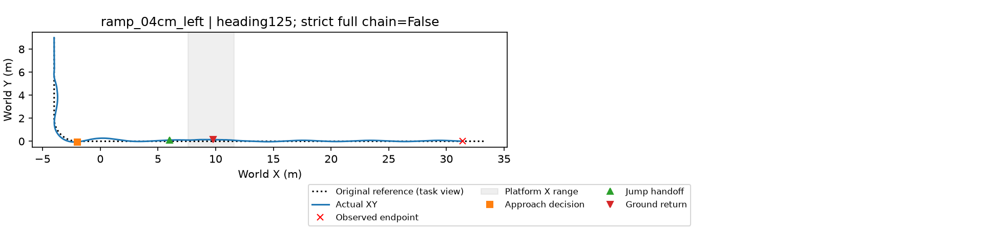

# GLM任务解释→接近规划→物理执行：一次真实闭环

**接口闭环完成；既有20ms合同通过，原严格判据未通过。** 本次为新仿真，不是旧结果回放。单次DEV不能证明可靠性或LLM提高了控制性能。

| 数据流步骤 | 本次实际数据 | 谁产生 |
|---|---|---|
| 人的任务 | 经过4cm坡道，左转后跳上平台，落地后继续到终点 | 自然语言请求 |
| 任务解释 | execute_scene({"scene_id":"ramp_04cm_left"}) | 已配置glm-5.3，从11场景目录选择 |
| 路径与技能 | 已有左转R2参考路径、4cm坡道、固定平台与heading125技能 | 工程配置，不是LLM生成 |
| 接近规划输入 | 5.58s：前向1.827m/s、横偏−0.0526m、航向误差−0.0648rad、侧倾0.1015rad、侧倾角速度−0.2101rad/s、侧向0.0502m/s、剩余准备距离7.967m | 当前仿真状态与原路线 |
| 接近规划输出 | 速度请求1.8m/s、alpha0.5 | 冻结动力学入口/技能能力规划器 |
| 运动执行 | 9.94s切换跳跃，12.12s回交地面，续行至26s观察结束 | 地面控制与冻结跳跃策略 |
| 物理判定 | contact_filtered_20ms complete=true；original strict complete=false | 冻结检查程序 |
| 自然语言反馈 | 解释本次完成及两套判据的区别 | GLM收到真实工具结果后回复 |

总共2次真实GLM请求、1条26s仿真、10400物理步、0训练更新；流水线约98.43秒。阶段时间以实际日志为准；没有把语言响应当物理成功。

**直接给同一scene_id可绕过LLM运行同一运动链。** 当前LLM作用是理解与反馈，不是生成轨迹；当前接近规划器选速度/alpha，不负责决定跳还是绕行。失败返回revision_required，本次没有自动多轮改路线。

代码/接口说明：[CHAPTER3_PLANNER_DATAFLOW](../../CHAPTER3_PLANNER_DATAFLOW.md)。

完整本机证据：`/media/qy/6A7E3DB07E3D75C3/STTW_runs/chapter3_glm_planner_integration_20261108/live`，含两次请求/响应、config、原始trajectory、接触、实际选档、交接与物理判定。凭据不在本包。

保留的其他验证：[多弯道6条](/media/qy/6A7E3DB07E3D75C3/STTW_runs/chapter3_multiscene_planner_online_20261108/RESULTS.md)、[4/8cm坡道4条](/media/qy/6A7E3DB07E3D75C3/STTW_runs/chapter3_terrain_planner_online_20261108/RESULTS.md)、[11种高地形工况](/media/qy/6A7E3DB07E3D75C3/STTW_runs/chapter3_offroad_terrain_levels_20261108/RESULTS.md)。多场景失败并未因本次闭环实例而改写。
