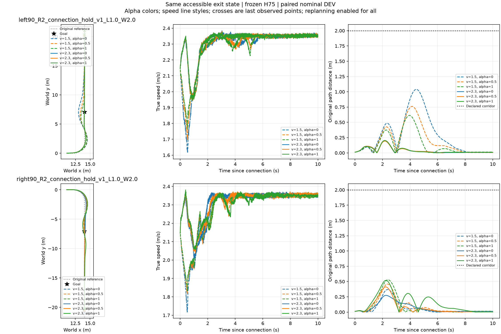
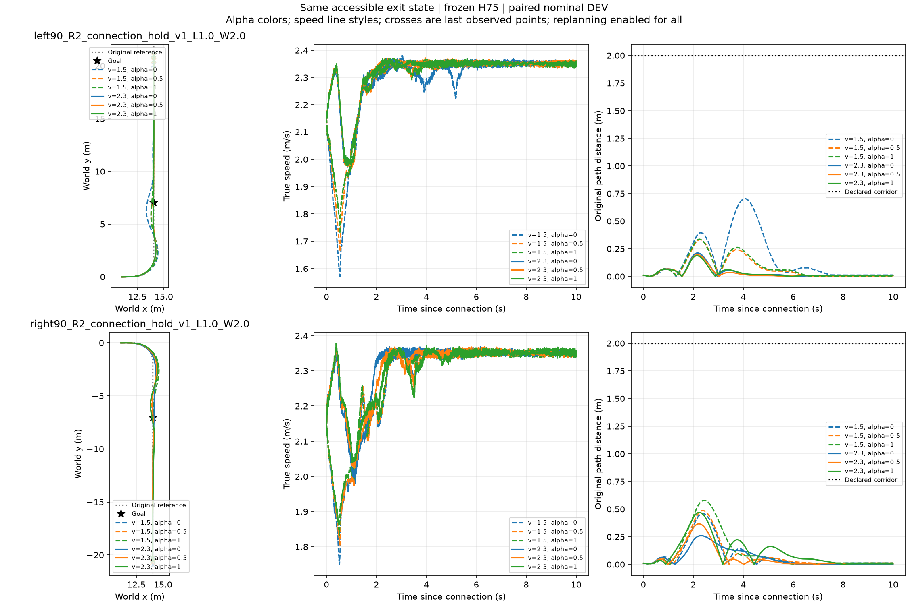
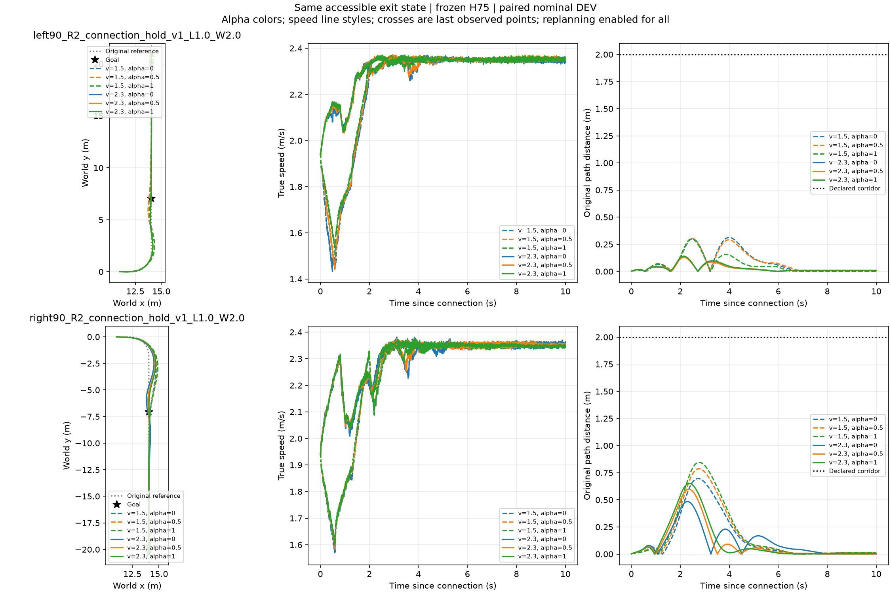
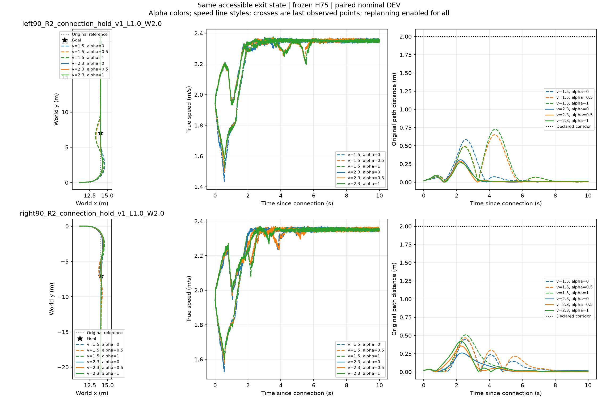

## 地面速度与α的配对消融（13根、26左右任务组）

实际轨迹见下方第13根总览；统计直接复用同一156后缀，无新增物理。

|方法|成功组/已完成组|成功时间均值s|相对固定2.3/.5节省s|
|---|---:|---:|---:|
|固定2.3/.5|26/26|3.343846|0|
|只调速度，α=.5，事后最优|26/26|3.343846|0|
|只调α，速度2.3，事后最优|26/26|3.317692|.026154|
|速度与α联选，事后最优|26/26|3.317692|.026154|
|当前DEV最佳固定2.3/0|26/26|3.320769|.023077|

高速固定档已解释主要时间差。只调α的事后上界与联合上界相同，但超过最佳固定档仅.003077s，远小于任务书建议的.10s工程意义阈值；不能把相对任意固定α=.5的.026s全称为动态选档贡献。本组全成，因此时间均值是同26组配对；26组来自13根，不是26独立试验。未完成11根不记失败。各档、逐根选择与原始分母见[selection_ablation.json](selection_ablation.json)。这不是在线策略成绩，也不推论窄道或受扰任务同样无收益。

## 最新名义采集快照：13/24根，156/288后缀

26个左右弯组均六档通过，11根仍待完成，不能记失败。仍按2m半宽、10s全窗条件；第13根左弯低速α0峰值中心偏差超过1m，不代表精确跟踪或窄道通过。

固定最快档 `v2.3_a0.0` 平均3.320769s，逐组事后最快3.317692s，差0.003077s。156条最大原路径中心偏差1.040090m。宽路数据仍不支持为微小收益训练复杂评价器；既定窄道挑战仍在队列，完整D0后再决定扰动扩展。0优化，本轮只复用新完成轨迹。nominal_summary/records更新至156；历史B入口CSV仍为120条快照，逐根新入口事件已随轨迹保存。下列均为历史快照。

## 当前名义采集快照：10/24 根，120/288 后缀

20个左右弯组全部六档成功（120/120），14根待完成。第10根源速度2.1m/s、横向−.04m、航向−2°、斜向凸起+.4。左弯低速α=0轨迹偏移明显，峰值约.7m；不能以2m宽走廊通过声称精确跟踪或窄道通过。

固定2.3m/s、α=0平均3.332s，逐组事后最快3.329s，差.003s；当前宽路尚无明显学习选档增益。全部120条最大原路径中心偏差.965435m。nominal_summary/records与B入口CSV均更新为120条，模型/时钟/任务标准不变，0优化。下列为历史阶段快照，不与本段分母混用。

## 当前名义采集快照：9/24 根，108/288 后缀

18个左右弯组全部六候选成功（108/108）。前8根源速度1.9 m/s，第9根为2.1 m/s、横向−.04 m、航向−2°、斜向凸起−.4；其他15根待完成。仍是2 m半宽的参数化DEV，不是窄道或独立TEST。

固定2.3 m/s、α=0的平均完成时间3.337778 s，逐组事后最优3.335556 s，差约.002222 s；当前宽走廊没有明显选档收益，未据此训练评价器。见[分组数据](nominal_summary.json)与[逐候选记录](nominal_records.jsonl)。

新增第8根[XY/速度/路径误差](v1.9_lat0.04_yaw2_oblique0.4/evaluation/xy_candidates.png)；第9根[XY/速度/路径误差](v2.1_lat-0.04_yaw-2_oblique-0.4/evaluation/xy_candidates.png)。各根evaluation包含实际轨迹、命令与B入口事件。旧阶段记录如下。

## 四根名义采集阶段结果（48/288 后缀）

当前4/24根、8个左右任务组均六档全成，48条宽路后缀均通过。固定2.3 m/s、α=0为8/8，平均首次到达3.340秒；逐组事后最快3.3375秒，仅差0.0025秒，尚无选档器任务收益证据。其余根仍待完成，不记失败。

新增两根为1.9 m/s、横向−0.04 m、航向+2°、斜向±0.4。真实出口侧倾分别+0.494°和−0.179°，侧倾角速度−1.697°/s和+3.916°/s；出口速度1.939和1.932 m/s。不能把初始符号直接当成相反的残余状态。

最新根右弯高速α=0/.5/1的全程最大原路径中心误差分别0.484/0.598/0.652米。全部宽路轨迹事后按0.6米中心阈值描述性重评分，低速三档分别7/8、4/8、5/8，高速三档8/8、8/8、7/8。此为旧宽路轨迹的中心几何诊断，不是新窄路实测、整车包络验收或独立测试；固定高速α=0仍覆盖，不能据此宣称学习选择必要。

nominal_b_entry.csv逐条列出实际B入口速度、横向速度、侧倾与转向状态、原路径误差及输入限幅。低速三档实际入口1.446–1.631 m/s，高速2.081–2.204 m/s，速度确实分开；48条转向与后轮输入目标碰限幅占比均0，不能据此推断实际力矩无饱和。

nominal_summary.json / nominal_records.jsonl固定本次48条快照；新增两根evaluation含原始轨迹、B入口、实际执行输入及重规划记录。原5000/200/50 Hz、橙Local300/H75/ECBC、10秒窗口及共同B指令不变。继续原24根与预先声明窄路/外扰预算，不新增训练。

# 地面接续实验：12组平地可达检查完成

本目录对应新任务书G1/G2。12组平地条件先检查出口可达性；随后24根（两斜向×三请求速度×四初始偏差）各接左右弯×六候选，共288后缀。上游失败保留，不从根分母删除。

控制器为原STTW H75 u77＋用户选定橙色Local300＋ECBC/ESO；5000Hz物理、200Hz底层、50Hz上层。原保存行驶状态保留关节、ESO及命令；起步横移±.04m、航向±2°，世界速度随航向旋转。1.9/2.1/2.3m/s是请求值，实际进障速度从轨迹记录，不能默认相等。

候选1.5/2.3m/s×α0/.5/1仅作用于1m连接段。进入B后所有候选统一2.3m/s、α=.5，保留滤波/控制历史；原路径半宽2m，10秒后缀窗口，到达目标且全窗口存活且不越界。左右弯目标位于弯后至少5m，同一重规划器全部启用。该协议与此前24条全后缀候选不同，结果不得混合。

地形采用既有place_isaac_terrain.py和NVIDIA terrain_utils，平地、±.4斜向6cm凸起三份资产复用；水平/垂直离散.1/.005m，摩擦不改，地形不随车移动。资产哈希和完整配置见manifest及每根目录。生成初态/路由使用prepare_connection_candidates.py；平地执行collect_connection_candidates.py --source-only。大体积网格和权重留在数据盘/既有模型入口，不入此包。

最大预算：平地2160000物理lane步，名义18720000物理lane步，0优化更新。当前12组平地可达检查完成，剩余11条已启动；24根地形和288连接后缀尚未运行。首条采样1.54s仿真约91.84s墙钟，六lane共约503物理lane步/秒，不等于完整加载后吞吐。5000Hz物理保持，0优化。

## 首条实际结果

请求1.9m/s、初始横移−.04m/航向−2°，出口实际1.93725m/s，最大横向偏差.06115m、峰值侧倾1.667°。1.54s到出口，仅一个根；六lane不是六个独立样本。该结果只证明此平地源条件可达，不代表带地形或连接弯道已通过。

## 全部12组平地结果

全部12根均到出口，不等于地形或下游弯道通过。速度列为真实车体前向速度；源采样墙钟不含应用加载。

|来车条件|仿真时长(s)|出口速度(m/s)|最大横偏(m)|采样墙钟(s)|XY|
|---|---:|---:|---:|---:|---|
|v1.9_lat-0.04_yaw-2_oblique0.0|1.540|1.9373|0.0611|91.8|[轨迹](first_flat_result/xy_source.png)|
|v1.9_lat-0.04_yaw2_oblique0.0|1.540|1.9532|0.0396|72.1|[轨迹](flat_results/v1.9_lat-0.04_yaw2_oblique0.0/xy_source.png)|
|v1.9_lat0.04_yaw-2_oblique0.0|1.540|1.9403|0.0396|69.7|[轨迹](flat_results/v1.9_lat0.04_yaw-2_oblique0.0/xy_source.png)|
|v1.9_lat0.04_yaw2_oblique0.0|1.540|1.9444|0.0685|98.5|[轨迹](flat_results/v1.9_lat0.04_yaw2_oblique0.0/xy_source.png)|
|v2.1_lat-0.04_yaw-2_oblique0.0|1.460|2.1452|0.0612|88.7|[轨迹](flat_results/v2.1_lat-0.04_yaw-2_oblique0.0/xy_source.png)|
|v2.1_lat-0.04_yaw2_oblique0.0|1.460|2.1473|0.0396|77.9|[轨迹](flat_results/v2.1_lat-0.04_yaw2_oblique0.0/xy_source.png)|
|v2.1_lat0.04_yaw-2_oblique0.0|1.460|2.1470|0.0396|80.6|[轨迹](flat_results/v2.1_lat0.04_yaw-2_oblique0.0/xy_source.png)|
|v2.1_lat0.04_yaw2_oblique0.0|1.460|2.1464|0.0683|89.6|[轨迹](flat_results/v2.1_lat0.04_yaw2_oblique0.0/xy_source.png)|
|v2.3_lat-0.04_yaw-2_oblique0.0|1.320|2.3458|0.0636|78.9|[轨迹](flat_results/v2.3_lat-0.04_yaw-2_oblique0.0/xy_source.png)|
|v2.3_lat-0.04_yaw2_oblique0.0|1.320|2.3434|0.0396|82.9|[轨迹](flat_results/v2.3_lat-0.04_yaw2_oblique0.0/xy_source.png)|
|v2.3_lat0.04_yaw-2_oblique0.0|1.320|2.3424|0.0396|84.3|[轨迹](flat_results/v2.3_lat0.04_yaw-2_oblique0.0/xy_source.png)|
|v2.3_lat0.04_yaw2_oblique0.0|1.320|2.3472|0.0688|81.4|[轨迹](flat_results/v2.3_lat0.04_yaw2_oblique0.0/xy_source.png)|

首条6cm负斜向源后的不中断/恢复对照已启动，尚无结果。地面288候选未启动。所有模型与5000/200/50Hz时序保持，0优化。

记录时间说明：这12条原始source_trajectory中的executed_commands第0列是每20ms窗口内的局部时间；整段命令时刻应由物理采样序号×0.0002s恢复。原命令值及原始文件保留。XY/速度图用lower-trace时钟，未受影响；后续采集已直接保存累计时间。

## 上游连续运行与暴露状态回放（已完成）

6 cm 负斜向凸起、请求源速度 1.9 m/s、初始横偏 -0.04 m/航向 -2°。实际达到出口后，先直接连续运行左弯，再恢复同一出口快照运行相同左弯；每段 10 s，统一速度 2.3 m/s、α=0.5，H75 + 原 Local300，同一重规划器。物理 5000 Hz、底层 200 Hz、中层 50 Hz，没有优化更新。

两段各六 lane 全程未摔倒；lane 0 的 2000 个配对底层样本最大位置差 0.036432 m、最大速度差 0.023176 m/s，完整轨迹走势一致。墙钟 1269.204 s。采用此快照继续左右弯各六候选采集；该结果支持本工况的回放可用性，不证明隐藏 PhysX 接触缓存一致，不代表候选任务矩阵已完成。六 lane 为同根复制，不是六个独立源。

原始配对轨迹、配置及状态见 `replay_first/`。快照留在数据盘，模型权重不入 Git。首根十二后缀于 17:06 UTC 左右启动，仍待结果；其他 23 根尚未采集。

## 首个真实出口的左右弯六候选（12/12已完成）

源为v1.9_lat-0.04_yaw-2_oblique-0.4，复用已做连续/恢复对照的6 cm斜向凸起真实出口。1 m连接段后统一B参考2.3 m/s、α=.5；两弯原走廊半宽2 m、各10 s，重规划相同。5000/200/50 Hz，冻结H75+原Local300，0优化更新。12条均通过完整任务；同源分支，不是12个独立根。

| 弯向 | 连接速度 | α | 完成 | 到达时间s | 全程最大路径误差m | B入口实速m/s |
|---|---:|---:|---:|---:|---:|---:|
|左|1.5|0.0|1|3.700|0.5844|1.4634|
|左|1.5|0.5|1|3.680|0.6524|1.5316|
|左|1.5|1.0|1|3.660|0.7281|1.5816|
|左|2.3|0.0|1|3.340|0.3065|2.1687|
|左|2.3|0.5|1|3.320|0.2866|2.1728|
|左|2.3|1.0|1|3.320|0.2675|2.1723|
|右|1.5|0.0|1|3.640|0.4485|1.5355|
|右|1.5|0.5|1|3.640|0.4674|1.5958|
|右|1.5|1.0|1|3.640|0.5085|1.6222|
|右|2.3|0.0|1|3.340|0.2599|2.1496|
|右|2.3|0.5|1|3.400|0.3557|2.1741|
|右|2.3|1.0|1|3.440|0.4207|2.1926|

固定2.3/α0两弯均值3.34 s，逐弯事后最优3.33 s，仅0.01 s余量；不是已部署选择收益，没有据此训练网络。低速档最大误差0.449–0.728 m，高速档0.260–0.421 m，本根中更慢并不意味着路径更好。十二候选的前/后轮输入目标触限比例均0，不能解释成实际电机力矩未饱和。到达后继续观察至10 s，全程偏差也计入。

实际命令、完整轨迹、B入口状态、原路线和重规划事件见first_nominal；奖励图见first_nominal/recorded_lower_rewards.png。尚未记录刚体包络，不能据中心点声称整车窄道通过；另23名义根与384扰动后缀未执行。采集墙钟1271.146 s，后续批量吞吐仍需改善，不能把GPU环境数当速度证据。
