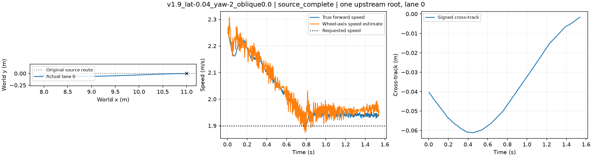
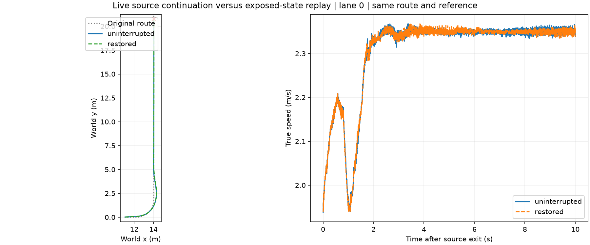

# 地面接续实验：12组平地可达检查完成

本目录对应新任务书G1/G2。12组平地条件先检查出口可达性；随后24根（两斜向×三请求速度×四初始偏差）各接左右弯×六候选，共288后缀。上游失败保留，不从根分母删除。

控制器为原STTW H75 u77＋用户选定橙色Local300＋ECBC/ESO；5000Hz物理、200Hz底层、50Hz上层。原保存行驶状态保留关节、ESO及命令；起步横移±.04m、航向±2°，世界速度随航向旋转。1.9/2.1/2.3m/s是请求值，实际进障速度从轨迹记录，不能默认相等。

候选1.5/2.3m/s×α0/.5/1仅作用于1m连接段。进入B后所有候选统一2.3m/s、α=.5，保留滤波/控制历史；原路径半宽2m，10秒后缀窗口，到达目标且全窗口存活且不越界。左右弯目标位于弯后至少5m，同一重规划器全部启用。该协议与此前24条全后缀候选不同，结果不得混合。

地形采用既有place_isaac_terrain.py和NVIDIA terrain_utils，平地、±.4斜向6cm凸起三份资产复用；水平/垂直离散.1/.005m，摩擦不改，地形不随车移动。资产哈希和完整配置见manifest及每根目录。生成初态/路由使用prepare_connection_candidates.py；平地执行collect_connection_candidates.py --source-only。大体积网格和权重留在数据盘/既有模型入口，不入此包。

最大预算：平地2160000物理lane步，名义18720000物理lane步，0优化更新。当前12组平地可达检查完成，剩余11条已启动；24根地形和288连接后缀尚未运行。首条采样1.54s仿真约91.84s墙钟，六lane共约503物理lane步/秒，不等于完整加载后吞吐。5000Hz物理保持，0优化。

## 首条实际结果

请求1.9m/s、初始横移−.04m/航向−2°，出口实际1.93725m/s，最大横向偏差.06115m、峰值侧倾1.667°。1.54s到出口，仅一个根；六lane不是六个独立样本。该结果只证明此平地源条件可达，不代表带地形或连接弯道已通过。

## 全部12组平地结果

全部12根均到出口，不等于地形或下游弯道通过。速度列为真实车体前向速度；源采样墙钟不含应用加载。

|来车条件|仿真时长(s)|出口速度(m/s)|最大横偏(m)|采样墙钟(s)|XY|
|---|---:|---:|---:|---:|---|
|v1.9_lat-0.04_yaw-2_oblique0.0|1.540|1.9373|0.0611|91.8|[轨迹](first_flat_result/xy_source.png)|
|v1.9_lat-0.04_yaw2_oblique0.0|1.540|1.9532|0.0396|72.1|[轨迹](flat_results/v1.9_lat-0.04_yaw2_oblique0.0/xy_source.png)|
|v1.9_lat0.04_yaw-2_oblique0.0|1.540|1.9403|0.0396|69.7|[轨迹](flat_results/v1.9_lat0.04_yaw-2_oblique0.0/xy_source.png)|
|v1.9_lat0.04_yaw2_oblique0.0|1.540|1.9444|0.0685|98.5|[轨迹](flat_results/v1.9_lat0.04_yaw2_oblique0.0/xy_source.png)|
|v2.1_lat-0.04_yaw-2_oblique0.0|1.460|2.1452|0.0612|88.7|[轨迹](flat_results/v2.1_lat-0.04_yaw-2_oblique0.0/xy_source.png)|
|v2.1_lat-0.04_yaw2_oblique0.0|1.460|2.1473|0.0396|77.9|[轨迹](flat_results/v2.1_lat-0.04_yaw2_oblique0.0/xy_source.png)|
|v2.1_lat0.04_yaw-2_oblique0.0|1.460|2.1470|0.0396|80.6|[轨迹](flat_results/v2.1_lat0.04_yaw-2_oblique0.0/xy_source.png)|
|v2.1_lat0.04_yaw2_oblique0.0|1.460|2.1464|0.0683|89.6|[轨迹](flat_results/v2.1_lat0.04_yaw2_oblique0.0/xy_source.png)|
|v2.3_lat-0.04_yaw-2_oblique0.0|1.320|2.3458|0.0636|78.9|[轨迹](flat_results/v2.3_lat-0.04_yaw-2_oblique0.0/xy_source.png)|
|v2.3_lat-0.04_yaw2_oblique0.0|1.320|2.3434|0.0396|82.9|[轨迹](flat_results/v2.3_lat-0.04_yaw2_oblique0.0/xy_source.png)|
|v2.3_lat0.04_yaw-2_oblique0.0|1.320|2.3424|0.0396|84.3|[轨迹](flat_results/v2.3_lat0.04_yaw-2_oblique0.0/xy_source.png)|
|v2.3_lat0.04_yaw2_oblique0.0|1.320|2.3472|0.0688|81.4|[轨迹](flat_results/v2.3_lat0.04_yaw2_oblique0.0/xy_source.png)|

首条6cm负斜向源后的不中断/恢复对照已启动，尚无结果。地面288候选未启动。所有模型与5000/200/50Hz时序保持，0优化。

记录时间说明：这12条原始source_trajectory中的executed_commands第0列是每20ms窗口内的局部时间；整段命令时刻应由物理采样序号×0.0002s恢复。原命令值及原始文件保留。XY/速度图用lower-trace时钟，未受影响；后续采集已直接保存累计时间。

## 上游连续运行与暴露状态回放（已完成）

6 cm 负斜向凸起、请求源速度 1.9 m/s、初始横偏 -0.04 m/航向 -2°。实际达到出口后，先直接连续运行左弯，再恢复同一出口快照运行相同左弯；每段 10 s，统一速度 2.3 m/s、α=0.5，H75 + 原 Local300，同一重规划器。物理 5000 Hz、底层 200 Hz、中层 50 Hz，没有优化更新。

两段各六 lane 全程未摔倒；lane 0 的 2000 个配对底层样本最大位置差 0.036432 m、最大速度差 0.023176 m/s，完整轨迹走势一致。墙钟 1269.204 s。采用此快照继续左右弯各六候选采集；该结果支持本工况的回放可用性，不证明隐藏 PhysX 接触缓存一致，不代表候选任务矩阵已完成。六 lane 为同根复制，不是六个独立源。

原始配对轨迹、配置及状态见 `replay_first/`。快照留在数据盘，模型权重不入 Git。首根十二后缀于 17:06 UTC 左右启动，仍待结果；其他 23 根尚未采集。
