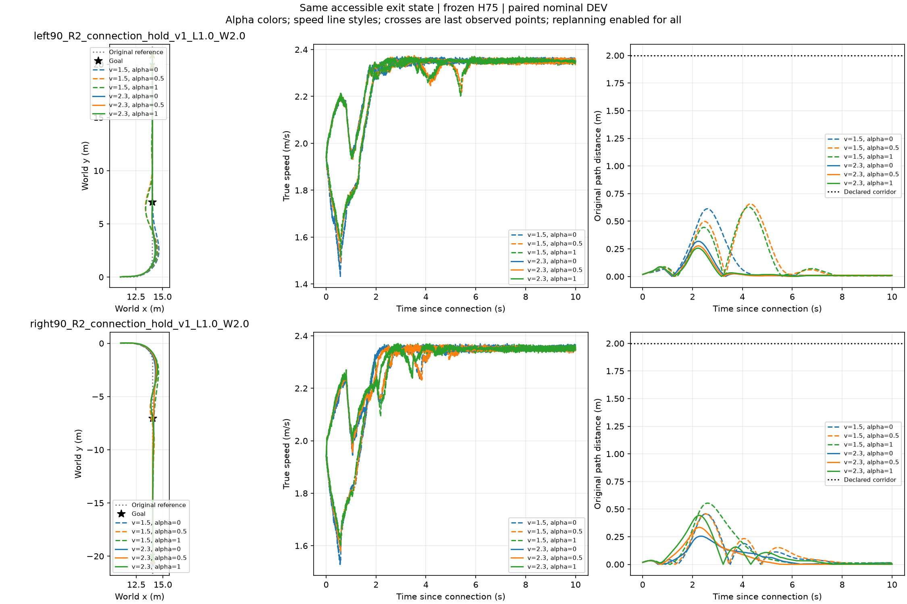

# 地面左右候选十二环境并行

同首根实际出口快照、同模型和物理/控制频率，左右各六档一次执行。12/12完整通过，原串行也是12/12；10条到达时间相同，右弯高速度 alpha=.5/1 分别相差−.02/+.02秒。全程逐lane XY RMS为.0112–.0875m，最大位置差.16744m，最大速度差.11171m/s。并非逐位相同，保留完整轨迹与parallel_comparison.json。

采集耗时1271.146→641.873秒，观测吞吐1.980倍；两次共享机器负载不完全相同，不能声称严格隔离的硬件加速倍数。物理5000Hz、底层200Hz、H75 50Hz不变，冻结H75/橙色原Local300/ECBC+ESO，不训练。

采用12环境入口继续其余23根。每根内部左右并行、根之间串行；原首根不重跑，源失败保留。新源阶段也使用12环境，剩余23根最大2208万physics lane步，0优化；预计总5–6小时。此次证明入口可用及实际吞吐改善，不是24根任务结果或能力规划收益。
