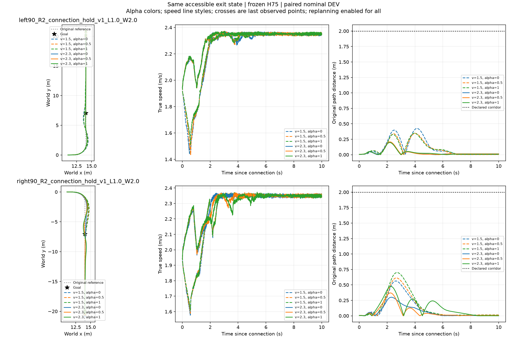

# 第二个名义出口：12/12完整后缀通过

参数为1.9m/s上游请求、横向−.04m/航向−2°、正斜向6cm凸起；12lane同时左右各六档，源到出口实际执行后展开，采集644.421秒，无训练。原始出口实际速度1.93419m/s、侧倾−.012741rad、侧倾角速度+.020776rad/s。负斜向首根对应1.95371m/s、−.008926rad、−.005559rad/s，不能将正反凸起假设成等幅反向侧倾。跨根不是同初态随机重复，首根六环境/本根十二环境布局也有差异，不声称单因素因果效果。

左弯1.5m/s三alpha到达3.68/3.62/3.60s，2.3m/s三alpha均3.30s；右弯低速3.64/3.66/3.68s，高速3.34/3.40/3.48s。全12条均满足到达、10s存活和原地图2m半宽。完整逐步奖励、实际指令、B入口和路径误差保留。

目前2/24根完成，4个完整出口—弯向组都全六档通过。固定2.3/0平均3.33秒，事后逐组选最优平均3.325秒，只有.005秒描述性余量；无成功率提升空间，不凭这一子集新增评价器训练。剩余22根结果待回收；文件中的pending为尚未封存结果，不能据此判断后台进程状态。
