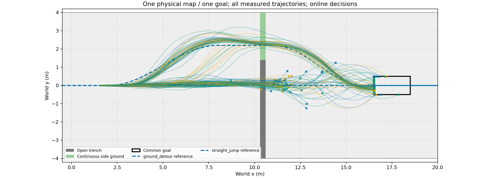
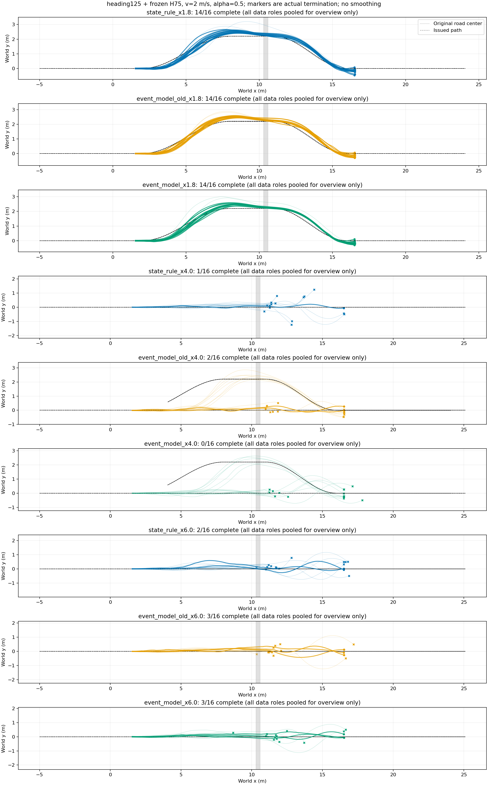
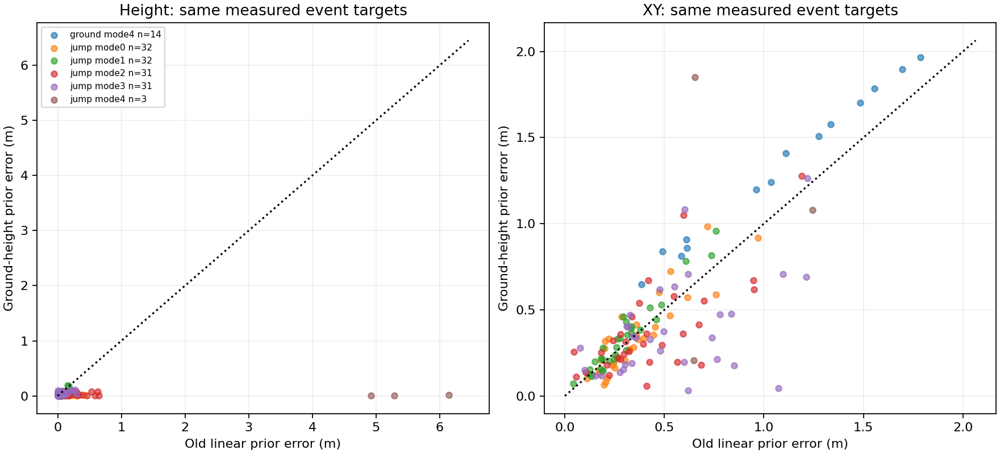

# 途中规划方法实际执行结果

|查询x/m|方法|完成|越廊|绕行/跳跃|平均查询ms|
|---|---|---:|---:|---:|---:|
|1.8|event_model|14/16|2/16|16/0|3.946|
|1.8|event_model_old|14/16|2/16|16/0|3.830|
|1.8|state_rule|14/16|2/16|16/0|0.125|
|4.0|event_model|0/16|10/16|5/11|4.003|
|4.0|event_model_old|2/16|8/16|7/9|3.909|
|4.0|state_rule|1/16|8/16|0/16|0.129|
|6.0|event_model|3/16|2/16|0/16|3.947|
|6.0|event_model_old|3/16|2/16|0/16|3.832|
|6.0|state_rule|2/16|6/16|0/16|0.136|

仿真墙钟83.70秒，542592物理环境步；0策略训练。每个初态重复多个查询位置，不能视作独立初态样本。方法共享原道路和物理失败判据；克隆环境同方案结果差异仍存在。

[逐初态XY、每步与累计奖励、速度](/media/qy/6A7E3DB07E3D75C3/STTW_runs/chapter3_jump_or_detour/ground_height_comparison/plots/README.md)；[完整分组与逐条结果](results.json)。

## 只修订预测先验，不改变仿真任务

旧模型将落地向下速度持续线性外推，出现数米地下终点。新模型仅对地面事件mode0（接近至入口）和mode4（接续至目标）使用当前高度保持先验，仍学习完整状态残差；其他模式保留旧线性基线。没有裁剪最终输出，没有把目标高度强制写入结果，也未改变Isaac本体、控制器、道路或任务判据。选项缺省关闭，旧checkpoint按原公式运行。

同197个实际发布片段、相同根分组、600次CPU更新，每100步按DEV损失选择；新旧均选择400。修订动机来自前批误差检查，正式物理比较另用seed20261119的16新初态，3位置×3方法共144条，空间排列打乱。耗时83.70秒，542592物理环境步；0PPO训练。

整程完成：新模型17/48、旧模型19/48、准备距离规则17/48；中段新模型0/16、旧模型2/16。新模型没有带来规划收益。仍不针对这批初态继续调参，保留同方案执行差异。

## 同一批实际状态上的预测比较

另外在规则方法实际执行的48条轨迹上离线查询两模型，确保比较使用相同物理真值和所选方案；不是新仿真或模型自主选路成绩。14条绕行成功，32条跳跃中31条交接、3条完成。缺失目标不计算位置误差，全部失败参与概率评分；事件个数不代表独立初态个数。

|指标|旧模型|新模型|真实目标数|
|---|---:|---:|---:|
|跳跃终点滚动高度误差/m|5.452|0.0091|3|
|绕行终点滚动高度误差/m|0.0326|0.0030|14|
|首次远岸接触滚动XY误差/m|0.4357|0.3796|31|
|STTW交接滚动XY误差/m|0.5422|0.3841|31|
|跳跃终点滚动XY误差/m|0.8480|1.0454|3|
|整程完成Brier|0.09732|0.09771|48条全部结果|

地面高度预测的明显错误得到修正，但XY、时间与分类并非全面改善，不能用较合理的预测曲线替代任务收益。原始逐事件误差在数据盘`rule_audit_*`；精简指标见[paired_prediction_metrics.json](paired_prediction_metrics.json)。

采用范围：保留为合理的可选预测先验和后续候选结构，不采用为已验证更优规划器。该事件链按照预定义物理阶段预测事件发生及状态，不等于已学会任意下一接触模式分类；当前缺少部分失败事件及独立地图覆盖。下一步扩大实际接近速度／α动作覆盖，停止反复微调这些已看过的初态。
