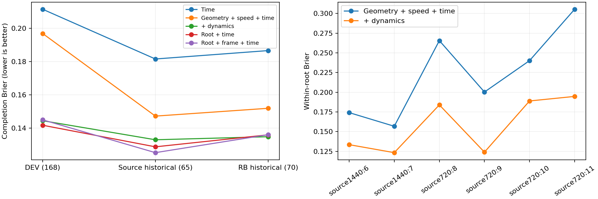

# Information carried by handoff dynamics

Actual/reference XY source: [all eligible handoff suffixes](../chapter3_interface_labels/RESULTS.md). This analysis reuses measured handoff states; no new physical trajectories or policy training.

|Predictor|DEV168|Historical source65|Historical RB70|
|---|---:|---:|---:|
|Time|0.21142|0.18155|0.18660|
|Geometry + speed + time|0.19686|0.14725|0.15194|
|+ dynamics|0.14450|0.13305|0.13488|
|Root + time|0.14178|0.12881|0.13602|
|Root + frame + time|0.14502|0.12531|0.13610|

Geometry/speed/time uses world x,y,mount-corrected yaw,world vx and physical handoff time (5 inputs). Dynamics adds mount-corrected roll/pitch,world vy/vz and world angular velocities (7 more inputs). The added group is not an isolated roll ablation. Root+time14 and root+latest-frame+time39 are the previously fitted models, reused unchanged. The named state_history output uses only the latest25D frame,not a complete controller history.

All new models use64/32SiLU hidden units,200epochs,3seeds7101–7103,BCE Adam.001/wd.0001,TRAIN-only normalization and grouped DEV Brier checkpoint selection. TRAIN463/DEV168 have14/6 roots. Historical groups do not select epochs. Input widths and parameter counts differ,so this is a feature-information diagnostic rather than capacity-controlled proof.

The dynamics group improves over geometry/speed/time in all6DEV roots and both historical transfer groups. Time alone stays near the TRAIN-rate constant. Full latest-frame input does not consistently beat root-only. These observations support predictive information in physical handoff dynamics under this fixed downstream context,not a causal recovery domain or online benefit. No new independent TEST is claimed; within-root scores have unequal denominators and are not independent observations.

Successful fitting elapsed1.380s. First attempt completed the time-only fits then failed when float64 mount conversion reached the float32 network; preserved in `/media/qy/6A7E3DB07E3D75C3/STTW_runs/chapter3_handoff_information_dtype_failure`. Input tensors were explicitly cast tofloat32 and the declared fit rerun; no physics changes.

Raw checkpoints and curves: `/media/qy/6A7E3DB07E3D75C3/STTW_runs/chapter3_handoff_information`.
