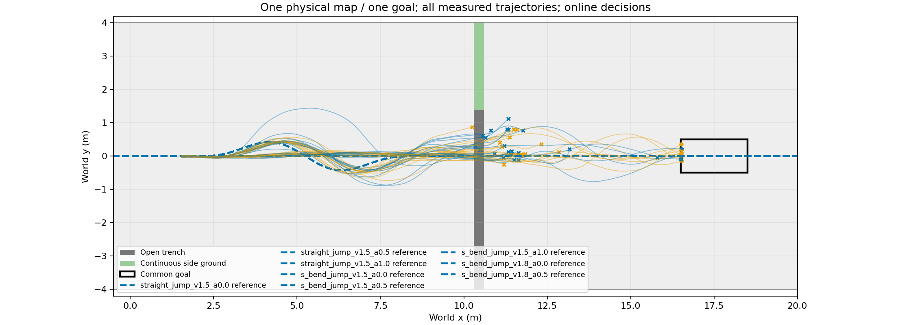

# Landing observer initialization diagnostic

|Initialization|N|Handoffs|Complete task|Observed full2s after handoff|Full2s without prior/current road violation|Goal before2s|
|---|---:|---:|---:|---:|---:|---:|
|cold|24|20|3|5|3|0|
|measured|24|22|6|9|7|0|

Measured versus cold: gains 5, losses 2. Wall time 313.51s; 192000 physical lane steps; no training.

Pre-intervention matching is not established: handoff counts/states differ across cloned lanes. Completion differences are descriptive and must not be attributed causally to observer initialization. The default remains cold.

The measured condition initializes ESO steering/lean/lean-rate and the lean-rate filter from the current measurement. Unknown disturbance remains zero. H75 policy history is reset identically in both conditions. This is not temporal prewarming and does not test history initialization.

Descriptive DEV initialization ablation.24 selected historical handoff branches from4 original roots, not24 independent roots. Full prefix rerun; no certified capture envelope or warmed H75 history.

Full2s means the trajectory has not ended before that observation point; it does not alone establish capture or eventual task success. Road-clean uses the latched road flag, including earlier violations. Goals reached earlier are separately reported, not counted as full-window observations. All sources, failures and individual records remain in JSON.

[All paired XY, reward and speed panels](plots/README.md). Raw data: `/media/qy/6A7E3DB07E3D75C3/STTW_runs/chapter3_handoff_initialization/evaluation/trajectories.npz`.
