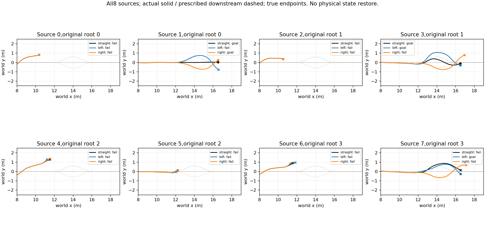
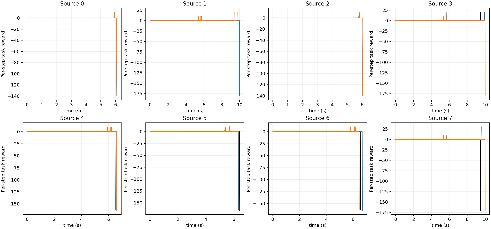
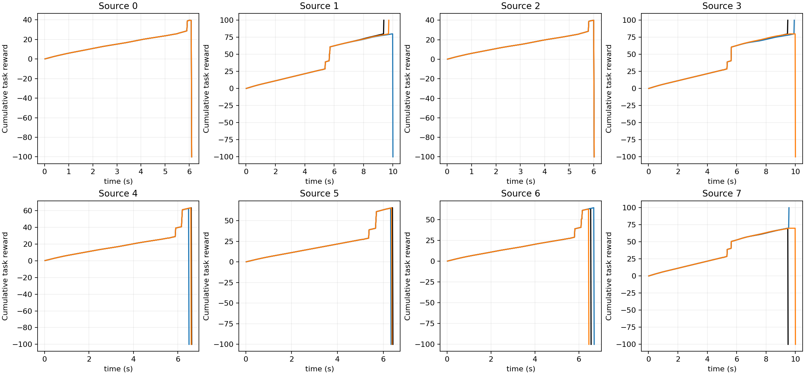

# Posthandoff route intervention

Full-prefix same-slot reruns of8historical branches from4underlying roots. All branches retained. Downstream reference switches only at measured handoff; speed1.5m/s,alpha0.5,cold initialization,goal,terrain and0.6m corridor half-width remain fixed. Left/right excursions reach +/-0.6m between x12 and16 and return to the same goal. No root-only state restore.

|Variant|Goal/N|Handoffs|Valid handoffs|Road violations|
|---|---:|---:|---:|---:|
|straight|2/8|6|5|4|
|left|2/8|6|5|4|
|right|1/8|6|5|5|

|Source|Variant|Both handoff|Recorded prefix exact|Handoff root L2|Straight goal|Variant goal|
|---|---|---|---|---:|---|---|
|0|left|False|False|None|False|False|
|1|left|True|True|0.0|True|False|
|2|left|False|False|None|False|False|
|3|left|True|True|0.0|True|True|
|4|left|True|False|0.014001528732478619|False|False|
|5|left|True|True|0.0|False|False|
|6|left|True|False|0.6125025749206543|False|False|
|7|left|True|True|0.0|False|True|
|0|right|False|False|None|False|False|
|1|right|True|True|0.0|True|True|
|2|right|False|False|None|False|False|
|3|right|True|True|0.0|True|False|
|4|right|True|False|0.9262999296188354|False|False|
|5|right|True|True|0.0|False|False|
|6|right|True|False|0.642902135848999|False|False|
|7|right|True|True|0.0|False|False|

Actual physics lane steps94400;summed wall time210.44s;0training.

Only pairs with equal recorded incoming prefixes and handoff states support the intended interface comparison. Hidden contact-solver state is not serialized. No-handoff or prior-road failures are not downstream recovery failures. These are inspected historical sources,not independent new TEST or a sampled recoverability boundary. Numerical equalities cover root,observation,ground history,action,reference index,physics roots and contact modes up to the switch.

Raw complete trajectories and frozen config/protocol remain in straight/left/right; results.json retains per-case failures and prefix audit.

## Matched interface examples and fixed-context limitation

Sources1,3,5,7 have identical recorded incoming prefixes and handoff roots/times across all3tasks and no prior road violation. Source1 completes straight/right but left times out;source3 completes straight/left but right times out;source5 fails all3;source7 violates the straight corridor,completes left,and times out right. Thus outcome differences include deadline/goal and corridor effects,not only balance failure.

Sources0/2 never hand off. Sources4/6 have unequal recorded physical incoming states across variants and are not used for same-state interpretation,though retained in aggregate8-source denominators. No hidden PhysX snapshot equivalence is asserted.

The frozen straight-context downstream predictor assigns each matched source exactly the same score across tasks: source1 .16370,source3 .40342,source5 .09409,source7 .37005. This is expected because task geometry is not an input. It is a scope diagnostic,not a fair calibrated prediction evaluation on changed tasks. A task-conditioned downstream model is required before claiming task-adaptive handoff planning. The four matched sources include both positive and negative examples and are retrospective developer-inspected cases,not independent validation.
